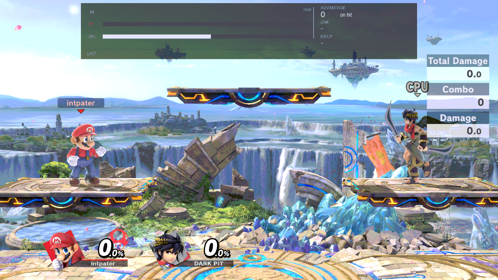

# Eggs-ercise

## Break a flying target

| Step | What to do |
|---|---|
| 1. Pick a goal | Open Eggs-ercise in [Practice games](../menu/practice-games.md); choose a timed set, target count or free practice. |
| 2. Play | Choose Start and break targets with attacks allowed by **Breaks on**. |
| 3. Compare your best | One minute: most targets broken. Target count: fastest finish. |
| Aim off stage | Choose **Off stage**, then open **Off-stage zone…** for this stage. |
| Set the zone | Move each edge with the stick; A advances, B backs up, X previews defaults. |
| From Preview | A or Plus applies the zone. |
| Earn an offstage point | Break the target, then land on the main floor or catch the ledge. |
