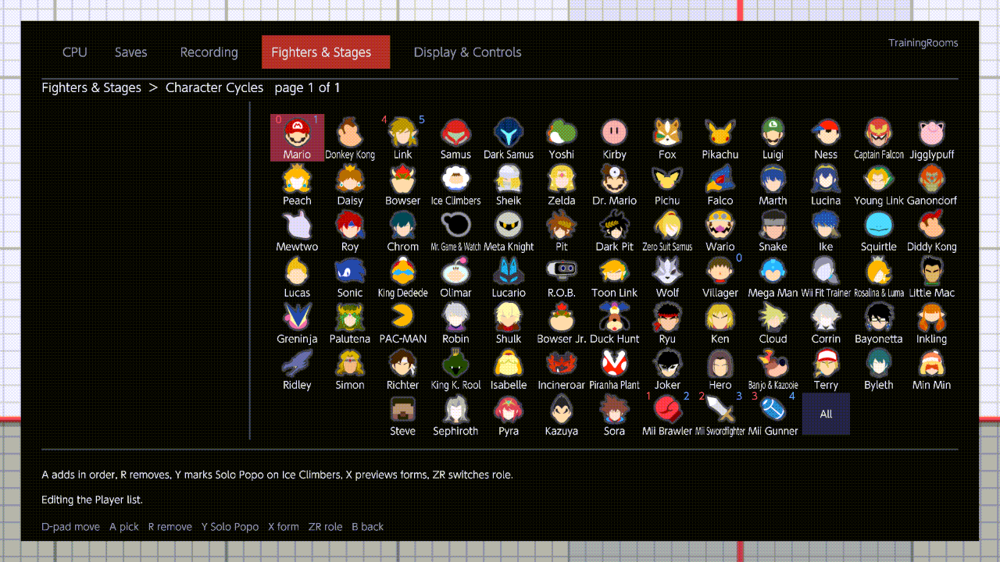
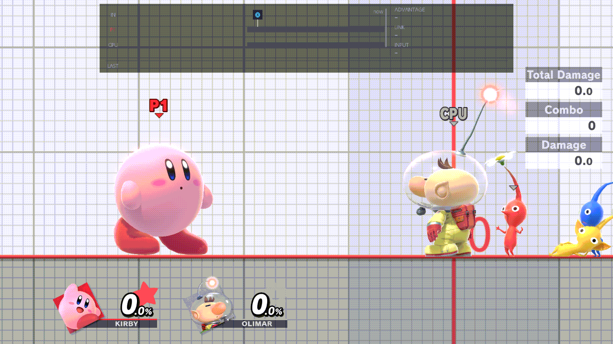

# Fighter cycles

Switch fighters without leaving Training: a chord steps Player 1 or the CPU through your own list of fighters, and a
stick click gives Kirby the next hat. This page covers the two cycle chords, the Character Cycles editor, Solo Popo,
Kirby hats, and the Loading rows that make a switch instant.

<!-- reshoot: rc6-cycle-switch.gif -->

## The cycle chords

| Chord | Default | What it does |
| --- | --- | --- |
| Cycle Player | ZL + D-pad Right | Player 1's next fighter. Needs Player Swapping On (Off by default). |
| Cycle CPU | ZL + D-pad Left | The CPU's next fighter. Always works. |

- Each press loads the next fighter of that role's list in Fighters & Stages ›
  [Character Cycles](../menu/fighters-and-stages.md#character-cycles). After the last one, the role goes back to the
  fighter it started with.
- They work in Training, and in a waiting room while Fighters & Stages ›
  [Lobby Practice](../menu/fighters-and-stages.md#lobby-practice) is On. There the CPU chord changes the first
  training partner.
- With Training's No. of CPUs above 1, the extra CPUs take the next fighters of the CPU's list.
- To change the buttons, see [Controls › Changing a chord](controls.md#changing-a-chord).

A press is refused, with a notice that says why, while a fighter swap is still running ("Wait for the character swap
to finish"), during a recording or a playback, during a save-state load, while the game's own menu is open, or before
the practice fighter has loaded. If both chords come in at once, the notice reads "Use different mappings for player
and CPU".

## Player Swapping

Fighters & Stages › [Player Swapping](../menu/fighters-and-stages.md#player-swapping) is Off by default, so Player 1
stays the fighter you picked at the character select. While it is Off:

- Cycle Player does nothing, with no notice.
- A pick in [Player Character](../menu/fighters-and-stages.md#player-character) is kept but doesn't load. Turning
  Player Swapping On loads it.
- A combo's Switch still changes Player 1 to the combo's fighter (see [Recording › Combos](recording.md#combos)).

The CPU has no such switch: Cycle CPU and CPU Character always work.

## The Character Cycles editor

1. Open Fighters & Stages › Character Cycles and press A. The grid shows every fighter.
2. Red numbers are Player 1's list, blue numbers the CPU's. The second help line reads "Editing the Player list" or
   "Editing the CPU list"; ZR switches.
3. A on a fighter adds it at the end of the list. If the list was All, it starts a new list with just that fighter.
4. A on All takes every fighter, in character-select order.
5. R removes a fighter, and the numbers after it move up. The last one stays.
6. X on Pokémon Trainer or Pyra / Mythra shows its next form (Squirtle, Ivysaur, Charizard; Pyra, Mythra). A then
   makes the cycle load that form.
7. Y on Ice Climbers marks [Solo Popo](#solo-popo) for that list.
8. B goes back. The new order counts once you close the menu.

The numbers are exactly what the chord loads:

- **0** is the fighter the role started with: the one picked at the character select, for the CPU too. The list
  doesn't number that fighter again.
- **1, 2, …** follow the list. Each fighter counts once, whatever form it is in.
- A Mii class (Brawler, Swordfighter, Gunner) gets a number only while that role has a Mii of the class it can load.
  Otherwise its tile is greyed and the help line reads "… - unavailable". Which Mii loads is set in the Mii rows: see
  [Mii fighters](mii.md).

Both lists start as All. Y on the Character Cycles row (on the page, not in the grid) puts both back to your saved
defaults.

A change made in Training starts loading the new fighters at once. The fighter on screen stays until you switch away,
and the fighters that left the list are freed the next time you open the pause menu (or at once, if the new ones need
their room).

## Solo Popo

Ice Climbers can be loaded as the pair (Popo and Nana) or as Popo alone. Three settings decide which:

- **Fighters & Stages ›
  [Solo Popo (original Ice Climbers)](../menu/fighters-and-stages.md#solo-popo-original-ice-climbers):** Player 1
  picked Ice Climbers at the character select. It covers Player 1's 0.
- **The "S" mark on Ice Climbers in the Player list** (Y in Character Cycles): the Ice Climbers in Player 1's cycle.
- **The "S" mark on Ice Climbers in the CPU list** (Y in Character Cycles, CPU list): the CPU's Ice Climbers, its 0
  and its cycle alike.

All three are Off by default. If Player 1's two settings differ, Ice Climbers can be in Player 1's cycle twice: as 0
(one way) and as a number (the other way).

## Kirby hats

Kirby can copy another fighter's neutral special and wear that fighter's hat. TrainingRooms gives Kirby a hat with a
click, from a list you choose.

- **The chord:** hold B (special) with the left stick at rest, then click the left stick: your Kirby takes the next
  hat of your list. Click the right stick instead for the CPU's Kirby. The B press doesn't reach the game. These
  buttons are fixed; they are not in the chord editor.
- **The list:** Fighters & Stages › [Kirby Hats](../menu/fighters-and-stages.md#kirby-hats), one list per role (ZR
  switches). A adds a hat at the end, All takes everyone, R removes one, X previews a shared slot's form. It starts as
  Mario only.
- The hat changes once Kirby stands or falls (not in the middle of a move). The notice reads "Kirby Hats" (or "CPU
  Kirby Hats") and the fighter's name.
- If Kirby lost its hat, the next click gives the same hat back before moving on.
- With an empty list the notice reads "Select a Kirby hat first". If a hat can't load within about 15 seconds, it
  reads "Kirby hat could not be loaded".
- Nothing happens during a fighter swap, a save-state load, a recording or a playback, or while a menu is open.
- With Training's CPU Behavior set to Control, the controller that drives the CPU changes the CPU's hat with B and a
  click of either stick.
- In a waiting room, the hat comes back when you return to the same room after a match.

## What the Loading rows do

Loading a fighter from scratch takes a moment and stops the game while it happens. So TrainingRooms loads the
fighters of your cycles, and Kirby's hats, ahead of time in the background. Then a chord or a click only swaps in a
fighter that is already there.

The notice "Fighters" counts them while they load:

- "Loading 6/10", then "Ready 10/10" (or "All loaded") when they are all there.
- "Swap once to load", "Swap P1 once to load", "Swap the CPU once to load" or "Swap both once to load": that role's
  first swap starts the loading.
- "Loaded 7/10 · swap to load 3 more": the rest load after the next swap.
- "(2 waiting for memory)" or "(… waiting for pool space)": some wait until there is room, then load.
- "Paused": loading waits while something else needs the game, such as a swap or a save-state load.

The rows are in the Loading section of Fighters & Stages, collapsed until you open it. The defaults suit most players.

- [Cycle Preload](../menu/fighters-and-stages.md#cycle-preload) (5): how many of each role's next fighters are kept
  ready. Off: each swap loads its fighter then, more slowly.
- [Preload](../menu/fighters-and-stages.md#preload) (Both): keep the fighters ready, Kirby's hats, or both.
- [Ready Fighters](../menu/fighters-and-stages.md#ready-fighters) (10): how many fighters are loaded at most, both
  roles and the two on screen together.
- [Ready Hats](../menu/fighters-and-stages.md#ready-hats) (5): how many Kirby hats are kept ready on top of that.
- [Ready Fighter Bodies](../menu/fighters-and-stages.md#ready-fighter-bodies) (3): how many fighters each role keeps
  in its own slot, the one on screen included.
- [Group Swap](../menu/fighters-and-stages.md#group-swap) (On): lets each role keep more groups of fighters ready
  besides its own slot.
- [Swap groups](../menu/fighters-and-stages.md#swap-groups) (all On): seven switches for the fighters that need
  special care: Ice Climbers, Pokémon Trainer, Pyra / Mythra, Solo Popo, Miis, and the fighter a role started with.

If the notice often says "waiting for memory", lower Ready Fighters or Ready Hats. Cycle Preload Off uses the least
memory, and every swap is a full reload.
