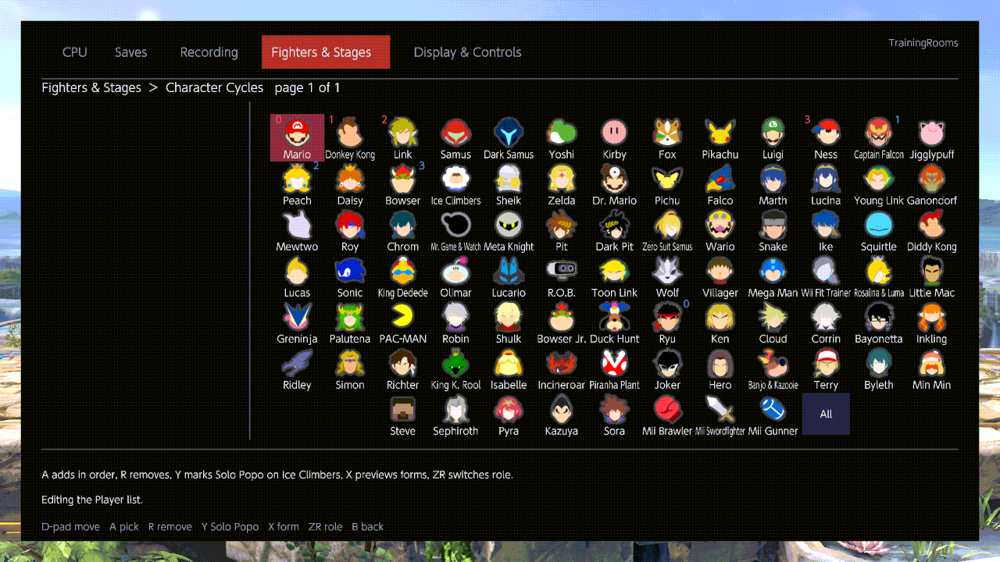
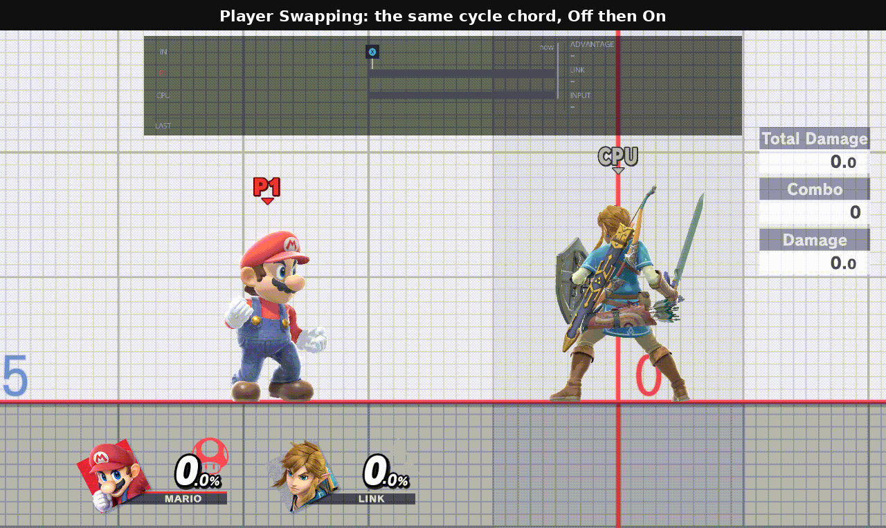
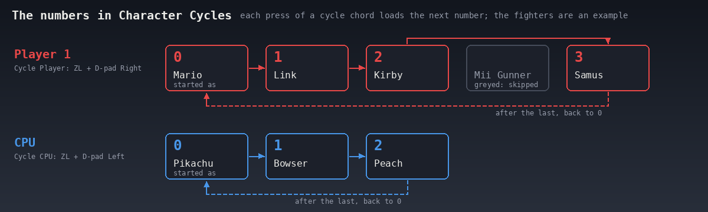
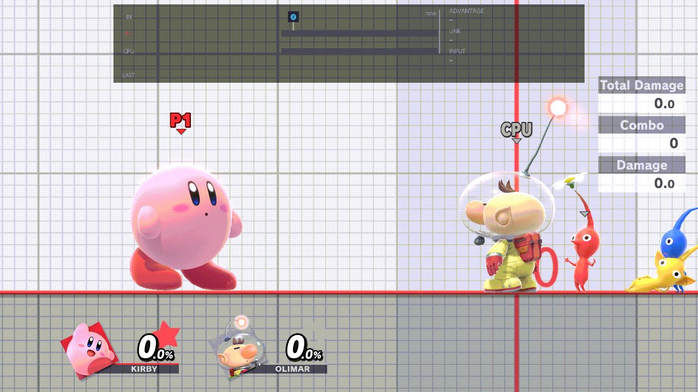

# Fighter cycles

Switch fighters without leaving Training: a chord steps Player 1 or the CPU through your own list of fighters, and a
stick click gives Kirby the next hat. This page covers the two cycle chords, the Character Cycles editor, Solo Popo,
Kirby hats, and the Loading rows that make a switch instant.

## The cycle chords

| Chord | Default | What it does |
| --- | --- | --- |
| Cycle Player | ZL + D-pad Right | Player 1's next fighter. Needs Player Swapping On (Off by default). |
| Cycle CPU | ZL + D-pad Left | The CPU's next fighter. Always works. |

- Each press loads the next fighter of that role's list in Fighters & Stages ›
  [Character Cycles](../menu/fighters-and-stages.md#character-cycles). After the last one, the role goes back to the
  fighter it started with.
- They work in Training, and in a waiting room while Fighters & Stages ›
  [Lobby Practice](../menu/fighters-and-stages.md#lobby-practice) is On. There the CPU chord changes the first
  training partner.
- With Training's No. of CPUs above 1, the extra CPUs take the next fighters of the CPU's list.
- To change the buttons, see [Controls › Changing a chord](controls.md#changing-a-chord).

A press that can't happen shows a notice that says why:

| Notice or case | Why |
| --- | --- |
| "Wait for the character swap to finish" | A fighter swap is still running. |
| A notice | During a recording or a playback, during a save-state load, while the game's own menu is open, or before the practice fighter has loaded. |
| "Use different mappings for player and CPU" | Both chords came in at once. |

## Player Swapping

Fighters & Stages › [Player Swapping](../menu/fighters-and-stages.md#player-swapping) is Off by default, so Player 1
stays the fighter you picked at the character select. While it is Off:

- Cycle Player does nothing, with no notice.
- A pick in [Player Character](../menu/fighters-and-stages.md#player-character) still loads, when you close the menu.
- A combo's Switch still changes Player 1 to the combo's fighter (see [Recording › Combos](recording.md#combos)).

The CPU has no such switch: Cycle CPU and CPU Character always work.

 *The same chord, Player Swapping Off then On. Eden, rc.13 (untested on hardware).*

## The Character Cycles editor

1. Open Fighters & Stages › Character Cycles and press A. The grid shows every fighter.
2. Red numbers are Player 1's list, blue numbers the CPU's. The second help line reads "Editing the Player list" or
   "Editing the CPU list"; ZR switches.
3. A on a fighter adds it at the end of the list. If the list was All, it starts a new list with just that fighter.
4. A on All takes every fighter, in character-select order.
5. R removes a fighter, and the numbers after it move up. The last one stays.
6. X on Pokémon Trainer or Pyra / Mythra shows its next form (Squirtle, Ivysaur, Charizard; Pyra, Mythra). A then
   makes the cycle load that form.
7. Y on Ice Climbers marks [Solo Popo](#solo-popo) for that list.
8. B goes back. The new order counts once you close the menu.

Both lists start as All. Y on the Character Cycles row (on the page, not in the grid) puts both back to your saved
defaults.

The numbers are exactly what the chord loads:

- **0** is the fighter the role started with: the one picked at the character select, for the CPU too. The list
  doesn't number that fighter again.
- **1, 2, …** follow the list. Each fighter counts once, whatever form it is in.
- A Mii class (Brawler, Swordfighter, Gunner) gets a number only while that role has a Mii of the class it can load.
  Otherwise its tile is greyed and the help line reads "… - unavailable". Which Mii loads is set in the Mii rows: see
  [Mii fighters](mii.md).

A change made in Training starts loading the new fighters at once. The fighter on screen stays until you switch away,
and the fighters that left the list are freed the next time you open the pause menu (or at once, if the new ones need
their room).

## Solo Popo

Ice Climbers can be loaded as the pair (Popo and Nana) or as Popo alone. Three controls decide which. All start Off:

| Which Ice Climbers? | Control |
| --- | --- |
| Player 1's, picked at the character select (picking them again in Player Character counts too) | Fighters & Stages › [Solo Popo (original Ice Climbers)](../menu/fighters-and-stages.md#solo-popo-original-ice-climbers) |
| Player 1's cycle, and Player Character when Player 1 started as another fighter | The "S" mark on Ice Climbers in the Player list (Y in Character Cycles) |
| The CPU's: its 0 and its cycle | The "S" mark on Ice Climbers in the CPU list (Y in Character Cycles, CPU list) |

If Player 1's two controls differ, Ice Climbers can be in Player 1's cycle twice: as 0 one way and as a number the
other.

## Kirby hats

Kirby can copy another fighter's neutral special and wear that fighter's hat. TrainingRooms gives Kirby a hat with a
click, from a list you choose.

- **The chord:** hold B (special) with the left stick at rest, then click the left stick: your Kirby takes the next
  hat of your list. Click the right stick instead for the CPU's Kirby. The B press doesn't reach the game. These
  buttons are fixed; they are not in the chord editor.
- **The list:** Fighters & Stages › [Kirby Hats](../menu/fighters-and-stages.md#kirby-hats), one list per role (ZR
  switches). A adds a hat at the end, All takes everyone, R removes one, X previews a shared slot's form. It starts as
  Mario only.
- **When it changes:** once Kirby stands or falls (not in the middle of a move). If Kirby lost its hat, the next click
  gives the same hat back before moving on.
- **With Training's CPU Behavior set to Control,** the controller that drives the CPU changes the CPU's hat with B and a
  click of either stick.
- **In a waiting room,** the hat comes back when you return to the same room after a match.
- **Nothing happens** during a fighter swap, a save-state load, a recording or a playback, or while a menu is open.

| Notice | When |
| --- | --- |
| "Kirby Hats" (or "CPU Kirby Hats") and the fighter's name | The hat changed. |
| "Select a Kirby hat first" | The list is empty. |
| "Kirby hat could not be loaded" | A hat couldn't load within about 15 seconds. |

## What the Loading rows do

Loading a fighter from scratch takes a moment and stops the game. So TrainingRooms loads your cycle fighters and Kirby's
hats ahead of time in the background, and a chord or a click only swaps in a fighter that is already there. The defaults
suit most players; change them only to use less memory.

If a cycle has more fighters than Ready Fighters leaves room for, the fighters that fit stay loaded and the others stay
cold. A swap to a cold fighter loads it while you wait (the fighter you left stays on screen until it is ready), and it
is freed after you swap away from it. Nothing else loads again. While a cold fighter is on screen, one fighter more than
Ready Fighters is loaded. Lowering Ready Fighters frees the loaded fighters whose turn is farthest away, right away.
In a very long cycle every loading spot can be taken; then a swap to a cold fighter still reloads that side's fighters.

If a cycle has more fighters than Ready Fighters leaves room for, one can't stay loaded. A swap to it loads it alone,
and everything else that is already loaded stays loaded: the groups beside it, and the fighters that were on screen
with the one you swapped from, windows included. When more would stay than Ready Fighters allows, the fighter whose
turn is farthest away is freed, never the next one or the one on screen.

Pokémon Trainer and Pyra / Mythra stay loaded the same way. When a swap has to load a fighter, the window a Trainer or
a Pyra / Mythra was on is kept too, and swapping back to it is instant. Kirby holding a copied ability gives the copy up
before he leaves and then stays loaded like any other fighter. He comes back without it, and the next Kirby hat click
gives the same hat again.

The notice "Fighters" counts them while they load:

| Notice | Meaning |
| --- | --- |
| "Loading 6/10", then "Ready 10/10" (or "All loaded") | Loading, then all there. |
| "Swap once to load", "Swap P1 once to load", "Swap the CPU once to load", "Swap both once to load" | That role's first swap starts the loading. |
| "Loaded 7/10 · swap to load 3 more" | The rest load after the next swap. |
| "(2 waiting for memory)" or "(… waiting for pool space)" | Some wait for room, then load. If it keeps saying so, lower Ready Fighters or Ready Hats. |
| "(2 load after you pause)" | Kirby's hats or other fighters loaded ahead hold the room these need. The next pause unloads them, then these load. |
| "Paused" | Loading waits while something else, such as a swap or a save-state load, needs the game. |

The rows are in the Loading section of Fighters & Stages, collapsed until you open it:

| Row | Default | What it sets |
| --- | --- | --- |
| [Cycle Preload](../menu/fighters-and-stages.md#cycle-preload) | 5 | How many of each role's next fighters are kept ready. Off: each swap loads, more slowly. |
| [Preload](../menu/fighters-and-stages.md#preload) | Both | Keep the fighters ready, Kirby's hats, or both. |
| [Ready Fighters](../menu/fighters-and-stages.md#ready-fighters) | 10 | The most fighters loaded, both roles and the two on screen together. |
| [Ready Hats](../menu/fighters-and-stages.md#ready-hats) | 5 | Kirby hats kept ready on top of that. |
| [Ready Fighter Bodies](../menu/fighters-and-stages.md#ready-fighter-bodies) | 3 | Fighters each role keeps in its own slot, the one on screen included. |
| [Group Swap](../menu/fighters-and-stages.md#group-swap) | On | Lets each role keep more groups ready besides its own slot. |
| [Swap groups](../menu/fighters-and-stages.md#swap-groups) | all On | Seven switches for the fighters that need special care: Ice Climbers, Pokémon Trainer, Pyra / Mythra, Solo Popo, Miis, and a role's starting fighter. |

Cycle Preload Off uses the least memory, and every swap is a full reload.