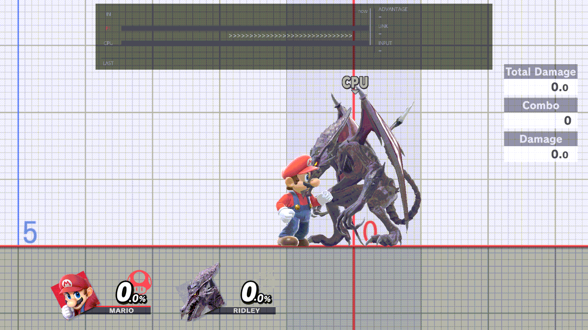
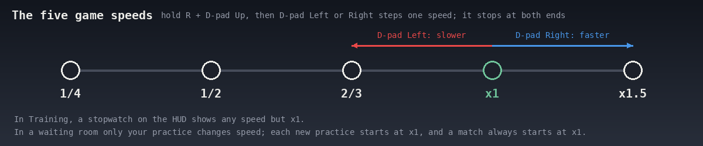
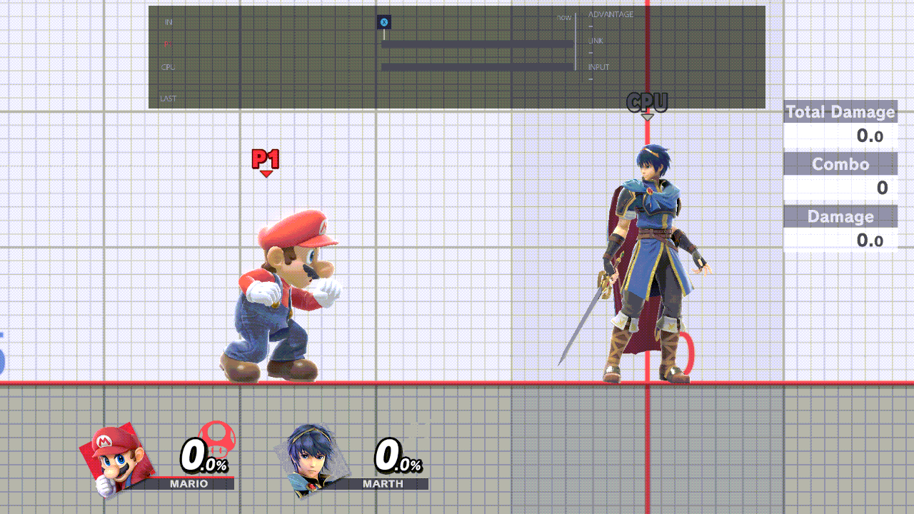
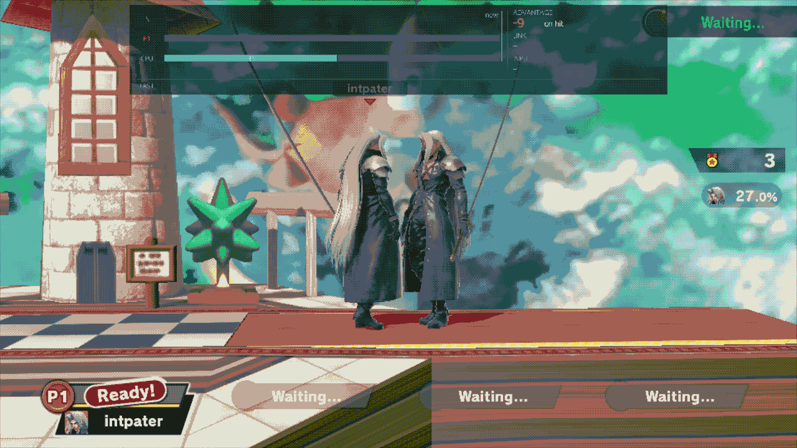

# Game speed

Slow the game down to watch a move in slow motion, or speed it up, without opening a menu. It works in Training and in
waiting-room practice.

## Changing the speed

1. Hold R and press D-pad Up. A "Game speed" pop-up shows the current speed.
2. Keep holding R. D-pad Left goes slower, D-pad Right faster. It stops at both ends.
3. Let go. The pop-up goes away and the speed stays.

The scale's slowest step is 1 Frame, one step left of 1/4: 1 Frame, 1/4, 1/2, 2/3, x1, x1.5. At 1 Frame the game
holds still. Each press of ZL (L on a GameCube controller) moves it one frame. Hold the button and the game runs from
the 18th frame on, until you let go. This is the same button Training uses for its 1 Frame.

While you hold the speed chord, ZL doesn't step and doesn't reach the game. If ZL is still down when you let go of the
chord, it counts as held, not as a new press. A ZL that is part of another chord doesn't step when you press it:
D-pad Down + ZL saves a state and the game stays on its frame. In Training, don't keep that chord down: after 18
frames the game takes the held ZL and runs until you let go.

While you hold the chord, D-pad Left and Right don't reach the game and no other chord fires, so ZL + D-pad Left can't
cycle the CPU by accident. The chord doesn't work while a menu is open (this one or the game's pause menu).

On a GameCube controller the chord is Z + D-pad Up ([Controls](controls.md#gamecube-controller)). To use another chord,
change the Game speed row of Display & Controls › [Button chords](../menu/display-and-controls.md#button-chords). Any
chord you set works the same way: hold it, then D-pad Left or Right.
## In Training

The chord sets Training's own Speed, so the game's pause menu (Other Settings › Speed) shows the same value. Training's
HUD shows a stopwatch with the speed whenever it isn't x1, and the stopwatch goes away at x1.

1 Frame is Training's own 1 Frame: the game pauses, ZL steps, and the stopwatch shows it. Training keeps its Speed the
way the game does, so 1 Frame stays set after you reset the positions. A new Training starts at x1.

## In the waiting rooms

With Fighters & Stages › [Lobby Practice](../menu/fighters-and-stages.md#lobby-practice) On, the same chord and the same
six speeds work in a waiting room. Only your practice changes speed: the room's own timers keep their normal pace.
There is no stopwatch there; the pop-up shows the speed while you hold the chord. At 1 Frame your practice holds still
and ZL steps it, as in Training; the room keeps running.

Each new practice starts at x1. The speed ends with the practice, so a match always starts at x1.

More: [Waiting rooms](waiting-rooms.md)

## With Online Deluxe

While L is held (Online Deluxe's L + R chords), the chord doesn't open and D-pad Left and Right don't change the speed.
A Game speed chord of yours that uses L itself isn't held back by L. With Online Deluxe's window open on a settings
page, the default chord (R + D-pad Up) still opens and steps the speed, because Online Deluxe ignores the D-pad while R
is held; a chord of yours on a D-pad button that page uses waits.
[Controls › Online Deluxe](controls.md#online-deluxe) has the details.
