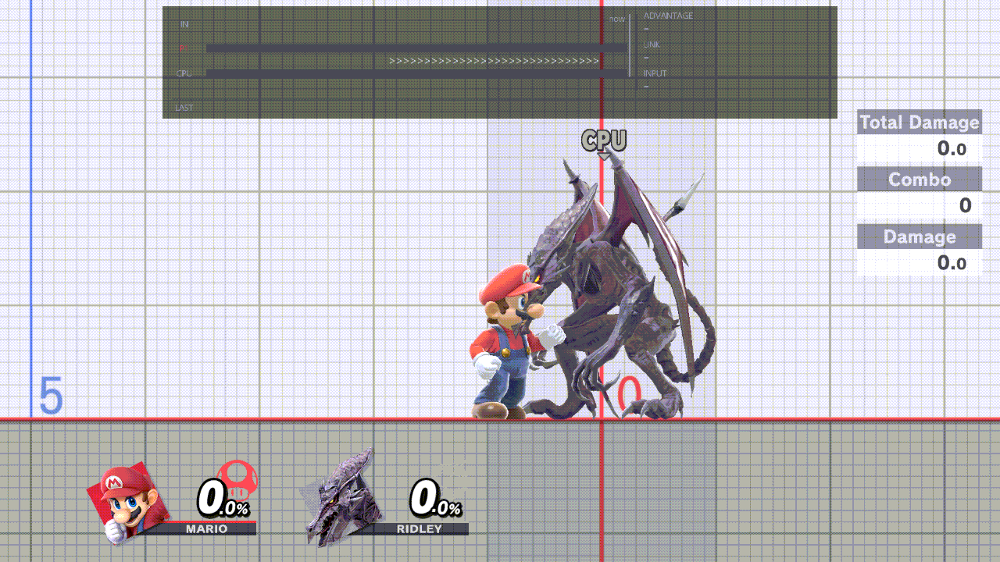
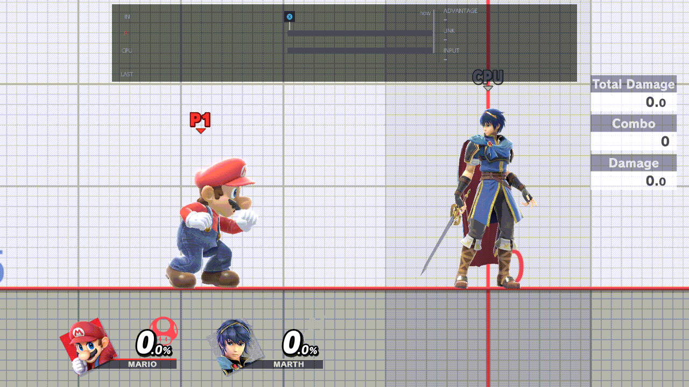
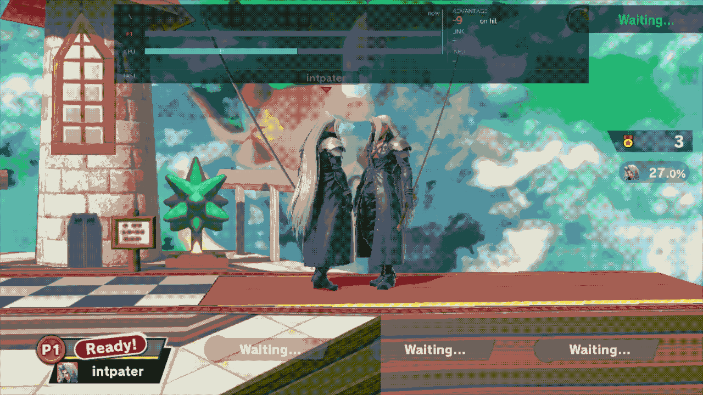

# Game speed

Slow the game down to watch a move in slow motion, or speed it up, without opening a menu. It works in Training and in
waiting-room practice.

## Changing the speed

1. Hold R and press D-pad Up. A "Game speed" pop-up shows the current speed.
2. Keep holding R. D-pad Left goes slower, D-pad Right faster:

   1/4 · 1/2 · 2/3 · x1 · x1.5

   It stops at both ends.
3. Let go. The pop-up goes away and the speed stays.

While you hold the chord, D-pad Left and Right don't reach the game and no other chord fires, so ZL + D-pad Left
can't cycle the CPU by accident. The chord doesn't work while a menu is open (this one or the game's pause menu).

On a GameCube controller the chord is Z + D-pad Up. To use another chord, change the Game speed row of Display &
Controls › [Button chords](../menu/display-and-controls.md#button-chords). Any chord you set works the same way: hold
it, then D-pad Left or Right.

## In Training

The chord sets Training's own Speed, so the game's pause menu (Other Settings › Speed) shows the same value. Training's
HUD shows a stopwatch with the speed whenever it isn't x1, and the stopwatch goes away at x1.

Training's 1 Frame speed (pause and step) stays in the game's pause menu. If Training is on 1 Frame, the chord steps
from x1.

## In the waiting rooms

With Fighters & Stages › [Lobby Practice](../menu/fighters-and-stages.md#lobby-practice) On, the same chord and the same
five speeds work in a waiting room. Only your practice changes speed: the room's own timers keep their normal pace.
There is no stopwatch there; the pop-up shows the speed while you hold the chord.

Each new practice starts at x1. The speed ends with the practice, so a match always starts at x1.

More: [Waiting rooms](waiting-rooms.md)

## With Online Deluxe

While Online Deluxe's window shows a settings page, or while L is held (its L + R chords), the chord doesn't open and
D-pad Left and Right don't change the speed. A Game speed chord of yours that uses L itself isn't held back by L.
[Controls › Online Deluxe](controls.md#online-deluxe) has the details.
