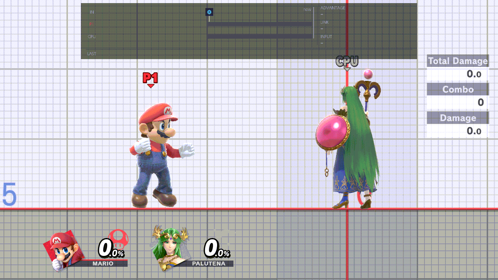
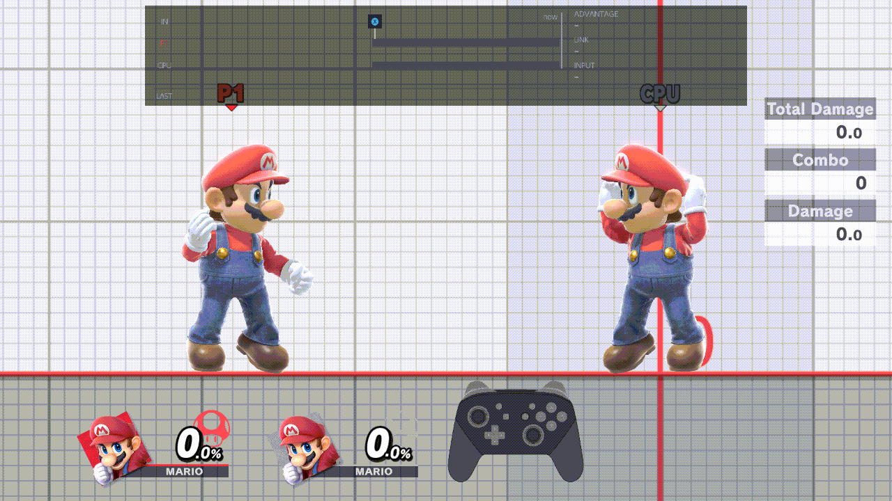
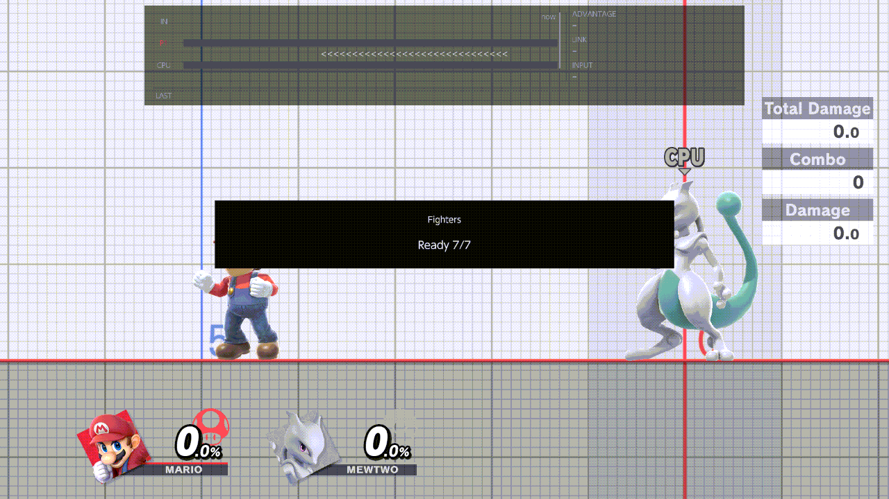
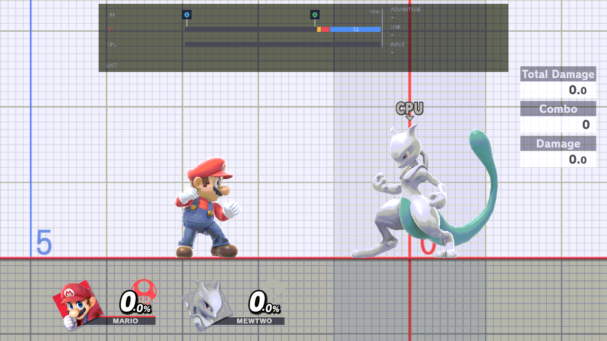
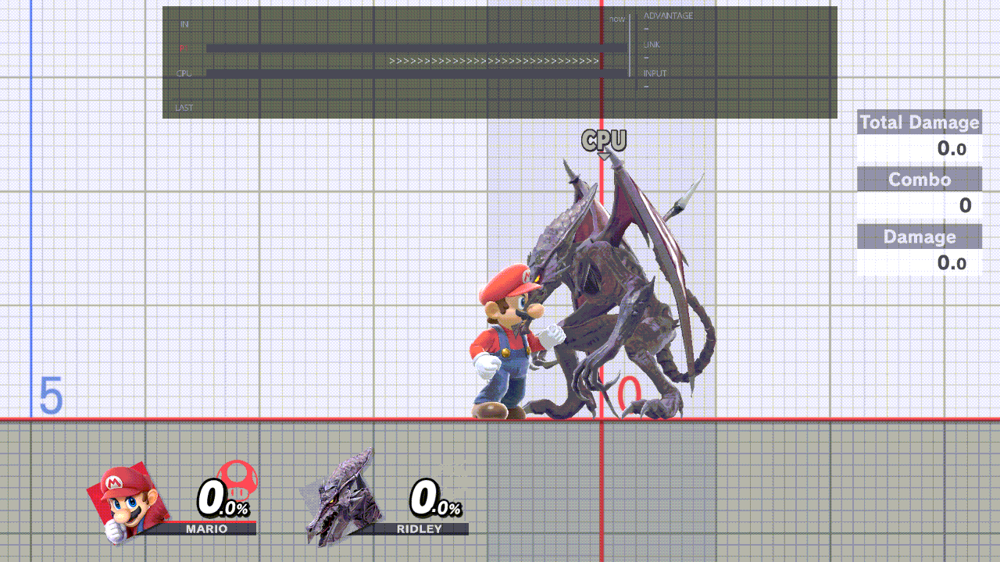
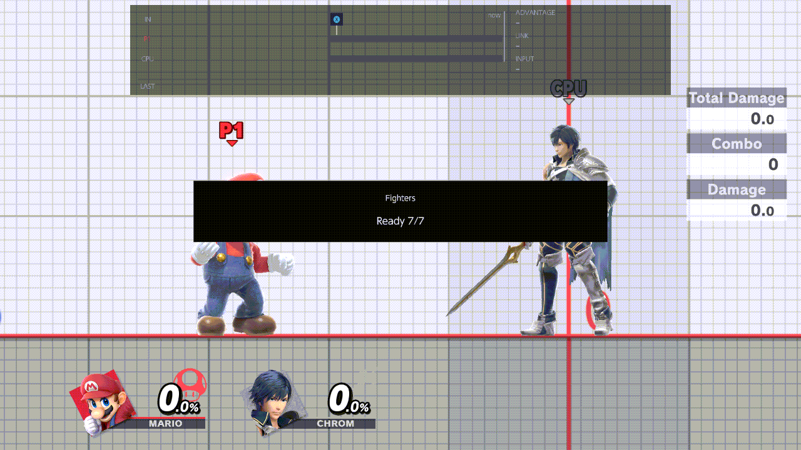

# Getting started

TrainingRooms adds practice tools to Super Smash Bros. Ultimate's Training mode, and to the waiting rooms of online and
local play. Hitboxes, save states, recordings, combo drills, game speed and more are all in one menu that you open with a
button chord. It is a Skyline plugin for game version 13.0.5. It is an unofficial fan project (MIT license), not
affiliated with or endorsed by Nintendo.

<br>
*The menu, then hitboxes on. Eden, rc.11.*

This page takes you from an empty card to your first practice. Something not working?
[Troubleshooting](troubleshooting.md) lists what you may see and what to do.

## What you need

- Super Smash Bros. Ultimate at version **13.0.5**. On any other version the plugin installs nothing.
- Skyline, set up for Smash Ultimate 13.0.5 on your Switch. The plugin folder below is under `atmosphere/` on the SD
  card.
- The plugin files: `libtraining_rooms.nro`, `libnro_hook.nro` and `libparam_hook.nro`. The first is TrainingRooms. The
  second is needed (without it the CPU's DI, tech and out-of-shield options are missing); the third is its usual
  companion, and this build doesn't call it.
- **No** `libtraining_modpack.nro`. That is the Training Modpack's plugin. The two can't run together.

## Installing

1. Set up Skyline for Smash Ultimate 13.0.5 on your Switch.
2. Copy `libtraining_rooms.nro`, `libnro_hook.nro` and `libparam_hook.nro` into
   `atmosphere/contents/01006A800016E000/romfs/skyline/plugins/` on the SD card.
3. If `libtraining_modpack.nro` is there, remove it.
4. Start the game.

To update, copy the new `libtraining_rooms.nro` over the old one. Your settings aren't in that file: they live in
`sd:/ultimate/TrainingRooms/`.

## First start

1. Open Training from the game's main menu.
2. The first time Training opens on a new install, six short reminders appear: Welcome, Open Menu, Save State, Load
   State, Input Record and Input Playback. The five after Welcome show their button chords. A later start leaves them
   out.
3. If the Training Modpack's folder `sd:/ultimate/TrainingModpack/` is on the card, its settings, save states and
   recordings are copied into `sd:/ultimate/TrainingRooms/` once, on the first start. The originals aren't changed.
   (The Modpack's plugin file must still be removed: see above.)

## Open the menu

Hold **B**, then press **D-pad Up**. **Minus** opens it too, until you change Menu shortcut 1. **B** closes it. **L** and
**R** turn the pages.

<br>
*B + D-pad Up opens the menu. Eden, rc.11.*

The menu opens in Training, and in a waiting room once Fighters & Stages › Lobby Practice is On (it is Off at first).
More about moving around and changing rows: [Using the menu](using-the-menu.md).

## A first look around

The menu has five pages. Here is one thing to try on each. Every option is on the page's own doc.

| Page | Try this | Button | More |
| --- | --- | --- | --- |
| [CPU](../menu/cpu.md) | Teach the CPU to DI, tech, shield and mash. | CPU › DI Direction, then A | [CPU behaviour](cpu-behaviour.md) |
| [Saves](../menu/saves.md) | Save where you stand, then come back to it. | ZL + D-pad Down saves, ZL + D-pad Up loads | [Save states](save-states.md) |
| [Recording](../menu/recording.md) | Record yourself and let the CPU play it back. | ZR + D-pad Down records, ZR + D-pad Up plays on the CPU | [Recording](recording.md) |
| [Fighters & Stages](../menu/fighters-and-stages.md) | Switch fighters without leaving Training. | ZL + D-pad Left (the CPU) or Right (you, with Player Swapping On) | [Fighter cycles](fighter-cycles.md) |
| [Display & Controls](../menu/display-and-controls.md) | See the boxes that hit and hurt. | Hitbox Visualization, then A | [Controls](controls.md) |

<br>
*Save, move, load: back where you saved. Eden, rc.10.*

<br>
*Record, then the CPU plays it back. Eden, rc.10.*

Two more buttons worth knowing: **R + D-pad Down** turns the input display on and off, and holding **R + D-pad Up** lets
you slow the game down with Left and Right ([Game speed](game-speed.md)). Every chord and how to change it:
[Controls](controls.md).

<br>
*The same smash at x1, then at 1/4. Eden, rc.11.*

Waiting for a match? TrainingRooms can run in the waiting rooms too: turn on Fighters & Stages › Lobby Practice first.
See [Waiting rooms](waiting-rooms.md).

## Which build you have

At the bottom of every menu page, the key hints end with the **build tag**. For example:

```text
0.2.0-rc.14 · rc14 1a2b3c4d
```

| Part | What it is |
| --- | --- |
| `0.2.0-rc.14` | The version number inside the plugin. From rc.14 on it is the release's own name, the same as the release's tag (`v0.2.0-rc.14`). |
| `rc14` | The build name, the short form of the same release: rc.14 shows `rc14`. |
| `1a2b3c4d` | The commit the build was made from: eight characters, digits and the letters a to f, so yours will differ. `-dirty` after it means the build was made from uncommitted changes, and `unknown` means the commit wasn't known. |

So a build whose tag reads `0.2.0-rc.14 · rc14 …` is rc.14. [Current release](../CURRENT-RELEASE.md) says which release
that page describes, what it adds and what is known not to work.

**An older build** reads differently. Its first part is `0.2.0-rc.6`, whatever its release, so read the second part: rc.13
showed `rc13`, rc.12 `rc12`, and so on.

<br>
*The tag at the foot of two pages. Eden, rc.11, so this older clip reads `0.2.0-rc.6 · rc11`.*

## Where to go next

- [Using the menu](using-the-menu.md): moving, changing rows, saving your defaults.
- [Controls](controls.md): every chord and how to change it.
- [The docs](../README.md): one page per menu page, and a guide for each topic.
- [Troubleshooting](troubleshooting.md): when something doesn't work.
