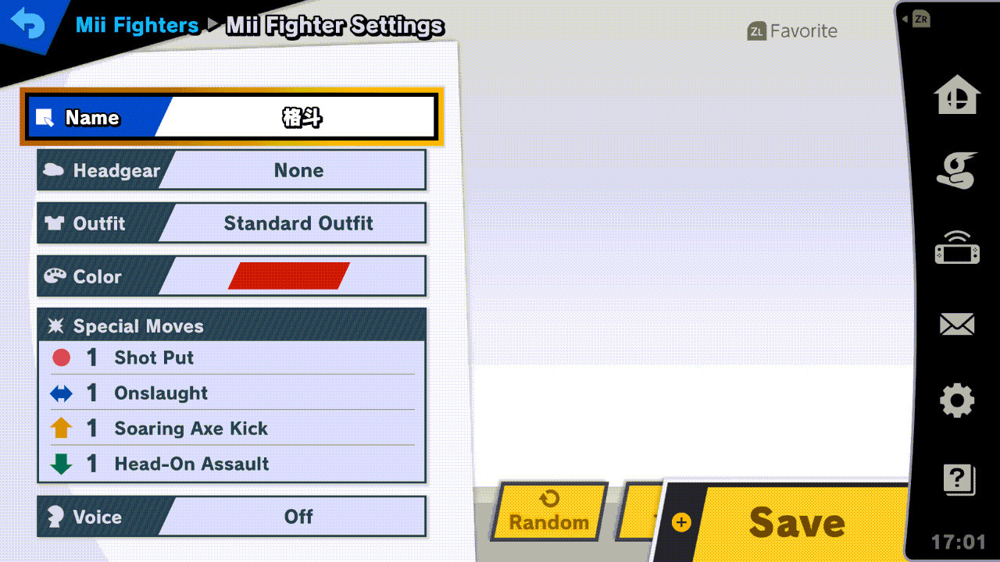
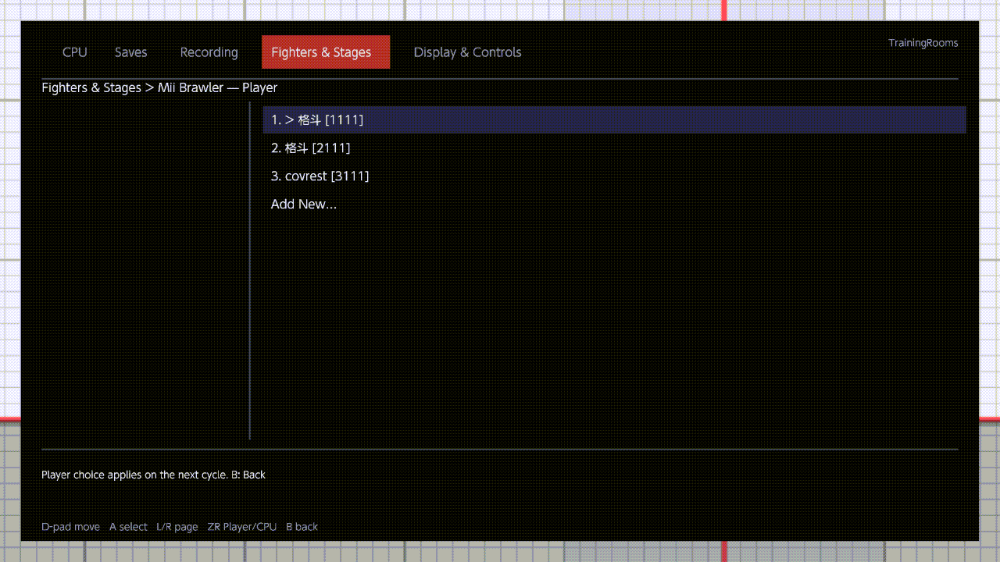

# Mii fighters

Fighters & Stages has one row per Mii class: [Mii Brawler](../menu/fighters-and-stages.md#mii-brawler),
[Mii Swordfighter](../menu/fighters-and-stages.md#mii-swordfighter) and
[Mii Gunner](../menu/fighters-and-stages.md#mii-gunner). Each picks which Mii plays that class, for Player 1 and for
the CPU, and can make a new Mii with Smash's own editor without leaving Training.



## The list

A on a Mii row opens its list, for Player 1 first: the title reads "Mii Brawler — Player". ZR switches to the CPU's
list ("Mii Brawler — CPU") and back.

```text
1. > 格斗 [1111]
2. 格斗 [2111]
3. covrest [3111]
Add New…
```

- Each line is a number, the name, and the four specials in brackets: neutral, side, up and down special, each 1, 2
  or 3.
- "> " marks the role's choice for this class.
- Your saved Miis come first, then the [replay Miis](#a-replay-mii), then *Add New…*.
- The Mii a role picked at the character select is greyed in that role's list: it is the fighter the role started
  with, its 0 in the cycle.
- Up / Down move, L / R move a page, A picks, ZR switches Player / CPU, B goes back.

With no saved Mii of the class, the footer says "No saved configurations in this class." While the Miis are being
read, the help line says "Reading saved and replay Miis…"; if they can't be read in this scene, it says "Mii lists
open in Training and in waiting practice."

## Picking a saved Mii

A on a Mii makes it the role's choice, and the "> " moves to it. The choice is kept with your settings, one per class
and per role. When you close the menu:

- If that role is a fighter of this class on screen right now, it changes to the Mii you picked. The list's footer
  says so: "The active Player class updates on menu close."
- Otherwise the choice waits, and loads the next time a cycle chord or a Player / CPU Character pick brings in that
  class.

The Mii you picked stays through L + R + A, save-state loads, fighter swaps and stage changes. A class is in a role's
[Character Cycles](fighter-cycles.md#the-character-cycles-editor) only while that role has a Mii of the class it can
load; otherwise its tile is greyed.

## A replay Mii

With Recording › [Replay capture](../menu/recording.md#replay-capture) On, saving a replay also keeps the Miis that
played in it. The next time you enter Training or waiting-room practice, they join the lists as "Replay Brawler",
"Replay Swordfighter" or "Replay Gunner", after your saved Miis. Pick one with A, as any other.

- Replay Miis belong to TrainingRooms: they are kept in `sd:/ultimate/TrainingRooms/mii-presets.json` (up to 256) and
  never added to Smash's own Mii list.
- A replay Mii that is the same as one of your saved Miis isn't listed; the saved one stands for it. Capturing the
  same Mii again adds no copy.

## A new Mii: Add New…

1. Open the class's list and press A on *Add New…*, the last line. The menu closes and Smash's own Mii Fighter editor
   opens.
2. The editor starts from a copy of Player 1's choice for the class (or your first saved Mii of the class, or the
   game's default). The copy itself never changes.
3. Change what you like: the look, the specials, the name (up to 10 characters). Test works as in the game.
4. **Save** makes a new saved Mii, in a new place of Smash's own list. No Mii you already have is overwritten. You are
   back in practice, and the new Mii is in the list: press A on it to pick it.
5. **B**, or Exit Without Saving, leaves without making anything.

A Mii picked in the same visit before *Add New…* stays your choice, but it doesn't load then: the editor opens on its
own. *Add New…* is greyed when some saved Miis couldn't be read, and Save is refused once you have 99 saved Miis.

## "Same as …, nothing new saved"

If the Mii you save is the same as one you already have, nothing new is saved, and the notice reads "Mii Fighter · Same
as ‹its name›, nothing new saved". Two Miis are the same when the class, the look, the four specials, the colour, the
voice, the outfit and the hat all match. The name doesn't count, so renaming a Mii alone saves nothing new.



## In a waiting room

The lists and *Add New…* work in waiting-room practice too, in local wireless rooms and in Quickplay, while Fighters &
Stages › [Lobby Practice](../menu/fighters-and-stages.md#lobby-practice) is On. Anywhere else, the notice reads "Enter
Training, Quickplay, or Local Wireless waiting practice to edit a Mii".

- In a local wireless room, Headgear, Outfit, Colour, Voice and Random are greyed in the editor.
- If a match starts while you are in the editor, your unfinished Mii is kept (not saved). Back in the same room after
  the match, the editor comes back as you left it.
- Your practice Mii changes; the match uses the fighter you picked for it.

More on the waiting rooms: [Waiting rooms](waiting-rooms.md). The plugin's own checklist of how the Mii code works is
in the [developer notes](../MII.md).
