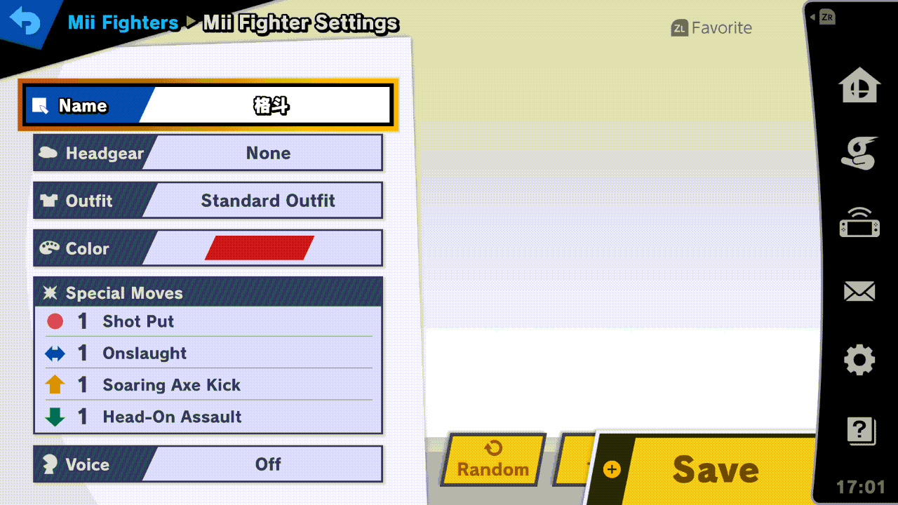
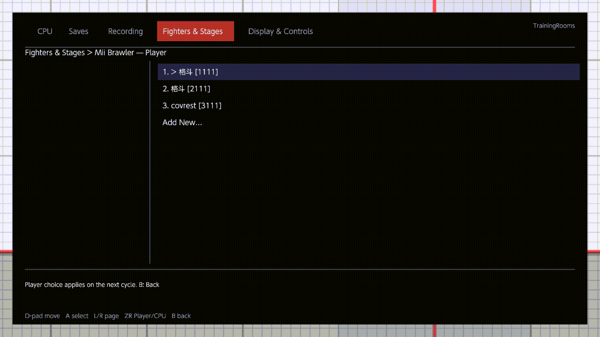

# Mii fighters

Fighters & Stages has a row for each class: [Mii Brawler](../menu/fighters-and-stages.md#mii-brawler),
[Mii Swordfighter](../menu/fighters-and-stages.md#mii-swordfighter) and
[Mii Gunner](../menu/fighters-and-stages.md#mii-gunner). Pick a Mii for Player 1 and one for the CPU, or make a new
one in Smash's editor without leaving practice.

## The list

A on a class opens its list for **Player**; ZR switches to **CPU** and back. Saved Miis come first, then replay Miis,
then **Add New…**. Each numbered entry shows the name and four specials in brackets, in neutral, side, up and down
order. `>` marks the role's choice.

Up / Down move, L / R turn a page, A picks, and B goes back. The Mii a role started with at character select is greyed
in that role's list: it is the role's 0 in the cycle. An empty-list notice means there are no saved or replay Miis of
that class. A replay Mii can appear here even if Smash has no saved Mii of that class.

## Picking a saved Mii

<!-- CLIP: tut-mii-pick.mp4 | Fighters & Stages › Mii Brawler → the list of saved Miis → A on one → Player 1 is that Mii -->
*Clip coming.*

1. Open the class's list. Press ZR if you want the CPU rather than Player.
2. Move to a saved Mii and press A. The `>` moves to your choice.
3. Close the menu. If that role is already a fighter of the class, it changes to the chosen Mii. Otherwise the choice
   waits until a cycle chord or Player / CPU Character pick brings in that class.

The choice is kept per role and class. A class is available in that role's
[Character Cycles](fighter-cycles.md#the-character-cycles-editor) only while it has a Mii of that class it can load.

## A replay Mii

With Recording › [Replay capture](../menu/recording.md#replay-capture) On, saving a replay also keeps its Miis. On the
next entry to Training or waiting-room practice they appear after the saved Miis as Replay Brawler, Replay Swordfighter
or Replay Gunner. Pick one with A. They belong to TrainingRooms, not Smash's own Mii list; a replay Mii matching a saved
Mii is represented by the saved one.

## A new Mii: Add New…

1. On a class's list, press A on **Add New…**. The menu closes and Smash's Mii Fighter editor opens.
2. Edit the look, specials or name. The editor starts from a copy of Player 1's choice for the class, your first
   saved Mii of the class, or the game's default; the original is not changed.
3. Save to make a new entry in Smash's list. Back in practice, open the list and press A on the new Mii to pick it.
   B or Exit Without Saving leaves without creating one.

Add New is greyed if some saved Miis could not be read; Save is refused at 99 saved Miis.

*Edit, save and pick a new Mii.*

## "Same as …, nothing new saved"

If the Mii you save matches one you already have, nothing new is saved. The notice reads "Same as ‹its name›, nothing
new saved". Class, look, four specials, colour, voice, outfit and hat count; the name does not. Renaming alone does not
make a new Mii.

*Saving without changing the Mii shows the same-as notice.*

## In a waiting room

The lists and Add New work in local wireless and Quickplay waiting-room practice while
[Lobby Practice](../menu/fighters-and-stages.md#lobby-practice) is On. In local wireless, Headgear, Outfit, Colour,
Voice and Random are greyed out; you can still change the name and specials. If a match starts in the editor, the
unfinished Mii is kept but not saved; the editor returns when you return to the same room. Your practice Mii changes,
while the match uses the fighter you picked for it.

More: [Waiting rooms](waiting-rooms.md).
