# Recording

Recording lets you capture what you do, play it back on yourself or the CPU, and drill combos. This guide explains how
the pieces fit together. The [Recording page](../menu/recording.md) lists every row and button.

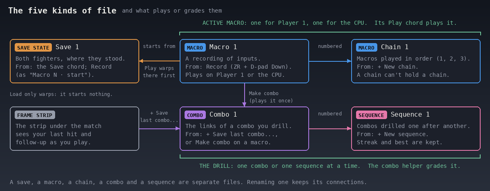

| File | What it is | You make it with |
| --- | --- | --- |
| Save state | Where both fighters stand. It only warps. | The Save chord, and Record (as "Macro N · start"). |
| Macro | A recording of inputs. | Record (ZR + D-pad Down). |
| Chain | A macro made of macros, played in order. | + New chain. |
| Combo | The links of a combo you drill. | + Save last combo…, or Make combo on a macro. |
| Sequence | Combos drilled one after another. | + New sequence. |

- Player 1 and the CPU each have one **active macro**, a recording or a chain. That side's Play chord plays it.
- The combo helper grades one **drill** at a time, a combo or a sequence. Combos have no chord.
- Each file is saved on its own under `sd:/ultimate/TrainingRooms/`. Renaming a file keeps its connections.

## Save states only warp

Save (ZL + D-pad Down) writes the one bound save. Load (ZL + D-pad Up) warps both fighters to it and starts nothing: no
macro, no chain. One save is bound at a time, for both sides, because a save holds both fighters. Auto-load on death
only warps to the bound save too, and with none bound it does nothing. Mirroring, damage on load and buffs still apply
to that warp. The full story is in [Save states](save-states.md).

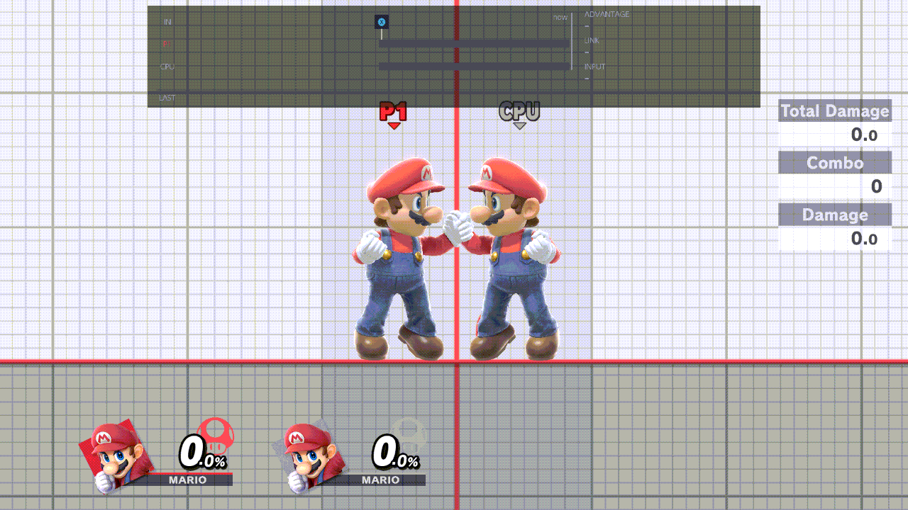

*Player 1 walks away, Load puts both fighters back, and the CPU just stands: nothing plays.*

*Player 1 is KO'd and is back at the bound save at once. With Bind to Save / Load turned Off on that save, the next KO
gives the game's revival.*

## Recording a macro, and its start save

Press Record (ZR + D-pad Down) to start and again to stop. The inputs are kept as a named macro (Macro 1, Macro 2, …;
rename it on its own screen). The Record presses themselves are not in the recording.

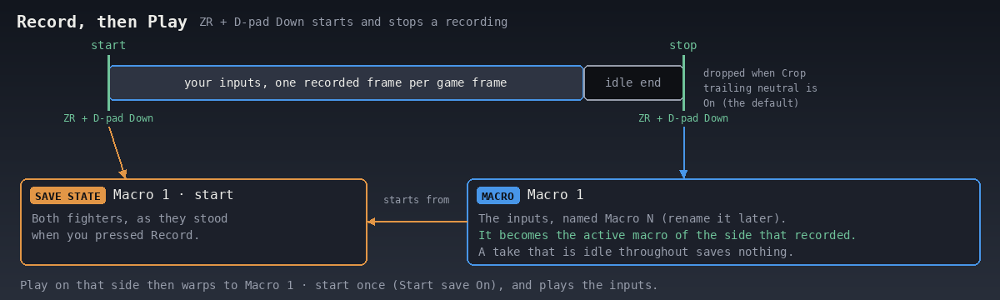

- **Who records:** the side the pop-up is set to (Player 1 until you pick CPU there). A recording made for the CPU
  names the CPU's fighter. Stopping makes the new macro that side's active macro, so you can Play at once, and the
  most recently used of its kind (the [hot five](../menu/recording.md#save-states-macros)).
- **The start save:** Record also writes a save state, "Macro 1 · start", with both fighters where they stood. The
  macro remembers that save, and the fighter's facing and speed at that moment.
- **Start save switch** (on the macro's own screen, On by default): On warps both fighters to the start save once,
  then plays. Off plays from where the fighters stand; the connection stays, so On again warps next time.
- **Idle frames at the end** are dropped when Recording › Options ›
  [Crop trailing neutral](../menu/recording.md#crop-trailing-neutral) is On (the default). A take that is idle
  throughout saves nothing ("Recording was empty").
- **Length:** the capture stops taking frames at 36,000 (10 minutes). A recording that long is kept, and one frame more
  is not saved.
- **No start save:** macros made from replays, and ones carried over from the old numbered slots, have none and no
  switch: Play starts where the fighters already are. If a start save was deleted, Play skips the warp and shows "No
  start save. This macro plays from where the fighters are."

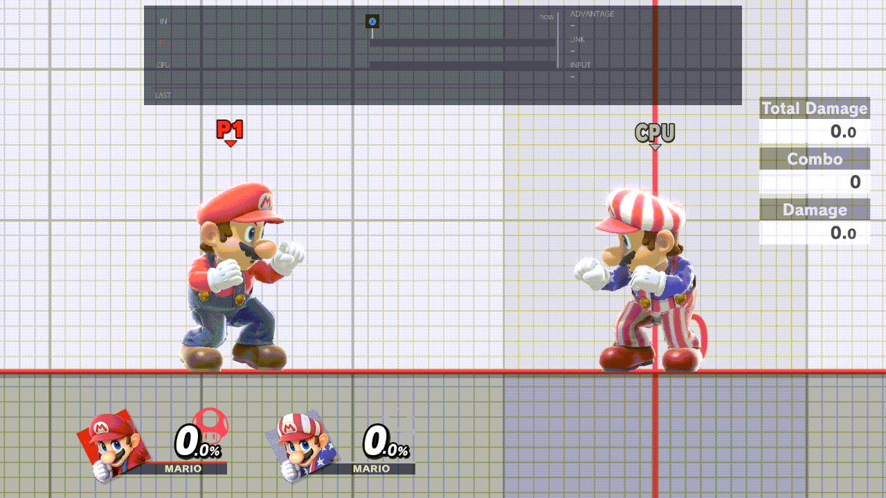

*The pop-up lists nothing; Record, two jabs, stop; it then lists Macro 1 (recorded on Mario) and "Macro 1 · start".*

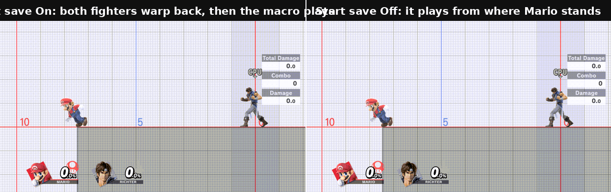 
*The Start save switch: Player 1 walked away to the left, then Play on Player 1 (ZR + D-pad Left) with the switch On (left) and Off (right). On, both fighters warp back to where Record started and the macro's jab hits the CPU (Richter, 2.7%). Off, Mario plays it from where he stands, away from the CPU, and nothing is hit. Eden, rc.14 (untested on hardware).*

## Set active, and the Play chords

A macro, or a chain, plays on the side it is active for. Set active for Player 1 replaces Player 1's old one, and Set
active for the CPU replaces the CPU's: the two sides don't share one.

| Chord | Default | What it does |
| --- | --- | --- |
| Record | ZR + D-pad Down | Starts or stops recording the side the pop-up is set to. |
| Play on Player 1 | ZR + D-pad Left | Plays Player 1's active macro, or stops it if it is playing. |
| Play on CPU | ZR + D-pad Up | Plays the CPU's active macro, or stops it. This chord was Input Playback. |
| Recording pop-up | ZR + D-pad Right | Opens the pop-up. B closes it (the chord does nothing while it is open). |

Save and Load (ZL + D-pad Down and Up) are in [Save states](save-states.md). All chords are changed in Display &
Controls › Button chords ([Controls](controls.md)).

- **Play** gives the side one recorded frame per game frame, in order, and warps to the start save once when its switch
  is On. A macro recorded on one side plays on either. With no active macro, the chord does nothing.
- **Both Play chords can run at once:** Player 1 and the CPU play together. A chain's own macros play one after
  another.
- **Your chord buttons don't reach the game** while you hold them, so pressing Record or Play never makes Player 1
  shield.
- **Mash interrupts playback** (Recording › Options), when On, stops the CPU's macro the moment the CPU would mash,
  library macros and chains included. Player 1's macro keeps playing. See
  [Mash interrupts playback](../menu/recording.md#mash-interrupts-playback).

*Play on CPU: one warp to the start save, then the macro; the same chord again stops it.*

*Both Play chords pressed together start the two jabs at once, with both lanes running side by side. Pressed one after
the other, the CPU's lane trails Player 1's.*

## The loop

The loop is how many times the Play chord plays the active macro. It belongs to the side, not to a file: Player 1 and
the CPU each keep their own count, from ∞, 1, 2, 3, 5 and 10, and a new library starts at 1. Set it with Recording ›
Options › [Loop](../menu/recording.md#loop), or with X in MACROS.

- **Only the first pass warps** to the start save (when its switch is On). The loop never warps back.
- **A chain repeats as a whole:** 1, 2, 3, then 1 again. ∞ keeps going until you press the Play chord again.
- **Reset page to defaults** (Recording › Options) puts both counts back to 1.

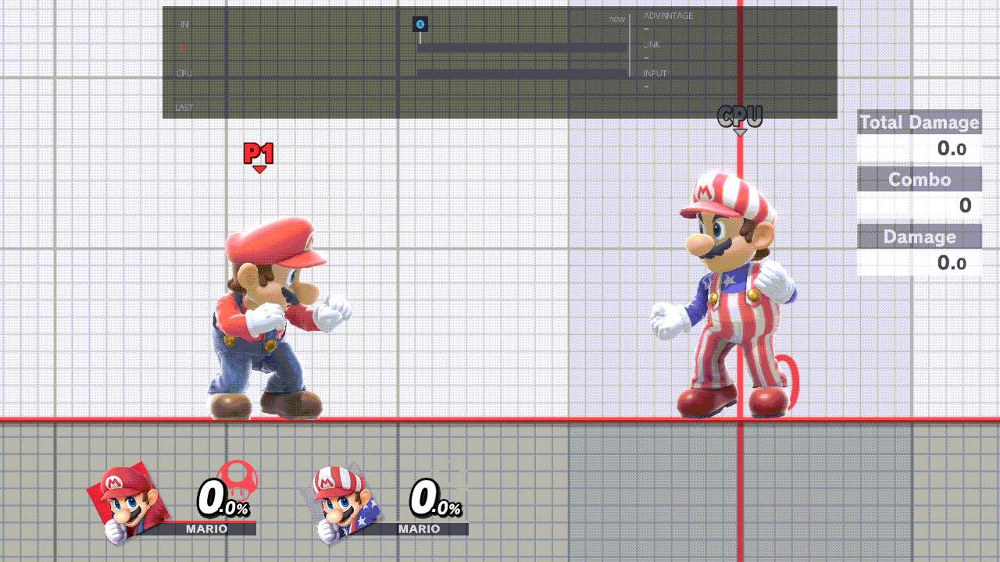

## Chains

A chain is a macro made of macros: an ordered list of your recordings, numbered 1, 2, 3. It can't hold another chain,
because the picker lists recordings only.

- **Make one:** + New chain, the last row under MACROS, opens the numbered picker
  ([how it works](../menu/recording.md#a-file-s-own-screen)). It is the Character Cycles picker, except that R can take
  off the last number, so a chain can end up empty. X is done and asks for a name; B backs out and makes nothing.
  A on a tile that already has a number does nothing.
- **Where it starts:** at its first macro's start save. The chain has its own Start save switch, On by default. On
  warps there once when the Play chord starts the chain. Off plays from where the fighters are. The macros inside don't
  use their own start saves, whatever their switches say. If macro 1 has no start save, the chain has none.
- **How it plays:** the macros in order, from where the fighters are after that one warp. With a loop, the whole chain
  repeats and nothing warps back.
- **Nothing to play:** an empty chain, or one whose recordings were all deleted, plays nothing, with no extra message.

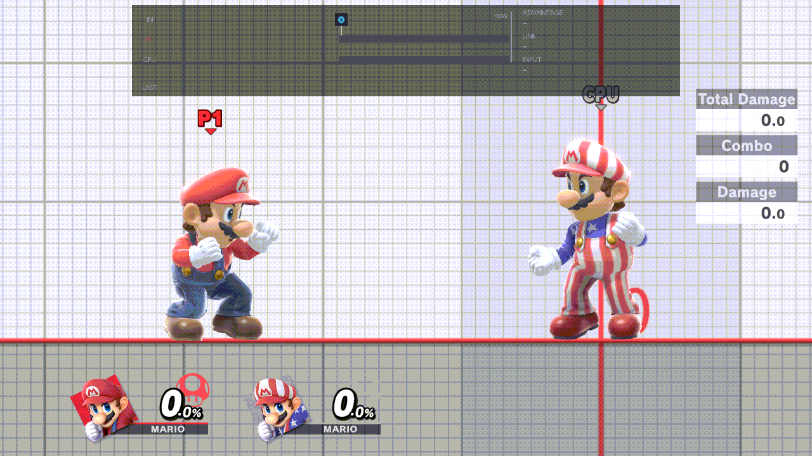

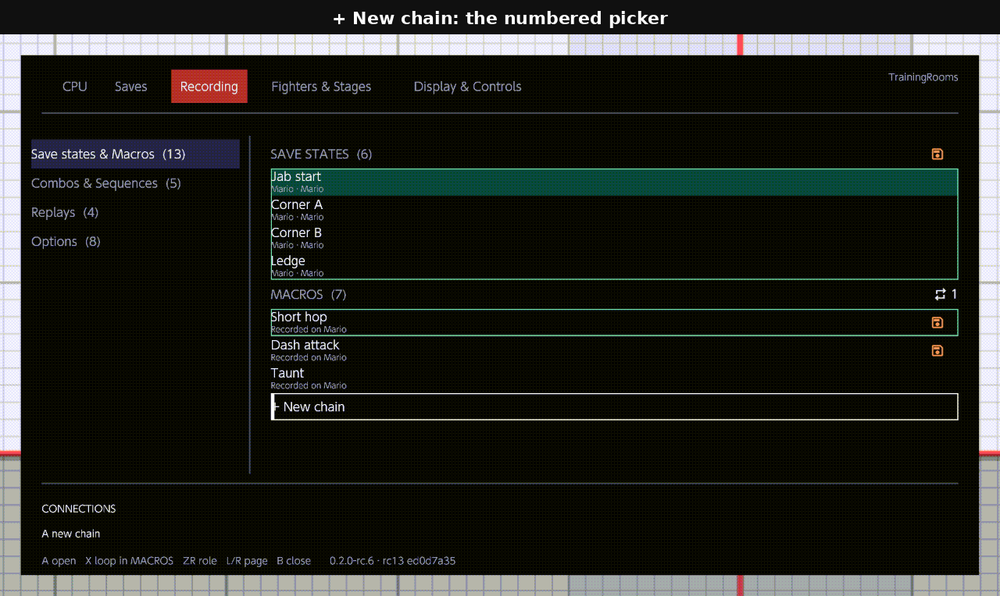 
*+ New chain opens the numbered picker. A gives the tile under the cursor the next number (Neutral air 1, Dash attack 2, P1 jab 3), R takes the last number off, A numbers it again, B finishes and asks for a name (empty keeps Chain N). The keyboard step is cut. The chain is written when the menu closes: reopened, MACROS lists Chain 2 with its three steps and CONNECTIONS. Eden, rc.13 (untested on hardware).*

## Combos

### Getting a combo

- **+ Save last combo…** is the first row of COMBOS, on the Recording page and in the pop-up's Combos & Sequences tab.
  It keeps the last combo the frame strip saw and makes it the drill. A opens the keyboard for a name. An empty name,
  or a room where no keyboard can open, gives it the next Combo N. With no link on the strip yet it says so and saves
  nothing.
- **Make combo,** on a macro's or a chain's own screen, plays that file once on Player 1 from the file's own start
  save (a chain uses its first macro's) and keeps what it did as a new combo, Combo N, with Made from set to the
  source.
  - The file on screen stays, the drill doesn't change, and the new combo joins the five most recently used.
  - A pass with no hit saves its input steps as Drill N under COMBOS > DRILLS. A pass that touches the opponent but has no follow-up still says "No combo yet: land a hit and a follow-up first."
  - If the start save was deleted, Make combo skips the warp, shows "No start save. This macro plays from where the
    fighters are." and still plays. A switch that is Off, or a file that never had a start save, doesn't warp and shows
    nothing. A chain whose first macro is missing skips that step and plays the next one still there.
- **What a combo file holds:** its links, and the input events of each follow-up: presses, releases, the C-stick and
  stick flicks (fast-fall, dash, tap-jump). Make combo records the same events, because it plays into the same strip.
  Any fighter can practise a combo. The format is in [Combo files](combos.md).

*Jab into jab is a TRUE combo on the strip. COMBOS goes from (0) to (1) and lists "Jab jab saved, recorded on Mario".
The name is typed on Eden's keyboard, a window that isn't in the frame.*

### How a combo is graded

The link cells under the frame strip grade each attempt. The card in the top-right corner shows what you are drilling,
the result, and your streak and best.
A link **counts** when the recorded input events come, of the same kind and the same facing-relative direction, in
order and within the [On-time tolerance](../menu/recording.md#on-time-tolerance), and the move that comes out is the
recorded one.

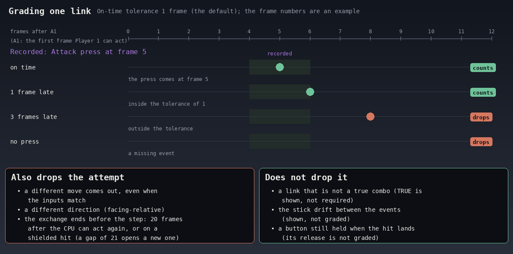

- **TRUE is not required.** A link that is not a true combo still counts. TRUE stays on the bar as information. Drift,
  the stick you hold between the events, is shown and never graded.
- **Angled moves and held buttons:** a combo saved with move descriptions tells an angled side tilt or side smash
  from a level one, and names a fighter's own special status by its special. An older file has no descriptions and is
  graded on the kind of move, as before. A release whose press is in the same link is graded on how long the button
  was held.
- **Match sweet/sour spot** (Off by default) also compares the spot: with it On a link counts only if it lands the
  spot the saved link landed. A link saved with no spot always matches.
- **A follow-up's events end at its hit,** so a button you still hold when the hit lands is not graded for its release.
- **An older file with only presses** is graded on those presses, with left and right as one direction.
- **The exchange** ends 20 frames after the CPU can act again, or on a shielded hit. A gap of 20 frames still belongs
  to it. A gap of 21 opens a new one, so the step drops.
- **Best and streak:** a single combo's best is the most true links in one attempt. The streak counts the links that
  counted, so a link that is not true can still extend it.

*Cropped to the top of the screen.*

### Input drills

**DRILLS >** under COMBOS opens the input-drill list in Training and waiting rooms. A drill needs no contact with the opponent: use it for dash-back, short hops, fast-falls or a movement sequence. Its default name is Drill N. Its file screen has Drill, Rename, Crop and Delete, plus Made from when a macro or chain made it.

- **Record directly:** choose **+ Record drill…**. The library closes and shows the configured Record chord. Press that chord to start recording Player 1, then press it again to stop and save the take straight as a drill. It becomes the current grading target. This one take uses Player 1 even if the pop-up's Record role is CPU; later ordinary recordings keep their selected role. Opening the library before starting cancels the armed take. The menu press and the Record chords are excluded. The take's inputs are kept with the drill in a file of its own; it is not listed under MACROS and is deleted with the drill.
- **From a macro or chain:** Make combo saves an input drill when the pass touches no opponent. A pass with hit links keeps making a hit combo. The source and current grading target stay selected as before.
- **Steps:** a press, C-stick input or stick flick starts a new step when it comes more than 20 frames after the last
  input. A release or a special's first direction does not itself start a step, however late; a second direction has
  its own step. A step with 12 events continues in another step. The shared combo capacity is 16 steps of up to 12
  events; an overfull take saves nothing.
- **Grading:** the same event kind, facing-relative direction, order and On-time tolerance apply. The first event
  starts the clock; later steps keep their recorded offsets, including idle gaps. In a new recording, a release is
  graded on its hold only when the status of the action started by its press changes on release or within the selected
  On-time tolerance afterwards. The hold may differ by the On-time tolerance plus one frame per
  eight frames of the saved hold, at most 15 extra frames. A missing graded release, or a button held longer or shorter than that, drops
  the step; a release marked as unreacted is not graded. A special with saved directions is graded on them, not
  its press's stick direction. A side tilt or smash uses
  the angle the game chose, not the stick position. There is no move, hit, spot or TRUE requirement; the TRUE field
  stays blank.
- **Directions of a special:** for any fighter, a special records a direction when the fighter starts to move a way
  that is not the special's own and the stick pointed that way since the press (up to two per special, each graded on
  its direction). A special that only goes its own way, such as a straight-up up special, records none.
- **After a Training reset:** the reset's own presses held at clear do not make an attempt; buttons held through the
  reset are not new presses, and the next input starts a fresh attempt.
- **Older drill files:** they did not record whether the game reacted. A saved hold under eight frames is a tap and is
  not graded; a hold of eight or more is graded in its band. Re-recording the drill grades releases by the game's
  reaction instead. A step beginning with a release or first special direction joins the preceding step on load if
  both fit in 12 events. Loading does not change the file.
- **Progress:** the bar shows steps, Best counts steps that counted, and the streak counts complete clean attempts. After an attempt, more than 20 idle frames allow a fresh attempt.
- **Crop:** the shared clip editor's handles select whole steps. It saves a new Drill N and leaves the original; the retained first event becomes time zero. X has no preview, as for hit combos.
- **Preview:** on a drill's row, X plays the drill's recorded inputs once on Player 1 through Recording's playback. The menu hides while it plays; X or B stops it, and the page returns about a second after the last input. X does nothing while a macro is already playing on Player 1. Only a drill recorded directly in this build has its inputs: one recorded earlier, a crop, or one Make combo made shows "Re-record to preview" (a made drill's source macro can be played as a macro).

 
*A drill's Crop: L selects the start or R the end; Left/Right changes the kept steps (4 → 3 → 4 → 3). Eden, 2026-11-15, rc.15 `2eb3903e`. This early build's helper overlaps the editor; the overlap was fixed before the integrated release. The clip shows range selection, not recording or grading.*

[Input drill acceptance evidence](../EVIDENCE-rc15-input-drill.md).

Sequences in rc.15 offer hit combos only. Their continuation currently checks the hit connecting two combos, which an input drill does not have.

### Crop

Crop on a combo, drill or macro opens the Replay window's clip editor ([keys](../menu/recording.md#replay-window)).

- L selects In and R selects Out; Left/Right move the selected handle. Hold to move faster. B leaves.
- A opens the name keyboard and saves the cut as a new file of the same kind. An empty name uses the next unused Macro N, Combo N or Drill N. The original stays; a crop of the role's active macro becomes its new active macro.
- A macro crop keeps that range of input frames and the original's one start context; no pose is stored for every frame.
- X previews a macro's kept inputs through Play on the role you opened Crop from (Player view: Player 1; CPU view: the CPU), using its start save when On. The page hides during preview and returns about a second after the last input; X or B stops it early.
- A combo crop keeps the links from the first handle through the last; a drill crop keeps the selected steps. The handles step by whole links or steps, and X is not offered.
- A chain has no Crop row, because it has no frames of its own. The Replay window is a separate row under Replays.

 
*Macro Crop range selection: L, then Left/Right moves the start handle. Eden, 2026-11-15, rc.15 `d520d325`. Preview and save-as-new were checked separately; this clip shows the selection.*

## Sequences and the one drill

A sequence is an ordered list of hit combos. Input drills are excluded in rc.15 because continuation requires a connecting hit. It stores each combo's id, so renaming a combo shows the new name in the
sequence, and deleting a combo makes the sequence skip that step. An empty sequence drills nothing, and a sequence of
any length drills every combo in it.

- **One drill at a time.** Drilling a sequence replaces a drilled combo, and drilling a combo replaces a drilled
  sequence. There is no chord: use Drill on the file's own screen, or A on it in the pop-up.
- **A numbered row inside a sequence** drills that combo alone, with that combo's own streak. The sequence file stays.
- **Editing:** the picker is the one a chain uses, including R removing the last number. Edit combos, Rename and Delete
  are written to the card at once.

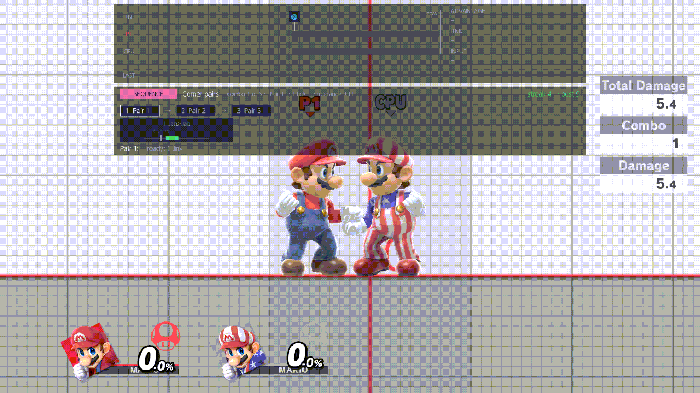

### The sequence card

The **SEQUENCE** card shows the drill's name and which combo you are on. It stacks up to three combos. A completed
combo is green with a check, the current one is white, and later ones are grey. The card also shows the previous result,
the current link count and tolerance, and the streak and best. The link cells under the strip grade the current combo.

 
*The sequence bar mid-drill: combo 1 done (green, with a check), combo 2 current (white), combo 3 later (grey), with the streak and the best. Eden, rc.13 (untested on hardware).*

### Passing and dropping

- **Combo 2 follows inside the same exchange as combo 1.** The link from combo 1's last hit to combo 2's first hit
  joins them: it is shown and not graded, and the move it lands must be combo 2's first move. The CPU may act for up
  to 20 frames between the combos, and TRUE is not required there either.
- **Each step** is graded like a single combo: the events, the direction, the order, the tolerance and the move.
- **A finished sequence** adds one to the streak, and the best is the highest streak.
- **A drop** sends the sequence back to combo 1 and the streak to 0 (the best is kept). A step drops on any fault a
  single combo drops on, on a different first move after the joining link, or when the exchange ends before the next
  combo. A save-state load or a scene change in the middle of a sequence is a drop too.
- **After a drop** the dropped combo is red and the footer names the fault, until combo 1 starts again in a new
  exchange.
- **Saved with the file:** the streak and the best are written to the sequence file, so CONNECTIONS shows the same
  numbers as the bar, after the menu closes and after you leave Training.

## The pop-up

The pop-up is one window over the match, so you can work with your files without leaving it. Its layout and keys are
on the [Recording page's pop-up section](../menu/recording.md#the-recording-pop-up).

- While it is open it takes your buttons. B closes it and leaves the bound save, the active macros and the cursor as
  they were. That B never reaches your fighter, tapped or held; your buttons stay with the pop-up until you let go.
- L Player and CPU R choose the side you are working on. That side is the one Record records and Edit placement edits.
- A acts at once: no file screens. Renaming, cropping and deleting are on the page.

The pop-up role and the Recording page's ZR view are remembered separately across menu closes, leaving Training and a
restart. They are stored in `settings.json` as the top-level `recording_roles` key; older files start both at Player.
After a restart, Record uses the remembered pop-up role even before you open the menu.

*Cropped to the pop-up.*

### Reading the lists

| You see | It means |
| --- | --- |
| A green row | The bound save, the active macro of the side in view, or the drilled combo or sequence. A row can be green and hold the cursor too. |
| A green outline, a thin line under it | The hot five: the five files of a kind you used last, newest first. |
| An orange floppy on a macro | The save it starts at; grey when that macro's Start save switch is Off. The Start save row of its own screen shows the same floppy, and the SAVE STATES header too. |
| A number on a chain's row | How many macros it holds. With the cursor on a chain, they show 1, 2, 3 before their names. |
| A red number badge (pop-up) | A row's place in the chain or sequence under the cursor. The page writes the number before the name. |
| A square before a header (pop-up) | The kind: blue MACROS, purple COMBOS, pink SEQUENCES. Each header shows how many files it lists. |
| A white border and a bar on the left | The cursor. |

CONNECTIONS, the right-hand column in the pop-up and two help lines on the page, shows what the row under the cursor is
joined to. Each file sits in a box labelled SAVE STATE, MACRO, COMBO or SEQUENCE, under a heading:

| Heading | Shows |
| --- | --- |
| start save of | The macros that start from this save. |
| starts from (warps there once, first) | A macro's start save. |
| in chains | The chains a macro is in. |
| combos made from it, made from | A macro's combos, and the macro a combo came from. |
| in sequences, combos | The sequences a combo is in, and a sequence's combos. |

Plain lines follow: a combo's links and fighters, whether a save is bound, and a macro's recorded fighter and length.
A row's connections are not limited to the side in view.

## A file's own screen

On the Recording page, A on a file opens its own screen. The rows each kind of file has are in
[the menu reference](../menu/recording.md#a-file-s-own-screen). The rules behind them:

- **Set active** is one row, for the side in view: Right sets On and Left sets Off. Left on a row that is already Off
  doesn't clear the other side.
- **Names:** a name may be at most 48 characters, and it may not be empty or hold a control character.
  - Rename opens the Switch keyboard. B, or an empty confirm, keeps the old name.
  - A new chain or sequence with an empty name is Chain N or Sequence N. A recording stopped with no typed name is
    Macro N, a duplicated save is Save N, and a combo saved with no typed name is Combo N.
  - Training and every waiting room, local wireless or Quickplay, open the keyboard. In a waiting room a match closes
    it and nothing typed is applied; back in the same room it reopens with what you typed.
- **The breadcrumb** reads "Recording (Player view) > Save states & Macros > name", or Combos & Sequences for a combo or
  a sequence. The CPU view says "Recording (CPU view)".
- **A combo's help lines** list each link as the two moves and TRUE or not, then its input events, then its drift when
  it has one. The word sequence means the file of combos, and the word chain is only the compound macro.

 
*A macro (Walk and jab, with a start save): Start save reads "Jab start · On" beside the orange floppy. Eden, rc.13 (untested on hardware).*

 
*A chain (Chain 1, P1 jab then Walk and jab): its Start save is the first macro's. Eden, rc.13 (untested on hardware).*

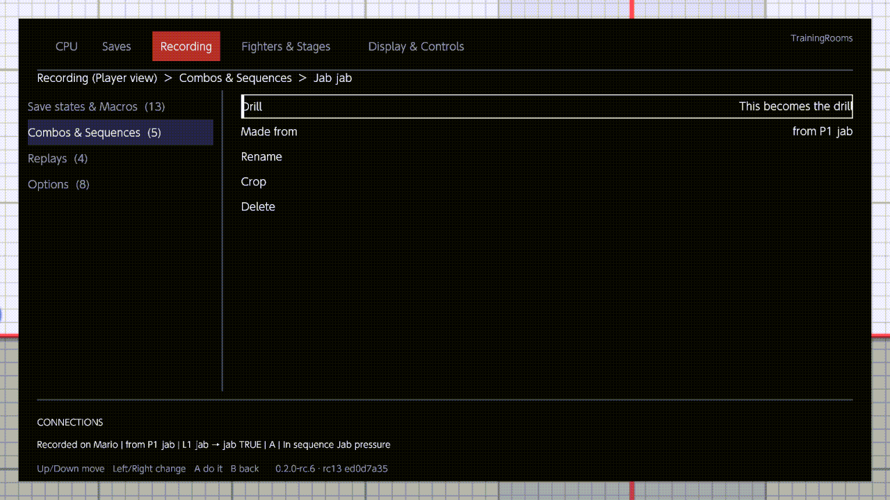 
*A combo (Jab jab, made from the macro P1 jab). Eden, rc.13 (untested on hardware).*

 
*A save state (Jab start, bound: Bind to Save / Load reads On). Eden, rc.13 (untested on hardware).*

## Replays: Edit placement and the Replay window

**Edit placement** moves where a macro starts. Play warps the fighters to the macro's start save, and the offset moves
the side that plays it.

- **Which macro:** the active macro of the side the pop-up is set to (its lit tab, not the page's ZR view), the file
  that side's Play chord plays. For a chain it is macro 1, whose start save the chain uses.
- **The anchor** is where that macro's start save puts the side. The offset is added on the next Play, to the playing
  side only. The keys, Write, Keep, New and Back are in the
  [menu reference](../menu/recording.md#edit-placement).
- **Momentum:** "Keep recorded speed", the default, gives the side the speed it had when Record started, on its first
  input after the warp. "Start at rest" starts it from standstill. Like the offset, it applies with the warp to the
  start save.

**The Replay window** lists your saved match captures. A opens the clip editor on one: the fighter, the crop window,
the playhead and the timeline. On a capture's Mii track it reads the recorded Mii, asks Fighter Mismatch, and Switch
loads that exact Mii on the CPU. Its keys are in the [menu reference](../menu/recording.md#replay-window).

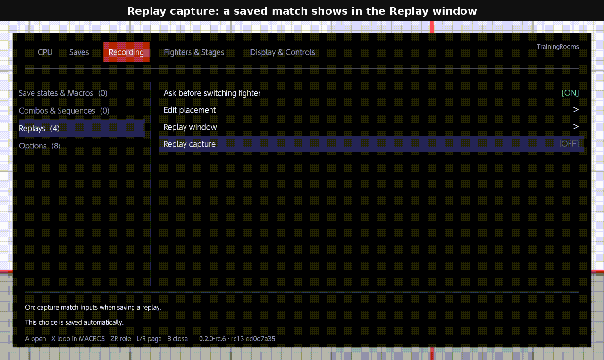 
*With Replay capture On, a 1-stock match is played and its replay saved: A, A, Y on the results opens "Save a replay of this battle?", Right and A answer Yes ("Replay saved"), and Recording > Replays > Replay window then lists the capture with its name and length. The loads, the match and the menus between the clips are cut. Eden, rc.13 (untested on hardware).*

<!-- CAPTURE-REQUEST rec-replay-editor: the Replay window's clip editor, a still with the fighter, the crop window, the playhead and the timeline visible (rc.13). See artifacts/docs4/CAPTURE-REQUESTS.md. -->

## Fighter Mismatch

Fighter Mismatch is the question a macro, a chain, a replay clip or a combo drill can ask before it switches a fighter.

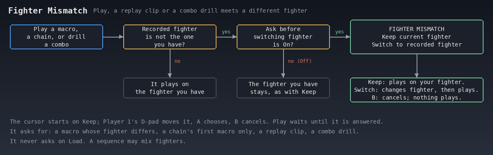

- **The prompt:** its first line names the recorded fighter and the side that plays it ("current Player 1" or "current
  CPU"). Keep current fighter plays on the fighter you have. Switch to recorded fighter changes to the one the file
  was recorded on, then plays. B cancels and doesn't play. The cursor starts on Keep.
- **Play waits** until it is answered. With the menu closed, the prompt is drawn over the match, the frame strip is
  hidden, and Player 1's presses answer it instead of reaching the match: the D-pad moves, A chooses, B cancels.
- **Ask before switching fighter Off** (Recording › Replays): nothing asks, and the fighter you have stays, as Keep
  would leave it.
- **Nothing is refused** because the fighter differs. A sequence may mix fighters.

| It asks | When |
| --- | --- |
| A macro | Its recorded fighter differs. For a CPU macro recorded on an exact Mii, Switch loads that Mii: its look, specials, colour, voice, outfit and hat. |
| A chain | Only for its first macro. Later macros aren't checked and don't switch. |
| A combo drill | The drilled combo changes to one recorded on another fighter. The first time a saved drill is seen, it doesn't ask. |
| A replay clip | Opening a capture in the Replay window, when the CPU isn't the recorded fighter. |
| Load | Never. |

A Mii from a replay carries no ID and no name of its own, so it is installed as the saved Mii with the same look, or
else with a made-up ID and the name "New Mii".

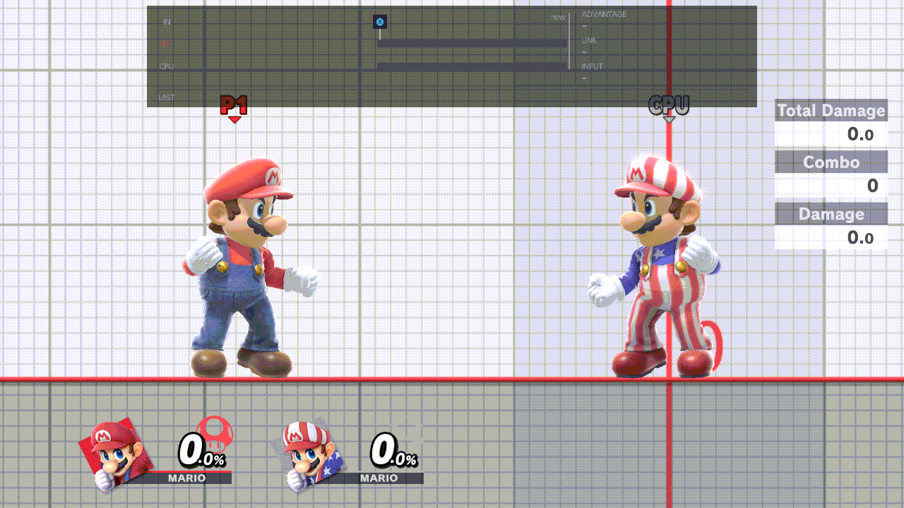

*A CPU macro recorded on a Mii Gunner, played with the CPU on Mario. Switch to recorded fighter reloads the CPU, and
"Saved Mii applied" brings in the recorded Mii Gunner (red armour, spiked helmet).*

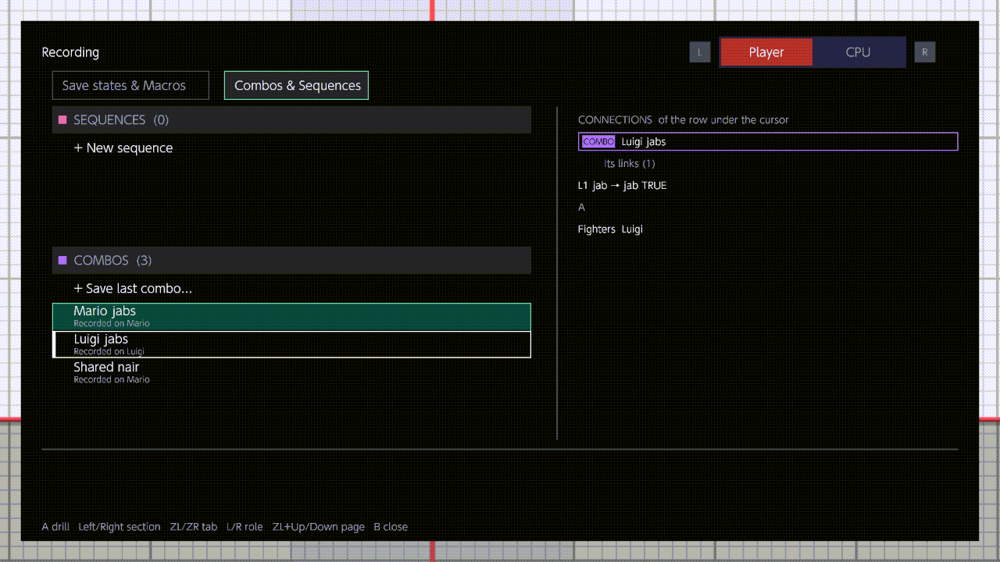

*With Player Swapping Off, Fighter Mismatch reads "Recorded Luigi · current Player 1 Mario"; Switch to recorded
fighter, and Player 1 becomes Luigi ("Player fighter applied").*

## Migration of the old slots

The first time this library is built:

- **Recording slots** that hold inputs become macros named `Slot N (YYYY-MM-DD)`, with the date the migration runs.
  Empty slots are skipped. These macros have no start save, so they have no switch and play from where the fighters
  are. No chain is built from them. Recording slots were never kept between boots, so on a card updated from an earlier
  build they are empty and no slot becomes a macro.
- **Save indexes** that hold a save become one file, both fighters, with the same `Slot N (date)` name. The slot the
  Save and Load chords were using becomes the bound save. An empty index is skipped.
- **`macros/selected.txt`**, when it names a file that is there, becomes Player 1's active macro. The CPU has none
  until you set one. The old "play a recording when a state loads" row is not turned into a chain.
- **The loop:** an old Loop On becomes ∞, and Loop Off, or a missing loop row, becomes 1.
- **The page:** the old Recording and Saves rows are gone from the Recording page: the slot number, Randomize slots,
  Record Slot, Trigger, the Duration dropdown, button slots, the save-state playback checklist, Source and per-slot
  playback. Their settings ids stay, so an old settings file still loads. Respawn on platform stays under Fighters &
  Stages › Stages.

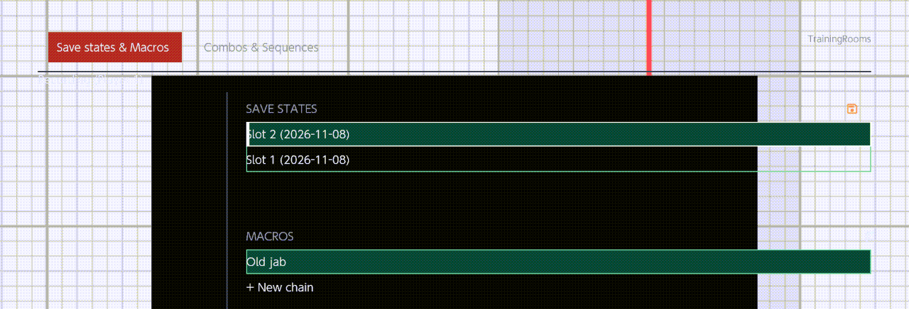

*Cropped to the top of the screen.*
