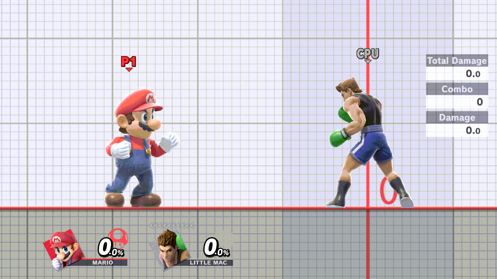

# Save states

## Repeat a position

<video src="https://git.syntaxbyexample.com/intpa/TrainingRoomsForUltimate/media/blob/2f0394ea36fb533c09e157925c016b4e369ab2a6" autoplay muted loop playsinline controls></video>

*Load returns both fighters to the saved spot.* [Open the clip](../media/tut-save-load.mp4)

| To | Do this |
|---|---|
| Save here | Position both fighters and press your [Save State Save chord](../menu/display-and-controls.md#button-chords). |
| Try again | Press Save State Load: both fighters return; no macro starts. |
| Use another save | Open the Recording pop-up, highlight that save and press A to bind it. |
| Practise at 90–110% | Choose Random Value for CPU damage; set Min to 90 and Max to 110. |
| Adjust the restore | See [Saves](../menu/saves.md) for damage, mirroring, buffs and automatic loading. |
| Change a respawn | Check [Respawn on platform](../menu/fighters-and-stages.md#respawn-on-platform) if auto-load isn't taking over. |

## Keep a named setup

| Goal | On the Saves page |
|---|---|
| Keep this position | Choose **Save setup here…** and name it; the bound save stays unchanged. |
| Copy the next Load's positions | Choose **Save setup from bound save…**; a setup selected for Load also counts. |
| Move to a setup once | Open **Setup library**, select the named setup, choose **Restore here**, then close the menu. |
| Restore refused? | Enable Save States and match the stage and both fighters, including exact Miis. |
| Use the setup for later loads | Choose **Make Load use it**; nobody moves until the next load. |
