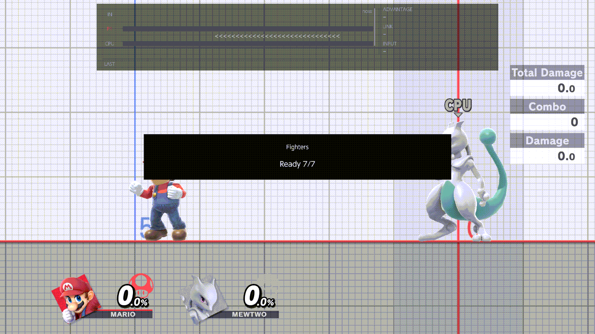
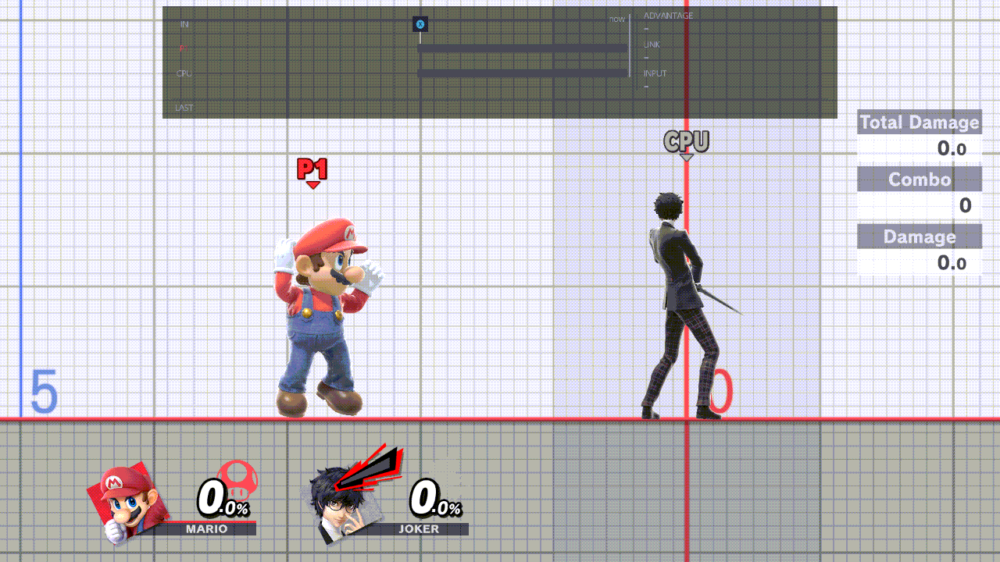
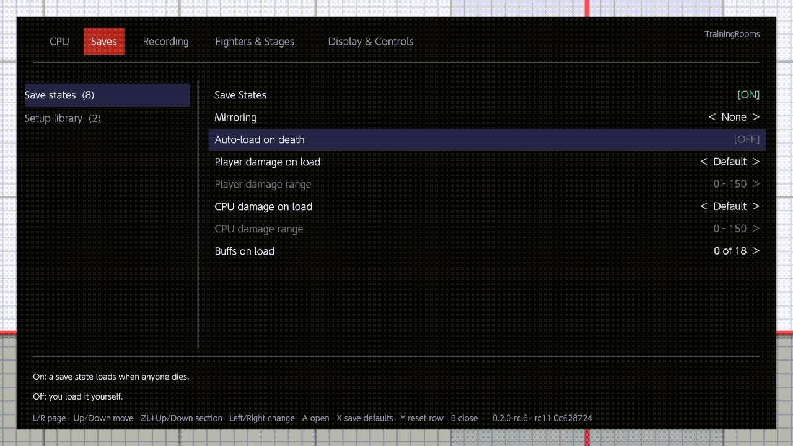

# Save states

A save state remembers where both fighters are, so one press takes you back there. This guide covers saving and
loading, the bound save and its files, what a save keeps, the load options, Auto-load on death and respawning, and the
setup library. The options are on the [Saves](../menu/saves.md) page.

## Saving and loading

| Chord | Default | What it does |
| --- | --- | --- |
| Save State Save | ZL + D-pad Down | Saves both fighters as they are now. |
| Save State Load | ZL + D-pad Up | Puts both fighters back where you saved. |

- **Save:** both fighters flash and the notice "Save State · Saved" appears. What was written is the
  [bound save](#the-bound-save).
- **Load:** both fighters vanish in a short burst and are back at the saved spots. There is no notice.
- Load only warps. It doesn't start a recording, and it stops one that is playing.
- Both need Saves › [Save States](../menu/saves.md#save-states) On. It is On by default.
- A Save or Load that doesn't happen says why in a "Save State" notice (rc.12):

  | Notice | Why |
  | --- | --- |
  | Save States is Off (Saves page) | The Save States row is Off. |
  | Nothing is saved here yet: Save first, or bind a save | Load with nothing [bound](#the-bound-save). |
  | A load is already being placed | Load pressed while a load is still under way. |
  | A setup is being placed: save (load) again after it | A setup, a preview or a Play warp is being placed. |
  | A CPU drives Player 1: take Player 1 back to load | The game's own CPU control plays Player 1. With the CPU pilot on Player 1 the Load works, because the pilot only presses Player 1's buttons. |
  | Online Deluxe's open page uses this button: close it to save (load) | A chord you moved onto a D-pad button Online Deluxe's open page uses. The default chords work beside it. |
  | Both triggers are Online Deluxe's L + R: hold one of them | A GameCube controller with both triggers held. |
  | Save states have not started in this match yet | The first moments of a match, before save states are ready. |

  A press the open menu or the game speed pop-up uses there (ZL + D-pad Up pages the menu) shows no notice.
- They work in Training, and in a waiting room while Fighters & Stages ›
  [Lobby Practice](../menu/fighters-and-stages.md#lobby-practice) is On.
- To change the buttons, see [Controls › Changing a chord](controls.md#changing-a-chord).

Every load uses the Saves page's options: [damage on load](#damage-on-load), [mirroring](#mirroring) and
[buffs](#buffs). The combo helper can also load the save after each attempt, to retry from the same spot: Recording ›
[After an attempt](../menu/recording.md#after-an-attempt).

## The bound save

The chords use one save at a time, the *bound* save:

- Save overwrites the bound save. With nothing bound, it makes a new save named Save 1 (or the lowest free number) and
  binds it.
- Load warps to the bound save. With nothing bound, it does nothing.

Every save state is a file in `sd:/ultimate/TrainingRooms/saves/`. They are listed under SAVE STATES on the Recording
page (Recording › [Save states & Macros](../menu/recording.md#save-states--macros)) and in the recording pop-up
(ZR + D-pad Right). The bound save is the green row, and the five you used last come first.

<!-- CAPTURE-REQUEST v13-bound-save: a still of the SAVE STATES list with the bound save highlighted green, next to a macro's "name · start" save, so the two are not confused. See artifacts/docs4/CAPTURE-REQUESTS.md. -->

The names you'll see:

| Name | Where it comes from |
| --- | --- |
| Save N | The Save chord when nothing was bound, or Duplicate. |
| name · start | The start save a recording writes for its macro, such as "Macro 1 · start". See [Recording › Recording a macro, and its start save](recording.md#recording-a-macro-and-its-start-save). |
| Slot N (YYYY-MM-DD) | A save from an older version's numbered slots. The first time this version started, each filled slot became a file with its number and that day's date, and the slot the chords were using became the bound save. See [Recording › Migration of the old slots](recording.md#migration-of-the-old-slots). |

To bind another save:

- In the pop-up, put the cursor on it and press A.
- On the Recording page, A opens the save's own screen. Its first row is Bind to Save / Load: A flips it, Right binds,
  Left unbinds. The screen also has Duplicate (a copy named Save N), Rename (up to 48 characters) and Delete. See
  [Recording › A file's own screen](recording.md#a-files-own-screen).

Deleting the bound save leaves nothing bound, so Load does nothing until you bind another save or press Save.

Play's warp to a macro's start save is separate: it neither uses nor changes the bound save.

## What a save keeps

For each fighter:

- where it stands and which way it faces;
- whether it was on the ground, in the air or hanging on the ledge (a ledge save puts it back on the ledge);
- its damage (a load uses it only when [damage on load](#damage-on-load) is Save State);
- its special-move charges, such as Samus's Charge Shot, Donkey Kong's Giant Punch, Mewtwo's Shadow Ball, Sheik's
  needles, Robin's tomes and Levin Sword, Olimar's Pikmin, Steve's materials and tools, and Kirby's copy ability;
- for Player 1, a held item such as a turnip or a bomb;
- the fighter and the stage, and for a Mii, the exact Mii.

A load doesn't change fighters or the stage. It puts whoever is playing at the saved spots, and the charges come back
only when the fighter is the one that was saved.

## Damage on load

Each fighter has its own row: Saves › [Player damage on load](../menu/saves.md#player-damage-on-load) and
[CPU damage on load](../menu/saves.md#cpu-damage-on-load).

| Value | Damage after a load |
| --- | --- |
| Default | 0%, as after a respawn. |
| Save State | The damage the fighter had when you saved. |
| Random Value | A random damage within that fighter's range: Player damage range or CPU damage range. |

- The ranges go from 0 to 150, and are 0 to 150 by default. A range row is greyed unless its damage row reads Random
  Value.
- Random Value draws a new damage on every load.
- With the defaults, every load puts both fighters at 0%, whatever the save holds.
- Play's warp to a macro's start save always uses the saved damage, whatever these rows say.

For example, to practise a kill confirm at around 100%, set CPU damage on load to Random Value and CPU damage range to
90 to 110.

## Mirroring

Saves › [Mirroring](../menu/saves.md#mirroring) flips a load left to right: each fighter lands at the mirror image of
its saved spot, across the middle of the stage, and faces the other way.

- **None** (the default): never flips.
- **Alternate:** flips every other load, starting with the first load after a Save.
- **Random:** flips each load by chance, one in two.

A restored setup is flipped the same way. Play's warp to a macro's start save is never flipped.

## Buffs

Saves › [Buffs on load](../menu/saves.md#buffs-on-load) gives character buffs right after each load, to Player 1 and to
the CPU alike: Hero's spells, Joker's Arsene, Wii Fit Trainer's Deep Breathing, Cloud's Limit, Little Mac's KO Punch,
Sephiroth's wing, Shulk's Monado Arts, Min Min's Power Dragon and Wario's waft. The menu doc's table lists what each one
does.

- Every ticked buff is given, except for Shulk and Wario: a fighter has one art or one waft at a time, so one of the
  ticked ones is picked at random on each load.
- A fighter that isn't in the list gets nothing.
- Buffs come with every load: the Load chord, Auto-load on death, a restored setup, and Play's warp to a macro's start
  save.

## Auto-load on death

With Saves › [Auto-load on death](../menu/saves.md#auto-load-on-death) On, when Player 1 or the CPU is KO'd, the bound
save loads at once, as if you had pressed Load: same spots, with the damage, mirroring and buffs options. Nobody
respawns. It is Off by default.

With nothing bound, Auto-load loads nothing, and the fighter respawns at once.

### Respawning

What happens after a KO depends on three rows: Saves › Save States, Saves › Auto-load on death and Fighters & Stages ›
[Respawn on platform](../menu/fighters-and-stages.md#respawn-on-platform).

| Save States | Auto-load on death | Respawn on platform | After a KO |
| --- | --- | --- | --- |
| On | Off | Off (the default) | The fighter respawns at once. |
| On | Off | On | The fighter comes down on the revival platform, with the game's invincibility. |
| On | On | greyed | The bound save loads. With nothing bound, the fighter respawns at once. |
| Off | any | Off | The fighter respawns at once. Nothing loads. |
| Off | any | On | The fighter comes down on the revival platform, with the game's invincibility. |

While Save States and Auto-load on death are both On, Respawn on platform is greyed with the reason "Auto-load on
death is On: a save state loads instead". Its value is kept, and counts again when either goes Off.

## The setup library

A setup is a spot you practise from, kept under a name: where both fighters stand, which fighters they are, and the
stage. Setups live in their own library, `sd:/ultimate/TrainingRooms/setups/`, apart from your save states, and using
one never changes a save file. Both rows are in Saves › [Setup library](../menu/saves.md#setup-library).

<!-- CAPTURE-REQUEST setup-own-screen: a new clip, rc14-setup-own-screen.gif (see docs/menu/saves.md). It replaces the A-versus-Y picture, which showed the old A and Y. -->

### Making a setup

1. Put both fighters where you want to practise and press Save (ZL + D-pad Down). This replaces the spot in your bound
   save. To keep that spot too, bind another save first (Recording ›
   [Save states & Macros](../menu/recording.md#save-states--macros)). If your bound save is already the spot you
   want, skip this step.
2. Open Saves › Save setup to library... and press A. It reads your save ("Reading your save…"); B cancels.
3. The keyboard opens with the name "Setup" and "From your bound save" under the name box. Type a name of up to 48
   characters and confirm.
4. The notice reads "Saved setup" and the name.

A setup is a copy of your bound save, the one Load goes to, not of where the fighters stand now. That is why step 1
matters: without it you keep the old spot.

Both fighters must have been saved on the same stage. With nothing saved yet, the notice reads "Nothing is saved here
yet: Save first, or bind a save"; with the two saved on different stages, "Both fighters must be saved on the same
stage". Either way nothing is kept. Each setup is a new file; one never overwrites another.

### Using a setup

Saves › Setup library lists each setup, A to Z, as "name · Player 1's fighter / the CPU's fighter · stage · spots", such
as "Corner trap · Mario / Little Mac · Training · spots -40 / 35". A row is cut off at 16 characters on the grid; the
full row shows under the grid for the setup under the cursor. Choose a setup with Up / Down / Left / Right and press A:
its own screen opens, with four rows. The line under them says what the row under the cursor does.

| Row | What it does | When the menu closes | The next Load |
| --- | --- | --- | --- |
| Restore here | Go there once | Both fighters go to the setup through an ordinary load, so damage on load, mirroring and buffs apply (with Default damage, both are at 0%; choose Save State to get the setup's damage). | Goes to your bound save, as before. |
| Make Load use it | Make Load go there | Nobody moves. | Goes to the setup, and so does Auto-load on death, until you press Save or bind another save. |

Nothing moves until you close the menu. After either row the menu returns to the Saves page, and a notice says what
will happen: "Setup chosen: both fighters move there when you close the menu", or "Setup chosen: Load will go there once
you close the menu. Nobody moves".

**To drill a setup again and again: Make Load use it, then Load.** Restore here is for putting yourself there once.
Neither row writes a save file. On the list, Y is the one-press shortcut for Make Load use it.

<!-- CAPTURE-REQUEST setup-load-target: a new clip, rc14-setup-load-target.gif (A on Corner trap, Make Load use it, close the menu, nobody moves; Load goes to the setup, and again after a smash). The same clip goes in docs/menu/saves.md. Plan: artifacts/setup-library-review/PROPOSAL.md section 2.3 and storyboard-load-target.png. -->

### When Restore here says no

Restore here is refused unless every row below is true. The screen comes back with the reason on its second line.

| What is wrong | What to do |
| --- | --- |
| Save States is Off. The notice reads "Enable Save States before restoring a setup". | Turn Saves › Save States On. |
| You are on another stage. The notice reads "This setup is for another stage. Make Load use it works anywhere". | Go to the setup's stage first (the row names it): Restore here never changes the stage. |
| A side has a different fighter. The notice reads "This setup is for other fighters. Make Load use it works anywhere". | Choose the setup's fighters (Fighters & Stages). |
| A side has a different Mii. The notice reads "This setup is for other Miis. Make Load use it works anywhere". | Choose the same Mii. |

Make Load use it has none of these limits and always works, but a setup's spots only make sense on the stage it was saved
on.

### Renaming and deleting

- **Rename:** X on a setup in the list, or the Rename row on its screen. The keyboard opens with the name and
  "Renaming" under the name box. Confirm to keep the new name; the setup stays in the same file, so its other fields
  are untouched. The notice reads "Renamed to" and the name.
- **Delete:** the Delete row on the setup's screen asks once: "Keep it" (where the cursor starts) or "Delete it". Delete it
  removes the setup's file, and the notice reads "Setup deleted". Your saves are not touched.
- **B** goes back one step: from the question to the screen, from the screen to the list, from the list to the Saves
  page.