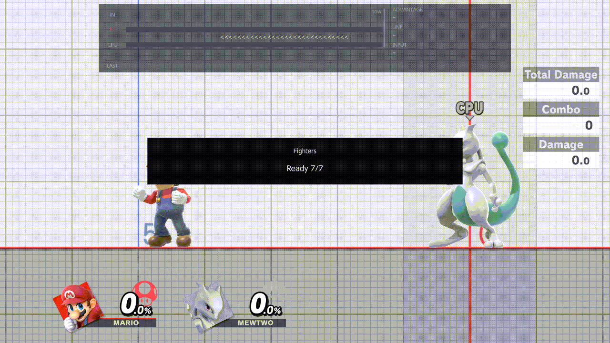
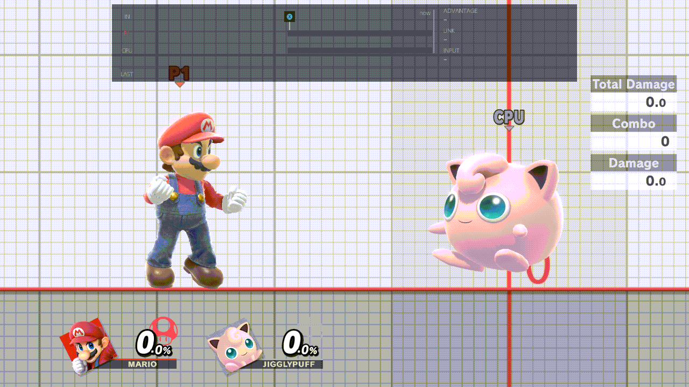

# Save states

A save state remembers where both fighters are, so one press takes you back there. This guide covers saving and
loading, the bound save and its files, what a save keeps, the load options, Auto-load on death and respawning, and the
setup library. The options are on the [Saves](../menu/saves.md) page.

## Saving and loading

| Chord | Default | What it does |
| --- | --- | --- |
| Save State Save | ZL + D-pad Down | Saves both fighters as they are now. |
| Save State Load | ZL + D-pad Up | Puts both fighters back where you saved. |

- **Save:** both fighters flash and the notice "Save State · Saved" appears. What was written is the
  [bound save](#the-bound-save).
- **Load:** both fighters vanish in a short burst and are back at the saved spots. There is no notice.
- Load only warps. It doesn't start a recording, and it stops one that is playing. A Load pressed while a load is still
  under way is ignored.
- Both need Saves › [Save States](../menu/saves.md#save-states) On. It is On by default.
- They work in Training, and in a waiting room while Fighters & Stages ›
  [Lobby Practice](../menu/fighters-and-stages.md#lobby-practice) is On.
- To change the buttons, see [Controls › Changing a chord](controls.md#changing-a-chord).

Every load uses the Saves page's options: [damage on load](#damage-on-load), [mirroring](#mirroring) and
[buffs](#buffs). The combo helper can also load the save after each attempt, to retry from the same spot: Recording ›
[After an attempt](../menu/recording.md#after-an-attempt).

## The bound save

The chords use one save at a time, the *bound* save:

- Save overwrites the bound save. With nothing bound, it makes a new save named Save 1 (or the lowest free number) and
  binds it.
- Load warps to the bound save. With nothing bound, it does nothing.

Every save state is a file in `sd:/ultimate/TrainingRooms/saves/`. They are listed under SAVE STATES on the Recording
page (Recording › [Save states & Macros](../menu/recording.md#save-states--macros)) and in the recording pop-up
(ZR + D-pad Right). The bound save is the green row, and the five you used last come first. The names you'll see:

- **Save N:** made by the Save chord when nothing was bound, or by Duplicate.
- **name · start:** the start save a recording writes for its macro, such as "Macro 1 · start". See
  [Recording › Recording a macro, and its start save](recording.md#recording-a-macro-and-its-start-save).
- **Slot N (YYYY-MM-DD):** a save from an older version's numbered slots. The first time this version started, each
  filled slot became a file named with its number and that day's date, and the slot the chords were using became the
  bound save. See [Recording › Migration of the old slots](recording.md#migration-of-the-old-slots).

To bind another save:

- In the pop-up, put the cursor on it and press A.
- On the Recording page, A opens the save's own screen. Its first row is Bind to Save / Load: A flips it, Right binds,
  Left unbinds. The screen also has Duplicate (a copy named Save N), Rename (up to 48 characters) and Delete. See
  [Recording › A file's own screen](recording.md#a-files-own-screen).

Deleting the bound save leaves nothing bound, so Load does nothing until you bind another save or press Save.

Play's warp to a macro's start save is separate: it neither uses nor changes the bound save.

## What a save keeps

For each fighter:

- where it stands and which way it faces;
- whether it was on the ground, in the air or hanging on the ledge (a ledge save puts it back on the ledge);
- its damage (a load uses it only when [damage on load](#damage-on-load) is Save State);
- its special-move charges, such as Samus's Charge Shot, Donkey Kong's Giant Punch, Mewtwo's Shadow Ball, Sheik's
  needles, Robin's tomes and Levin Sword, Olimar's Pikmin, Steve's materials and tools, and Kirby's copy ability;
- for Player 1, a held item such as a turnip or a bomb;
- the fighter and the stage, and for a Mii, the exact Mii.

A load doesn't change fighters or the stage. It puts whoever is playing at the saved spots, and the charges come back
only when the fighter is the one that was saved.

## Damage on load

Each fighter has its own row: Saves › [Player damage on load](../menu/saves.md#player-damage-on-load) and
[CPU damage on load](../menu/saves.md#cpu-damage-on-load).

| Value | Damage after a load |
| --- | --- |
| Default | 0%, as after a respawn. |
| Save State | The damage the fighter had when you saved. |
| Random Value | A random damage within that fighter's range: Player damage range or CPU damage range. |

- The ranges go from 0 to 150, and are 0 to 150 by default. A range row is greyed unless its damage row reads Random
  Value.
- Random Value draws a new damage on every load.
- With the defaults, every load puts both fighters at 0%, whatever the save holds.
- Play's warp to a macro's start save always uses the saved damage, whatever these rows say.

For example, to practise a kill confirm at around 100%, set CPU damage on load to Random Value and CPU damage range to
90 to 110.

## Mirroring

Saves › [Mirroring](../menu/saves.md#mirroring) flips a load left to right: each fighter lands at the mirror image of
its saved spot, across the middle of the stage, and faces the other way.

- **None** (the default): never flips.
- **Alternate:** flips every other load, starting with the first load after a Save.
- **Random:** flips each load by chance, one in two.

A restored setup is flipped the same way. Play's warp to a macro's start save is never flipped.

## Buffs

Saves › [Buffs on load](../menu/saves.md#buffs-on-load) gives character buffs right after each load, to Player 1 and to
the CPU alike: Hero's spells, Joker's Arsene, Wii Fit Trainer's Deep Breathing, Cloud's Limit, Little Mac's KO Punch,
Sephiroth's wing, Shulk's Monado Arts, Min Min's Power Dragon and Wario's waft. The menu doc's table lists what each one
does.

- Every ticked buff is given, except for Shulk and Wario: a fighter has one art or one waft at a time, so one of the
  ticked ones is picked at random on each load.
- A fighter that isn't in the list gets nothing.
- Buffs come with every load: the Load chord, Auto-load on death, a restored setup, and Play's warp to a macro's start
  save.

## Auto-load on death

With Saves › [Auto-load on death](../menu/saves.md#auto-load-on-death) On, when Player 1 or the CPU is KO'd, the bound
save loads at once, as if you had pressed Load: same spots, with the damage, mirroring and buffs options. Nobody
respawns. It is Off by default.

With nothing bound, Auto-load loads nothing, and the fighter respawns at once.

### Respawning

What happens after a KO depends on three rows: Saves › Save States, Saves › Auto-load on death and Fighters & Stages ›
[Respawn on platform](../menu/fighters-and-stages.md#respawn-on-platform).

| Save States | Auto-load on death | Respawn on platform | After a KO |
| --- | --- | --- | --- |
| On | Off | Off (the default) | The fighter respawns at once. |
| On | Off | On | The fighter comes down on the revival platform, with the game's invincibility. |
| On | On | greyed | The bound save loads. With nothing bound, the fighter respawns at once. |
| Off | any | any | The game's own respawn: in Training, the revival platform. |

While Auto-load on death is On, Respawn on platform is greyed with the reason "Auto-load on death is On: a save state
loads instead". Its value is kept, and counts again when you turn Auto-load off.

## The setup library

A setup is a named copy of a save state, together with the stage it was saved on. Setups live in their own library,
`sd:/ultimate/TrainingRooms/setups/`, apart from the save states: using one never changes a save file. Both rows are in
Saves › [Setup library](../menu/saves.md#setup-library).

### Naming a setup

1. Bind the save you want to keep, or press Save where you want it.
2. Open Saves › Save setup to library... and press A.
3. The keyboard opens with the name "Setup". Type a name of up to 48 characters and confirm.
4. The notice reads "Saved setup" and the name.

The setup holds what the Load chord would load at that moment: both fighters as saved, and the stage. Both fighters
must have been saved on the same stage, or the notice reads "Save both fighters in this slot on the same stage before
exporting" and nothing is kept. Each setup is a new file; one never overwrites another.

### Using a setup

Saves › Setup library lists each setup as "name · Player 1's fighter / the CPU's fighter". Choose one with Up / Down,
then:

- **A: bind and restore.** When you close the menu, both fighters go to the setup through an ordinary load, so damage
  on load, mirroring and buffs apply (with Default damage, both are at 0%; choose Save State to get the setup's
  damage). Afterwards the chords go back to your bound save: the next Load returns there.
- **Y: bind without restoring.** Nobody moves. The Load chord, and Auto-load on death, go to the setup until you press
  Save or bind another save.

Neither writes a save file. The choice waits for the menu to close, and a notice says so: "Setup will bind and restore
when the menu closes", or "Setup will bind when the menu closes".

A works only:

- with Save States On;
- on the stage the setup was saved on;
- with the same fighters on both sides, and for a Mii, the same Mii.

Otherwise a notice names the problem, for example "Restore this setup on its saved stage; Y can bind it without
moving". Y has none of these limits.
