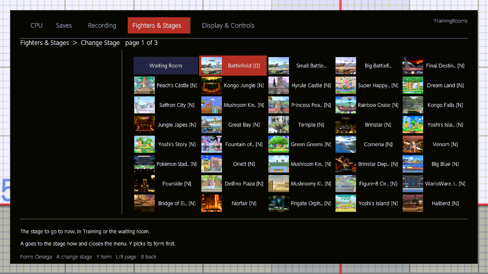

# Stages

Change stages from the menu, or choose a list for Training and waiting-room practice. The rows are on
Fighters & Stages.

<video src="https://git.syntaxbyexample.com/intpa/TrainingRoomsForUltimate/media/blob/e0de6dbeba09dd60aa5dc2ec3c5fbde73470d79a" autoplay muted loop playsinline controls></video>

*Fighters & Stages › Change Stage: the grid, Y for the Ω form, A on Battlefield. The stage is swapped and both fighters stand on Battlefield's Ω form. Eden, the diagnostic file of preview build `cc71537c`, 2026-11-27.* [Open the clip](../media/tut-stage-change.mp4)

## Change Stage

1. Open Fighters & Stages › [Change Stage](../menu/fighters-and-stages.md#change-stage) with A. L / R turn the grid's
   pages.
2. Move to a stage. Press Y to choose a form, then A to request it.
3. The menu closes. The notice says "Practice Stage · Stage requested", then "Stage ready" when it is up.

It works in Training and in a waiting room with [Lobby Practice](../menu/fighters-and-stages.md#lobby-practice) On. If
the stage cannot change, a notice says why. The selected stage also becomes the Direct stage of
[Lobby Stages](#lobby-stages).

## Stage forms

Most stages offer Normal, Omega and Battlefield, marked **[N]**, **[Ω]** and **[BF]** on the tile. Y steps through
the available forms; the footer names the selected form. Battlefield has Normal and Omega; Final Destination has
Normal and Battlefield. Small Battlefield, Big Battlefield, Waiting Room and Training have one form.

Each stage keeps one form, shared by Change Stage, Lobby Stages and Training Stage Rotation.

*Y on Battlefield chooses Omega. Eden, rc.13 (untested on hardware).*

## Custom stages

Stages made in Stage Builder appear after the game's stages in Change Stage and Lobby Stages, under their own names.
They have one form. You can pick one directly or add it to the rotation list.

Deleting a custom stage removes it from the grids and lists. If the Direct stage was deleted, the next room uses the
previous game stage, or the Waiting Room if there was none, and a notice names the missing custom stage. A custom
stage that cannot be read may fall back to a normal stage in rotation; on Change Stage the current stage stays.

## Lobby Stages

Fighters & Stages › [Lobby Stages](../menu/fighters-and-stages.md#lobby-stages) sets the list for waiting rooms, and
for Training when rotation is On. Press X in the grid to switch modes.

| | Rotation (default) | Direct |
| --- | --- | --- |
| A on a stage | Add it to the end of the numbered list, or remove it; the last stage stays. | Go there now; `>` marks the Direct stage. |
| A on All | Take every stage in game order; picking a stage afterwards starts a new list. | — |
| New waiting room | Opens on the next stage in the list. | Opens on the Direct stage. |

The default rotation list contains only the Waiting Room. The waiting rooms use it while Lobby Practice is On; local
wireless and Quickplay each keep their own place.

*A adds Battlefield to the rotation list.*

## Training Stage Rotation

Fighters & Stages › [Training Stage Rotation](../menu/fighters-and-stages.md#training-stage-rotation) starts Off.
Turn it On to follow the Lobby Stages Rotation list: Training first opens on the stage chosen at stage select, then
each return through character select opens the next stage on the list.

Training keeps its own place, separate from the waiting rooms, until the game closes. Choosing another stage at stage
select opens that stage without advancing the list. Change Stage goes directly to the chosen stage without advancing
it, too. Training follows the Rotation list even if Lobby Stages is in Direct mode.

*Training Stage Rotation: the stage pick first, then the next stage in the list. Eden, rc.13 (untested on hardware).*

## Stage Hazards

Fighters & Stages › [Stage Hazards](../menu/fighters-and-stages.md#stage-hazards) chooses whether hazards are On or
Off; the default is Off. A change applies when a stage loads, not immediately on the current stage. Change to another
stage to apply it now. With Lobby Practice On, a waiting room follows the setting when you enter it.

More: [Fighters & Stages](../menu/fighters-and-stages.md).
