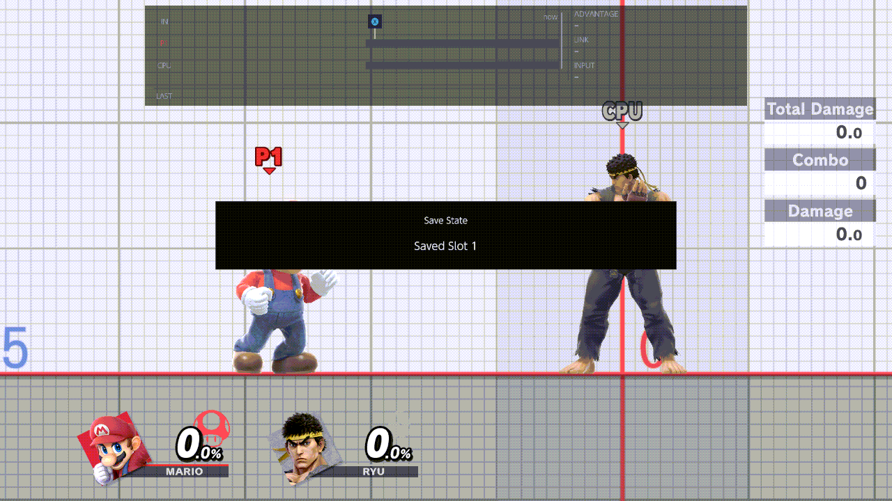
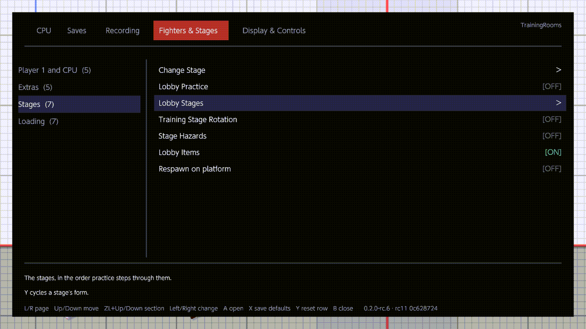
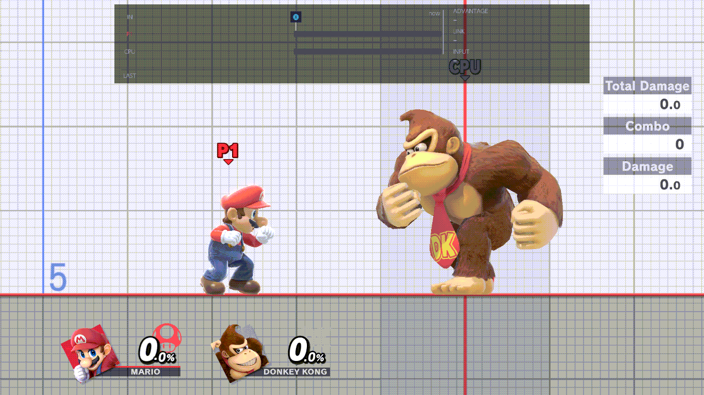

# Stages

Go to any stage from the menu, in Training or in a waiting room, or let Training and the waiting rooms move through a
list of stages you choose. All the rows are in Fighters & Stages › Stages.

## Change Stage

1. Open Fighters & Stages › [Change Stage](../menu/fighters-and-stages.md#change-stage) and press A. The grid shows
   every stage, the Waiting Room and Training included. L / R turn its page.
2. To pick a form, press Y on the stage until its tag shows the one you want (see [Stage forms](#stage-forms)).
3. Press A. The menu closes and the notice reads "Practice Stage · Stage requested", then "Stage ready" once the new
   stage is up.

It works in Training, and in a waiting room while Fighters & Stages ›
[Lobby Practice](../menu/fighters-and-stages.md#lobby-practice) is On. If the stage can't change, the notice says why,
for example "Stage unchanged: …". The stage you go to also becomes the Direct stage of [Lobby Stages](#lobby-stages).

## Stage forms

Most stages come in three forms, shown as a tag on the tile:

| Tag | Form |
| --- | --- |
| [N] | Normal |
| [Ω] | Omega |
| [BF] | Battlefield |

Y steps through the forms the game has for the stage under the cursor, and the footer names the one picked ("Form:
Omega"). Battlefield has Normal and Ω; Final Destination has Normal and BF. Small Battlefield, Big Battlefield, the
Waiting Room and Training have one form, and their tiles show no tag.

Each stage keeps one form. Change Stage, Lobby Stages and Training Stage Rotation all use it, so Y on either grid
changes it for both.

## Lobby Stages

Fighters & Stages › [Lobby Stages](../menu/fighters-and-stages.md#lobby-stages) is the list the waiting rooms, and
Training with rotation On, move through. It has two modes; X switches between them.

**Rotation** (the default):

- A on a stage adds it at the end of the list, or takes it out. Its number on the tile is its place. The last stage
  stays.
- A on All takes every stage, in the game's order. A stage you pick after that starts a new list with just it.
- The list starts as the Waiting Room only.
- Each new waiting room opens on the next stage of the list. A change applies from the next room.

**Direct:**

- "> " marks the Direct stage. A on a stage goes there now and closes the menu, as Change Stage does.
- Every new waiting room opens on the Direct stage instead of the list.

The waiting rooms use this list only while Lobby Practice is On. Local wireless rooms and Quickplay each keep their own
place in the list.

## Training Stage Rotation

With Fighters & Stages › [Training Stage Rotation](../menu/fighters-and-stages.md#training-stage-rotation) On, each
time you enter Training from the character select, Training opens on the next stage of the Lobby Stages list. It is
Off by default: Training then opens on the stage you chose, as usual.

- It always follows the Rotation list, even while Lobby Stages is on Direct.
- Training keeps its own place in the list, apart from the waiting rooms, until you close the game.
- With the default list (the Waiting Room only), Training opens on the Waiting Room. Add stages first.
- A Change Stage in Training goes to that stage without moving your place in the list.

## Stage Hazards

Training loads stages with their hazards on, as it has no rules screen.
Fighters & Stages › [Stage Hazards](../menu/fighters-and-stages.md#stage-hazards) decides instead: On keeps the
hazards, Off (the default) turns them off.

- It takes effect when a stage loads: when you enter Training, or go to a stage with Change Stage. The stage you are
  on keeps its hazards until then: to apply a change now, Change Stage to another stage.
- With Lobby Practice On, the waiting room's stage follows it too, from the moment you enter the room.
