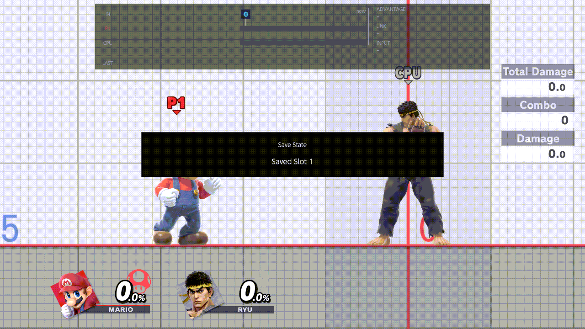
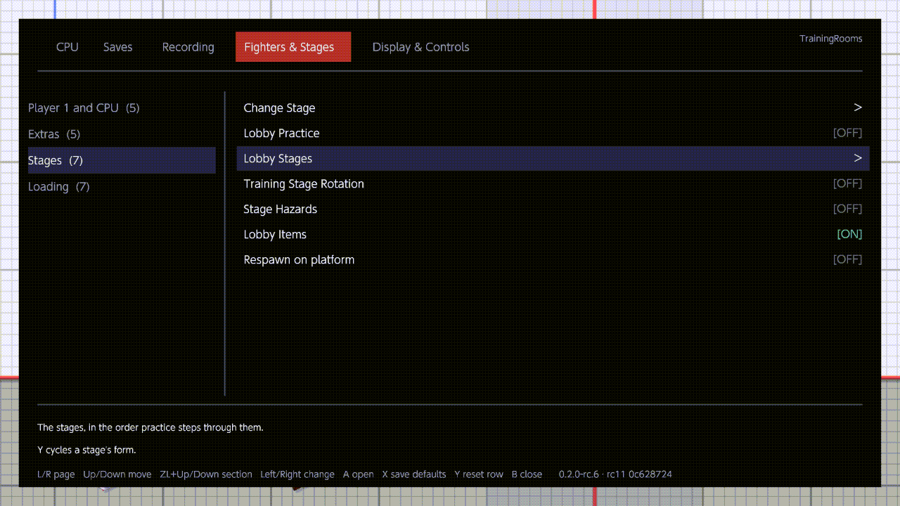
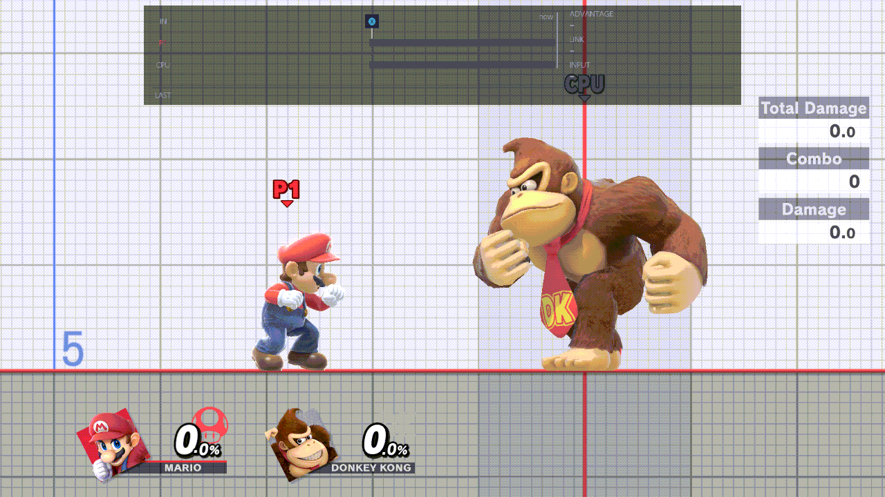
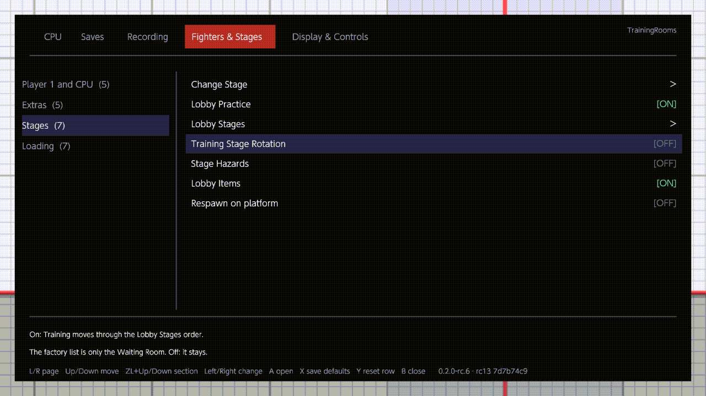

# Stages

Go to any stage from the menu, in Training or in a waiting room, or let Training and the waiting rooms move through a
list of stages you choose. All the rows are in Fighters & Stages › Stages.

*A on Battlefield (Ω) closes the menu ("Stage requested"); then the whole morph to Battlefield Ω and "Stage ready". The 3 s wait between them, where nothing moves, is cut. Eden, rc.11.*

## Change Stage

1. Open Fighters & Stages › [Change Stage](../menu/fighters-and-stages.md#change-stage) and press A. The grid shows
   every stage, the Waiting Room and Training included. L / R turn its page.
2. To pick a form, press Y on the stage until its tag shows the one you want (see [Stage forms](#stage-forms)).
3. Press A. The menu closes and the notice reads "Practice Stage · Stage requested", then "Stage ready" once the new
   stage is up.

It works in Training, and in a waiting room while Fighters & Stages ›
[Lobby Practice](../menu/fighters-and-stages.md#lobby-practice) is On. If the stage can't change, the notice says why,
for example "Stage unchanged: …". The stage you go to also becomes the Direct stage of [Lobby Stages](#lobby-stages).

## Stage forms

Most stages come in three forms, shown as a tag on the tile:

| Tag | Form |
| --- | --- |
| [N] | Normal |
| [Ω] | Omega |
| [BF] | Battlefield |

Y steps through the forms the game has for the stage under the cursor, and the footer names the one picked ("Form:
Omega"). Battlefield has Normal and Ω; Final Destination has Normal and BF. Small Battlefield, Big Battlefield, the
Waiting Room and Training have one form, and their tiles show no tag.

Each stage keeps one form. Change Stage, Lobby Stages and Training Stage Rotation all use it, so Y on either grid
changes it for both.

![The Change Stage grid with Battlefield on its Omega form: the tile reads [Ω] and the footer reads Form: Omega](../media/rc13-stage-forms.png) 
*Y on Battlefield: the tile reads [Ω] and the footer "Form: Omega". Eden, rc.13 (untested on hardware).*

![Change Stage on Battlefield [N] loads it with its platforms; Y to Omega and A loads the same stage flat](../media/rc13-stage-forms.gif) 
*The same stage, two forms. A on Battlefield [N] loads it with its platforms; Y changes the tile to [Ω] and A loads it flat (both loads are cut). Each press is named in a box. Eden, rc.13 (untested on hardware).*

## Custom stages

The stages you made in Stage Builder are in the lists too. Each one is a tile after the game's stages, on Change Stage
and on Lobby Stages, under the name you gave it. Make three, and the grids end with three more tiles.

- **Change Stage** goes to one in Training or in a waiting room, like any other stage.
- **Lobby Stages** can put them in the list, so waiting rooms, and Training with rotation On, move through them too.
  In Direct, A on one goes there now.
- A custom stage has one form: Y does nothing on its tile.
- **Deleted in Stage Builder:** the stage leaves every grid and every list you kept. The next stages move up to close
  the gap.
- If your Direct stage was a custom stage you deleted, the next room opens on the game stage you had as Direct before
  it (the Waiting Room if none), and the notice reads "Custom stage missing: ‹its name›".
- The game reads a custom stage from your save when it is needed. Change Stage waits a moment for it. Training Stage
  Rotation and the waiting rooms read the next one while you practice, so the first entry after the game starts can
  open a normal stage with the notice, and the next one opens the custom stage.
- If a custom stage can't be loaded right then (for example while the game is saving), you get that notice too, and a
  normal stage opens instead. On Change Stage the stage on screen stays.

## Lobby Stages

Fighters & Stages › [Lobby Stages](../menu/fighters-and-stages.md#lobby-stages) is the list the waiting rooms, and
Training with rotation On, move through. It has two modes; X switches between them.

| | Rotation (the default) | Direct |
| --- | --- | --- |
| A on a stage | Adds it at the end of the list, or takes it out. Its number on the tile is its place. The last stage stays. | Goes there now and closes the menu, as Change Stage does. "> " marks the Direct stage. |
| A on All | Takes every stage, in the game's order. A stage you pick after that starts a new list with just it. | |
| A new waiting room | Opens on the next stage of the list. The list starts as the Waiting Room only, and a change applies from the next room. | Opens on the Direct stage instead of the list. |

<!-- CAPTURE-REQUEST v06-lobby-stages-modes: a clip of Rotation versus Direct in a waiting room (see Fighters & Stages › Lobby Stages); the same clip goes here. See artifacts/docs4/CAPTURE-REQUESTS.md. -->
The waiting rooms use this list only while Lobby Practice is On. Local wireless rooms and Quickplay each keep their own
place in the list.

## Training Stage Rotation

With Fighters & Stages › [Training Stage Rotation](../menu/fighters-and-stages.md#training-stage-rotation) On,
Training first opens on the stage you pick before the character select. Each time you go back to the character select
and enter again, it opens on the next stage of the Lobby Stages list. It is Off by default: Training then always opens
on the stage you chose, as usual.

- Going back to the stage select and picking another stage opens Training on that stage. Your place in the list
  doesn't move.
- It always follows the Rotation list, even while Lobby Stages is on Direct.
- Training keeps its own place in the list, apart from the waiting rooms, until you close the game.
- With the default list (the Waiting Room only), each return opens on the Waiting Room. Add stages first.
- A Change Stage in Training goes to that stage without moving your place in the list.

 *The stage you pick opens Training first; each return through the character select rotates. Eden, rc.13 (untested on hardware).*

## Stage Hazards

Training loads stages with their hazards on, as it has no rules screen.
Fighters & Stages › [Stage Hazards](../menu/fighters-and-stages.md#stage-hazards) decides instead: On keeps the
hazards, Off (the default) turns them off.

- It takes effect when a stage loads: when you enter Training, or go to a stage with Change Stage. The stage you are
  on keeps its hazards until then: to apply a change now, Change Stage to another stage.
- With Lobby Practice On, the waiting room's stage follows it too, from the moment you enter the room.
