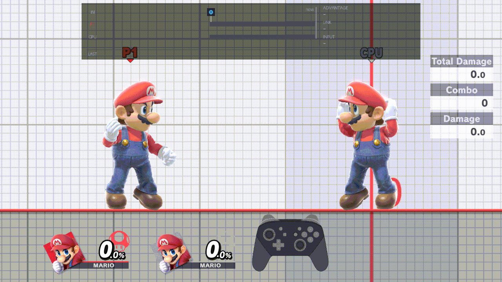
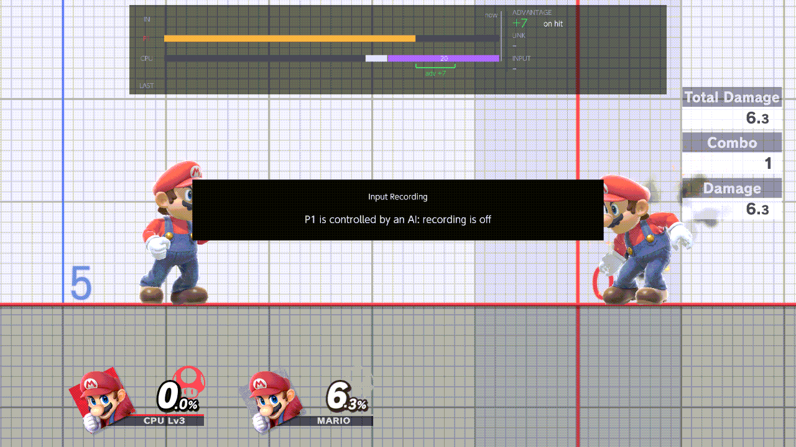
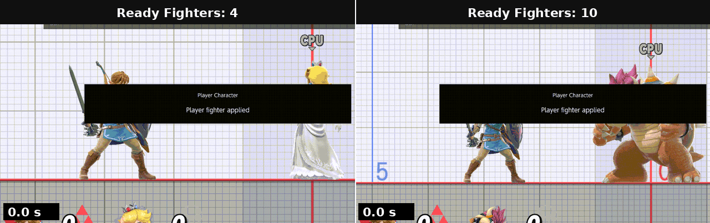

# Troubleshooting

Find what you see below, then read why it happens and what to do. Everything here comes from how the plugin behaves,
as the docs and the code describe it; the current release is untested on hardware ([Current
release](../CURRENT-RELEASE.md)). New here? [Getting started](getting-started.md) comes first.

- [The plugin does nothing, or the game acts up after installing](#the-plugin-does-nothing-or-the-game-acts-up-after-installing)
- [The menu does not open](#the-menu-does-not-open)
- [A chord or a button does nothing](#a-chord-or-a-button-does-nothing)
- [A row is greyed](#a-row-is-greyed)
- [A notice says no](#a-notice-says-no)
- [Fighters load slowly, or the notice says "waiting for memory"](#fighters-load-slowly-or-the-notice-says-waiting-for-memory)
- [Waiting rooms](#waiting-rooms)
- [Settings look wrong or went missing](#settings-look-wrong-or-went-missing)
- [Where the logs are, and what to send](#where-the-logs-are-and-what-to-send)

## The plugin does nothing, or the game acts up after installing

**First, look at the install line.** Every start, the plugin writes one line to `sd:/ultimate/TrainingRooms/events.log`.
It starts with the milliseconds since the console booted, and it looks like this (the middle is cut here):

```text
48213 plugin=training_rooms/0.2.0-rc.6 game=13.0.5 build=21450c64… … result=installed heap_allocations=0
```

| What the line says | Why | What to do |
| --- | --- | --- |
| `result=installed` | The plugin loaded and put its hooks in. | The install is fine. If one thing is missing, see the next rows and the rest of this page. |
| `result=unsupported_version`, with `game=` followed by another version | The plugin works on game version 13.0.5 and installs nothing on any other. | Use game version 13.0.5. |
| `cpu_common=not_installed reason=no_nro_hook` | `libnro_hook.nro` isn't on the card. Without it the CPU's DI, tech and out-of-shield options are missing. | Copy `libnro_hook.nro` next to `libtraining_rooms.nro` ([Getting started › Installing](getting-started.md#installing)). |
| `<name>=not_installed reason=site:<place>` | A place in the game that this feature needs didn't match what the build expects, so the plugin left the feature out and installed the rest. | Report it, with the line ([what to send](#where-the-logs-are-and-what-to-send)). |
| No new line for your last start, or no file | Only the plugin writes that line, so it probably wasn't loaded. | Check that the three plugin files are in `atmosphere/contents/01006A800016E000/romfs/skyline/plugins/` and that Skyline is set up for Smash Ultimate 13.0.5. |

**The game crashes, or acts strangely, once TrainingRooms is installed.**

- *Why:* if `libtraining_modpack.nro` (the Training Modpack's plugin) is on the card too, the two can't run together.
  TrainingRooms doesn't check for it, so nothing warns you.
- *What to do:* remove `libtraining_modpack.nro`.
- Version 0.1.0 crashes when the console boots; use a newer build ([Current release](../CURRENT-RELEASE.md)).
- Still crashing? [What to send](#where-the-logs-are-and-what-to-send). If the plugin itself panics, the panic is written
  to the diagnostics file and the Skyline log; there is no pop-up.

## The menu does not open

The menu opens with **B + D-pad Up**: hold B, then press Up. **Minus** opens it too, until you change Menu shortcut 1.
Check these in order:

1. **Are you in Training?** The menu opens in Training, and in a waiting room only while Fighters & Stages › Lobby
   Practice is On. It is Off at first; while it is Off, the waiting rooms are left to the game. It doesn't open
   elsewhere.
2. **Is another menu open?** The menu doesn't open over the game's pause menu, and chords don't fire while the game's own
   menu or the waiting room's menu is open. Close it first.
3. **Did you hold B first?** Hold one button of a chord, then press the others. A chord fires once per press and holding
   it doesn't repeat, so let go of everything and press it again.
4. **Are you on a GameCube controller?** It has no Minus. Use B + D-pad Up.
5. **Did you change Menu shortcut 1?** Then Minus no longer opens the menu. B + D-pad Up always does: it can't be changed
   or turned off. The two shortcuts are kept in `sd:/ultimate/TrainingRooms/button_config.ini`, and a value that can't be
   read goes back to that shortcut's default.
6. **Another plugin on the same buttons?** Online Deluxe's window doesn't stop this menu from opening: B + D-pad Up and
   your shortcuts always work. But a press that two plugins both react to can look like a fault. rc.9 fixed several of
   those and shipped beside new builds of Online Deluxe (0.10.5), the CPU pilot (0.2.4) and imgui_smash (1.0.2): see
   [the rc.9 notes](../RELEASE-NOTES-rc9.md). If you use an older version of one of them, update it.

Still nothing? Look at the [install line](#the-plugin-does-nothing-or-the-game-acts-up-after-installing).

<br>
*B + D-pad Up opens the menu. Eden, rc.11.*

## A chord or a button does nothing

| You pressed | Why it may do nothing | What to do |
| --- | --- | --- |
| Cycle Player (ZL + D-pad Right) | Fighters & Stages › Player Swapping is Off at first. While it is Off the chord does nothing, and there is no notice. | Turn Player Swapping On. Cycle CPU (ZL + D-pad Left) always works. |
| Save State or Load State | Saves › Save States is Off. The notice says so. | Turn Save States On. |
| Any chord | The TrainingRooms menu, the game's pause menu, the waiting room's menu or the Recording pop-up is open. | Close it (B closes the pop-up and the menu). |
| A D-pad chord, while Online Deluxe's window shows a page with rows | Online Deluxe uses those buttons itself, so the chord waits. | Hide Online Deluxe's window with L + R + D-pad Down. See [Controls › Online Deluxe](controls.md#online-deluxe). |
| A chord with ZL or ZR on a GameCube controller, with both triggers held | Both triggers are Online Deluxe's L + R, so no ZL or ZR chord fires. | Hold one trigger only. |
| Kirby's hat click | Hold B with the left stick at rest, then click the left stick (the right stick for the CPU's Kirby). Nothing happens during a fighter swap, a save-state load, a recording or a playback, or while a menu is open. | See [Fighter cycles › Kirby hats](fighter-cycles.md#kirby-hats). |
| Hitbox Visualization draws nothing | It starts with nothing ticked. | Open Display & Controls › Hitbox Visualization and tick what you want ([the page](../menu/display-and-controls.md#hitbox-visualization)). |
| The input display (frame strip) is gone | R + D-pad Down turns it off, and it steps aside while the TrainingRooms menu or a waiting room's own menu is open. | Press R + D-pad Down, or close the menu. |

One press doing two things is a different case: the chord editor doesn't stop two rows from sharing a chord, and then both
actions happen. Change one of them in Display & Controls › Button chords
([Controls › Changing a chord](controls.md#changing-a-chord)).

## A row is greyed

A greyed row is dimmed and ignores A, and the menu shows why. These are the reasons it gives:

| The reason shown | What it means |
| --- | --- |
| "Auto-load on death is On: a save state loads instead" | Respawn on platform can't be changed while Saves › Auto-load on death is On. |
| "Only used when damage on load is Random Value" | A damage range counts only when its damage setting reads Random Value. |
| "Group Swap is Off" | A swap group needs Fighters & Stages › Loading › Group Swap On. |
| "Ice Climbers pair bank is Off" | The pair groups need the Ice Climbers pair bank On. |
| "Needs Ready Fighter Bodies set to 3" | The Ice Climbers pair bank needs Ready Fighter Bodies at 3. |
| "A range is set: clear it first (Y)" | A delay row holds a range, so its checklist is greyed. Y clears the range. |
| "Values are ticked: clear them first (Y)" | A delay row holds ticked values, so its range is greyed. Y clears the ticks. |
| "Not in a waiting room yet" | Hide CPU works in Training only. In a waiting room its row is greyed and does nothing. |
| "Targets stay still" | Target speed does nothing while Break the Targets is On: the targets don't move. |

More: [Using the menu](using-the-menu.md).

## A notice says no

A press that can't happen shows a notice that says why. The texts below are exact. First, swapping fighters and
loading lists:

| The notice | Why | What to do |
| --- | --- | --- |
| "Wait for the character swap to finish" | A fighter swap is still running. | Wait, then press again. |
| "Close the current game menu before swapping" | The game's own menu is open. | Close it. |
| "Use different mappings for player and CPU" | Both cycle chords came in at once. | Press one. |
| "Select a Kirby hat first" | Your Kirby Hats list is empty. | Add a hat in Fighters & Stages › Kirby Hats. |
| "Kirby hat could not be loaded" | A hat didn't load within about 15 seconds. | Try again. |
| "Wait for the practice fighters to finish loading" | The combo list, the setup list and Break the Targets' Saved layouts open only once the practice fighters have loaded. | Open it again in a moment. |

Save states, recording and practice games:

| The notice | Why | What to do |
| --- | --- | --- |
| "Save States is Off (Saves page)" | A Save or Load chord while Saves › Save States is Off. | Turn it On. |
| "Nothing is saved here yet: Save first, or bind a save" | Load with nothing saved or bound. | Save first (ZL + D-pad Down). |
| "A load is already being placed" | A load, setup, preview or Play warp is being placed, and the press would cut it. | Press again when it is done. |
| "A setup is being placed: save again after it" (or "load again after it") | The same. | Press again when it is done. |
| "A CPU drives Player 1: take Player 1 back to load" | Load takes Player 1's own body, and the game's own CPU drives Player 1. | Take Player 1 back from the CPU. |
| "Online Deluxe's open page uses this button: close it to save" (or "to load") | A chord on a D-pad button that Online Deluxe's open page uses. | Hide Online Deluxe's window (L + R + D-pad Down), or move the chord. |
| "Both triggers are Online Deluxe's L + R: hold one of them" | A GameCube controller with both triggers held. | Hold one. |
| "Save states have not started in this match yet" | The save-state step's game values aren't ready at the start of a match. | Try again a little later. |
| "This Playback Slot is empty: pick its macro on the Recording page" | The CPU picked a Playback Slot that no macro fills. | Pick a macro for the slot on the Recording page. |
| "P1 is controlled by an AI: recording is off", "P1 is controlled by an AI: Play on Player 1 is off" and "P1 is controlled by an AI: Quick Reset is off" | An AI, such as the standalone CPU pilot, plays Player 1. | They work again when it stops: [Controls](controls.md#when-the-cpu-pilot-plays-player-1). |
| "The CPU is hidden: turn Hide CPU Off first" | Play on CPU feeds the CPU's controller, and a hidden CPU takes no action. | Turn Hide CPU Off (CPU page). |
| "The CPU is hidden during this game" | The same, because a practice game hides the CPU. | Set Fighters & Stages › CPU during a game to Show, or turn the practice game Off. |
| "Preview fighter is not available" | The fighter of a replay capture isn't one the roster can load, so there is nothing to preview or switch to. | Nothing to fix. |
| "Recorded Mii metadata is unavailable" | The capture's Mii couldn't be found, so Switch can't load that exact Mii. | Choose Keep: it still plays the inputs. |
| "Could not save button_config.ini" | The menu shortcuts file couldn't be written. | The change lasts until you close the game. |

<br>
*While the CPU pilot plays Player 1, Record shows "P1 is controlled by an AI: recording is off". Eden, rc.13 (untested on hardware).*

A Mii tile whose help line reads "… - unavailable" is greyed: the role has no Mii of that class it can load ([Mii
fighters](mii.md)). Every refusal with the reason it was added: [Restrictions](../RESTRICTIONS.md).

## Fighters load slowly, or the notice says "waiting for memory"

Loading a fighter from scratch takes a moment and stops the game. So TrainingRooms loads your cycle fighters and Kirby's
hats ahead of time, in the background. The notice "Fighters" counts them:

| The notice | What it means | What to do |
| --- | --- | --- |
| "Loading 6/10", then "Ready 10/10" (or "All loaded") | Loading, then everything is there. | Wait for it to finish. |
| "Swap once to load", "Swap P1 once to load", "Swap the CPU once to load", "Swap both once to load" | That role's first swap starts the loading. | Swap once. |
| "Loaded 7/10 · swap to load 3 more" | The rest load after the next swap. | Swap once more. |
| "(2 waiting for memory)" or "(2 waiting for pool space)" | Some fighters are held until there is room, then load. They are not failed. | If it keeps saying so, lower Ready Fighters or Ready Hats. |
| "Paused" | Loading waits while something else, such as a swap or a save-state load, needs the game. | Wait. |

If swaps are slow, look at Fighters & Stages › Loading (collapsed: A on its header opens it):

- **Cycle Preload** Off loads each swap's fighter when you press, which takes longer. The default is 5.
- **Ready Fighters** is the most fighters kept loaded (default 10). If a cycle has more fighters than that, the ones that
  fit stay loaded and the others load when you swap to them, so that swap takes a moment.
- **Lowering Ready Fighters or Ready Hats** uses less memory, at the cost of slower swaps.

<br>
*Ready Fighters at 4 and at 10. Eden, rc.12.*

More: [Fighter cycles › What the Loading rows do](fighter-cycles.md#what-the-loading-rows-do).

## Waiting rooms

- **The menu and the chords do nothing in a waiting room.** Fighters & Stages › Lobby Practice is Off at first, and while
  it is Off TrainingRooms leaves the waiting rooms to the game. Turn it On in Training, before you look for a match.
- **The practice stops when the match starts.** Nothing of it is carried into the match: the speed is back to x1, the
  partners' level isn't applied, and the match is played with the fighters you picked for it. If the menu was open, it
  closes, and the changes from that visit are not kept. Back in the same room after the match, your practice fighters
  and Kirby's hat return.
- **The name keyboard doesn't open in Quickplay's room.** The next combo or recording you save there gets a numbered name,
  such as "Combo 3" ("The next combo gets a Combo N name"). Rename it later in Training. Local wireless rooms open the
  keyboard.
- **Plus doesn't open the game's menu in a Quickplay room.** While the TrainingRooms menu is open, Plus doesn't reach the
  game. Close the menu (B), then open the game's menu to Leave Battle.
- **A fighter swap says "Close the current game menu before swapping".** The game's own menu is open. Close it.
- **Hide CPU is greyed** ("Not in a waiting room yet"), and Eggs-ercise shows its targets on your own screen only.
- **While the CPU pilot plays Player 1,** Record, Play on Player 1 and L + R + A are refused.

More: [Waiting rooms](waiting-rooms.md).

## Settings look wrong or went missing

- **A row isn't what you set.** Y puts the row back to your saved default. *Reset page to defaults*, the last line of every
  page, does it for the page. X saves every setting as your defaults. See [Using the menu › Your
  defaults](using-the-menu.md#your-defaults).
- **A settings file that doesn't read cleanly** (not valid JSON, a bad field, a repeated key). The plugin first keeps the
  untouched original as `settings.invalid-1.json` (the number goes up each time), then rewrites `settings.json` with what
  could be read: each bad field goes back to its default, and the other fields load.
- **Settings from the Training Modpack didn't come over.** They are copied once, on the first start, and
  `sd:/ultimate/TrainingRooms/migration.json` marks it done. Delete that file to import again.

## Where the logs are, and what to send

Both logs are in `sd:/ultimate/TrainingRooms/` on the SD card:

| File | What is in it |
| --- | --- |
| `events.log` | The install line, one per start: the plugin version, the game version, which features installed, and the result. |
| `practice-diagnostics.log`, and `practice-diagnostics.previous.log` | Short lines about what the plugin did (fighter loading, saves, imports and so on). Each start begins a new `practice-diagnostics.log` and moves the old one to `practice-diagnostics.previous.log`; a file that reaches 128 KiB rotates the same way. |

The install line also goes to the Skyline log.

Because each start moves the last run's diagnostics to the `.previous` file, a second start would push a crashed run's
lines out. Copy both files off the card before you start the game again.

When you report a problem, send:

1. What you were doing, what you expected and what happened, and the **notice** on screen if there was one, word for word.
2. The **build tag**: the end of the key hints on any menu page ([Getting started › Which build you
   have](getting-started.md#which-build-you-have)).
3. `events.log`, and the two `practice-diagnostics` files.
4. The game version (the install line shows `game=`) and which other plugins are in the plugins folder.
