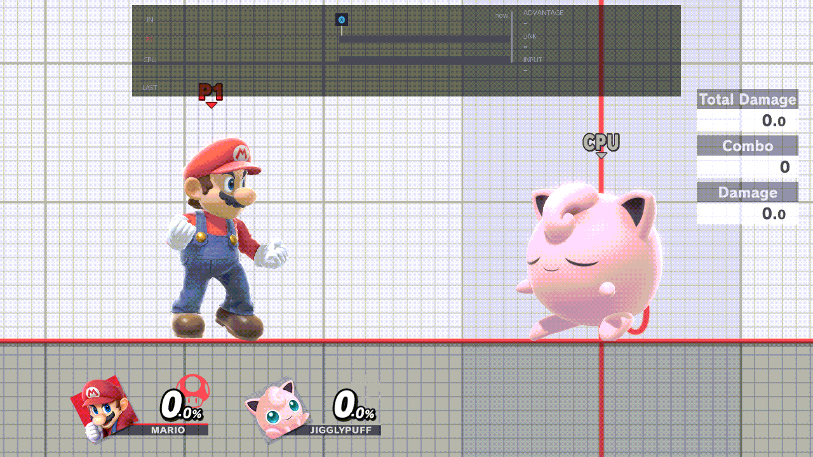
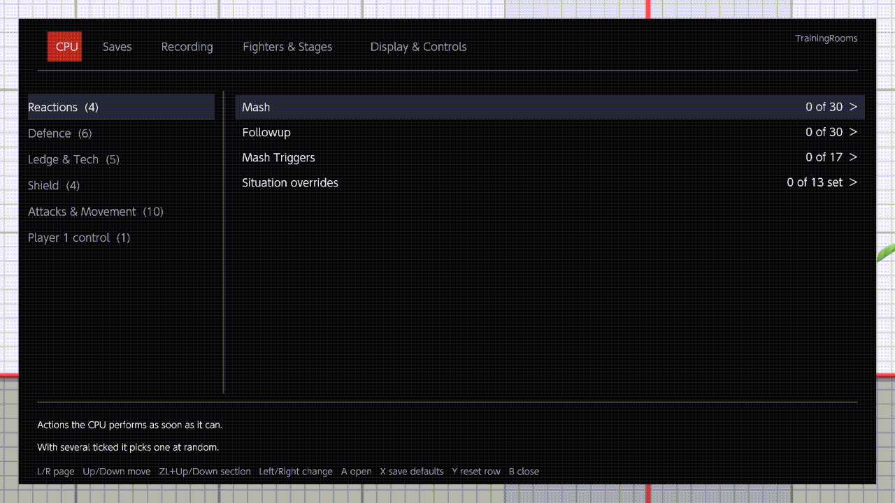

# Using the menu

Every TrainingRooms setting is in one menu with five pages. This page explains how to open it, move around it and
change a row. What each row does is on the page's own doc, linked below.

<!-- reshoot: rc7-menu-tour.gif -->


## Opening and closing

- **B + D-pad Up** opens the menu: hold B, then press Up. It always works and can't be changed.
- **Minus** opens it too, unless you changed Menu shortcut 1. You can set up to two shortcuts of your own
  ([Controls › Opening the menu](controls.md#opening-the-menu)).
- The menu opens in Training, and in a waiting room while Fighters & Stages ›
  [Lobby Practice](../menu/fighters-and-stages.md#lobby-practice) is On. It doesn't open over the game's pause menu.
- While it is open, your buttons go to the menu, the frame strip steps aside, and in Training the game's HUD hides.
- **B** closes it. Inside a list or an editor, B goes back one step first.
- Your changes take effect when you close the menu with B. If the menu is closed for you instead (a match starts, or
  you leave Training), the changes from that visit are not kept.

## The pages

| Page | What it sets |
| --- | --- |
| [CPU](../menu/cpu.md) | How the CPU reacts, defends, recovers, shields and attacks, and its level. |
| [Saves](../menu/saves.md) | Save states and the setup library. |
| [Recording](../menu/recording.md) | Recordings, combos, replays and playback options. |
| [Fighters & Stages](../menu/fighters-and-stages.md) | Fighters, cycles, Kirby hats, Miis, stages, waiting rooms. |
| [Display & Controls](../menu/display-and-controls.md) | What's on screen, and the buttons. |

**L** and **R** turn the page. The pages wrap around, so L on the CPU page goes to Display & Controls. The menu opens on
the page you used last.

There is a sixth page, Developer, for testing the plugin. It stays hidden unless
`sd:/ultimate/TrainingRooms/developer.ini` has the line `developer_page=on` when the game starts. Its rows are
described in [TECHNICAL.md](../TECHNICAL.md).

## Moving around

- **Up / Down** move one row. They wrap from the bottom of the page to the top. The left or right stick works too, and
  holding it keeps moving.
- **ZL + Up / Down** jump to the next or previous section (the first row of each group). They stop at the first and
  last section instead of wrapping.
- A section tagged *advanced* (Loading, on Fighters & Stages) is collapsed. A on its header opens or closes it.
- A greyed row can't be changed until the row it depends on changes.
- Two help lines describe the row you are on, and the footer lists the keys:

```text
L/R page   Up/Down move   ZL+Up/Down section   Left/Right change   A open   X save defaults   Y reset row   B close
```



## Changing a row

Each row has one kind of control. A list, checklist or editor has its own footer with its buttons.

- **Toggle** (On or Off): A flips it.
- **List** (one value): Left / Right step through the values and wrap around. A opens the list: Up / Down choose,
  A sets, B goes back.
- **Yes / No / Random**: works like a list. Random picks Yes or No again each time.
- **Number**: Left / Right step it and stop at the ends. A opens the list.
- **Checklist** (shows how many are ticked): A opens it. A ticks or unticks, ZL ticks all (or none when all are
  ticked), B goes back. On most CPU rows, with several ticked the CPU picks one at random each time. The help line
  says when every ticked entry counts instead (Mash Triggers, Buffs on load).
- **Checklist and range** (the delay rows): A opens it. Tick values, or move past them to the Min and Max handles
  instead: A picks a handle up, Up / Down move it ten values, Left / Right one, A puts it down. While one of the two
  holds a value the other is greyed. Y clears the one in use.
- **Slider** (the damage ranges): Left / Right choose the lower or the upper handle, A picks it up, Up / Down move it
  by 10, Left / Right by 1, A puts it down. The lower stays at or below the upper. The slider is greyed unless the list
  above it reads Random Value.
- **Direction chips**: a 3 × 3 grid around the opponent, plus Left and Right. The D-pad moves. Each A adds one to a
  chip's weight (up to 5, then it clears), Y clears a chip, ZL selects all or none. A heavier chip is picked more
  often. In and Out are relative to you. Shield Tilt takes one chip only.
- **Editor** (a summary and `>`): A opens a screen of its own, such as a portrait grid, a stage list, a library or the
  chord editor.
- **Info**: read-only text.

More on how the CPU uses checklists, ranges and chips: [CPU behaviour](cpu-behaviour.md).

## Your defaults

- **X** saves every current setting, on every page, as your defaults.
- **Y** puts the row you are on back to your saved default. Until you first press X, that is the plugin's own default.
  On a row that opens an editor (Button chords, Situation overrides, Character Cycles…), Y resets everything in it.
- **Reset page to defaults** is the last line of every page. A on it asks "Reset this page to your saved defaults?":
  A resets, B cancels. Only that page changes. The menu shortcuts stay as they are.

The Recording page uses some of these buttons for its own lists: there X and Y don't save or reset, and ZR switches
between the Player and CPU views. See [Recording](../menu/recording.md).

## Where it reopens

The menu reopens where you left it: the same page, the same row on every page, the same sections open, and a list or
checklist you left open. The chord editor, the portrait and stage grids and the other editors don't reopen; their row
is selected instead. This lasts until you close the game. After a restart the menu opens on the page you used last.
