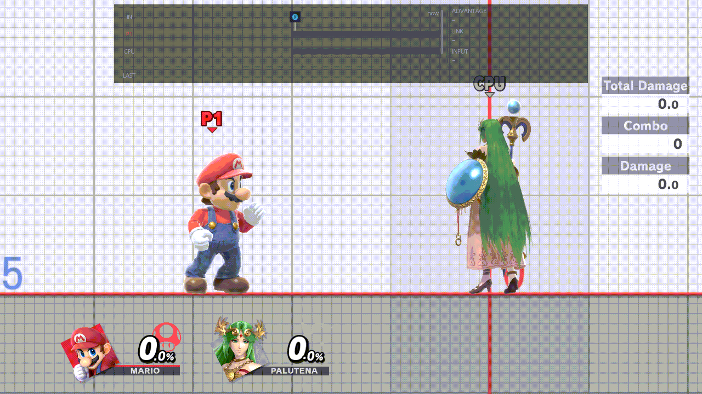
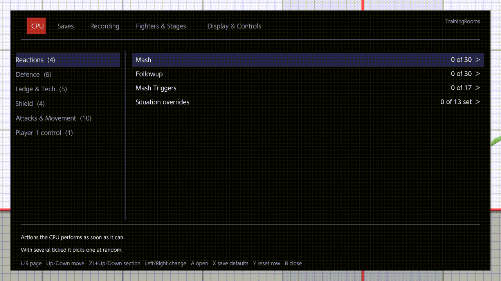
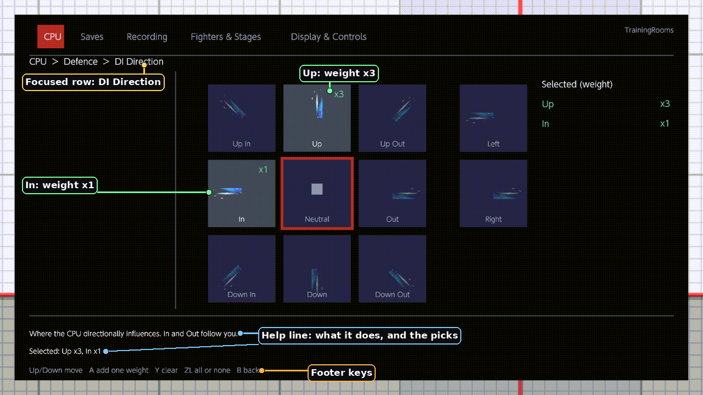
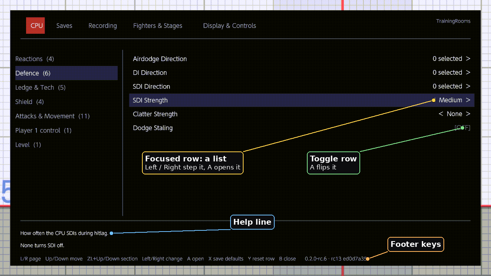
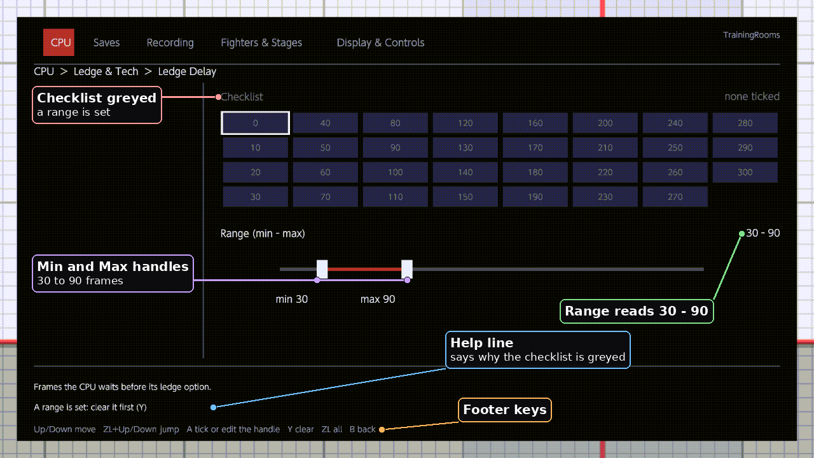
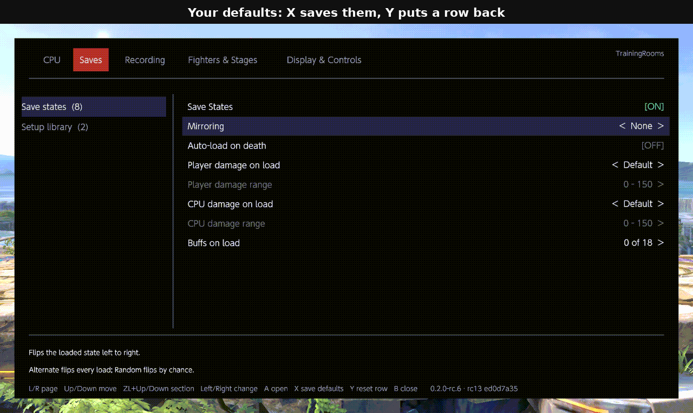
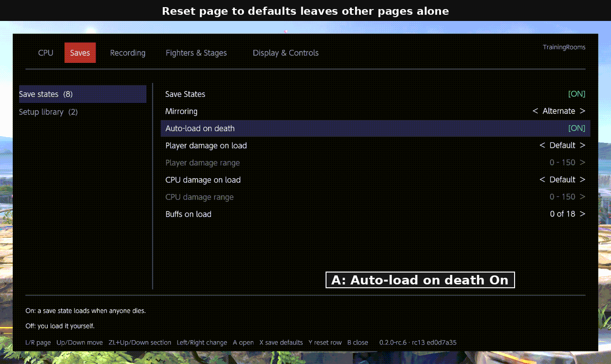

# Using the menu

Every TrainingRooms setting is in one menu with five pages. This page explains how to open it, move around it and
change a row. What each row does is on the page's own doc, linked below.

<br>
*The five pages in order; on Display & Controls, Hitbox Visualization opens a checklist: A ticks a row, Down moves, B goes back. Eden, rc.14 (untested on hardware).*

Hitbox Visualization has one colour scheme: red and pink attacks, purple grabs, grey normal hurtboxes, yellow hurtboxes that cannot be hit, green hurtboxes that take no damage, sky-blue windboxes, olive wind areas and white direction lines. Open its checklist with **A** to read the aligned colour key; tick only the families you want. The older menu-tour GIF above predates this palette. [The colour table](../menu/display-and-controls.md#hitbox-visualization) explains each one.

## Opening and closing

- **B + D-pad Up** opens the menu: hold B, then press Up. It always works and can't be changed.
- **Minus** opens it too, unless you changed Menu shortcut 1. You can set up to two shortcuts of your own
  ([Controls › Opening the menu](controls.md#opening-the-menu)).
- The menu opens in Training, and in a waiting room while Fighters & Stages ›
  [Lobby Practice](../menu/fighters-and-stages.md#lobby-practice) is On. It doesn't open over the game's pause menu.
- While it is open, your buttons go to the menu, the frame strip steps aside, and in Training the game's HUD hides.
- While it is open the CPU stands frozen where it is, and moves again when you close the menu.
  Your own fighter is not frozen. A preview, save-state load, recording or macro that is playing goes on.
  A CPU fighter change waits until the menu closes.
- **B** closes it. Inside a list or an editor, B goes back one step first.
- Your changes take effect when you close the menu with B. If the menu is closed for you instead (a match starts, or
  you leave Training), the changes from that visit are not kept.

## The pages

| Page | What it sets |
| --- | --- |
| [CPU](../menu/cpu.md) | How the CPU reacts, defends, recovers, shields and attacks, and its level. |
| [Saves](../menu/saves.md) | Save states and the setup library. |
| [Recording](../menu/recording.md) | Recordings, combos, replays and playback options. |
| [Fighters & Stages](../menu/fighters-and-stages.md) | Fighters, cycles, Kirby hats, Miis, stages, waiting rooms. |
| [Display & Controls](../menu/display-and-controls.md) | What's on screen, and the buttons. |

**L** and **R** turn the page. The pages wrap around, so L on the CPU page goes to Display & Controls. The menu opens on
the page you used last.

There is a sixth page, Developer, for testing the plugin. It stays hidden unless
`sd:/ultimate/TrainingRooms/developer.ini` has the line `developer_page=on` when the game starts. Its rows are
described in [TECHNICAL.md](../TECHNICAL.md).

## Moving around

- **Up / Down** move one row and wrap from the bottom of the page to the top, or within a list at its ends. On the
  Recording page each library list wraps separately; Left / Right switch lists and ZL + Up / Down leave them.
  Hold either on the D-pad or a stick
  to keep moving: it repeats after a third of a second and speeds up (about 7 rows a second, 12 after one second,
  15 after two). Left / Right repeat from a stick only, at a steady rate.
- **ZL + Up / Down** jump to the next or previous section (the first row of each group). From the last section
  ZL + Down goes to the first, and from the first ZL + Up goes to the last. In a list they jump a screenful, stop
  on the first or last entry, then wrap. Held, they repeat at the steady rate. On the Recording page's lists, the
  next jump goes to the other list, then to the page's next or previous section.
- **L / R** go to the previous or next page from the page and from a game's screen, a fighter grid or an editor
  screen. Popup lists, number editors, the chord editor and the grids that use L / R themselves keep their keys.
- A section tagged *advanced* (Loading, on Fighters & Stages) is collapsed. A on its header opens or closes it.
- A greyed row can't be changed until the row it depends on changes.
- Two help lines describe the row you are on, and the footer lists the keys:

```text
L/R page   Up/Down move   ZL+Up/Down section   Left/Right change   A open   X save defaults   Y reset row   B close
```



## Changing a row

Each row has one kind of control. A list, checklist or editor has its own footer with its buttons.

| Control | Buttons |
| --- | --- |
| Toggle (On or Off) | A, Left or Right flips it. |
| List (one value) | Left / Right step through the values and wrap around. A opens the list: Up / Down choose, A sets, B goes back. |
| Yes / No / Random | Works like a list. Random picks Yes or No again each time. |
| Number | Left / Right step it and stop at the ends. A opens the list. |
| Checklist (shows how many are ticked) | A opens it. A ticks or unticks, ZL ticks all (or none when all are ticked), B goes back. On most CPU rows, with several ticked the CPU picks one at random each time; the help line says when every ticked entry counts instead (Mash Triggers, Buffs on load). |
| Checklist and range (the delay rows) | A opens it. Tick values, or move past them to the Min and Max handles instead. Only one of the two can hold a value (the other is greyed); Y clears the one in use. Handles: [Delay rows](cpu-behaviour.md#delay-rows). |
| Slider (the damage ranges) | Left / Right choose the lower or the upper handle, A picks it up, Up / Down move it by 10, Left / Right by 1, A puts it down. The lower stays at or below the upper. Greyed unless the list above reads Random Value. |
| Direction chips | A grid of directions around the opponent. The D-pad moves, each A adds one to a chip's weight (up to 5, then it clears), Y clears a chip, ZL selects all or none. A heavier chip is picked more often. Shield Tilt takes one chip only. [Direction chips](cpu-behaviour.md#direction-chips) explains the grid. |
| Editor (a summary and `>`) | A opens a screen of its own, such as a portrait grid, a stage list, a library or the chord editor. |
| Info | Read-only text. |

<br>
*The DI Direction grid with Up x3 and In x1, labelled: the focused row, the weights, the help line and the footer keys. Eden, rc.13 (untested on hardware).*

<br>
*A list row and a toggle row on CPU > Defence. The focused row is SDI Strength, a list: Left and Right step it, A opens it. Dodge Staling is a toggle: A flips it. The help line and the footer keys are marked. Eden, rc.13 (untested on hardware).*

<br>
*A delay row with its range set: the Min and Max handles are in use and the checklist half is greyed. Eden, rc.13 (untested on hardware).*

## Your defaults

- **X** saves every current setting, on every page, as your defaults.
- **Y** puts the row you are on back to your saved default. Until you first press X, that is the plugin's own default.
  On a row that opens an editor (Button chords, Situation overrides, Character Cycles…), Y resets everything in it.
- **Reset page to defaults** is the last line of every page. A on it asks "Reset this page to your saved defaults?":
  A resets, B cancels. Only that page changes. The menu shortcuts stay as they are.

<br>
*Mirroring reads None. X saves every setting as your defaults, Right changes it to Alternate, and Y on the row puts it back to None. Eden, rc.13 (untested on hardware).*

<br>
*Two rows changed on Saves. Up to Reset page to defaults, A asks, A resets: both rows are back, and SDI Strength on the CPU page, set to High, is unchanged. Eden, rc.13 (untested on hardware).*

The Recording page uses some of these buttons for its own lists: there X and Y don't save or reset, and ZR switches
between the Player and CPU views. See [Recording](../menu/recording.md).

## Where it reopens

The menu reopens where you left it: the same page, the same row on every page, the same sections open, and a list or
checklist you left open. The chord editor, the portrait and stage grids and the other editors don't reopen; their row
is selected instead. This lasts until you close the game. After a restart the menu opens on the page you used last.
