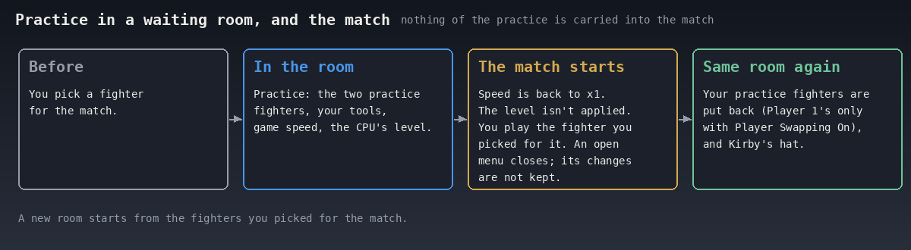

# Waiting rooms

## Practise before a match

| While waiting | What to do |
|---|---|
| Enter practice | Join wireless or Quickplay. If practice is missing, check [Lobby Practice](../menu/fighters-and-stages.md#lobby-practice) in Training. |
| Set the partners | Close TrainingRooms, press Plus, then choose Training Partners and Training Partner Behavior. |
| Pick a tool | [Practise a game](../menu/practice-games.md), [record inputs](recording.md), or [change practice speed](game-speed.md). |
| An AI plays Player 1 | Record captures its inputs; take control back before Play on Player 1 or Quick Reset. |
| A match interrupts typing | Nothing is applied; return to the same room to resume the name. |
| A match starts | Your matched fighters play at normal speed, without the practice partners' level. |
| You return | Practice fighters and Kirby's hat return; Player 1 requires Player Swapping. |
