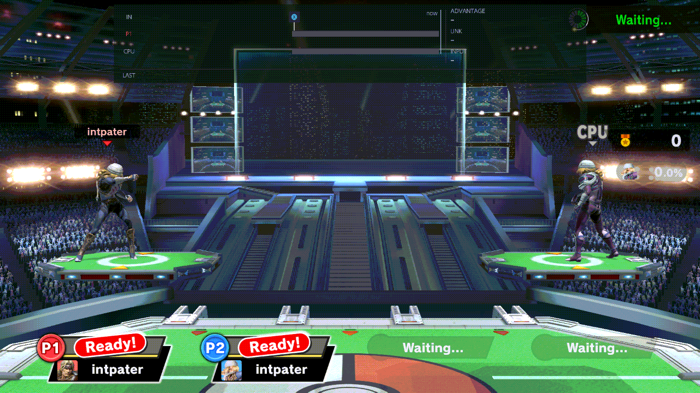
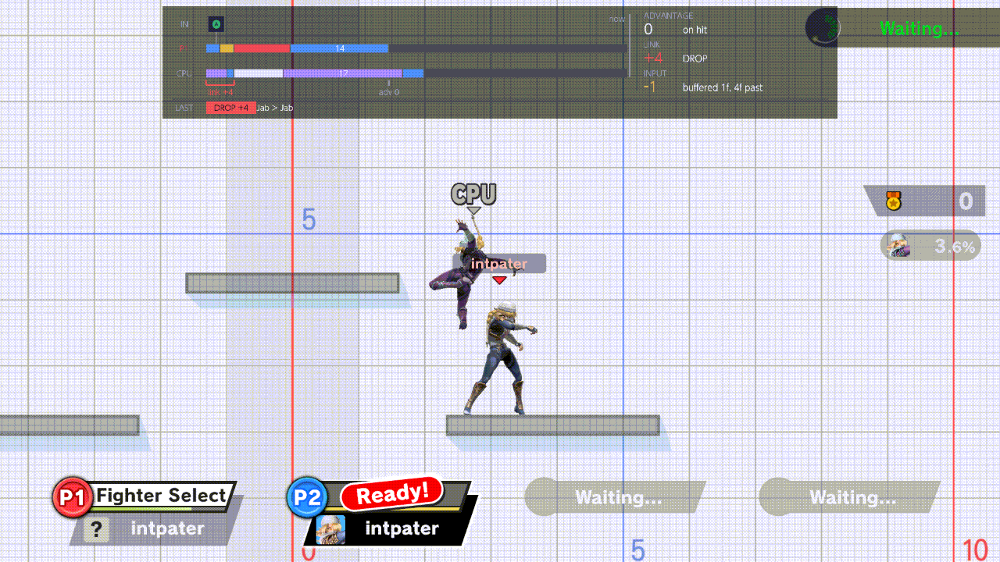
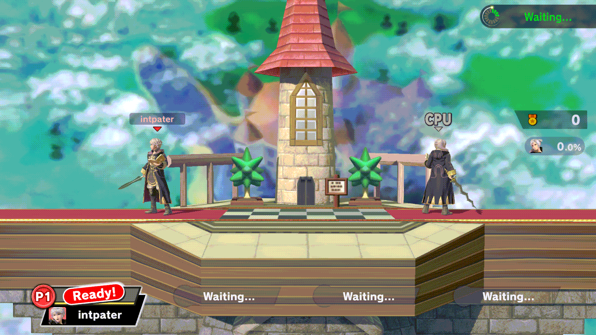
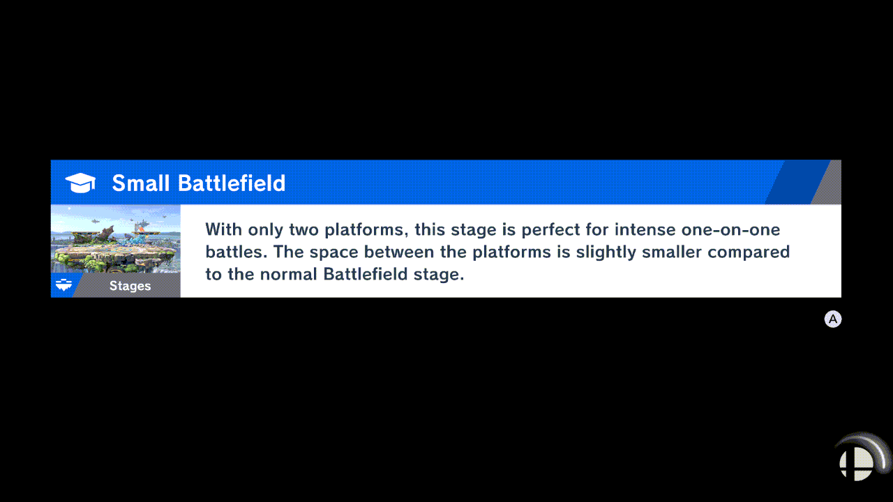
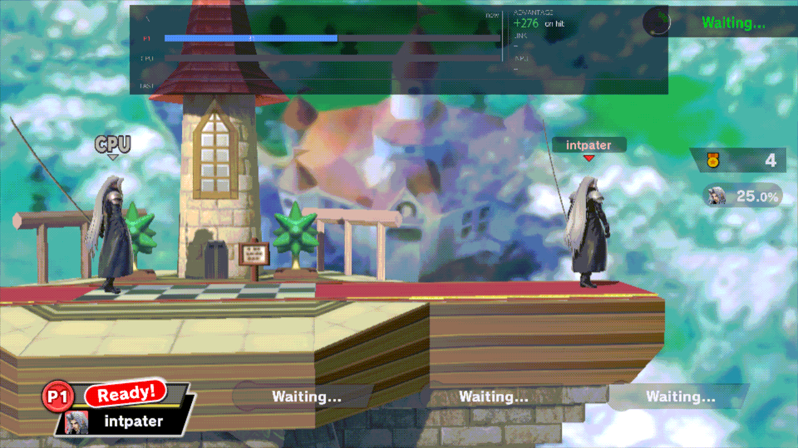

# Waiting rooms

While you wait for a match, Smash puts you in a waiting room with training partners. TrainingRooms can run its
practice there too: the same menu, the same chords, the same CPU settings. It knows two kinds of waiting room: local
wireless rooms, and the online waiting room of Quickplay.

## Turn on Lobby Practice first

Fighters & Stages › [Lobby Practice](../menu/fighters-and-stages.md#lobby-practice) is Off by default. While it is Off,
TrainingRooms leaves the waiting rooms to the game: the menu doesn't open there and the chords do nothing. So turn it
On in Training, before you look for a match.

With it On, the practice starts as soon as the waiting room's own screen is ready.

## What works there

- **The menu:** B + D-pad Up (or Minus, or your own shortcut) opens it, as in Training. See
  [Using the menu](using-the-menu.md).
- **The CPU page** drives the first training partner, and CPU › [CPU Level](../menu/cpu.md#cpu-level) sets the
  partners' level. See [CPU behaviour](cpu-behaviour.md).
- **Display:** [Hitbox Visualization](../menu/display-and-controls.md#hitbox-visualization) draws the boxes of the two
  practice fighters, and the [frame strip](frame-strip.md) runs as in Training.
- **The chords:** save states, recording and playback, the fighter cycles, Kirby hats and the input display. The CPU
  cycle changes the first training partner. See [Controls](controls.md).
- **Combos:** save a combo you landed and drill it with the combo helper, as in Training. See
  [Recording › Combos](recording.md#combos).
- **Stages:** [Change Stage](stages.md#change-stage) goes to another stage now, and each new room opens on the next
  stage of [Lobby Stages](stages.md#lobby-stages). [Stage Hazards](stages.md#stage-hazards) counts there too.
- **Fighters and items:** Player Character (with Player Swapping On), CPU Character, Give item and the Mii rows. Your
  practice fighter changes; the match still uses the fighter you picked for it. *Add New…* opens Smash's Mii editor: see
  [Mii fighters › In a waiting room](mii.md#in-a-waiting-room).
- **L + R + A** puts both practice fighters back where they first stood (Display & Controls ›
  [L+R+A Reset](../menu/display-and-controls.md#lra-reset)).
- **Respawn:** as in Training, a KO'd practice fighter is back at once unless Fighters & Stages ›
  [Respawn on platform](../menu/fighters-and-stages.md#respawn-on-platform) is On.
- **Game speed:** see [below](#game-speed).

<!-- reshoot: rc6-lobby-combos.gif -->

## Training Partners and Behavior

Plus opens the waiting room's own menu, the game's: Leave Battle, Training Partners (how many partners stand in the
room) and Training Partner Behavior (Attack or Stop). TrainingRooms doesn't change that menu, but it remembers your
last Training Partners and Behavior and sets them again in the next waiting room, local wireless or Quickplay.

- They are kept with your settings, so they last after you close the game.
- Until you change them once, the next room keeps the game's own choice (Automatic, Attack).
- This works whether Lobby Practice is On or Off.

<!-- reshoot: rc6-waiting-reentry.gif -->

## Lobby Items

Fighters & Stages › [Lobby Items](../menu/fighters-and-stages.md#lobby-items) On (the default) leaves the room's items
as the game makes them. Off: no new items appear, and the ones on the floor are removed when you turn it Off. It works
in local wireless rooms and in Quickplay's room, whether Lobby Practice is On or not. Training and the match are not
affected.

## The frame strip and the waiting room's menu

The frame strip at the top of the screen steps aside while the waiting room's own menu is open (Plus), and comes back
when it closes, so it never covers Leave Battle or Training Partners. It does the same for the TrainingRooms menu.

## Game speed

The Game speed chord (hold R + D-pad Up, then Left or Right) has the same five speeds in a waiting room. Only your
practice changes speed; the room's own timers keep their pace, and a match always starts at x1. See
[Game speed › In the waiting rooms](game-speed.md#in-the-waiting-rooms).

## What is different, or refused

- **Names online:** in Quickplay's room the name keyboard doesn't open. A combo or a recording saved there keeps its
  numbered name (such as "Combo 3"); rename it later in Training. Local wireless rooms open the keyboard.
- **Leaving Quickplay:** while the TrainingRooms menu is open, Plus doesn't reach the game. Close the menu (B) before
  you open the game's menu to Leave Battle.
- **The game's menu:** while it is open, the chords don't fire, and a fighter swap is refused with the notice "Close
  the current game menu before swapping".
- **The CPU pilot:** while it plays Player 1, Record, Play on Player 1 and L + R + A are refused. See
  [Controls › When the CPU pilot plays Player 1](controls.md#when-the-cpu-pilot-plays-player-1).

## When the match starts

The practice ends when the match begins, and nothing of it is carried into the match: the speed is back to x1, the
partners' level isn't applied there, and the match is played with the fighters you picked for it. If the TrainingRooms
menu was open, it closes, and the changes from that visit are not kept.

Back in the same room after the match, TrainingRooms puts back the practice fighters you had switched to (Player 1's
only with Player Swapping On) and Kirby's hat. A new room starts from the fighters you picked for the match.
