# CPU

The CPU page sets what the training CPU does: how it gets out of your combos, gets up from the ledge, techs, shields
and attacks, and how strong it is. It is the first page of the menu: open the menu with B + D-pad Up (or Minus, or
your own menu shortcut) and press L or R until the title reads CPU. The menu reopens where you left it.

The settings drive the CPU in Training, and the first training partner in a waiting room when
[Lobby Practice](fighters-and-stages.md#lobby-practice) is On. They never move Player 1, even when an AI plays
Player 1. How the rows work together is in [CPU behaviour](../guide/cpu-behaviour.md); the menu's keys are in
[Using the menu](../guide/using-the-menu.md). All pages are listed in [the docs index](../README.md).

Keys on every page: L/R page, Up/Down move, ZL + Up/Down jump a section, Left/Right change, A open, X save your
current settings as your defaults, Y reset the focused row to your default, B close.

## Reactions

What the CPU does as soon as it can act again.

### Mash

The actions the CPU does as soon as it can, in the situations ticked in [Mash Triggers](#mash-triggers). With several
ticked, it picks one at random each time.

- **Values:** any of the [30 actions](../guide/cpu-behaviour.md#the-30-actions): Air Dodge, Jump, Shield, Spot Dodge,
  Roll Forwards, Roll Backwards, the five aerials, the four specials, the three smashes, Jab, the three tilts, Grab,
  Dash, Dash Attack, and Playback Slot 1 to 5.
- **Default:** none ticked: the CPU doesn't mash.
- **How:** A opens the checklist. Up/Down move, A ticks or unticks, ZL ticks all (or clears all), B goes back. The
  row shows how many are ticked, such as "2 of 30".

The Playback Slot actions don't play your saved macros: see
[The Playback Slot actions](../guide/cpu-behaviour.md#the-playback-slot-actions).

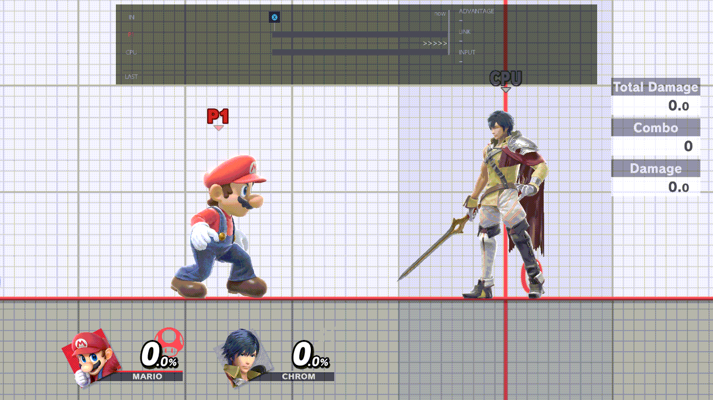 *Mash: none, then Jump*

More: [Mash and Followup](../guide/cpu-behaviour.md#mash-and-followup)

### Followup

An action the CPU does right after its first one, as soon as it can. The first one can come from Mash, a situation
override, or the mash after a ledge getup, a tech or a throw. The follow-up is picked at the same time.

- **Values:** the same 30 actions as Mash.
- **Default:** none ticked: no follow-up.
- **How:** A opens the checklist; A ticks, ZL ticks all or none, B goes back.

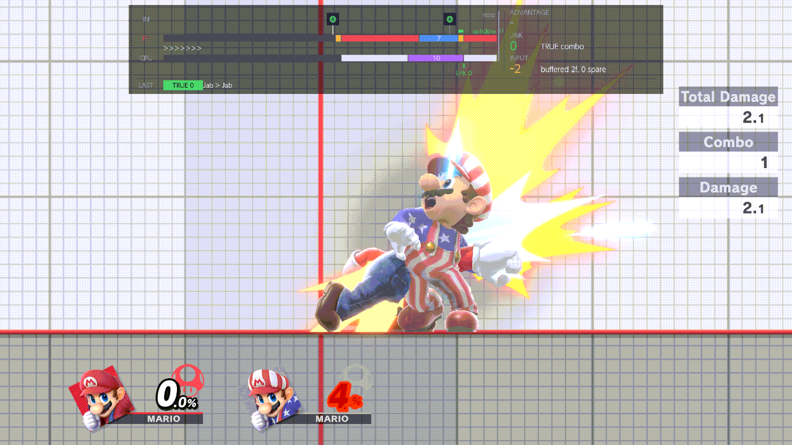 *Followup: none, then Neutral Air*

More: [Mash and Followup](../guide/cpu-behaviour.md#mash-and-followup)

### Mash Triggers

The situations that make the CPU do its Mash action. Nothing happens here until Mash has at least one action.

- **Values:** Hitstun, Shieldstun, Parry, Tumble, Landing, Ledge Trump, Footstool, Clatter, Ledge Option,
  Tech Option, Mistech Option, Grounded, Airborne, Distance: Close, Distance: Mid, Distance: Far, Always.
- **Default:** Hitstun, Shieldstun, Tumble, Clatter.
- **How:** A opens the checklist; A ticks, ZL ticks all or none, B goes back.

Hitstun doesn't cover tumble (a hard launch): tick Tumble too to mash out of both.

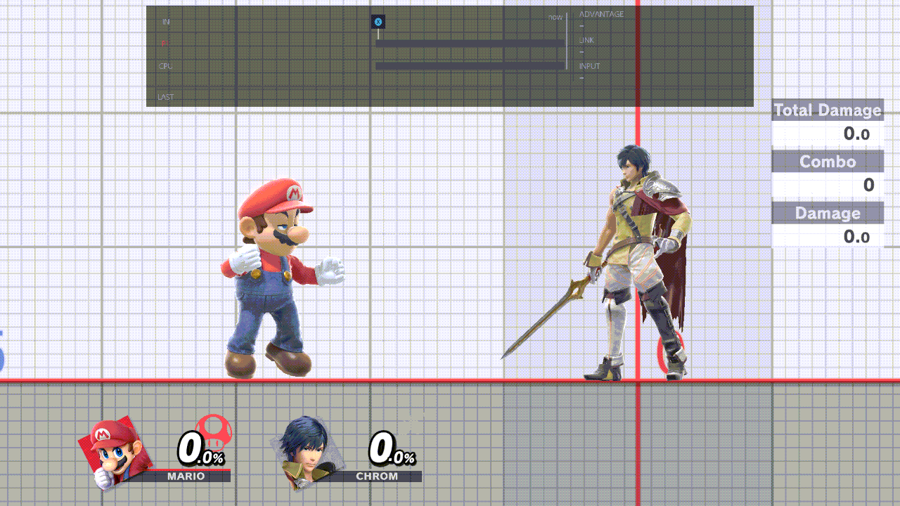 *Mash Triggers: Always ticked*

More: [Mash Triggers](../guide/cpu-behaviour.md#mash-triggers)

### Situation overrides

Gives one situation its own actions, used there instead of Mash. There are 13 situations: Ledge Neutral Getup,
Ledge Roll, Ledge Jump, Ledge Attack, Tech Action, Clatter, Tumble, Hitstun, Parry, Shieldstun, Footstool, Landing
and Ledge Trump. With several actions ticked, the CPU picks one at random.

- **Values:** for each situation, any of the 30 actions.
- **Default:** none set: the row reads "0 of 13 set".
- **How:** A opens the editor. On its top line, Left/Right pick the situation. Down moves into that situation's
  actions, drawn in columns: Up/Down move, Left/Right step a column, A ticks, ZL ticks all or none. B goes back. Y on
  the row clears every situation back to your default.

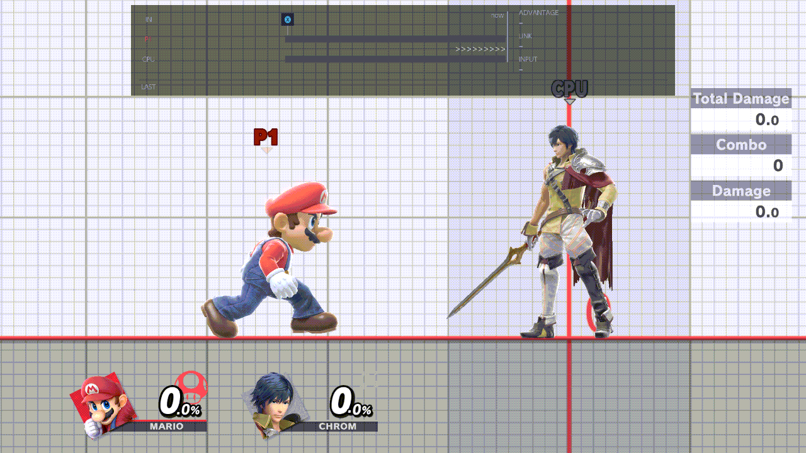 *Hitstun overridden with Shield*

More: [Situation overrides](../guide/cpu-behaviour.md#situation-overrides)

## Defence

How the CPU escapes after you hit it.

### Airdodge Direction

Where the CPU air dodges when it air dodges out of hitstun (Air Dodge in Mash or an override). In and Out are
relative to you. Other air dodges keep the game's direction.

- **Values:** direction chips: Up In, Up, Up Out, In, Neutral, Out, Down In, Down, Down Out, and Left and Right (fixed
  screen directions). Each chip can be weighted x1 to x5.
- **Default:** none selected: the CPU doesn't choose.
- **How:** A opens the grid. The D-pad moves between chips, each A adds one weight to the chip (a sixth press clears
  it), Y clears the chip, ZL selects every chip or clears them all, B goes back. The help line lists the picks, such
  as "Selected: Up x2, Out x1".

One direction is picked for each hit and kept until the next.

More: [Direction chips](../guide/cpu-behaviour.md#direction-chips)

### DI Direction

The direction the CPU holds to change its launch angle (DI) when you hit it. In and Out follow you.

- **Values:** direction chips, as Airdodge Direction, each weighted x1 to x5. Each chip shows the game's DI line.
- **Default:** none selected: TrainingRooms adds no DI and leaves it to the game.
- **How:** A opens the grid; the D-pad moves, each A adds one weight, Y clears the chip, ZL all or none, B goes back.

A new direction is picked for every hit and held for the whole hitstun.

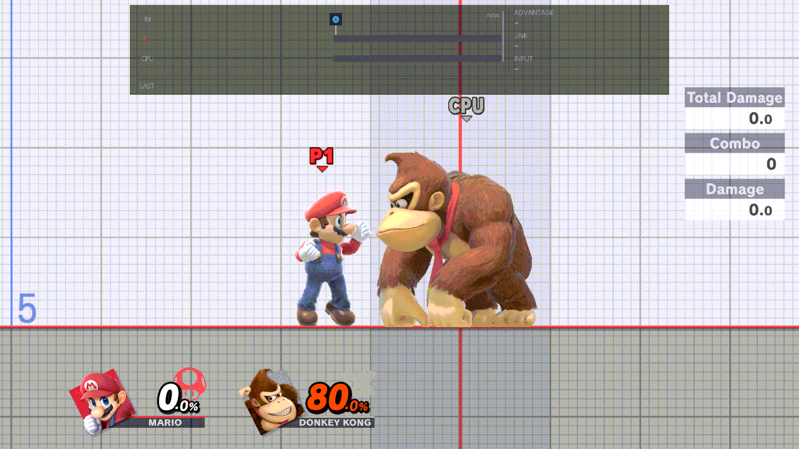 *DI Down, then DI Up*

More: [Direction chips](../guide/cpu-behaviour.md#direction-chips)

### SDI Direction

The direction the CPU nudges itself in during hitlag (smash DI). It does nothing while
[SDI Strength](#sdi-strength) is None.

- **Values:** direction chips, as Airdodge Direction, each weighted x1 to x5. Each chip shows the game's SDI streak.
- **Default:** none selected: the CPU doesn't SDI.
- **How:** A opens the grid; the D-pad moves, each A adds one weight, Y clears the chip, ZL all or none, B goes back.

One direction is picked at each reset (L+R+A or loading a save state) and right after you change the row. The CPU
uses it for every hit until the next pick. Neutral means no SDI.

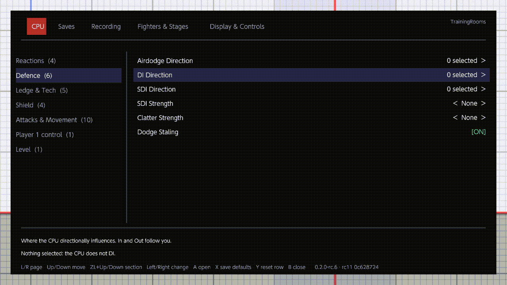 *The DI and SDI direction grids*

More: [Direction chips](../guide/cpu-behaviour.md#direction-chips)

### SDI Strength

How often the CPU SDIs during hitlag: Normal once every 8 frames, Medium every 6, High every 4. None turns SDI off.

- **Values:** None, Normal, Medium, High.
- **Default:** None.
- **How:** Left/Right cycle through the values (wrapping); A opens the list.

### Clatter Strength

How fast the CPU mashes out of grabs, buries and other holds: Normal once every 8 frames, Medium every 5, High
every 2.

- **Values:** None, Normal, Medium, High.
- **Default:** None: it doesn't mash out.
- **How:** Left/Right cycle through the values; A opens the list.

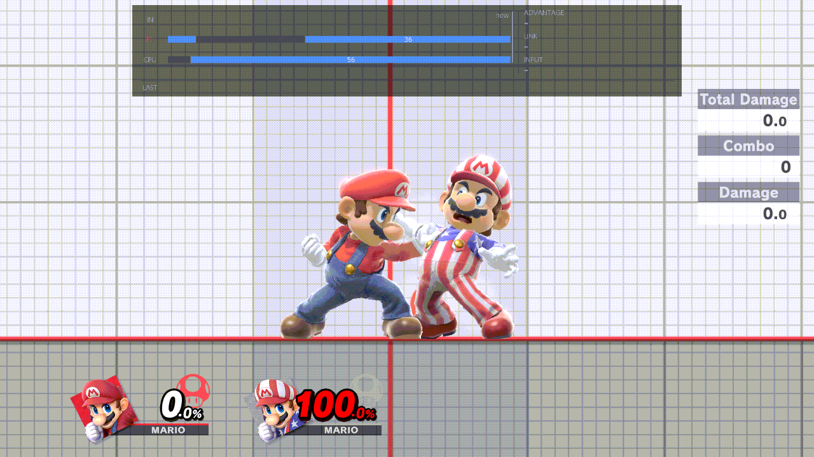 *Clatter Strength: None, then High*

### Dodge Staling

On: the CPU's dodges go stale like a player's, so repeated dodges get worse. Off: every dodge is fresh.

- **Values:** On, Off.
- **Default:** On.
- **How:** A switches it.

## Ledge & Tech

### Ledge Options

What the CPU does when it hangs on the ledge. With several ticked, it picks one at random for each ledge grab.

- **Values:** Neutral Getup, Roll, Jump, Getup Attack, Wait (it keeps hanging), Playback Slot 1 to 5.
- **Default:** Neutral Getup, Roll, Jump, Getup Attack.
- **How:** A opens the checklist; A ticks, ZL ticks all or none, B goes back.

With nothing ticked, the CPU does what the game's CPU would. If you change the row while the CPU hangs, it picks
again at once. After its getup, roll, jump or attack, the CPU can mash: the matching Situation override (Ledge Neutral
Getup, Ledge Roll, Ledge Jump or Ledge Attack) if one is set, otherwise Mash when Ledge Option is ticked in Mash
Triggers.

More: [Situation overrides](../guide/cpu-behaviour.md#situation-overrides)

### Ledge Delay

How long the CPU waits on the ledge before its ledge option, counted from when it can act.

- **Values:** 0 to 300 frames, in steps of 10. Tick values (one is picked at random for each ledge grab), or set a
  minimum and a maximum (any step between them, picked at random).
- **Default:** none ticked: no wait.
- **How:** A opens the delay pop-up. Tick values with A, or move down to Min or Max: A picks the handle up,
  Left/Right move it one step, Up/Down ten steps, A puts it down. While values are ticked the range is greyed, and the
  other way round; Y clears whichever is set. ZL ticks every value. B goes back.

More: [Delay rows](../guide/cpu-behaviour.md#delay-rows)

### Tech Options

How the CPU techs when it is launched into the ground, a wall or a ceiling. With several ticked, it picks one at
random each time.

- **Values:** No Tech, Roll Forwards, Roll Backwards, Tech In Place.
- **Default:** all four.
- **How:** A opens the checklist; A ticks, ZL ticks all or none, B goes back.

On a wall, Tech In Place is a wall tech and Roll Forwards a wall jump; Roll Backwards and No Tech miss the tech. On a
ceiling, anything but No Tech techs. With nothing ticked, the game decides.

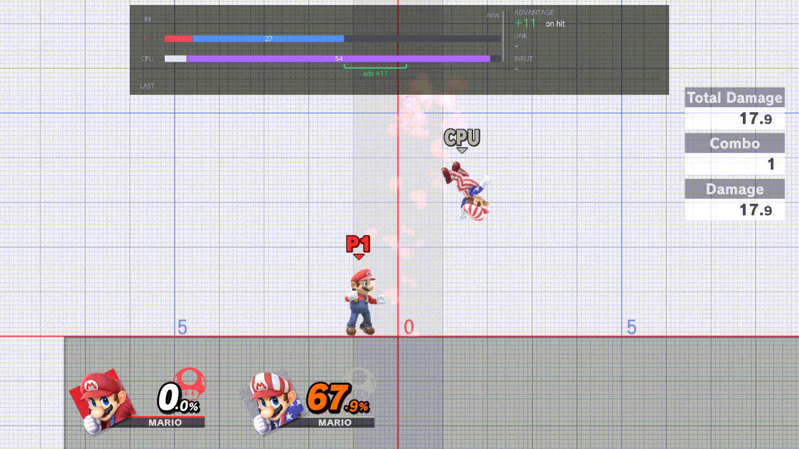 *Tech Options: No Tech, then Roll Forwards*

### Mistech Options

What the CPU does when it lies on the ground after a missed tech, or after it trips. With several ticked, it picks
one at random each time.

- **Values:** Neutral Getup, Getup Attack, Roll Forwards, Roll Backwards.
- **Default:** all four.
- **How:** A opens the checklist; A ticks, ZL ticks all or none, B goes back.

With nothing ticked, the game decides. Tick Mistech Option in Mash Triggers to make the CPU mash after it gets up.

 *Mistech Options: Neutral Getup, then Getup Attack*

### Hide Tech Animations

On: you can't read the CPU's choice from its tech animation. A few frames into a tech, a tech roll or a missed-tech
fall, the CPU disappears, and it shows again for that animation's last 5 frames. The tech effects, the marker above
the CPU and the screen shake of a missed tech are hidden too. With Training's fixed camera, it also fixes the
camera's centre on Battlefield, Final Destination and some other stages.

- **Values:** On, Off.
- **Default:** Off.
- **How:** A switches it.

## Shield

### Shield

How the CPU shields.

- **None:** it shields only when an action asks (Shield, or Air Dodge on the ground).
- **Infinite:** it holds its shield, and in Training hits don't damage the shield, so it never breaks.
- **Hold:** it holds its shield. The shield doesn't shrink until the first hit, then shrinks as normal.
- **Constant:** it holds its shield, and the shield never shrinks on its own (hits still damage it).

The CPU lowers its shield while a recording plays on it or a save state loads.

- **Values:** None, Infinite, Hold, Constant.
- **Default:** None.
- **How:** Left/Right cycle through the values; A opens the list.

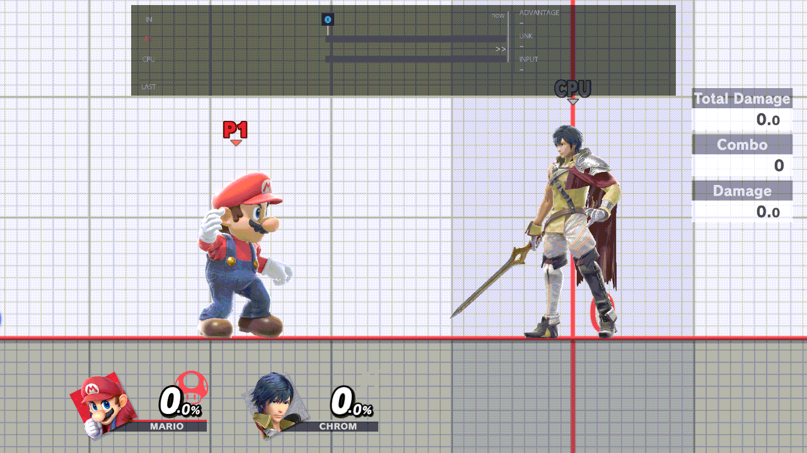 *Shield: None, then Infinite*

### Shield Tilt

Where the CPU tilts its shield. In and Out are relative to you.

- **Values:** one direction chip (the same grid as DI Direction), or none.
- **Default:** none: no tilt.
- **How:** A opens the grid. The D-pad moves, A on a chip selects it (and clears any other), A again or Y clears it,
  B goes back.

A change applies from the CPU's next frame. A reset (L+R+A or loading a save state) reads the row again.

### OoS Offset

How many hits the CPU's shield takes before it acts out of shield. At 0 it acts after the first hit; at 2 it lets two
hits through and acts after the third. The count starts again when the CPU stands still or is hit.

- **Values:** 0 to 30 hits. Tick values, or set a minimum and a maximum.
- **Default:** none ticked: it acts after the first hit.
- **How:** A opens the delay pop-up: tick values with A, or pick up Min or Max with A and move it with Left/Right
  (Up/Down ten at a time). Y clears whichever is set. B goes back.

What it does out of shield is its Mash action (Shieldstun ticked in Mash Triggers) or the Shieldstun override.

More: [Delay rows](../guide/cpu-behaviour.md#delay-rows)

### Reaction Time

Frames the CPU waits after shieldstun before it acts out of shield. A new value is picked for each hit on the shield.

- **Values:** 0 to 30 frames. Tick values, or set a minimum and a maximum.
- **Default:** none ticked: no wait.
- **How:** A opens the delay pop-up: tick values with A, or pick up Min or Max with A and move it with Left/Right
  (Up/Down ten at a time). Y clears whichever is set. B goes back.

More: [Delay rows](../guide/cpu-behaviour.md#delay-rows)

## Attacks & Movement

The angle, aerial and jump rows shape the actions the CPU does from Mash, Followup and the overrides, and are picked
along with the action. Throw and its delays decide what happens after the CPU grabs you. While a recording plays on
the CPU, these rows wait; Throw acts anyway if
[Settings override playback](recording.md#settings-override-playback) is On.

### Attack Angle

The angle of the CPU's angled attacks, such as forward tilt and forward smash. With several ticked, it picks one at
random each time. It is not used on the ledge.

- **Values:** Neutral, Up, Down.
- **Default:** none ticked: the game's own angle.
- **How:** A opens the checklist; A ticks, ZL ticks all or none, B goes back.

### Throw

What the CPU does after it grabs you. With several ticked, it picks one at random for each grab. None: it neither
throws nor pummels. After the throw, the CPU does its Mash action at once, whatever Mash Triggers says.

- **Values:** None, Forward Throw, Backward Throw, Up Throw, Down Throw.
- **Default:** None.
- **How:** A opens the checklist; A ticks, ZL ticks all or none, B goes back.

If you change the row while the CPU holds you, it picks again at once.

### Throw Delay

Frames the CPU holds you before throwing, counted from when it can throw.

- **Values:** 0 to 150 frames, in steps of 5. Tick values, or set a minimum and a maximum.
- **Default:** none ticked: it throws at once.
- **How:** A opens the delay pop-up: tick values with A, or pick up Min or Max with A and move it with Left/Right
  (Up/Down ten at a time). Y clears whichever is set. B goes back.

More: [Delay rows](../guide/cpu-behaviour.md#delay-rows)

### Pummel Delay

Frames after the grab before the CPU starts pummelling. Any value (or a range) turns pummels on; nothing ticked
means no pummels. The CPU pummels while it waits out the [Throw Delay](#throw-delay), so it needs a throw ticked in
[Throw](#throw) and a Throw Delay longer than this one.

- **Values:** 0 to 150 frames, in steps of 5. Tick values, or set a minimum and a maximum.
- **Default:** none ticked: no pummels.
- **How:** A opens the delay pop-up: tick values with A, or pick up Min or Max with A and move it with Left/Right
  (Up/Down ten at a time). Y clears whichever is set. B goes back.

More: [Delay rows](../guide/cpu-behaviour.md#delay-rows)

### Falling Aerials

Whether the CPU waits until it is falling before its aerial.

- **Values:** Yes, No, Random (either way each time).
- **Default:** No.
- **How:** Left/Right cycle Yes, No, Random; A opens the list.

### Aerial Delay

Frames the CPU waits, once it can, before its aerial.

- **Values:** 0 to 30 frames. Tick values, or set a minimum and a maximum.
- **Default:** none ticked: no wait.
- **How:** A opens the delay pop-up: tick values with A, or pick up Min or Max with A and move it with Left/Right
  (Up/Down ten at a time). Y clears whichever is set. B goes back.

More: [Delay rows](../guide/cpu-behaviour.md#delay-rows)

### Full Hop

Whether the CPU's jumps are full hops (Yes) or short hops (No), including the jump before an aerial from the ground.

- **Values:** Yes, No, Random (either way each time).
- **Default:** Yes.
- **How:** Left/Right cycle Yes, No, Random; A opens the list.

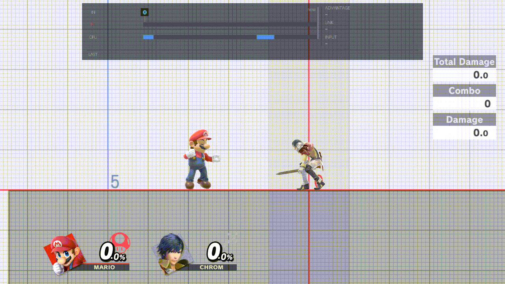 *Full Hop: Yes, then No*

### Fast Fall

Whether the CPU fast falls once it starts falling after a jump or an aerial.

- **Values:** Yes, No, Random (either way each time).
- **Default:** No.
- **How:** Left/Right cycle Yes, No, Random; A opens the list.

### Fast Fall Delay

Frames after the CPU starts falling before it fast falls. Used only when [Fast Fall](#fast-fall) says Yes.

- **Values:** 0 to 30 frames. Tick values, or set a minimum and a maximum.
- **Default:** none ticked: it fast falls at once.
- **How:** A opens the delay pop-up: tick values with A, or pick up Min or Max with A and move it with Left/Right
  (Up/Down ten at a time). Y clears whichever is set. B goes back.

More: [Delay rows](../guide/cpu-behaviour.md#delay-rows)

### Crouch

On: the CPU crouches in place instead of standing. Off: it stands.

- **Values:** On, Off.
- **Default:** Off.
- **How:** A switches it.

 *Crouch: Off, then On*

## Player 1 control

Lets the game's CPU play Player 1 for you. This group shows one of two things. If the separate CPU pilot plugin is
installed, it shows only the P1 control row. Without it, it shows P1 CPU Control and P1 CPU Level.

### P1 control

Shown only when the CPU pilot plugin is installed. The row reads "CPU pilot plugin": the pilot drives Player 1, and
you set it on its own page (Online Deluxe's CPU Pilot page), not here.

- **Values:** none: the row is read-only.
- **How:** nothing to change here; it tells you the pilot is in charge of Player 1.

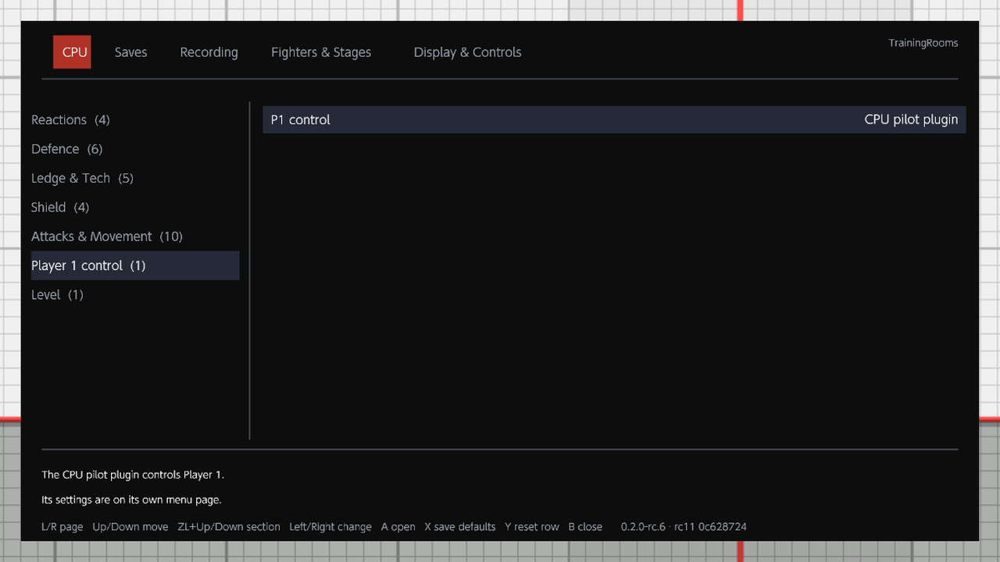 *P1 control with the CPU pilot plugin (a still: the row is read-only)*

### P1 CPU Control

Shown only when the CPU pilot plugin is not installed. On: the game's CPU AI plays Player 1 in Training once you close
the menu. It waits while a menu is open or a recording is made or played. While it plays, Record and Play on
Player 1 are refused.

- **Values:** On, Off.
- **Default:** Off: you play Player 1.
- **How:** A switches it.

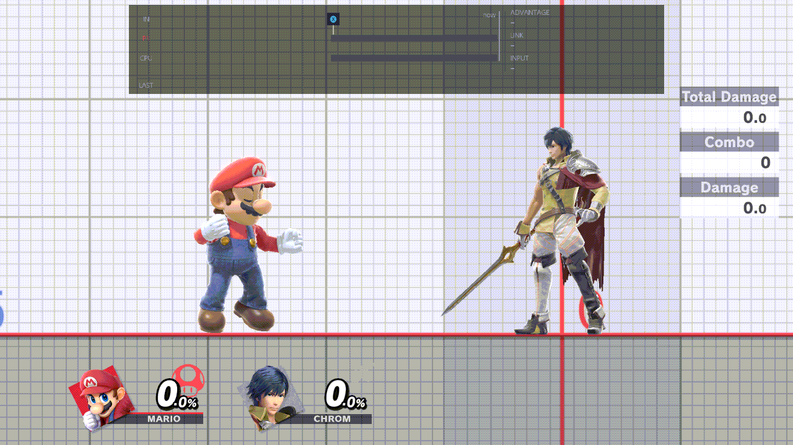 *P1 CPU Control: Off, then On*

More: [Controls](../guide/controls.md)

### P1 CPU Level

Shown only when the CPU pilot plugin is not installed. The level of the AI that plays Player 1: 1 is the weakest, 9
the strongest.

- **Values:** 1 to 9.
- **Default:** 3.
- **How:** Left/Right cycle through the levels; A opens the list.

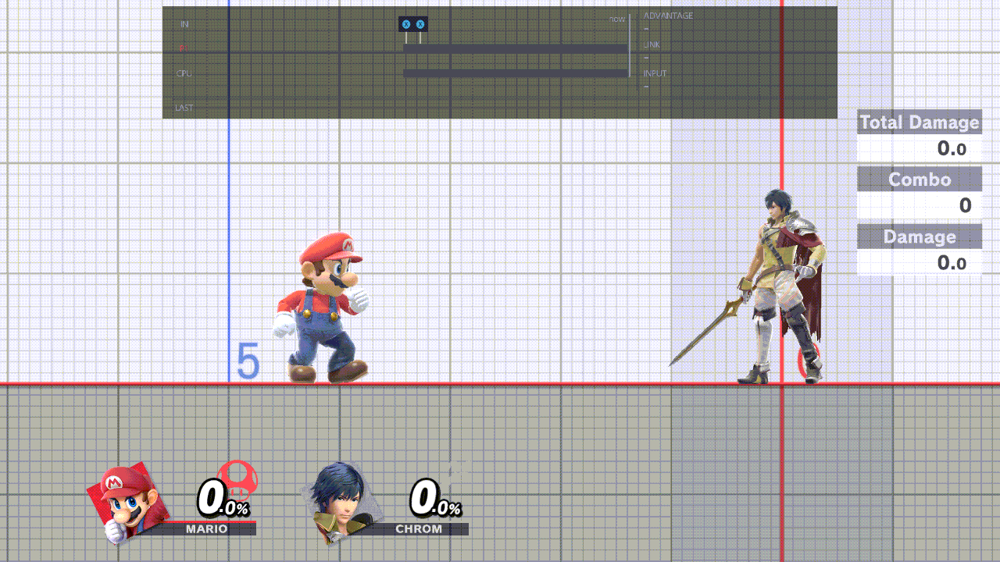 *P1 CPU Level: 1, then 9*

## Level

### CPU Level

The CPU's level, set from this menu.

- In Training it applies while the CPU Behavior in Training's own pause menu is CPU (Lv. n) or Control. Other
  behaviours, such as Stop, run the CPU at the game's fixed strength.
- In a waiting room it sets the training partners' level.
- Off leaves the game's own level, and puts Training's level back if this row had changed it.

When it differs from the level in Training's own menu, a notice says so each time you enter Training, for example
"CPU level · Lv 7 from TrainingRooms (Training menu: Lv 3)".

- **Values:** Off, 1 to 9.
- **Default:** Off.
- **How:** Left/Right cycle through the values (wrapping); A opens the list.

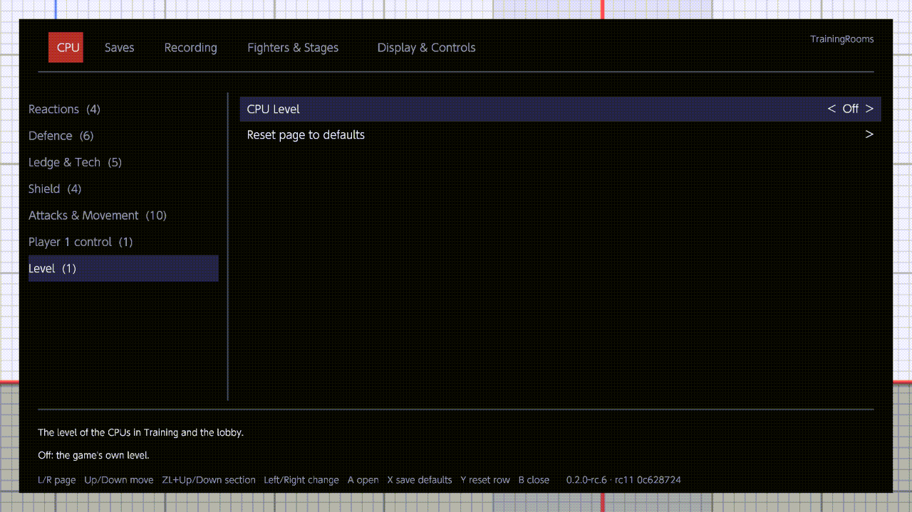 *The notice when Training's own level differs*

## Reset page to defaults

The last row of the page. It asks first, then puts every row of the CPU page back to your saved defaults (the factory
values above, until you save your own with X).
