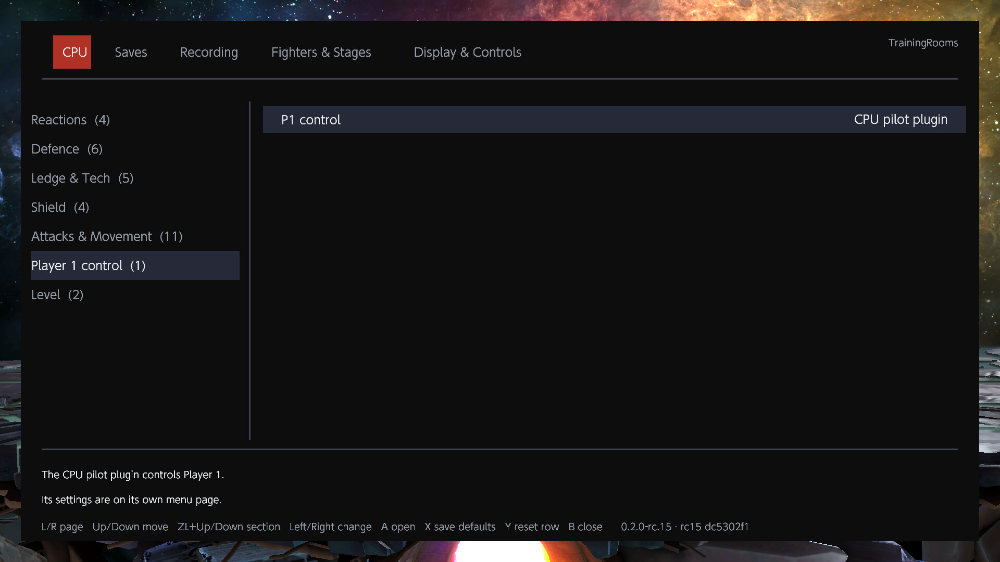

# CPU

Use these settings to practise against the training CPU or your first [waiting-room partner](../guide/waiting-rooms.md).

## Reactions

<video src="https://git.syntaxbyexample.com/intpa/TrainingRoomsForUltimate/media/blob/67d92f30104dd21a740499e4b780336754029284" autoplay muted loop playsinline controls></video>

*Link answers Mario's jab with an attack.* [Open the clip](../media/tut-cpu-mash.mp4)

Build a [two-action response](../guide/cpu-behaviour.md#mash-and-followup) by choosing when it starts and what comes next.

| Setting | Choices; default in bold | What it does |
| --- | --- | --- |
| Mash | [30 actions](../guide/cpu-behaviour.md#the-30-actions); **none** | Picks one ticked action when a trigger fires. |
| Followup | Same actions; **none** | Follows the first action as soon as the CPU can act. |
| Mash Triggers | 17 triggers; **Hitstun, Shieldstun, Tumble, Clatter** | Chooses when Mash fires; [Hitstun](../guide/cpu-behaviour.md#mash-triggers) alone excludes tumble. |
| Situation overrides | 13 situations; **none set** | Replaces Mash for one situation; Shieldstun still needs its trigger. |

## Defence

<video src="https://git.syntaxbyexample.com/intpa/TrainingRoomsForUltimate/media/blob/33d1eaf8950f69680e4cf2116dd880001009bb4e" autoplay muted loop playsinline controls></video>

*The same smash launches Link at two different angles.* [Open the clip](../media/tut-cpu-di.mp4)

On the [direction grid](../guide/cpu-behaviour.md#direction-chips), In means toward you; Left always means screen left.

| Setting | Choices; default in bold | What it does |
| --- | --- | --- |
| Airdodge Direction | Weighted directions; **none** | Picks a direction for an air dodge out of hitstun. |
| DI Direction | Weighted directions; **none** | Keeps one direction throughout hitstun. An empty selection leaves DI to the game. |
| SDI Direction | Weighted directions; **none** | Nudges the CPU during hitlag; needs SDI Strength. |
| SDI Strength | **None**, Normal, Medium, High | Nudges every 8, 6 or 4 frames respectively when enabled. |
| Clatter Strength | **None**, Normal, Medium, High | Mashes out of holds every 8, 5 or 2 frames when enabled. |
| Dodge Staling | **On**, Off | On: repeated dodges get worse. Off: every dodge stays fresh. |

## Ledge & Tech

<video src="https://git.syntaxbyexample.com/intpa/TrainingRoomsForUltimate/media/blob/3874e4debafd570e91d240a121406cc4ad6a8c5b" autoplay muted loop playsinline controls></video>

*The CPU climbs from the ledge, then jumps instead.* [Open the clip](../media/rc11-cpu-ledge-options.mp4)

| Setting | Choices; default in bold | What it does |
| --- | --- | --- |
| Ledge Options | **Neutral Getup, Roll, Jump, Getup Attack**; Wait; [Playback Slots 1-5](recording.md#playback-slot) | Picks once per ledge grab; empty leaves the choice to the game. |
| Ledge Delay | 0-300 frames, step 10; **no wait** | Waits before acting on the ledge. |
| Tech Options | No Tech, Roll Forwards, Roll Backwards, Tech In Place; **all** | Chooses how to recover on contact with a surface. |
| Mistech Options | Neutral Getup, Getup Attack, Roll Forwards, Roll Backwards; **all** | Chooses a getup after a missed tech or trip. |
| Hide Tech Animations | On, **Off** | Hides part of the tech or missed-tech animation; getups stay visible. |

## Shield

<video src="https://git.syntaxbyexample.com/intpa/TrainingRoomsForUltimate/media/blob/b2ca0b09d2664446c350ff95d74972d18d8fd626" autoplay muted loop playsinline controls></video>

*Link holds shield through three jabs.* [Open the clip](../media/tut-cpu-shield.mp4)

| Setting | Choices; default in bold | What it does |
| --- | --- | --- |
| Shield | **None**, Infinite, Hold, Constant | Infinite prevents breaks in Training; Constant stops passive shrink; Hold shrinks after first hit. |
| Shield Tilt | One direction; **none** | Tilts the shield; unlike DI, only one chip can be selected. |
| OoS Offset | 0-30 shield hits; **none** | Skips this many hits before responding; zero responds after the first hit. |
| Reaction Time | 0-30 frames; **no wait** | Adds a delay after shieldstun, picked per shield hit. |

## Attacks & Movement

<video src="https://git.syntaxbyexample.com/intpa/TrainingRoomsForUltimate/media/blob/a2ad1b8e6db3bbacf0b595fdaf1c9c017d75dc9b" autoplay muted loop playsinline controls></video>

*Compare the CPU's full hop with its short hop.* [Open the clip](../media/rc11-cpu-full-hop.mp4)

Use [delay rows](../guide/cpu-behaviour.md#delay-rows) to select individual values or a range.

| Setting | Choices; default in bold | What it does |
| --- | --- | --- |
| Attack Angle | Neutral, Up, Down; **none** | Angles supported attacks, including forward tilt and forward smash. |
| Throw | **None**, Forward Throw, Backward Throw, Up Throw, Down Throw | Picks one ticked option per grab. None allows pummels until the opponent escapes. |
| Throw Delay | 0-150 frames, step 5; **no wait** | Waits before throwing. |
| Pummel Delay | 0-150 frames, step 5; **no pummels** | Waits before each pummel, including the first. |
| Falling Aerials | Yes, **No**, Random | Waits until falling before starting an aerial. |
| Aerial Drift | None, In, Out, Forward, Back; **none ticked** | Holds the chosen drift while the mashed aerial is active and the CPU is airborne. |
| Aerial Delay | 0-30 frames; **no wait** | Waits before starting an aerial. |
| Full Hop | **Yes**, No, Random | Chooses full or short hops, including jumps before aerials. |
| Fast Fall | Yes, **No**, Random | Fast falls after reaching the jump's peak. |
| Fast Fall Delay | 0-30 frames; **no wait** | Delays a selected fast fall. |
| Crouch | On, **Off** | Crouches instead of standing idle. |

## Player 1 control

*With CPU Pilot installed, P1 control is read-only.*

The rows you see depend on whether the separate [CPU Pilot](../guide/controls.md#when-the-cpu-pilot-plays-player-1) is installed.

| Setting | Choices; default in bold | What it does |
| --- | --- | --- |
| P1 control | Read-only; external pilot installed | Identifies the pilot; change its settings on its own page. |
| P1 CPU Control | On, **Off**; no external pilot | Lets the game's AI play Player 1 in Training. |
| P1 CPU Level | 1-9; **3**; no external pilot | Sets Player 1's AI level, not the opponent's. |

## Level

<video src="https://git.syntaxbyexample.com/intpa/TrainingRoomsForUltimate/media/blob/7998f407ba2350b1fdda8bdefd090162e1015a00" autoplay muted loop playsinline controls></video>

*Hide CPU removes Link; turning it off brings him back.* [Open the clip](../media/tut-cpu-hide.mp4)

| Setting | Choices; default in bold | What it does |
| --- | --- | --- |
| CPU Level | **Off**, 1-9 | Sets partner level in rooms; in Training, applies only to CPU or Control behaviour. |
| Hide CPU | On, **Off** | Removes the CPU from play without changing its settings; blocks Play on CPU. |
| Reset page to defaults | Confirm or cancel | Restores this page's [saved defaults](../guide/using-the-menu.md#your-defaults). |
