# Display & Controls

This page sets what is drawn on screen while you practise, and the buttons that drive the plugin. Open the menu with
B + D-pad Up (or Minus), then press L once from the CPU page, or R until the title reads Display & Controls.
[Using the menu](../guide/using-the-menu.md) explains the buttons inside the menu.

## On screen

### HUD

Off hides the game's own HUD in Training while you play: the damage and stock panel, the player pointers above the
fighters, the item pointers and the off-screen bubbles. On keeps it. The frame strip and the plugin's notices stay
either way.

- **Values:** On, Off
- **Default:** On
- **How:** A, Left or Right flips it.

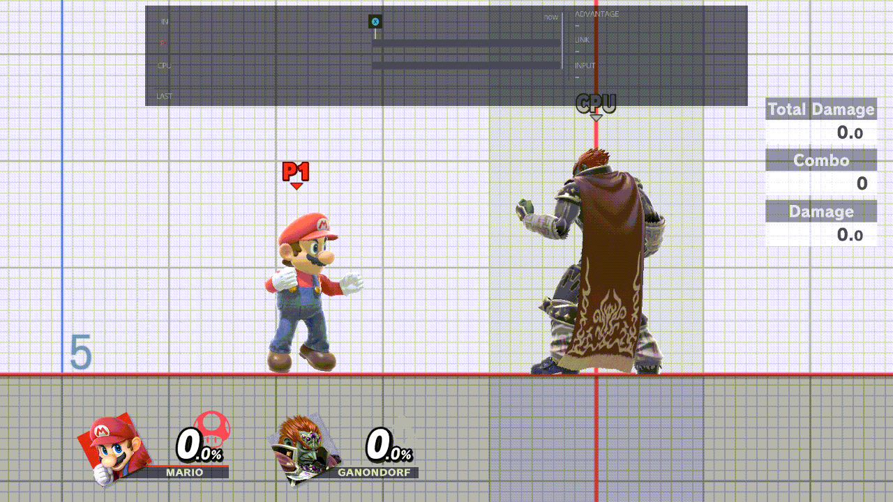

### Hitbox Visualization

Draws the fighters' boxes in colour. It is a checklist: tick what you want to see, and each item draws on its own, so
any mix works, such as hurtboxes alone, or hitboxes with their launch angles. It works in Training, and on the two
practice fighters in a waiting room.

- **Values:** Hitboxes, Grab boxes, Hurtboxes, Frame data colours, Launch angles, Windboxes.
- **Default:** none ticked: nothing is drawn.
- **How:** A opens the checklist; A ticks, ZL ticks all or none, B goes back. The row shows how many are ticked, such
  as "3 of 6".

A settings file from before this checklist keeps what it showed: On ticks Hitboxes, Grab boxes and Hurtboxes, and Off
ticks none.

| Box | Colour | With Frame data colours ticked | What it is |
| --- | --- | --- | --- |
| Hitbox | Each hitbox of a move gets its own colour; the first is red | Red when strong, pink when weak | The attack |
| Grab box | Always magenta, a colour no hitbox uses | Purple | The grab |
| Hurtbox | Yellow | White; blue while nothing can hit it; green while hits do no damage | Where a fighter can be hit |
| Windbox | Its hitbox colour; deep blue with Windboxes ticked | Deep blue | A hitbox that pushes or pulls without hitstun |

**Frame data colours** recolours whatever is ticked in the colours of Ultimate Frame Data. A hitbox is strong when it
is the strongest one out on that frame, such as a sword's tip, and weak when another hitbox out on the same frame is
stronger, or when it is weaker than the strongest hitbox earlier in the same move, as the late frames of a knee are.
A hitbox that cannot be ranked, such as a jab's single hitbox, is red. A hurtbox is blue during a spot dodge or a roll,
and on the revival platform; it is green for the moments after leaving the platform. The plugin reads all of this from
the game every frame, so no list of fighters is needed. Ticked alone, it draws nothing.

**Windboxes** draws the windboxes in deep blue. A windbox pushes or pulls without hitstun: the fighter it lands on is
moved but can still act. Most deal no damage, such as F.L.U.D.D.'s water, and some do, such as one of the two flames
of Bowser's Fire Breath. The game marks them itself, and the plugin uses that mark. A windbox is a hitbox, so Hitboxes
draws it too; with both ticked it is drawn once, in deep blue, and with Windboxes alone only the windboxes are drawn.

Some moves push through a wind area instead of a hitbox. Windboxes draws those too: a see-through deep blue box or
circle where the wind blows, with a white line, edged in dark so it shows on a pale stage, pointing the way it pushes. A
dot in the middle means the wind has no one direction. Items' wind, such as the Gust Bellows, is not drawn.

These fighters have moves with a wind area. Eden tried the special moves and smashes of every fighter whose moves can
make one, and Ganondorf's up tilt; aerials, throws and the other tilts were not tried, so a move missing here may still
have one.

| Fighter | Moves with a wind area |
| --- | --- |
| Bayonetta | neutral special |
| Bowser Jr. | neutral special |
| Chrom | neutral special (Flare Blade), down special, up smash, down smash |
| Cloud | neutral special, down special |
| Corrin | neutral special |
| Dr. Mario | side special |
| Falco | up special |
| Fox | up special |
| Ganondorf | neutral special, up special, down special, up tilt |
| Greninja | side special, up smash |
| Ike | neutral special, side special, down special, forward smash, down smash |
| Ken | every special, forward smash, up smash, down smash |
| King Dedede | neutral special, up special |
| Kirby | neutral special |
| Lucas | neutral special, side special, down special, forward smash, down smash |
| Lucina | neutral special (when held), down special, forward smash, up smash, down smash |
| Mario | side special |
| Marth | neutral special (when held), down special, forward smash, up smash, down smash |
| Meta Knight | neutral special |
| Mewtwo | neutral special, down special, forward smash, up smash, down smash |
| Palutena | every special, forward smash, up smash, down smash |
| Robin | up smash, down smash |
| Roy | neutral special, down special, up smash, down smash |
| Ryu | every special, forward smash, up smash, down smash |
| Shulk | forward smash, up smash |
| Wario | down special |

**Launch angles** draws a white line inside each hitbox, pointing where the hit sends the fighter it lands on. The line
mirrors when the attacker turns around. Two dashes mean the game picks the angle when the hit lands, from how hard it
hits and whether the target is on the ground; they point at 38 degrees, where such a hit sends a fighter in the air.
A dot means the hit carries the fighter along with the attack. With Hitboxes not ticked, the lines are drawn alone.

<!-- CAPTURE-REQUEST hb-legend-v01: Hitbox Visualization with Hitboxes, Grab boxes, Hurtboxes and Frame data colours ticked, 1/4 speed. The CPU spot-dodging next to a standing Player 1: the CPU's hurtboxes blue while it dodges, white otherwise. Player 1 walks off the stage with Respawn on platform On: blue on the platform, green for the moments after it. Mario's grab: a purple grab box. Marth's forward smash: the tip red, the blade pink. See artifacts/rc14-hb-legend/. -->
<!-- CAPTURE-REQUEST hb-legend-v03: Windboxes alone, 1/4 speed: Mario's F.L.U.D.D. (the water deep blue, nothing else drawn), then Bowser's Fire Breath (only the flame that does not cause hitstun, deep blue), then Ganondorf's up tilt (its deep blue windbox discs and the see-through blue box with its white line, which shows where the wind blows), then Chrom's Flare Blade held to charge (the see-through blue box on him with its white line pointing up and to the left). Then Hitboxes alone on F.L.U.D.D. (the water in its hitbox colour). Shoot it over the white Training grid on the build with the stronger wind-area colour. See artifacts/rc14-hb-legend/. -->
<!-- CAPTURE-REQUEST hb-legend-v02: Hitboxes and Launch angles ticked, 1/4 speed: Ganondorf's up tilt (the windbox lines, then the kick's dashes and its 70-degree line) facing right then left; Mario's jab (dashes). Then Hurtboxes alone: only the hurtboxes. See artifacts/rc14-hb-legend/. -->

A round box is a disc; a long one, such as a sword's hitbox or an arm's hurtbox, is one pill. The shapes are flat and
drawn over the stage and the fighters. While the camera pans they trail by a frame or two.

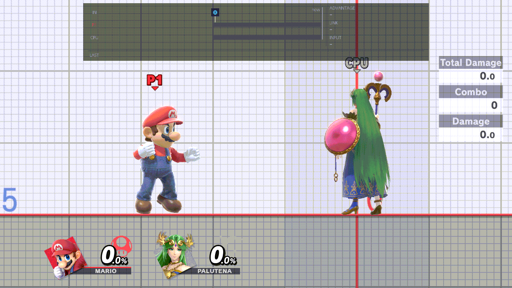

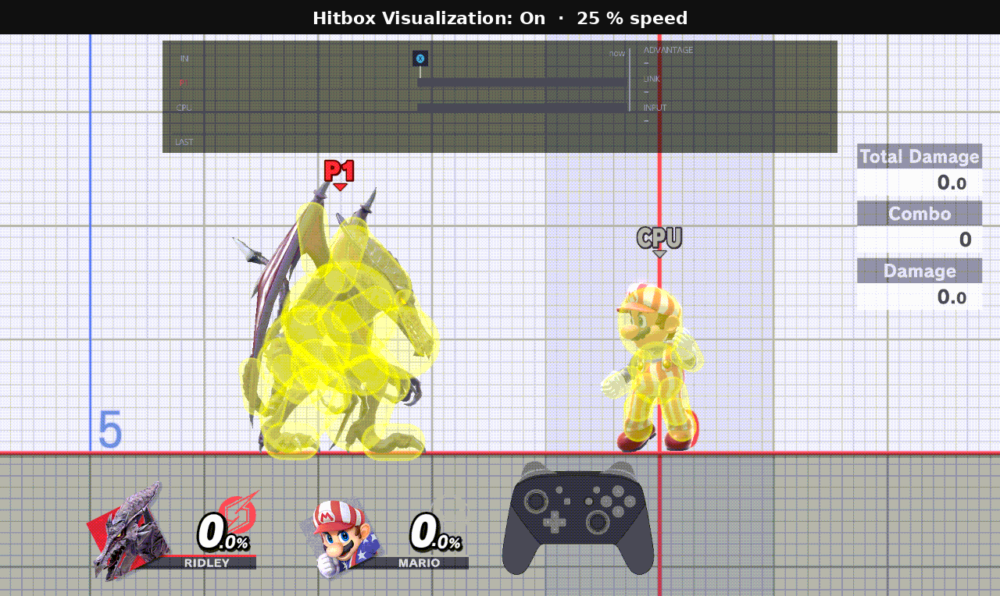

*Pills: at 1/4 speed, Ridley standing shows his hurtboxes as yellow pills; his forward tilt and down tilt draw their hitbox as one red pill along the tail. Eden, rc.13 (untested on hardware).*

**Shield and grab.** While a fighter shields nothing of it is drawn. While it is grabbing, its hurtboxes and grab box
are, since a missed grab can be punished. Grab boxes show only in the grab's active frames: a grab that catches on the
frame its box appears, as Samus's tether does, shows its box for that frame only, not through the pull.

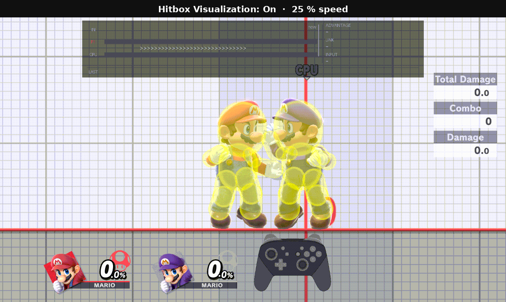

*Grab boxes: at 1/4 speed, Mario's standing grab, Samus's tether (a pill along the beam) and the Pikmin Olimar throws, each grab box in magenta; the grabber keeps its yellow hurtboxes through the grab. Eden, rc.13 (untested on hardware).*

**Projectiles and thrown items.** A projectile, or a thrown item such as Link's bomb, Peach's turnip or Diddy Kong's
banana, has its hitboxes drawn while its attack lasts. Up to four at a time; a fifth replaces the oldest. Olimar's Pikmin
show their grab box.

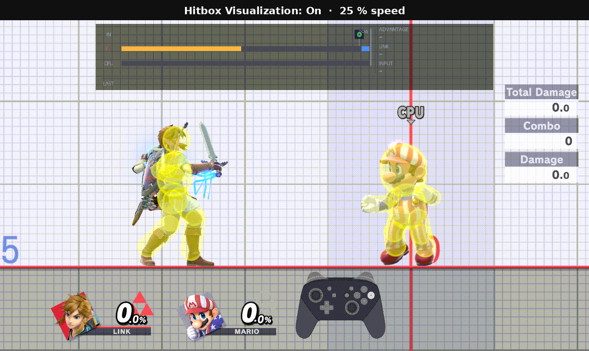

*Projectiles and thrown items: at 1/4 speed, a red disc rides on Ridley's fireball, Link's arrow and Link's thrown bomb while each is in flight. Eden, rc.13 (untested on hardware).*

### Frame data colours

On draws hitboxes in the colours of Ultimate Frame Data: a strong hitbox is red and a weak one is pink. Strong means
it launches hardest. A hitbox is strong when it would send the other fighter further than any other hitbox out on that
frame, such as a sword's tip or a knee's sweet spot. It is weak when another hitbox out on the same frame launches
harder, such as the gust of King K. Rool's Gut Check beside its hit. SmashWiki says the gust deals the same damage as
the hit; in the game's own data it deals 0.7 times the hit's damage, and the plugin follows the game. It is also weak
when it launches less than the strongest hitbox earlier in the same move, as the late frames of a knee do. This is SmashWiki's definition of
sweet and sour spots. The plugin works out the launch from each hitbox's own numbers in the game (damage, base knockback,
knockback growth, set knockback), using the game's knockback formula and the other fighter's percent and weight at that
moment, so no list of fighters is needed. It also counts the attacker's rage the way the game does: from 35% damage a
hitbox launches harder, up to 1.1 times at 150%, and no harder after that; a set knockback hitbox gets no rage. The game
never launches harder than its own limit, so two hitboxes that both reach it launch the same. Damage decides only between
hitboxes that launch the same. The launch angle
plays no part: which direction is best depends on the situation. With no other fighter to measure against, the colours
rank the hitboxes as they would launch a middleweight at 0%. A hitbox it cannot rank, such as a jab's single hitbox or
several identical hitboxes, is red. Grab boxes and hurtboxes keep their colours. It needs Hitbox Visualization On. Off
gives each hitbox its own colour, as before.

- **Values:** On, Off
- **Default:** Off
- **How:** A, Left or Right flips it.

<!-- CAPTURE-REQUEST spots-v01: Marth's forward smash at 1/4 speed with Hitbox Visualization On and Frame data colours Off, then On: the tip red and the blade pink on the early frames, the blade pink on the later frames. Captain Falcon's forward air: red on the knee's sweet frames, pink after. Same setup both times. See artifacts/rc14-spots/. -->
<!-- CAPTURE-REQUEST v18-hitbox-legend: a still of one fighter with hitbox, hurtbox and grab box all drawn, annotated with the colours (the first hitbox red, other hitboxes in their own colours, hurtbox yellow, grab magenta) and pointing at the grabber's hurtboxes. See artifacts/docs4/CAPTURE-REQUESTS.md. -->

### Frame Advantage

On shows a notice after each exchange with your frame advantage: plus means you can act before the CPU, minus means
the CPU can act first. The notice stays down while the frame strip is on screen, because the strip's ADVANTAGE readout
shows the same number, so you see it only with Input Display set to Off. Nothing is measured while the CPU has Mash
actions ticked.

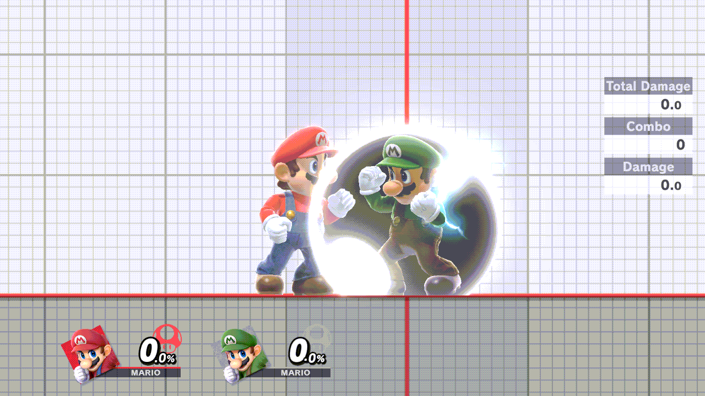

- **Values:** On, Off
- **Default:** Off
- **How:** A, Left or Right flips it.

More: [Frame strip › ADVANTAGE](../guide/frame-strip.md#advantage)

### Input Display

Frame strip draws the last second of frames at the top of the screen: your presses, your frames and the CPU's, how
each follow-up linked, and the frame advantage. It works in Training and in waiting-room practice. It steps aside while
a menu is open, the waiting room's own menu included, and comes back when the menu closes.

- **Values:** Off, Frame strip
- **Default:** Frame strip
- **How:** Left or Right switches it; A opens the list. The Input display chord (R + D-pad Down) switches it without
  opening the menu.

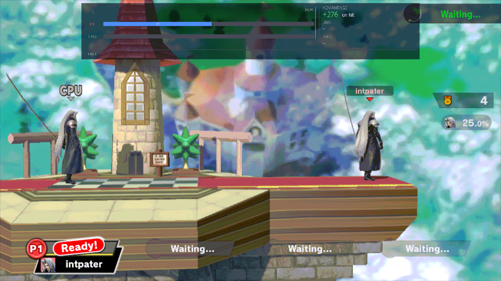

More: [Frame strip](../guide/frame-strip.md)

### Spot labels

On writes Sweet, Sour or Late on each hit that connects in the frame strip. The label sits on the grey hitlag block of
the fighter that was hit: your hit on the CPU's lane, the CPU's hit on yours. Sweet is the hitbox out on that frame that
launches the other fighter hardest, Sour one that launches it less, and Late a hit that launches less than the strongest
hitbox earlier in the same move. The ranking is the one [Frame data colours](#frame-data-colours) uses; the launch angle
plays no part. The game itself records which hitbox connected, and the plugin reads that record. It checks it against
what the other fighter took: the damage the hit added and how hard the game launched it. So two hitboxes of the same
damage, such as the two pairs in Mario's jab, are told apart, and so is a stale hit. A hit has no label when it cannot
be checked, such as identical hitboxes, a hit on a shield or a projectile's hit. A charged smash attack is labelled like
an uncharged one: the plugin reads the charge from the game. Labels work at any damage on either side. Damage stops at
999%, so a hit there adds little or nothing, and the plugin then reads the hit's damage from the game's record. It
needs Input Display set to Frame strip.

- **Values:** On, Off
- **Default:** Off
- **How:** A, Left or Right flips it.

More: [Frame strip](../guide/frame-strip.md#spot-labels)

<!-- CAPTURE-REQUEST spots-v02: the frame strip after Marth's forward smash lands with the tip (Sweet) and again with the blade (Sour); then a hit by the CPU on Player 1, labelled on Player 1's lane. Spot labels Off first, then On. See artifacts/rc14-spots/. -->

### Input Delay

Holds Player 1's inputs back by a number of frames, for example to practise as if playing online. Chords are not
delayed. The frame strip and recordings see the inputs as delayed. The frames are game frames at every
[game speed](../guide/game-speed.md): 18 is 18 game frames at 1/4 too, four times as long in seconds.

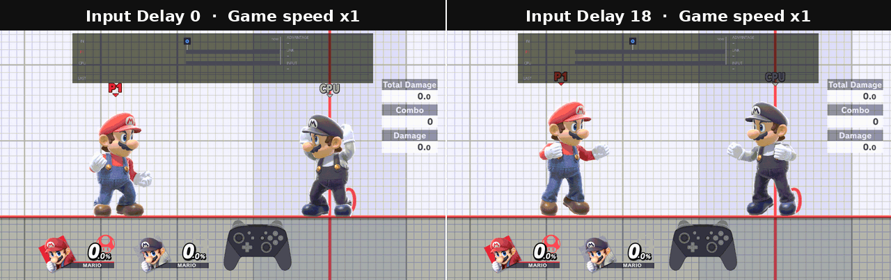

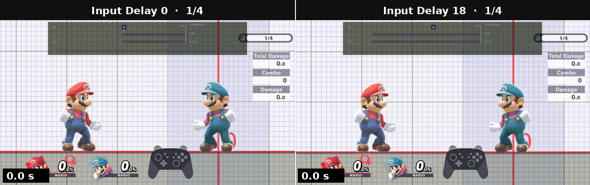 *At Game speed 1/4, the same A from the same spot: Input Delay 0 (left) jabs at once; Input Delay 18 (right) jabs 18 game frames later, four times as long in seconds as at x1. Eden, rc.13 (untested on hardware).*

- **Values:** 0 to 30 frames
- **Default:** 0
- **How:** Left or Right steps one frame (it stops at 0 and 30); A opens the list.

## Controls

### Button chords

Opens the chord editor: the ten chords for save states, recording, fighter cycles, the input display and game speed.
A chord is "hold one button and press the others".

| Row | Default | What it does |
| --- | --- | --- |
| Save State Save | ZL + D-pad Down | Saves a save state. |
| Save State Load | ZL + D-pad Up | Loads it. |
| Record | ZR + D-pad Down | Starts or stops a recording. |
| Play on CPU | ZR + D-pad Up | Plays the CPU's active recording, or stops it. |
| Play on Player 1 | ZR + D-pad Left | Plays Player 1's active recording, or stops it. |
| Recording pop-up | ZR + D-pad Right | Opens the recording pop-up (B closes it). |
| Cycle Player | ZL + D-pad Right | Your next fighter (needs Player Swapping On). |
| Cycle CPU | ZL + D-pad Left | The CPU's next fighter. |
| Input display | R + D-pad Down | Turns the frame strip on or off. |
| Game speed | R + D-pad Up | Hold it, then D-pad Left or Right changes the speed. |

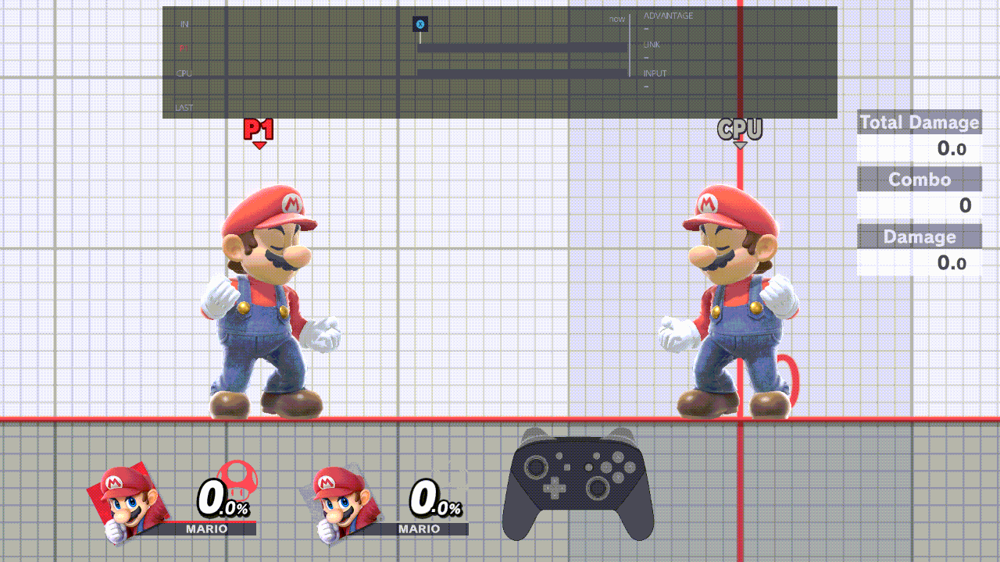

- **Values:** any button, or several, for each row; or disabled (an empty chord does nothing)
- **Default:** as in the table
- **How:** A opens the editor, and A on a row opens that chord. Press X, let go of every button, then hold the new
  chord: hold one button and press the others. Let go to see it, and A keeps it. Y empties it, B cancels. New chords
  work once you close the menu. Y on this row (on the page) puts all ten back to your saved defaults.

More: [Controls › Changing a chord](../guide/controls.md#changing-a-chord), [Game speed](../guide/game-speed.md)

### L+R+A Reset

On: holding L, R and A resets. In Training that is the game's own reset. In a waiting room with Lobby Practice on, both
practice fighters go back to where they first stood. Off: the chord does nothing (in Training, the game's reset is
blocked).

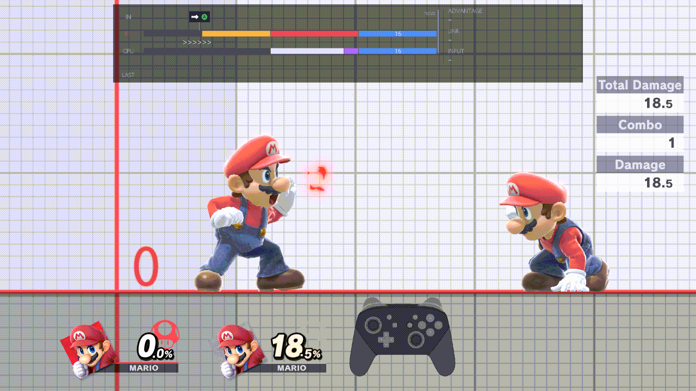

- **Values:** On, Off
- **Default:** On
- **How:** A, Left or Right flips it.

More: [Controls › Fixed buttons](../guide/controls.md#fixed-buttons)

### Taunts

Off stops Player 1's D-pad taunts in Training and in waiting-room practice, so a D-pad press meant for a chord never
starts one. Kirby holding a copy ability keeps D-pad Up, which drops the hat. The chords and the menu shortcuts work
either way, and online matches are not changed.

- **Values:** On, Off
- **Default:** On
- **How:** A, Left or Right flips it.

![The menu on Taunts [ON]: D-pad Right flips it to [OFF], D-pad Left flips it back to [ON], with no A](../media/rc13-left-right-toggle.gif) *Left or Right flips any On/Off row, as A does: on Taunts, Right turns it Off and Left turns it On again. Eden, rc.13 (untested on hardware).*

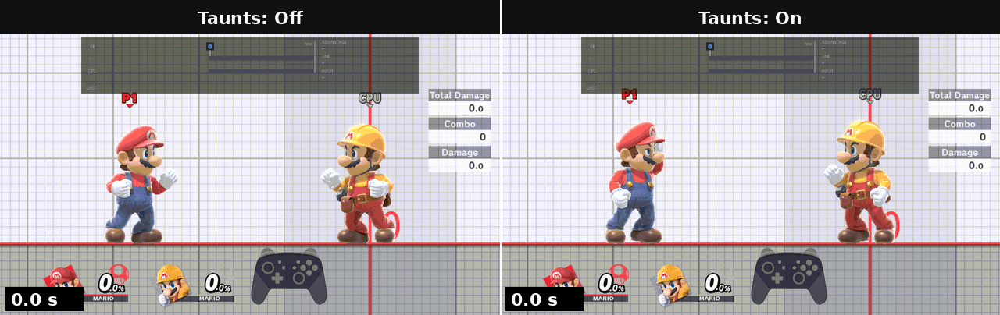

*The same D-pad Up, Side and Down from the same reset, lit on the pad: with Taunts Off (left) Mario does not taunt; with Taunts On (right) each press is a taunt. Eden, rc.13 (untested on hardware).*

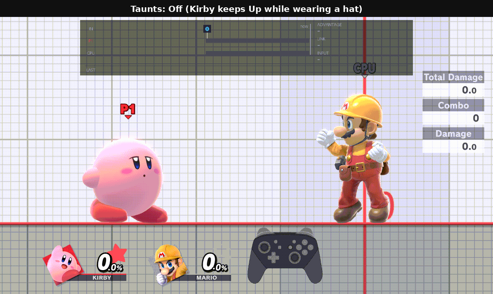

*Taunts Off, Player 1 Kirby: D-pad Up does nothing; with a copy hat, Side and Down still do nothing and Up drops the hat. Eden, rc.13 (untested on hardware).*

### Menu shortcut 1

A button or chord that opens this menu, as well as B + D-pad Up. It is kept in `button_config.ini` in
`sd:/ultimate/TrainingRooms/`, so the menu writes that file. A change works at once.

- **Values:** any button, or several; or disabled
- **Default:** Minus
- **How:** A opens the editor. Press X, let go of every button, hold the new chord, then let go to see it. A keeps it,
  Y empties it (disabled), B cancels. The editor refuses B + D-pad Up ("B + D-pad Up always opens the menu") and the
  chord the other shortcut already has. *Reset page to defaults* leaves the shortcuts as they are.

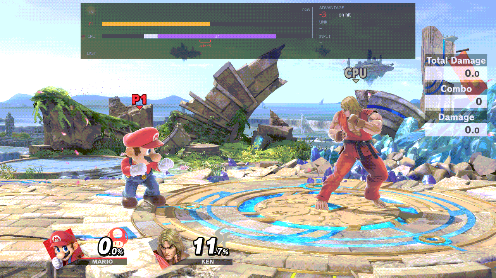

More: [Controls › Opening the menu](../guide/controls.md#opening-the-menu)

### Menu shortcut 2

A second button or chord that opens this menu. It works like Menu shortcut 1 and is kept in the same file.

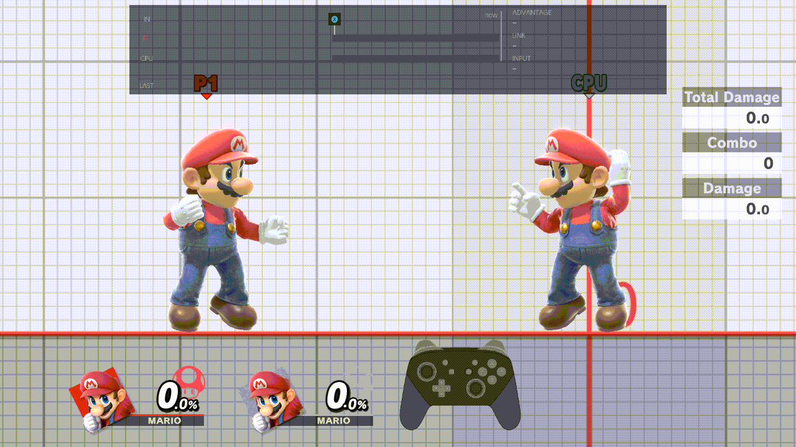

- **Values:** any button, or several; or disabled
- **Default:** disabled
- **How:** as Menu shortcut 1.

### Permanent shortcut

B + D-pad Up always opens this menu. This row only shows it; it cannot be changed.

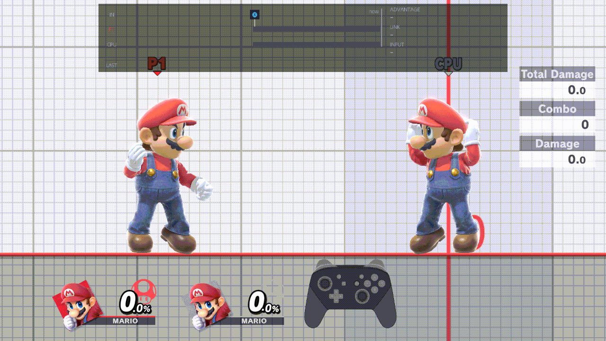

- **Values:** B + D-pad Up (read-only)
- **How:** nothing to change.
