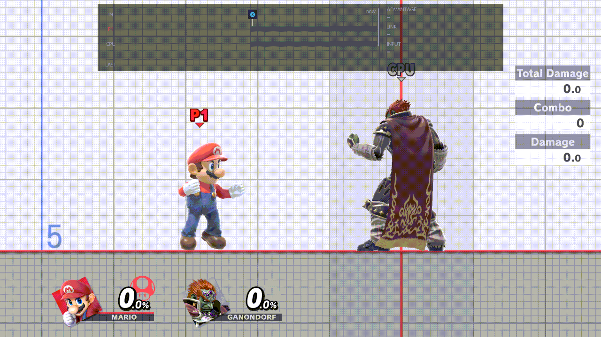
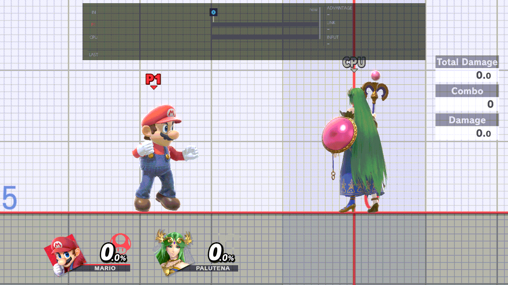
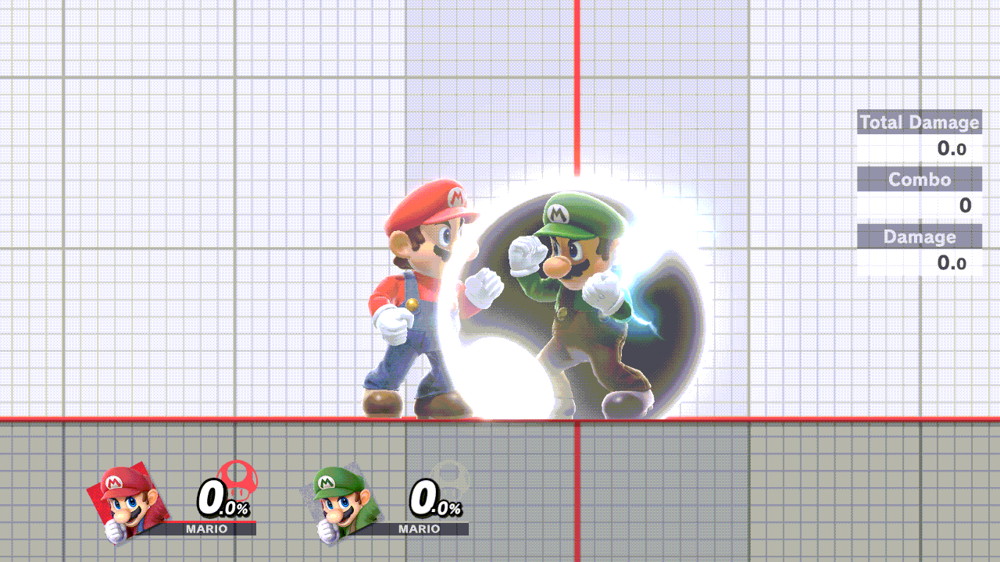
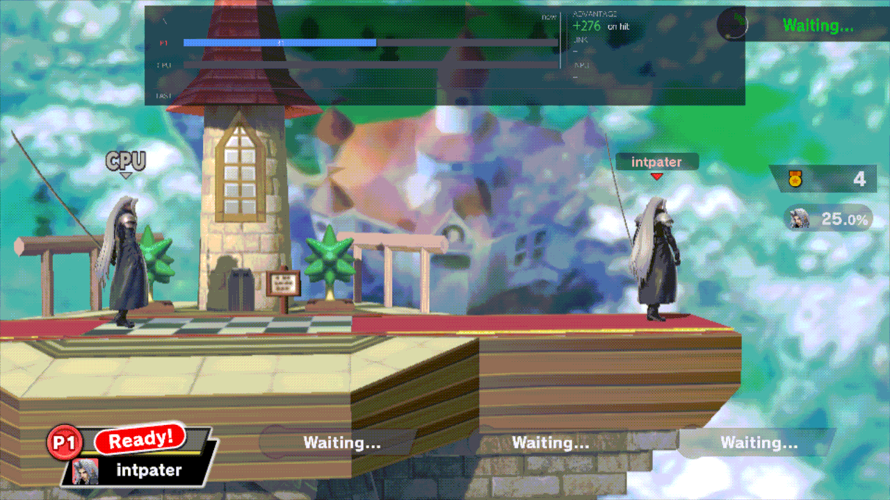
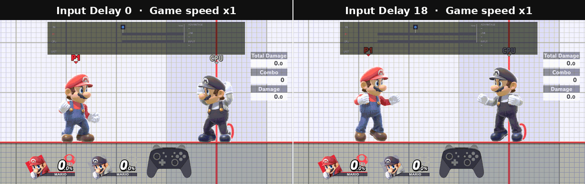
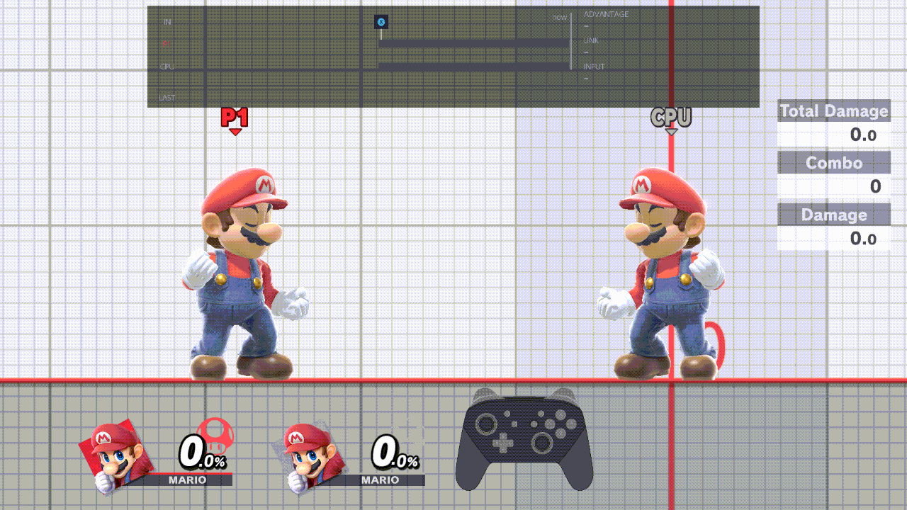
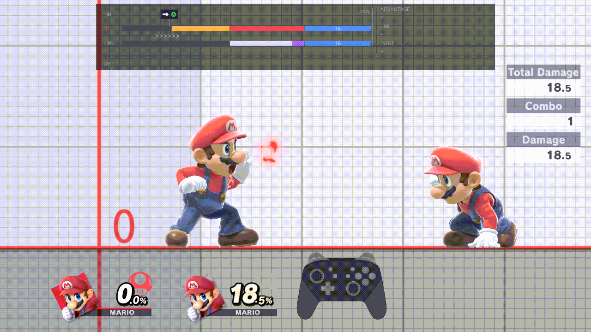
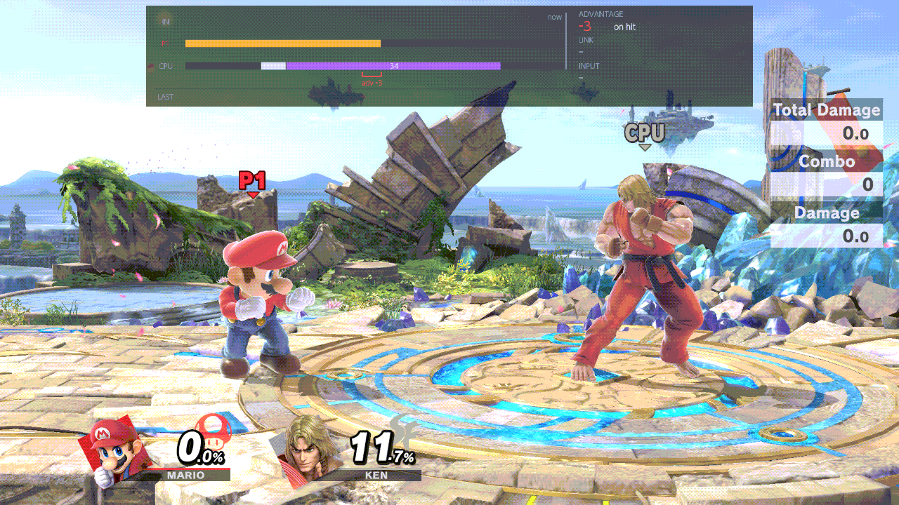
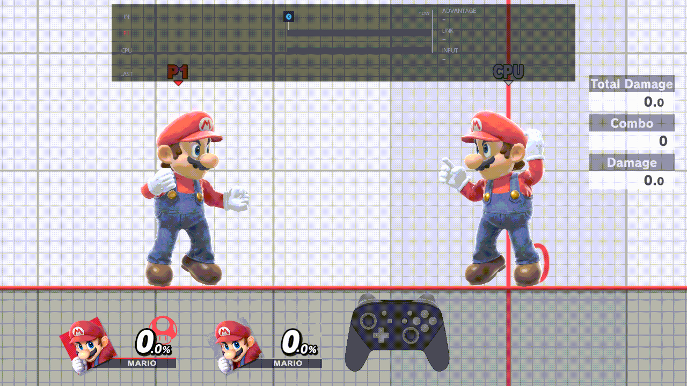
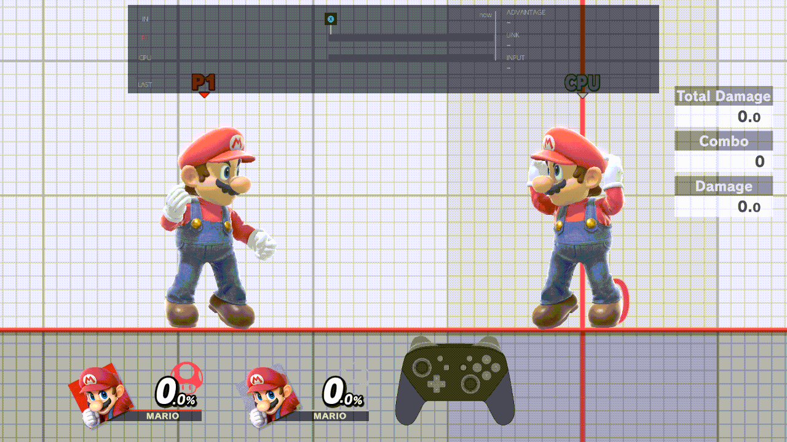

# Display & Controls

This page sets what is drawn on screen while you practise, and the buttons that drive the plugin. Open the menu with
B + D-pad Up (or Minus), then press L once from the CPU page, or R until the title reads Display & Controls.
[Using the menu](../guide/using-the-menu.md) explains the buttons inside the menu.

## On screen

### HUD

Off hides the game's own HUD in Training while you play: the damage and stock panel, the player pointers above the
fighters, the item pointers and the off-screen bubbles. On keeps it. The frame strip and the plugin's notices stay
either way.

- **Values:** On, Off
- **Default:** On
- **How:** A flips it.

The row's help line on screen says Off leaves "the game's own HUD only". In this build Off hides the game's HUD, as
described above.

### Hitbox Visualization

On draws the fighters' boxes as coloured discs: hitboxes (the attacks; each hitbox of a move gets its own colour, the
first is red), grab boxes, and hurtboxes (the yellow bubbles: where a fighter can be hit). It works in Training, and on
the two practice fighters in a waiting room. A fighter's boxes are not drawn while it shields or while it is grabbing.

- **Values:** On, Off
- **Default:** Off
- **How:** A flips it.

The row's help line still says hurtboxes are not available. They are drawn in this build.

### Frame Advantage

On shows a notice after each exchange with your frame advantage: plus means you can act before the CPU, minus means
the CPU can act first. The notice stays down while the frame strip is on screen, because the strip's ADVANTAGE readout
shows the same number, so you see it only with Input Display set to Off. Nothing is measured while the CPU has Mash
actions ticked.

- **Values:** On, Off
- **Default:** Off
- **How:** A flips it.

More: [Frame strip › ADVANTAGE](../guide/frame-strip.md#advantage)

### Input Display

Frame strip draws the last second of frames at the top of the screen: your presses, your frames and the CPU's, how
each follow-up linked, and the frame advantage. It works in Training and in waiting-room practice. It steps aside while
a menu is open, the waiting room's own menu included, and comes back when the menu closes.

- **Values:** Off, Frame strip
- **Default:** Frame strip
- **How:** Left or Right switches it; A opens the list. The Input display chord (R + D-pad Down) switches it without
  opening the menu.

More: [Frame strip](../guide/frame-strip.md)

### Input Delay

Holds Player 1's inputs back by a number of frames, for example to practise as if playing online. Chords are not
delayed. The frame strip and recordings see the inputs as delayed.

- **Values:** 0 to 30 frames
- **Default:** 0
- **How:** Left or Right steps one frame (it stops at 0 and 30); A opens the list.

## Controls

### Button chords

Opens the chord editor: the ten chords for save states, recording, fighter cycles, the input display and game speed.
A chord is "hold one button and press the others".

| Row | Default | What it does |
| --- | --- | --- |
| Save State Save | ZL + D-pad Down | Saves a save state. |
| Save State Load | ZL + D-pad Up | Loads it. |
| Record | ZR + D-pad Down | Starts or stops a recording. |
| Play on CPU | ZR + D-pad Up | Plays the CPU's active recording, or stops it. |
| Play on Player 1 | ZR + D-pad Left | Plays Player 1's active recording, or stops it. |
| Recording pop-up | ZR + D-pad Right | Opens the recording pop-up (B closes it). |
| Cycle Player | ZL + D-pad Right | Your next fighter (needs Player Swapping On). |
| Cycle CPU | ZL + D-pad Left | The CPU's next fighter. |
| Input display | R + D-pad Down | Turns the frame strip on or off. |
| Game speed | R + D-pad Up | Hold it, then D-pad Left or Right changes the speed. |

- **Values:** any button, or several, for each row; or disabled (an empty chord does nothing)
- **Default:** as in the table
- **How:** A opens the editor, and A on a row opens that chord. Press X, let go of every button, then hold the new
  chord: hold one button and press the others. Let go to see it, and A keeps it. Y empties it, B cancels. New chords
  work once you close the menu. Y on this row (on the page) puts all ten back to your saved defaults.

More: [Controls › Changing a chord](../guide/controls.md#changing-a-chord), [Game speed](../guide/game-speed.md)

### L+R+A Reset

On: holding L, R and A resets. In Training that is the game's own reset. In a waiting room with Lobby Practice on, both
practice fighters go back to where they first stood. Off: the chord does nothing (in Training, the game's reset is
blocked).

- **Values:** On, Off
- **Default:** On
- **How:** A flips it.

More: [Controls › Fixed buttons](../guide/controls.md#fixed-buttons)

### Menu shortcut 1

A button or chord that opens this menu, as well as B + D-pad Up. It is kept in `button_config.ini` in
`sd:/ultimate/TrainingRooms/`, so the menu writes that file. A change works at once.

- **Values:** any button, or several; or disabled
- **Default:** Minus
- **How:** A opens the editor. Press X, let go of every button, hold the new chord, then let go to see it. A keeps it,
  Y empties it (disabled), B cancels. The editor refuses B + D-pad Up ("B + D-pad Up always opens the menu") and the
  chord the other shortcut already has. *Reset page to defaults* leaves the shortcuts as they are.

More: [Controls › Opening the menu](../guide/controls.md#opening-the-menu)

### Menu shortcut 2

A second button or chord that opens this menu. It works like Menu shortcut 1 and is kept in the same file.

- **Values:** any button, or several; or disabled
- **Default:** disabled
- **How:** as Menu shortcut 1.

### Permanent shortcut

B + D-pad Up always opens this menu. This row only shows it; it cannot be changed.

- **Values:** B + D-pad Up (read-only)
- **How:** nothing to change.
