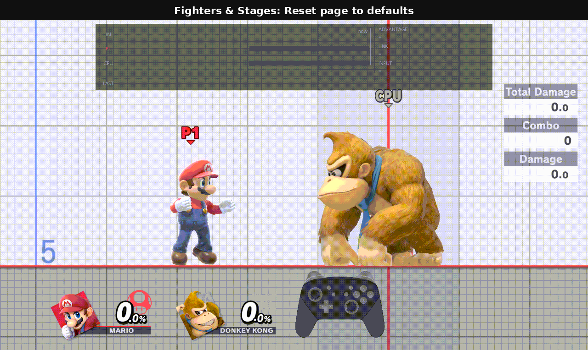

# Fighters & Stages

From the CPU page, press R three times to open Fighters & Stages.

## Player 1 and CPU

<video src="https://git.syntaxbyexample.com/intpa/TrainingRoomsForUltimate/media/blob/6d08f7457ab8d11ca30c8d7ed1140dd4611397e9" autoplay muted loop playsinline controls></video>

*Mario cycles to Donkey Kong.* [Open the clip](../media/tut-fighter-cycle.mp4)

Pick both fighters and the order the cycle chords step through ([Fighter cycles](../guide/fighter-cycles.md)).

| Setting | Values (default in bold) | What it does |
| --- | --- | --- |
| Player Swapping | On, **Off** | Enables Cycle Player. Manual fighter picks work either way. |
| Player Character | Any fighter | Pick Player 1's fighter on the grid. Close the menu to load it. [Clip](../media/rc12-player-character.gif) |
| CPU Character | Any fighter | The same grid for the CPU. [Clip](../media/rc11-cpu-character.gif) |
| Character Cycles | **All**, or your own order | The order the cycle chords step through, per role. ZR switches role. [Clip](../media/rc11-cycle-switch.gif) |
| Solo Popo (original Ice Climbers) | On, **Off** | On: Player 1's Ice Climbers from the character select are Popo alone. [Clip](../media/rc11-solo-popo.gif) |

## Extras

<video src="https://git.syntaxbyexample.com/intpa/TrainingRoomsForUltimate/media/blob/0858b8e26cf6db1c8d16f3d935c486380ffa303f" autoplay muted loop playsinline controls></video>

*Kirby gets Mario's cap.* [Open the clip](../media/tut-kirby-hat.mp4)

Kirby's hats, an item for Player 1, and the Mii of each class ([Mii fighters](../guide/mii.md)).

| Setting | Values (default in bold) | What it does |
| --- | --- | --- |
| Kirby Hats | **Mario**, All, or your own order | The hat order Kirby copies, for each role. [Clip](../media/rc7-kirby-hats.gif) |
| Give item | 39 items | A picks an item for Player 1. It arrives when the menu closes. [Clip](../media/rc11-give-item.gif) |
| Mii Brawler | A saved, replay or new Mii | The Mii used for the Brawler. [Clip](../media/rc7-mii-editor.gif) |
| Mii Swordfighter | A saved, replay or new Mii | The Mii used for the Swordfighter. [Clip](../media/rc11-mii-swordfighter.gif) |
| Mii Gunner | A saved, replay or new Mii | The Mii used for the Gunner. [Clip](../media/rc11-mii-gunner.gif) |

## Stages

<video src="https://git.syntaxbyexample.com/intpa/TrainingRoomsForUltimate/media/blob/e0de6dbeba09dd60aa5dc2ec3c5fbde73470d79a" autoplay muted loop playsinline controls></video>

*Both fighters move to Battlefield Ω.* [Open the clip](../media/tut-stage-change.mp4)

Change the stage now, or set up practice in the waiting room ([Stages](../guide/stages.md), [Waiting rooms](../guide/waiting-rooms.md)).

| Setting | Values (default in bold) | What it does |
| --- | --- | --- |
| Change Stage | 117 game stages, plus Stage Builder stages | Y cycles available forms. A changes stage and closes the menu. [Clip](../media/rc11-change-stage.gif) |
| Lobby Practice | **On**, Off | On: practice runs in the waiting room too. Off: only in Training. [Clip](../media/rc11-lobby-practice.gif) |
| Lobby Stages | **Waiting Room only**, All, or your own order | Set the rotation order. X switches to Direct for one fixed stage. [Clip](../media/rc11-lobby-stages.gif) |
| Training Stage Rotation | On, **Off** | On: Training moves through the Lobby Stages order. [Clip](../media/rc11-stage-rotation.gif) |
| Stage Hazards | On, **Off** | On: hazards are active. It applies as a stage loads. [Clip](../media/rc12-stage-hazards.gif) |
| Lobby Items | **On**, Off | Off stops automatic drops and clears existing items once. [Clip](../media/rc12-lobby-items.gif) |
| Respawn on platform | On, **Off** | On: respawn on the revival platform, invincible. Off: instant respawn. [Clip](../media/rc7-respawn-on.gif) |

## Loading

 
*The same swap with Ready Fighters at 4 and at 10.*

Keep fighters and hats ready to shorten swap times ([Fighter cycles](../guide/fighter-cycles.md#what-the-loading-rows-do)).

| Setting | Values (default in bold) | What it does |
| --- | --- | --- |
| Cycle Preload | Off, 1 to **5** | How many fighters per role are kept ready for swaps. [Clip](../media/rc12-cycle-preload.gif) |
| Preload | Fighters, Hats, **Both** | What is kept ready. [Clip](../media/rc12-preload.gif) |
| Ready Fighters | 2 to 12, **10** | The total kept ready across both roles, the two on screen included. |
| Ready Hats | 0 to **5** | How many Kirby hats are kept ready. [Clip](../media/rc12-preload-hats.gif) |
| Ready Fighter Bodies | Off, 2, **3** | Bodies in each role's own slot, including its active fighter. Off disables groups. [Clip](../media/rc12-ready-fighter-bodies.gif) [Still](../media/tut-loading-ready-fighter-bodies.png) |
| Group Swap | **On**, Off | Allow extra groups beyond each slot. Off: no extras; both bank settings stay. [Clip](../media/rc12-group-swap.gif) |
| Swap groups | Seven entries, **all On** | Which swaps are done as a group. A greyed entry says why. [Clip](../media/rc12-swap-groups.gif) [Help line](../media/tut-loading-swap-groups.png) |

## Practice games

<video src="https://git.syntaxbyexample.com/intpa/TrainingRoomsForUltimate/media/blob/48415ed2d8d2476130d914666584abf824135ae4" autoplay muted loop playsinline controls></video>

*Mash out: Good at 30 frames, Poor at 90.* [Open the clip](../media/tut-mash-out.mp4)

A on a game opens its screen: Start first, then its settings ([Practice games](practice-games.md)).

| Setting | Values | What it does |
| --- | --- | --- |
| Eggs-ercise | Start, Stop | Break the targets that appear, against the clock or freely. [Guide](../guide/eggs-ercise.md) |
| Break the Targets | Start, Stop | Place targets, then break them all against the clock. [Guide](../guide/break-the-targets.md) |
| Tech practice | Start, Stop | Practice techs at a chosen or random stage surface. [Guide](../guide/tech-practice.md) |
| Mash out | Start, Stop | Practice escaping a capture. [Guide](../guide/mash-out.md) |
| Parry practice | Start, Stop | Parry the CPU's recorded move, in sets of ten or freely. [Guide](../guide/parry-practice.md) |
| Guard the Edge | Start, Stop | Keep the CPU offstage and secure the stock. [Guide](../guide/guard-the-edge.md) |
| Juggler | Start, Stop | Keep the CPU airborne for as long as possible. [Guide](../guide/juggler.md) |

## Reset page to defaults

 
*Reset restores this page's saved defaults.*

| Setting | Values | What it does |
| --- | --- | --- |
| Reset page to defaults | A, then confirm | Restores saved defaults. Mii choices and stage forms stay unchanged. |

## Good to know

 
*Cycle Player works after Player Swapping is turned on.*

| If | Then |
| --- | --- |
| The Cycle Player chord does nothing | Check Player Swapping first; it defaults to Off. |
| You pick a fighter in a waiting room | Only your practice fighter changes, not the match's. |
| Respawn on platform is greyed | Save States and Auto-load on death are both On. |
| A Pokémon Trainer or Pyra / Mythra swap group is greyed | PT / Aegis groups need free Ready Fighters: PT 3, Aegis 2. |
| You reset this page | The settings inside the games' screens reset too. |
