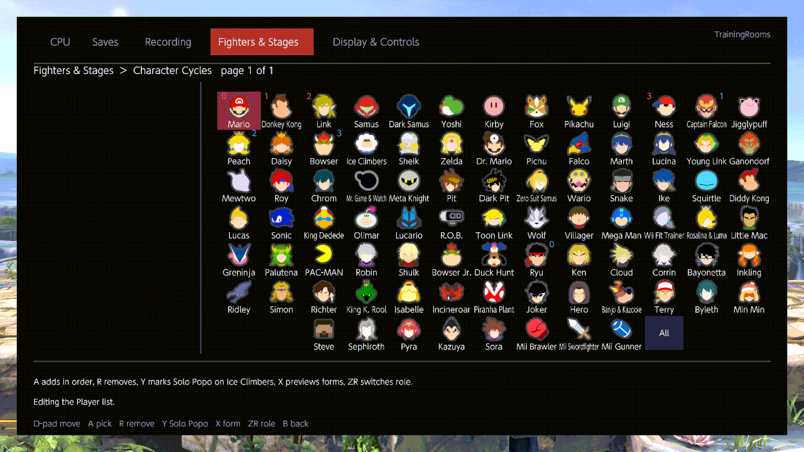
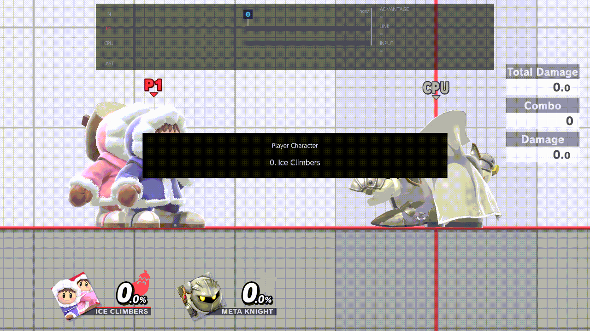
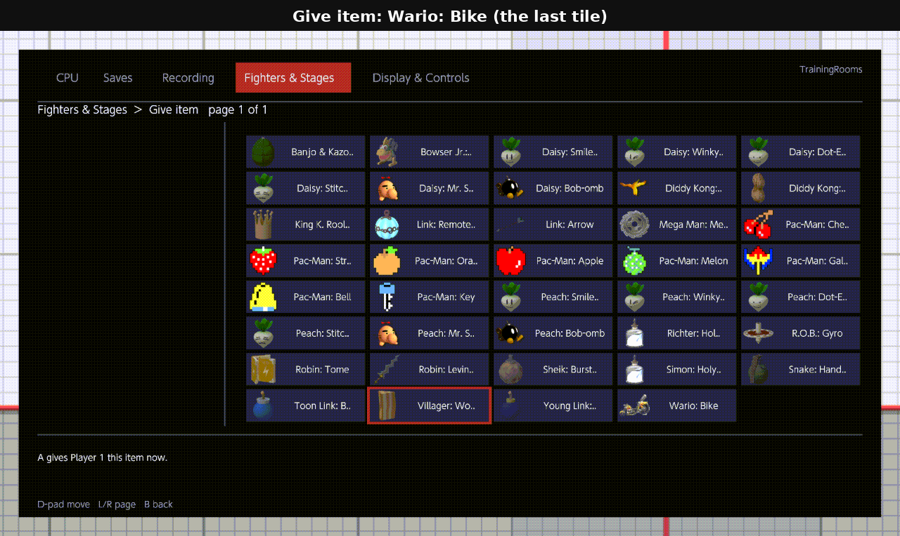
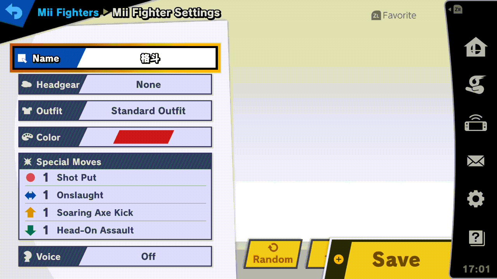
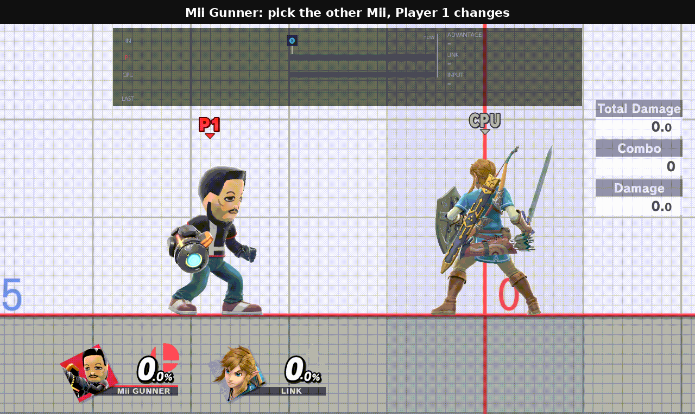
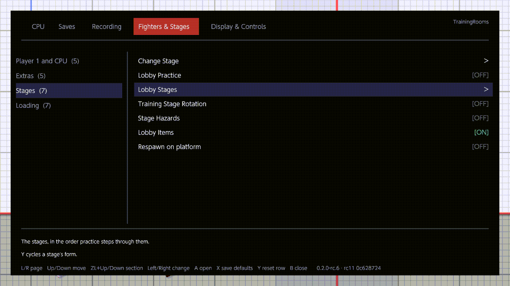
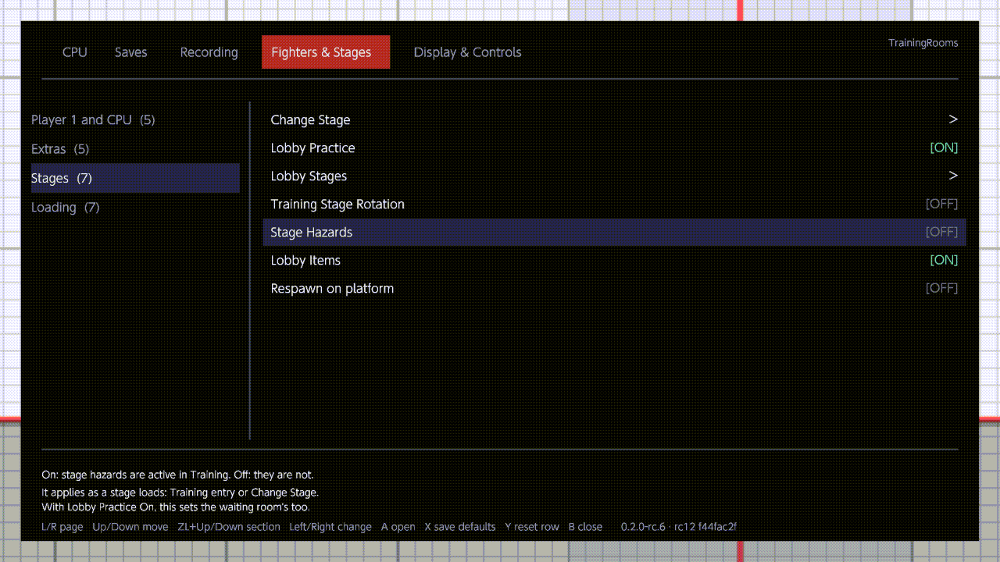
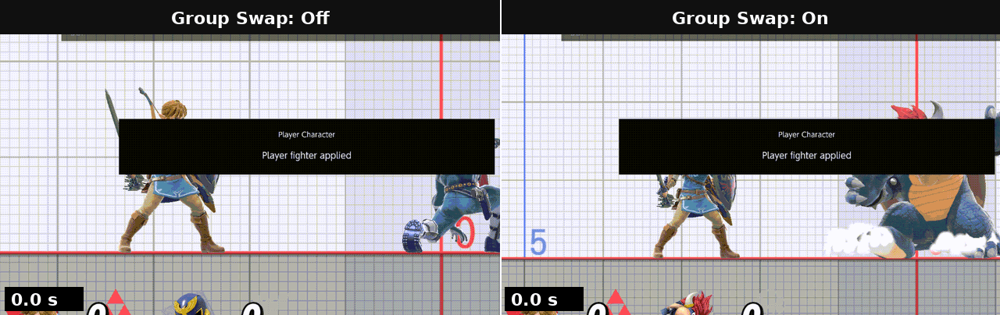
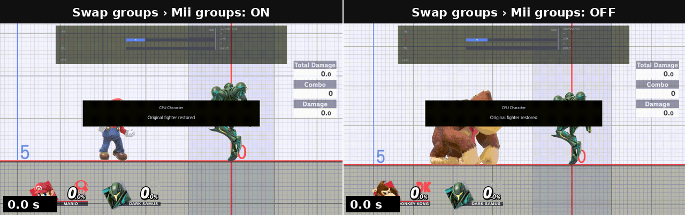
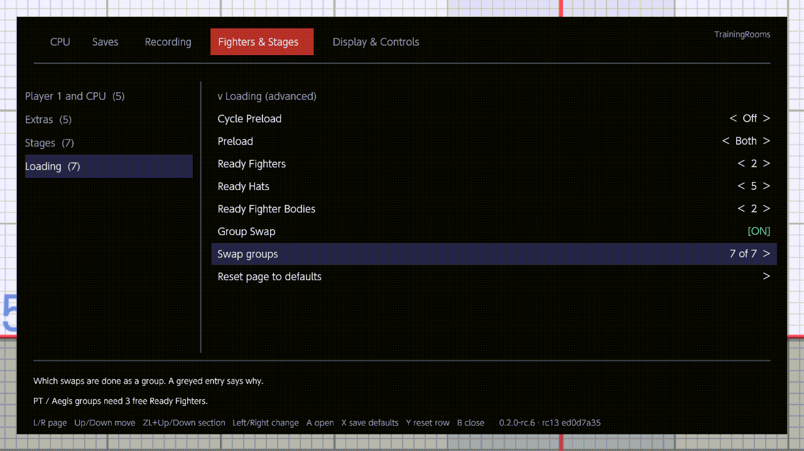

# Fighters & Stages

This page picks the fighters on both sides, the order the cycle chords step through, Kirby's hats, the Mii fighters
and the stage, and turns on practice in the waiting rooms. Open the menu with B + D-pad Up (or Minus), then press L
twice from the CPU page, or R until the title reads Fighters & Stages.
[Using the menu](../guide/using-the-menu.md) explains the buttons inside the menu.

The guides: [Fighter cycles](../guide/fighter-cycles.md), [Mii fighters](../guide/mii.md),
[Stages](../guide/stages.md) and [Waiting rooms](../guide/waiting-rooms.md).

## Player 1 and CPU

### Player Swapping

On: the Cycle Player chord (ZL + D-pad Right) changes your fighter. Off: the chord doesn't, so Player 1 stays the
fighter you picked; a pick in [Player Character](#player-character) and a combo's Switch (Recording) still change it.
The CPU is not affected: its chord and [CPU Character](#cpu-character) always work. With it Off, Cycle Player does nothing and shows no notice.

- **Values:** On, Off
- **Default:** Off
- **How:** A, Left or Right flips it.

 
*With Player Swapping Off the Cycle Player chord (ZL + D-pad Right, named in a box) does nothing and shows no notice. B + Up opens the menu on Player Swapping, A turns it On, B closes it, and the same chord loads Donkey Kong as Player 1 (the load is cut). Eden, rc.13 (untested on hardware).*

More: [Fighter cycles › Player Swapping](../guide/fighter-cycles.md#player-swapping)

### Player Character

Opens a portrait grid of every fighter and picks Player 1's. The new fighter loads when you close the menu, with
[Player Swapping](#player-swapping) On or Off.

- **Values:** any fighter on the grid
- **How:** A opens the grid. The D-pad moves, A picks ("> " marks the pick), B goes back. X on a shared slot (Pokémon
  Trainer, Pyra / Mythra) shows its next form, so A picks that form.

The pick follows the fighter on screen: when you enter Training, or a cycle chord switches you, it becomes that
fighter. A greyed Mii tile has no Mii that Player 1 can load (the help line reads "… - unavailable"). In a waiting room
this changes only your practice fighter; the match uses the fighter you picked for it. For Ice Climbers picked here, see
[Solo Popo](#solo-popo-original-ice-climbers).

### CPU Character

The same grid for the CPU. The new fighter loads when you close the menu. It always works; in a waiting room it
changes the first training partner.

- **Values:** any fighter on the grid
- **How:** as [Player Character](#player-character).

 
*CPU Character: A opens the grid, Right and A pick Donkey Kong, B closes the menu, and the CPU loads it ("CPU fighter applied"). The 3.6 s load is cut. Eden, rc.11.*

### Character Cycles

The order the cycle chords step through: one list for Player 1 (red numbers) and one for the CPU (blue numbers). The
second help line says which list you are editing.

- **Values:** All, or your own order
- **Default:** All, for both
- **How:** A opens the grid. Y on this row (on the page) resets both lists.

| In the grid | What it does |
| --- | --- |
| ZR | Switches between the Player and the CPU list. |
| A on a fighter | Adds it at the end. From All, it starts a new list with just that fighter. |
| A on All | Takes every fighter, in character-select order. |
| R | Removes a fighter. The last one stays. |
| X on Pokémon Trainer or Pyra / Mythra | Shows its next form; A then makes the cycle load that form. |
| Y on Ice Climbers | Marks Solo Popo ("S") for that list. |
| B | Goes back. |

The fighter each role started with is its 0. Each press of the cycle chord loads the next number; after the last it
goes back to 0. A Mii tile is numbered only while that role has a Mii of the class it can load; which Mii is set by
the [Mii rows](#mii-brawler). A change made in Training starts loading the new fighters at once.

More: [Fighter cycles › The Character Cycles editor](../guide/fighter-cycles.md#the-character-cycles-editor)

### Solo Popo (original Ice Climbers)

On: when Player 1 picked Ice Climbers at the character select, Player 1 is Popo alone, without Nana. That counts for
Player 1's 0 in the cycle too.

- **Values:** On, Off
- **Default:** Off
- **How:** A, Left or Right flips it.

Three controls decide when Ice Climbers load as Popo alone. All start Off:

| Which Ice Climbers? | Control |
| --- | --- |
| Player 1's, picked at the character select (picking them again in [Player Character](#player-character) counts too) | This row |
| Player 1's cycle, or picked in Player Character after starting as another fighter | Y on Ice Climbers in the Player list of [Character Cycles](#character-cycles) (the "S" mark) |
| The CPU's pick and its cycle | Y on Ice Climbers in the CPU list (the "S" mark) |

With this row Off, Player 1 can still be Popo alone through the "S" mark. If Player 1's two controls differ, Ice
Climbers can be in Player 1's cycle twice: as 0 one way and as a number the other.

 
*Player 1 picked Ice Climbers at the character select: Popo and Nana. B + Up, A turns Solo Popo On, B closes the menu; Player 1 reloads as Popo alone ("Player Character · 0. Ice Climbers"). The 3.3 s reload is cut. Eden, rc.11.*

More: [Fighter cycles › Solo Popo](../guide/fighter-cycles.md#solo-popo)

## Extras

### Kirby Hats

The order of the hats (copy abilities) the Kirby hat chord gives Kirby: one list for Player 1's Kirby and one for the
CPU's. Kirby itself can't be a hat.

- **Values:** All, or your own order
- **Default:** Mario only, for both
- **How:** A opens the grid. ZR switches between the Player and the CPU list. A adds a fighter's hat at the end (All
  takes everyone), R removes one (the last one stays), X shows the next form of a shared slot, B goes back.

The chord is fixed: hold B with the left stick at rest and click the left stick for your Kirby, or the right stick for
the CPU's. Each click gives the next hat in the list.

More: [Fighter cycles › Kirby hats](../guide/fighter-cycles.md#kirby-hats)

### Give item

Opens a grid of 39 fighter items: turnips (each face), bombs, Pac-Man's bonus fruit, Robin's tome and Levin Sword,
Wario's bike (the last tile), and more. A puts the item in Player 1's hand as soon as the menu closes, in place of
anything Player 1 holds; the notice reads "Character Item" and the item's name. Wario's bike works for any fighter:
A throws it, and it drives forward, hits whoever it meets, then stays on the floor.

- **Values:** the 39 items
- **How:** A opens the grid. The D-pad moves, L / R turn its page, A gives, B goes back. Every A asks again, the same
  item included; if you press A on several, the last one is given.

Most items need their fighter's data, which the plugin loads for you; if it can't, the notice says "Load ‹fighter› as
Player or CPU first". Daisy's and Peach's Bob-omb and Mr. Saturn, and Diddy Kong's Banana Peel, need nothing. Nothing is
given during a fighter swap, a save-state load, a recording or a playback.

 
*Give item: A opens the grid, Down, Right, Right to Daisy: Bob-omb, A, B closes the menu: Player 1 gets the Bob-omb (the notice names it). Eden, rc.11.*

 
*Give item, the last tile: Wario's bike with its own icon. A gives it; Mario holds the bike, and A throws it: it drives into the CPU and stays on the floor. Eden, rc.13 (untested on hardware).*

### Mii Brawler

Opens the list of Mii Brawlers for Player 1; ZR switches to the CPU's list. It lists your saved Miis, then the Miis
imported from your replays, then *Add New…*, which opens Smash's own Mii Fighter editor. Each line reads "number. name
[specials]", the four specials as digits; "> " marks the role's choice.

- **Values:** a saved Mii, a replay Mii, or a new one
- **How:** A opens the list. Up / Down move, L / R move a page, A picks, ZR switches Player / CPU, B goes back.

A pick applies when you close the menu if that role is a Mii Brawler on screen; otherwise the next time a cycle or a
pick loads the class.

More: [Mii fighters](../guide/mii.md)

### Mii Swordfighter

The same list for the Mii Swordfighter.

- **Values:** a saved Mii, a replay Mii, or a new one
- **How:** as [Mii Brawler](#mii-brawler).

 
*With the CPU a Mii Swordfighter: A opens the list (Player 1's), ZR switches to the CPU's, Down and A pick the second saved Swordfighter, and B closes the menu; the CPU reloads it ("Saved Mii applied"). The two saved Miis on this profile look alike. The 6.6 s load is cut. Eden, rc.11.*

### Mii Gunner

The same list for the Mii Gunner.

- **Values:** a saved Mii, a replay Mii, or a new one
- **How:** as [Mii Brawler](#mii-brawler).

 
*A opens Player 1's Mii Gunner list; ZR switches to the CPU's. This profile has one saved Gunner, then Add New…, which opens Smash's Mii editor (as for the Brawler). Eden, rc.11.*

 
*Player 1 is a Mii Gunner. Fighters & Stages > Extras > Mii Gunner opens the Player list (the saved Gunner and two Replay Gunners, ">" on the pick); A on the other Replay Gunner moves the marker, and when the menu closes "Saved Mii applied" shows and Player 1 is that Mii. Each press is named in a box. Eden, rc.13 (untested on hardware).*

## Stages

### Change Stage

Opens a grid of every stage. A on a stage closes the menu and goes there: the notice reads "Practice Stage · Stage
requested", then "Stage ready". It works in Training and in waiting-room practice.

- **Values:** any of the 117 stages, the Waiting Room and Training included, in the forms the game has for each
- **How:** A opens the grid. The D-pad moves, L / R turn its page, Y picks the focused stage's form first (the tile
  shows [N], [Ω] or [BF]), A goes there, B goes back.

*A on Battlefield (Ω) closes the menu ("Stage requested"); then the whole morph to Battlefield Ω and "Stage ready". The 3 s wait between them, where nothing moves, is cut. Eden, rc.11.*

More: [Stages › Change Stage](../guide/stages.md#change-stage)

### Lobby Practice

On: TrainingRooms runs in the waiting rooms too (local wireless rooms and Quickplay's online waiting room). The menu
opens there, the chords work, and the CPU page drives the first training partner. Off: the waiting rooms are left to
the game, and the menu doesn't open there. Turn it On in Training before you go.

- **Values:** On, Off
- **Default:** Off
- **How:** A, Left or Right flips it.

 
*In a local wireless waiting room with Lobby Practice On: B + Up opens the menu, A turns Lobby Practice Off, B closes it, and the frame strip goes. B + Up again opens no menu: Byleth does its up special. Eden, rc.11.*

More: [Waiting rooms](../guide/waiting-rooms.md)

### Lobby Stages

The stage list: each new waiting room opens on the next stage of it, and Training does too with
[Training Stage Rotation](#training-stage-rotation) On.

- **Values:** All, or your own order; Rotation or Direct
- **Default:** the Waiting Room only, Rotation
- **How:** A opens the grid. X switches between the two modes. Y changes the focused stage's form. L / R turn the page,
  B goes back.

| Mode | What A does |
| --- | --- |
| Rotation | Adds a stage at the end of the list or takes it out (the number is its place; the last one stays). A on All takes every stage. |
| Direct | Goes to the stage now and closes the menu, as Change Stage does. New waiting rooms open on that stage instead of the list. |

The waiting rooms follow the list only while [Lobby Practice](#lobby-practice) is On.

<!-- CAPTURE-REQUEST v06-lobby-stages-modes: a clip of Rotation versus Direct in a waiting room: Rotation with two stages ordered, the next practice opens on the next stage; Direct, pick stage B, close the menu, the room becomes B. Do not reuse the Training Stage Rotation clip. See artifacts/docs4/CAPTURE-REQUESTS.md. -->

More: [Stages › Lobby Stages](../guide/stages.md#lobby-stages)

### Training Stage Rotation

On: Training opens on the stage you pick, then on each return through the character select on the next
stage of the [Lobby Stages](#lobby-stages) list. Off: Training opens on the stage you chose, as usual.

- **Values:** On, Off
- **Default:** Off
- **How:** A, Left or Right flips it.

It always uses the Rotation list, even while Lobby Stages is on Direct. With the default list (the Waiting Room only),
each return opens on the Waiting Room.

 *Training Stage Rotation On: the stage you pick before the character select opens Training; going back through the character select opens the next stage of the list. Eden, rc.13 (untested on hardware).*

More: [Stages › Training Stage Rotation](../guide/stages.md#training-stage-rotation)

### Stage Hazards

On: stage hazards are active in Training. Off: they are not. It takes effect when a stage loads: when you enter
Training, or go to a stage with Change Stage. The stage you are on keeps its hazards until then.

- **Values:** On, Off
- **Default:** Off
- **How:** A, Left or Right flips it.

With [Lobby Practice](#lobby-practice) On it also sets the hazards of the waiting room's stage, when you enter the
room.

### Lobby Items

On: items appear in the waiting room as usual. Off: no items appear there, and the ones on the floor are removed when
you turn it Off. Training is not affected.

- **Values:** On, Off
- **Default:** On
- **How:** A, Left or Right flips it.

It works in local wireless rooms and in Quickplay's waiting room, whether Lobby Practice is On or not.

### Respawn on platform

On: after a KO, the fighter comes down on the revival platform with the game's invincibility. Off: the fighter is back
at once, with no invincibility. It works in Training and in waiting-room practice.

- **Values:** On, Off
- **Default:** Off
- **How:** A, Left or Right flips it. The row is greyed ("Auto-load on death is On: a save state loads instead")
  while Saves › [Save States](saves.md#save-states) and [Auto-load on death](saves.md#auto-load-on-death) are both On.

It works with Save States On or Off.

More: [Save states › Respawning](../guide/save-states.md#respawning)

## Loading

Advanced: this section is collapsed until you open it (A on its header).

These rows set how fighters and Kirby hats are loaded ahead of time, in the background, so a cycle chord or a hat
click switches at once instead of reloading. The notice "Fighters" counts them, such as "Loading 6/10", then
"Ready 10/10". The defaults suit most players.

More: [Fighter cycles › What the Loading rows do](../guide/fighter-cycles.md#what-the-loading-rows-do)

### Cycle Preload

How many of the next fighters in each role's cycle are kept ready. Off: none are; each swap loads its fighter then,
which takes longer.

- **Values:** Off, 1, 2, 3, 4, 5
- **Default:** 5
- **How:** Left or Right switches it; A opens the list.

### Preload

What is kept ready: the fighters of your cycles, Kirby's hats, or both. The banks and groups below need Fighters or
Both.

- **Values:** Fighters, Hats, Both
- **Default:** Both
- **How:** Left or Right switches it; A opens the list.

### Ready Fighters

The total number of fighters kept loaded, for Player 1 and the CPU together, the two on screen included.

- **Values:** 2 to 12
- **Default:** 10
- **How:** Left or Right steps one (it stops at 2 and 12); A opens the list.

### Ready Hats

How many Kirby hats are kept ready, apart from Ready Fighters. A hat whose fighter is already kept ready uses that
fighter, and takes no place of its own.

- **Values:** 0 to 5
- **Default:** 5
- **How:** Left or Right steps one (it stops at 0 and 5); A opens the list.

### Ready Fighter Bodies

How many fighters each role keeps loaded in its own slot, the one on screen included. Switching among them is
instant. Off: only the fighter on screen, and no groups.

- **Values:** Off, 2, 3
- **Default:** 3
- **How:** Left or Right switches it; A opens the list. The Ice Climbers pair bank in [Swap groups](#swap-groups)
  needs 3.

### Group Swap

On: each role can keep more groups of fighters ready besides its own slot, up to Ready Fighters. Off: only the
role's own slot; the group entries of [Swap groups](#swap-groups) are greyed ("Group Swap is Off").

- **Values:** On, Off
- **Default:** On
- **How:** A, Left or Right flips it.

### Swap groups

Opens seven switches for the fighters that need special care when they are kept ready. The row shows how many are On,
such as "7 of 7".

- **Values:** each entry On or Off
- **Default:** all On
- **How:** A opens the list. Up / Down move, A flips the entry, B goes back. A greyed entry shows why and ignores A.
  Y on this row (on the page) puts all seven back to your saved defaults.

| Entry | What it does | Greyed when |
| --- | --- | --- |
| Ice Climbers pair bank | Popo and Nana share a role's slot with one other fighter, so switching between them is instant. | Ready Fighter Bodies is not 3 |
| Original fighter bank | Keeps the role's starting fighter (its 0) ready. Miis and Solo Popo still reload. | Never |
| Solo Popo groups | Keeps Solo Popo ready as a group. | Group Swap is Off |
| Ice Climbers pair groups | Keeps the role's groups ready while the pair is in its slot. | Group Swap or the pair bank is Off |
| PT / Aegis groups | Keeps Pokémon Trainer and Pyra / Mythra ready as whole groups, or not at all. | Group Swap is Off |
| Ice Climbers pair group | Keeps the pair ready as a group of its own. | Group Swap or the pair bank is Off |
| Mii groups | Keeps one Mii group per role ready. | Group Swap is Off |

PT / Aegis groups need **3 free Ready Fighters** (the total is shared with the other ready fighters). With fewer, the
group loads on the swap instead, with no message on screen. The row's help line says "PT / Aegis groups need 3 free
Ready Fighters."
Every entry also needs Cycle Preload above Off, Preload on Fighters or Both and Ready Fighter Bodies above Off; the
list doesn't grey them for that.

 
*The Swap groups row on the Loading section, with Ready Fighters at 2: the help line reads "PT / Aegis groups need 3 free Ready Fighters." Eden, rc.13 (untested on hardware).*

<!-- CAPTURE-REQUEST v05-swap-groups: a short group Off then On clip for each Swap groups entry not yet shown (the Ice Climbers pair bank, pair groups and pair group look alike: label each). See artifacts/docs4/CAPTURE-REQUESTS.md. -->

## Practice games

### Eggs-ercise

A practice game for your attacks. A target pops up from the ground. Hit it and it breaks, and the next one pops up
somewhere else on screen, at least a few character widths away. Each target flies straight up for about half a second,
falls back, bounces once and then rests on the ground until you hit it; it may drift a little sideways. It passes
through platforms. Break as many as you can in one minute, break 10 or 20 as fast as you can, or practise without a
timer.

- **Values:** Off, 1 minute, 10 targets, 20 targets, Free practice
- **Default:** Off
- **How:** pick a mode and close the menu: the first target appears and the notice shows the count, in a band at the
  top, under Input Display's strip and the combo bar when they show, so the targets keep the middle of the screen.
  The clock runs while the game runs; pausing or opening the menu stops it.
  - **1 minute:** the notice reads "Eggs 0   1:00" and the clock counts down. At 0:00 the targets stop and the notice
    reads "Time! 12 eggs (best 15)" for three seconds.
  - **10 targets, 20 targets:** the notice reads "Eggs 0/10   0:00.00" and the clock counts up in hundredths. The last
    target stops it, and the notice reads "Done! 10 in 0:18.27 (best 0:16.90)" for three seconds.
  - **Free practice:** only the count.
  - The best is per fighter and per mode, and lasts until the game closes.

To go again, press L+R+A in Training (with **L+R+A Reset** On), or open and close the menu: either one starts a new run
from 0.
Changing the stage starts a new run too. A fighter cycle or a save-state load keeps the run going. Off removes the
target and the notice, and the notices are back where they were.

The target is drawn by the plugin, so Hitbox Visualization can be On or Off: with it On you see your hitboxes meet the
target. Nothing changes in the game. In the waiting room's practice only your own screen shows the target. The CPU keeps
doing what the CPU page says; hitting it doesn't count, unless the CPU is the target (see **Target**).

### Breaks on

Which of Player 1's hits break a target. Projectiles (lasers, arrows, thrown items) never do. Ice Climbers' Nana counts
as Player 1.

- **Values:** Any attack, Aerials, Hits of 12%+
- **Default:** Any attack
- **How:** Any attack: any hitbox of Player 1. Aerials: only while Player 1 is in an aerial. Hits of 12%+: only hitboxes
  that deal 12% or more, so most jabs and tilts don't. The rule applies from the next time the menu closes.

### Target

What the target is. Disc: the plugin's target, as above. CPU: the CPU itself is the target.

- **Values:** Disc, CPU
- **Default:** Disc
- **How:** CPU: the CPU is put on the ground at the spot where the next target would appear, with 0%, and held there. A
  hit that the game registers on it and that **Breaks on** lets count breaks the target: the game plays its own hitlag and
  knockback, then the CPU goes back to 0% at the next spot. The CPU stays still, so **Target speed** does nothing. It
  applies from the next time the menu closes. In the waiting room's practice the CPU is moved too.

### Target speed

How fast the targets fly. Every speed traces the same path: the same height and the same landing spot.

- **Values:** Normal, Slow, Fast
- **Default:** Normal
- **How:** Normal: up for half a second, at rest after about 1.6 s. Slow: half as fast (at rest after about 3.2 s).
  Fast: one and a half times as fast (at rest after about 1.1 s). It applies from the next time the menu closes.

### Break the Targets

A practice game where you choose where the targets go. The stage zooms out so all of it is on screen, you place up to 10
targets wherever you like, and then you break them all against the clock. It can't run together with Eggs-ercise:
turning one On turns the other Off.

- **Values:** Off, On
- **Default:** Off
- **How:** turn it On and close the menu. With no targets placed yet the placing view opens; with a layout it opens at
  Ready. The Place targets row below goes straight to the placing view.
  - **Placing:** the left stick moves a crosshair (up to 2 units a frame), the D-pad moves it one unit a press (held, it
    repeats). **A** places a target at the crosshair, and the notice shows "Place targets 3/10". A target can't go on top of
    another, and 10 is the most. **B** removes the last target when you let go of it: B + D-pad Up still opens the menu and
    removes nothing. **Y** twice clears them all. **X** starts, once at least one target is placed. The game doesn't see
    these buttons while you place.
  - **Ready:** every target is up and the clock reads 0:00.00. It starts with your first input: a button, or the stick
    leaving its dead zone.
  - **Running:** the notice reads "Targets 4/10   0:07.12". Breaking the last target stops the clock and the notice reads
    "Done! 10 in 0:18.27 (best 0:16.90)" for three seconds, then Ready again with every target back.
  - The best time is per fighter and per layout, and lasts until the game closes.
  - Targets stay where you put them: **Target speed** is greyed ("Targets stay still"). **Breaks on** applies, and a
    break freezes your fighter for a moment and plays the same break animation as Eggs-ercise.
  - To go again, press L+R+A in Training (with **L+R+A Reset** On), or open and close the menu. Each stage keeps its own
    layout until the game closes.

### Place targets

Closes the menu into the placing view and turns Break the Targets On (and Eggs-ercise Off), without a visit to the
Break the Targets row. Your layout stays: place more, remove some, or press X to start.

### Saved layouts

Your saved layouts, each one its own file in `ultimate/TrainingRooms/layouts/`, so you can place a course once and come
back to it. The list shows the layouts of the stage you're on; other stages' layouts aren't listed, since their target
positions belong to their stage.

- **The list:** the five layouts you used last come first, the newest at the top, inside a green outline, with a thin
  line after the fifth; the rest follow by name, as in the Recording lists. Saving, loading, duplicating and renaming
  count as a use, and a sixth use pushes the oldest out of the five (its file stays). Up/Down move, **A** opens the
  layout's own screen, **B** goes back.
- **A layout's own screen:** **Load** puts its targets on the stage and turns Break the Targets On: close the menu to start
  at Ready. **Rename** opens the Switch keyboard (B keeps the old name). **Duplicate** saves a copy as a new layout, at the
  top of the list. **Delete** asks once: Keep it or Delete it.
- **While placing:** the Save State chords work on the layout. **Save State Save** (ZL + D-pad Down by default) saves it as
  a new layout, named like "Layout 2 · Battlefield" (the lowest number free on that stage); a save never replaces another
  layout. **ZL + D-pad Left / Right** steps through this stage's five (the notice shows "1/3 Layout 2 · Battlefield: 6"),
  **Save State Load** (ZL + D-pad Up) loads the one shown, still in Placing, so you can edit it or start it with X, and
  **ZL + Y** twice deletes it. Outside placing, the chords are the normal save states.
- Editing a loaded layout doesn't change its file: save it to keep the change as a new layout.
- A file that can't be read is skipped, and the list's help line counts it ("2 files skipped").

### CPU during a game

Whether the CPU is hidden for as long as a practice game runs (a game runs from the menu close that starts a mode until
the mode is Off; "Time!", the end notice and the wait between runs count as running).

- **Values:** Hide, Show
- **Default:** Hide
- **How:** Hide: the CPU is hidden while a game runs, and afterwards it is as **Hide CPU** says. Show: the CPU stays as
  it is. It applies when the menu closes.

## Reset page to defaults

The last row of the page. It asks first, then puts every row of Fighters & Stages back to your saved defaults (the
factory values above, until you save your own with X): the switches, the Loading rows, both cycle lists, both Kirby
hat lists, the Lobby Stages list, and Player Character and CPU Character. If a pick changes, that fighter loads when
the menu closes. Your Mii choices, the stage forms, the Lobby Stages mode
(Rotation or Direct) and the Solo Popo marks of Character Cycles stay as they are.

 
*Up wraps to the last row, Reset page to defaults. A asks, A resets: Player Swapping and Solo Popo read Off, and when B closes the menu the CPU reloads as Mario (the load is cut). Eden, rc.13 (untested on hardware).*
