# Fighters & Stages

- This page picks the fighters on both sides, the order the cycle chords step through, Kirby's hats, the Mii fighters and the stage, and turns on practice in the waiting rooms.
- Open the menu with B + D-pad Up (or Minus), then press L twice from the CPU page, or R until the title reads Fighters & Stages.
- [Using the menu](../guide/using-the-menu.md) explains the buttons inside the menu.

The guides: [Fighter cycles](../guide/fighter-cycles.md), [Mii fighters](../guide/mii.md), [Stages](../guide/stages.md) and [Waiting rooms](../guide/waiting-rooms.md).

## Player 1 and CPU

### Player Swapping

Controls whether the Cycle Player chord (ZL + D-pad Right) changes Player 1's fighter.

| Value | What it does |
| --- | --- |
| On | The Cycle Player chord changes Player 1's fighter. |
| Off (default) | The chord does nothing and shows no notice, so Player 1 stays the fighter you picked. A pick in [Player Character](#player-character) and a combo's Switch (Recording) still change it. |
| To change it | A, Left or Right flips it. |

The CPU is not affected: its chord and [CPU Character](#cpu-character) always work.

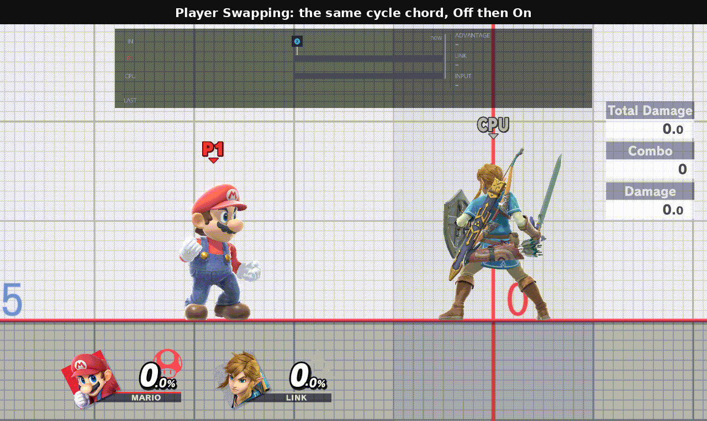 
*Player Swapping Off and On. Eden, rc.13 (untested on hardware).*

In the clip, the Cycle Player chord is named in a box, and the load is cut.

More: [Fighter cycles › Player Swapping](../guide/fighter-cycles.md#player-swapping)

### Player Character

Opens a portrait grid of every fighter and picks Player 1's. The new fighter loads when you close the menu, with [Player Swapping](#player-swapping) On or Off.

| Value | What it does |
| --- | --- |
| Any fighter on the grid | Loads for Player 1 when the menu closes. |
| To change it | A opens the grid. |
| To change it | The D-pad moves, A picks ("> " marks the pick), B goes back. |
| To change it | X on a shared slot (Pokémon Trainer, Pyra / Mythra) shows its next form, so A picks that form. |

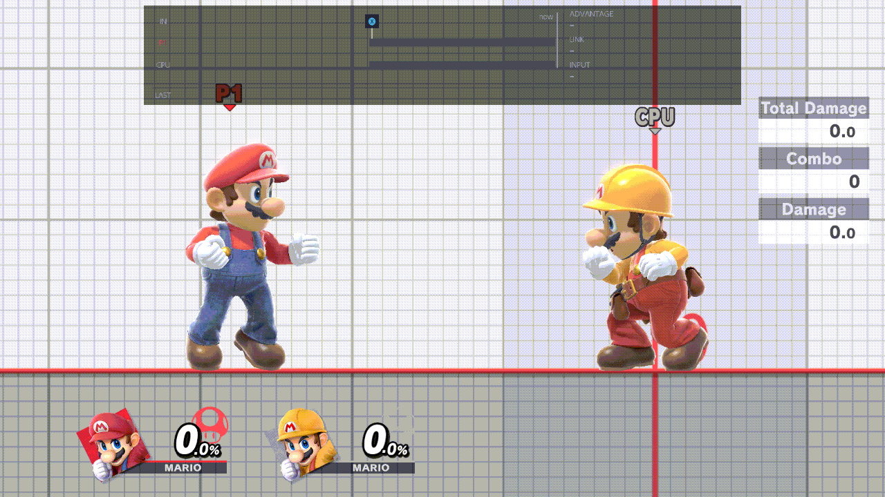

- The pick follows the fighter on screen: when you enter Training, or a cycle chord switches you, it becomes that fighter.
- A greyed Mii tile has no Mii that Player 1 can load (the help line reads "… - unavailable").
- In a waiting room this changes only your practice fighter; the match uses the fighter you picked for it.
- For Ice Climbers picked here, see [Solo Popo](#solo-popo-original-ice-climbers).

### CPU Character

The same grid for the CPU. The new fighter loads when you close the menu.

| Value | What it does |
| --- | --- |
| Any fighter on the grid | Loads for the CPU when the menu closes. |
| To change it | as [Player Character](#player-character). |

It always works. In a waiting room it changes the first training partner.

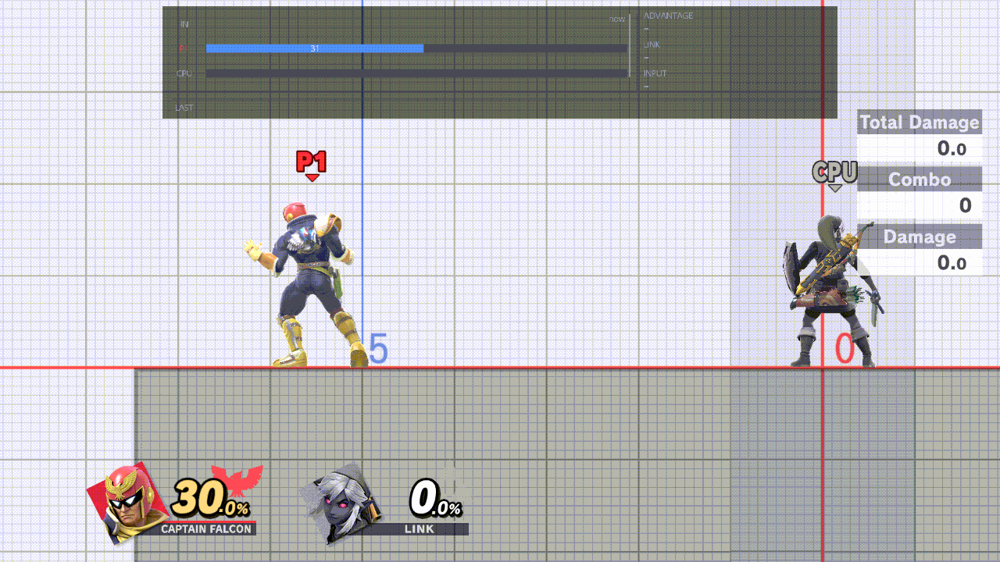 
*The CPU Character grid. Eden, rc.11.*

In this clip "CPU fighter applied" is shown. The 3.6 s load is cut.

### Character Cycles

The order the cycle chords step through: one list for Player 1 (red numbers) and one for the CPU (blue numbers). The second help line says which list you are editing.

| Value | What it does |
| --- | --- |
| All (default for both) | Uses every fighter in character-select order. |
| Your own order | Uses the fighters you add to that role's list. |
| To change it | A opens the grid. |
| To change it | Y on this row (on the page) resets both lists. |

| In the grid | What it does |
| --- | --- |
| ZR | Switches between the Player and the CPU list. |
| A on a fighter | Adds it at the end. From All, it starts a new list with just that fighter. |
| A on All | Takes every fighter, in character-select order. |
| R | Removes a fighter. The last one stays. |
| X on Pokémon Trainer or Pyra / Mythra | Shows its next form; A then makes the cycle load that form. |
| Y on Ice Climbers | Marks Solo Popo ("S") for that list. |
| B | Goes back. |

- The fighter each role started with is its 0.
- Each press of the cycle chord loads the next number; after the last it goes back to 0.
- A Mii tile is numbered only while that role has a Mii of the class it can load; which Mii is set by the [Mii rows](#mii-brawler).
- A change made in Training starts loading the new fighters at once.

More: [Fighter cycles › The Character Cycles editor](../guide/fighter-cycles.md#the-character-cycles-editor)

### Solo Popo (original Ice Climbers)

On: when Player 1 picked Ice Climbers at the character select, Player 1 is Popo alone, without Nana. That counts for Player 1's 0 in the cycle too.

| Value | What it does |
| --- | --- |
| On | Player 1's original Ice Climbers load as Popo alone, including at 0 in the cycle. |
| Off (default) | The original Ice Climbers do not load as Popo alone through this row. |
| To change it | A, Left or Right flips it. |

Three controls decide when Ice Climbers load as Popo alone. All start Off:

| Which Ice Climbers? | Control |
| --- | --- |
| Player 1's, picked at the character select (picking them again in [Player Character](#player-character) counts too) | This row |
| Player 1's cycle, or picked in Player Character after starting as another fighter | Y on Ice Climbers in the Player list of [Character Cycles](#character-cycles) (the "S" mark) |
| The CPU's pick and its cycle | Y on Ice Climbers in the CPU list (the "S" mark) |

With this row Off, Player 1 can still be Popo alone through the "S" mark. If Player 1's two controls differ, Ice Climbers can be in Player 1's cycle twice: as 0 one way and as a number the other.

 
*Solo Popo reload. Eden, rc.11.*

In this clip "Player Character · 0. Ice Climbers" is shown.

The 3.3 s reload is cut.

More: [Fighter cycles › Solo Popo](../guide/fighter-cycles.md#solo-popo)

## Extras

### Kirby Hats

The order of the hats (copy abilities) the Kirby hat chord gives Kirby: one list for Player 1's Kirby and one for the CPU's. Kirby itself can't be a hat.

| Value | What it does |
| --- | --- |
| Mario only (default for both) | The role's Kirby cycles through Mario's hat. |
| All | Takes every fighter's hat. |
| Your own order | Uses the hats you add to that role's list. |
| To change it | A opens the grid. |
| To change it | ZR switches between the Player and the CPU list. |
| To change it | A adds a fighter's hat at the end (All takes everyone), R removes one (the last one stays), X shows the next form of a shared slot, B goes back. |

The chord is fixed: hold B with the left stick at rest and click the left stick for your Kirby, or the right stick for the CPU's. Each click gives the next hat in the list.

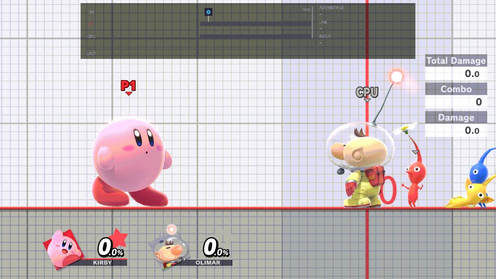

More: [Fighter cycles › Kirby hats](../guide/fighter-cycles.md#kirby-hats)

### Give item

Opens a grid of 39 fighter items. A puts the item in Player 1's hand as soon as the menu closes, in place of anything Player 1 holds.

| Value | What it does |
| --- | --- |
| The 39 items | Gives the selected item to Player 1 as the menu closes. |
| To change it | A opens the grid. |
| To change it | The D-pad moves, L / R turn its page, A gives, B goes back. |
| To change it | Every A asks again, the same item included; if you press A on several, the last one is given. |

The grid includes turnips (each face), bombs, Pac-Man's bonus fruit, Robin's tome and Levin Sword, and Wario's bike (the last tile). The notice reads "Character Item" and the item's name.

Wario's bike works for any fighter. A throws it, and it drives forward, hits whoever it meets, then stays on the floor.

- Most items need their fighter's data, which the plugin loads for you; if it can't, the notice says "Load ‹fighter› as Player or CPU first".
- Daisy's and Peach's Bob-omb and Mr. Saturn, and Diddy Kong's Banana Peel, need nothing.
- Nothing is given during a fighter swap, a save-state load, a recording or a playback.

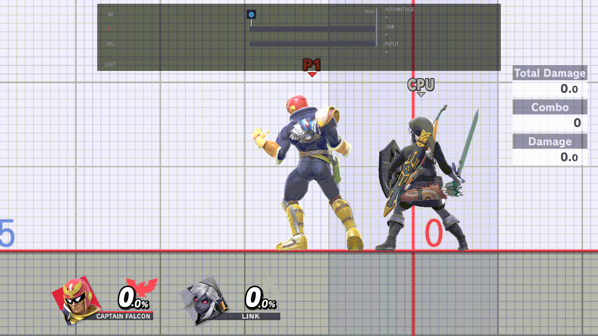 
*Give item: Daisy's Bob-omb. Eden, rc.11.*

 
*Give item: Wario's bike. Eden, rc.13 (untested on hardware).*

### Mii Brawler

Opens the list of Mii Brawlers for Player 1. ZR switches to the CPU's list.

| Value | What it does |
| --- | --- |
| A saved Mii | Uses a saved Mii Brawler. |
| A replay Mii | Uses an imported Mii Brawler. |
| A new one | Opens Smash's Mii Fighter editor. |
| To change it | A opens the list. |
| To change it | Up / Down move, L / R move a page, A picks, ZR switches Player / CPU, B goes back. |

It lists your saved Miis, then the Miis imported from your replays, then *Add New…*, which opens Smash's own Mii Fighter editor. Each line reads "number. name [specials]", the four specials as digits; "> " marks the role's choice.

A pick applies when you close the menu if that role is a Mii Brawler on screen; otherwise the next time a cycle or a pick loads the class.

More: [Mii fighters](../guide/mii.md)

### Mii Swordfighter

The same list for the Mii Swordfighter.

| Value | What it does |
| --- | --- |
| A saved Mii | Uses a saved Mii Swordfighter. |
| A replay Mii | Uses an imported Mii Swordfighter. |
| A new one | Opens Smash's Mii Fighter editor. |
| To change it | as [Mii Brawler](#mii-brawler). |

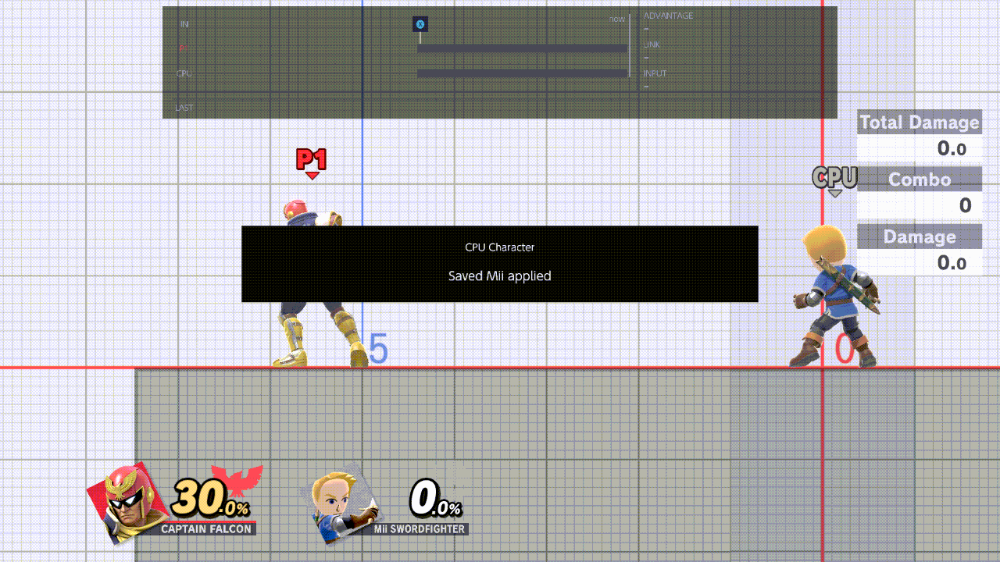 
*The CPU's Mii Swordfighter list. Eden, rc.11.*

In this clip the two saved Miis look alike and "Saved Mii applied" is shown. The 6.6 s load is cut.

### Mii Gunner

The same list for the Mii Gunner.

| Value | What it does |
| --- | --- |
| A saved Mii | Uses a saved Mii Gunner. |
| A replay Mii | Uses an imported Mii Gunner. |
| A new one | Opens Smash's Mii Fighter editor. |
| To change it | as [Mii Brawler](#mii-brawler). |

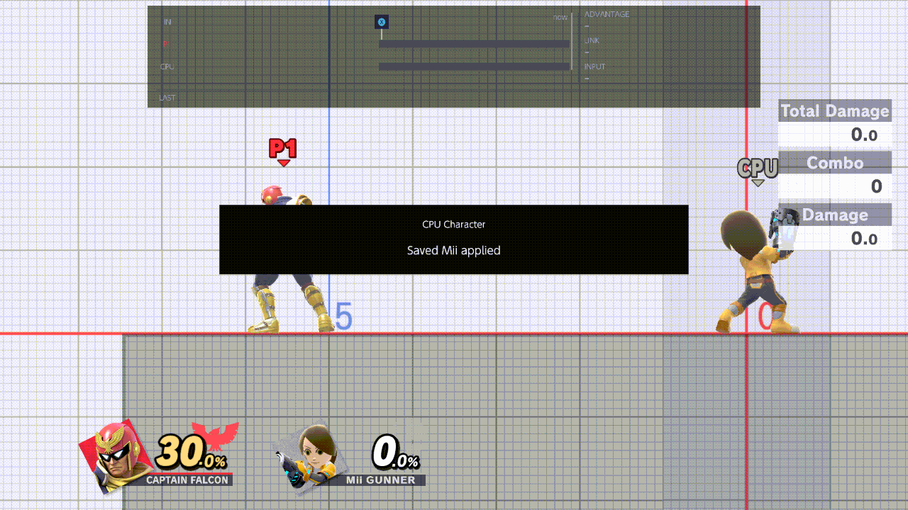 
*Player and CPU Mii Gunner lists. Eden, rc.11.*

This clip's profile has one saved Gunner, then Add New…, which opens Smash's Mii editor.

 
*Player 1 picks a Replay Gunner. Eden, rc.13 (untested on hardware).*

In the clip, the Player list has a saved Gunner and two Replay Gunners, with ">" on the pick. Each press is named in a box.

## Stages

### Change Stage

- Opens a grid of every stage.
- A on a stage closes the menu and goes there: the notice reads "Practice Stage · Stage requested", then "Stage ready".
- It works in Training and in waiting-room practice.

| Value | What it does |
| --- | --- |
| Any of the 117 stages | Includes the Waiting Room and Training, in the forms the game has for each. |
| Stage Builder stages | Follow the game's stages. See [Custom stages](../guide/stages.md#custom-stages). |
| To change it | A opens the grid. |
| To change it | The D-pad moves, L / R turn its page, Y picks the focused stage's form first (the tile shows [N], [Ω] or [BF]), A goes there, B goes back. |

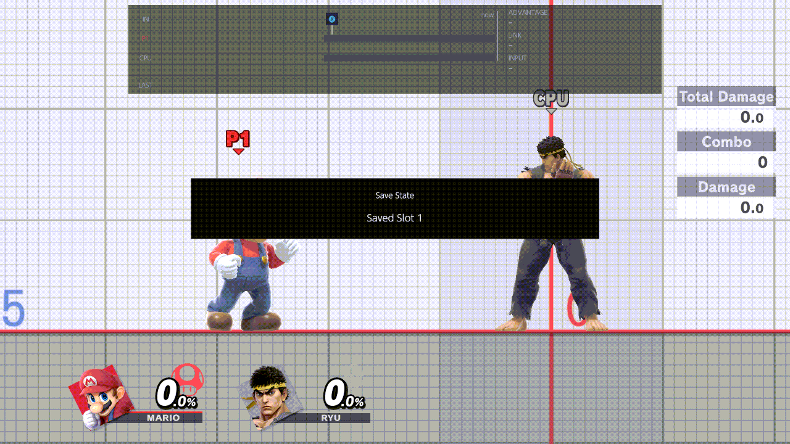

*Battlefield Ω stage change. Eden, rc.11.*

The clip shows "Stage requested", then "Stage ready". The 3 s wait between them, where nothing moves, is cut.

More: [Stages › Change Stage](../guide/stages.md#change-stage)

### Lobby Practice

Controls TrainingRooms in local wireless rooms and Quickplay's online waiting room.

| Value | What it does |
| --- | --- |
| On (default) | The menu opens, the chords work, and the CPU page drives the first training partner. |
| Off | The waiting rooms are left to the game and the menu does not open there. |
| To change it | A, Left or Right flips it. |

A settings file that already stores Off keeps it Off.

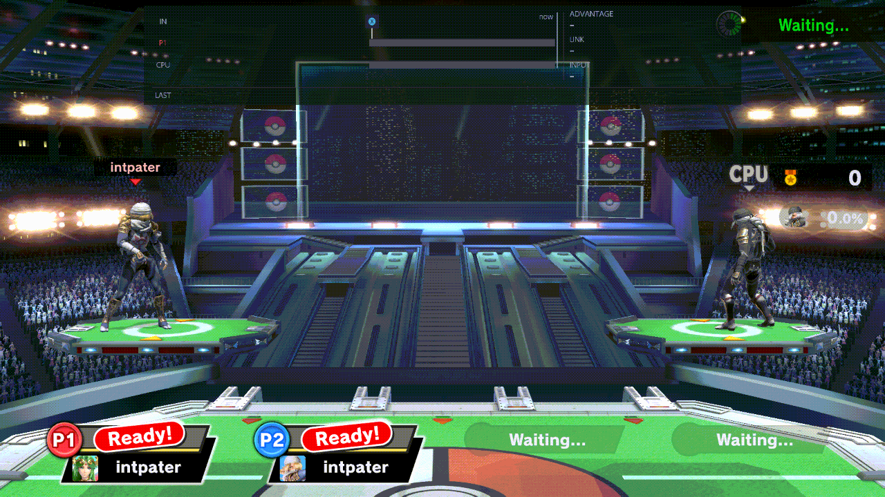 
*Lobby Practice Off in a wireless room. Eden, rc.11.*

In the clip, the frame strip disappears when Lobby Practice is turned Off. Byleth uses its up special instead of opening the menu.

More: [Waiting rooms](../guide/waiting-rooms.md)

### Lobby Stages

The stage list: each new waiting room opens on the next stage of it, and Training does too with [Training Stage Rotation](#training-stage-rotation) On.

| Value | What it does |
| --- | --- |
| The Waiting Room only (default) | The initial rotation list has one stage. |
| All | Takes every stage in the list. |
| Your own order | Can include Stage Builder stages, after the game's stages. See [Custom stages](../guide/stages.md#custom-stages). |
| Rotation (default) | A adds or removes a stage in the list. |
| Direct | A goes to the stage and closes the menu. |
| To change it | A opens the grid. |
| To change it | X switches between the two modes. |
| To change it | Y changes the focused stage's form. |
| To change it | L / R turn the page, B goes back. |

| Mode | What A does |
| --- | --- |
| Rotation | Adds a stage at the end of the list or takes it out (the number is its place; the last one stays). A on All takes every stage. |
| Direct | Goes to the stage now and closes the menu, as Change Stage does. New waiting rooms open on that stage instead of the list. |

The waiting rooms follow the list only while [Lobby Practice](#lobby-practice) is On.

<!-- CAPTURE-REQUEST v06-lobby-stages-modes: a clip of Rotation versus Direct in a waiting room: Rotation with two stages ordered, the next practice opens on the next stage; Direct, pick stage B, close the menu, the room becomes B. Do not reuse the Training Stage Rotation clip. See artifacts/docs4/CAPTURE-REQUESTS.md. -->

More: [Stages › Lobby Stages](../guide/stages.md#lobby-stages)

### Training Stage Rotation

On: Training opens on the stage you pick, then on each return through the character select on the next stage of the [Lobby Stages](#lobby-stages) list. Off: Training opens on the stage you chose, as usual.

| Value | What it does |
| --- | --- |
| On | Returns through character select open the next stage of the Lobby Stages rotation list. |
| Off (default) | Training opens on the stage you chose. |
| To change it | A, Left or Right flips it. |

It always uses the Rotation list, even while Lobby Stages is on Direct. With the default list (the Waiting Room only), each return opens on the Waiting Room.

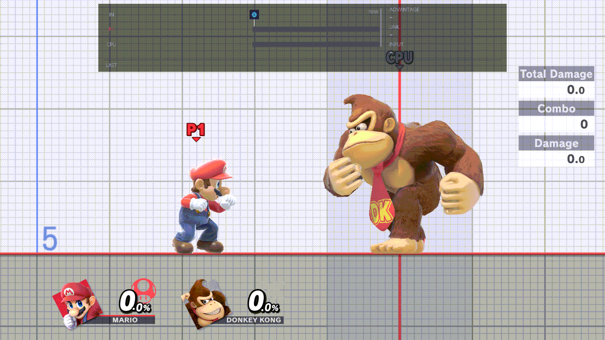

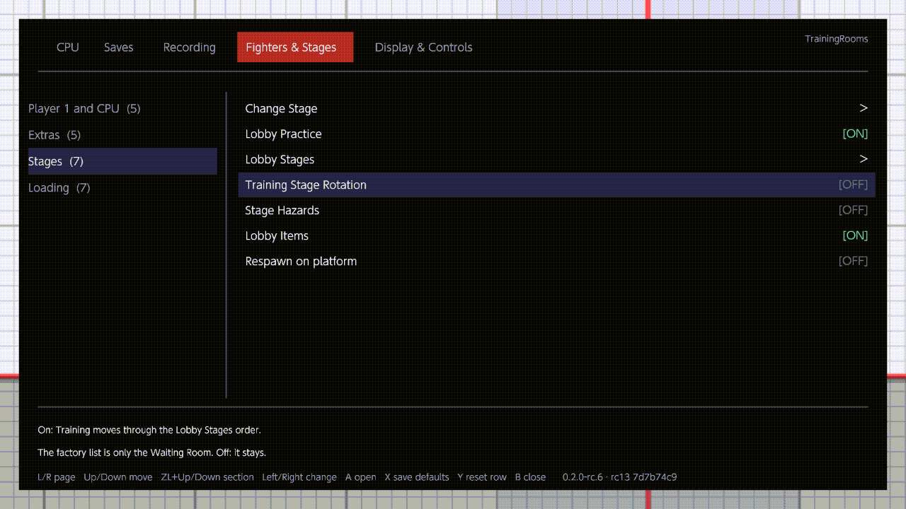 
*Training Stage Rotation. Eden, rc.13 (untested on hardware).*

More: [Stages › Training Stage Rotation](../guide/stages.md#training-stage-rotation)

### Stage Hazards

Controls stage hazards in Training. It takes effect when a stage loads.

| Value | What it does |
| --- | --- |
| On | Stage hazards are active when a stage loads. |
| Off (default) | Stage hazards are inactive when a stage loads. |
| To change it | A, Left or Right flips it. |

That happens when you enter Training or go to a stage with Change Stage. The stage you are on keeps its hazards until then.

With [Lobby Practice](#lobby-practice) On it also sets the hazards of the waiting room's stage, when you enter the room.

### Lobby Items

Controls items in the waiting room. Training is not affected.

| Value | What it does |
| --- | --- |
| On (default) | Items appear in the waiting room as usual. |
| Off | No items appear there and items on the floor are removed when you turn it Off. |
| To change it | A, Left or Right flips it. |

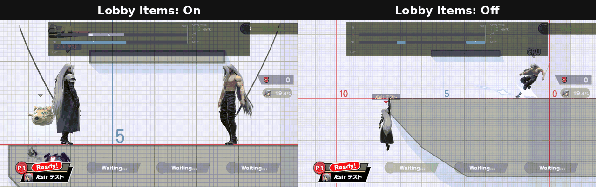

It works in local wireless rooms and in Quickplay's waiting room, whether Lobby Practice is On or not.

### Respawn on platform

Controls how a fighter respawns after a KO. It works in Training and in waiting-room practice.

| Value | What it does |
| --- | --- |
| On | After a KO, the fighter descends on the revival platform with the game's invincibility. |
| Off (default) | The fighter returns at once with no invincibility. |
| To change it | A, Left or Right flips it. |
| To change it | The row is greyed ("Auto-load on death is On: a save state loads instead") while Saves › [Save States](saves.md#save-states) and [Auto-load on death](saves.md#auto-load-on-death) are both On. |

It works with Save States On or Off.

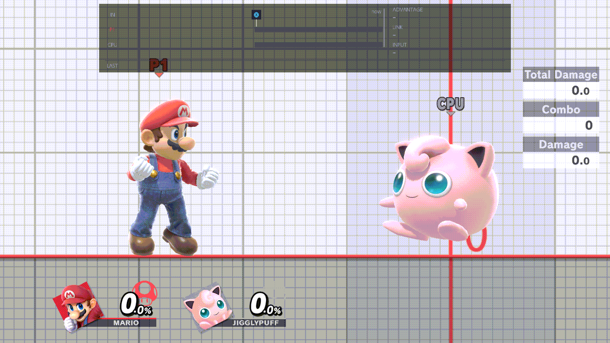

More: [Save states › Respawning](../guide/save-states.md#respawning)

## Loading

Advanced: this section is collapsed until you open it (A on its header).

- These rows set how fighters and Kirby hats are loaded ahead of time, in the background, so a cycle chord or a hat click switches at once instead of reloading.
- The notice "Fighters" counts them, such as "Loading 6/10", then "Ready 10/10".
- The defaults suit most players.

More: [Fighter cycles › What the Loading rows do](../guide/fighter-cycles.md#what-the-loading-rows-do)

### Cycle Preload

How many of the next fighters in each role's cycle are kept ready. Off: none are; each swap loads its fighter then, which takes longer.

| Value | What it does |
| --- | --- |
| Off | No next fighters are kept ready. Each swap loads its fighter then. |
| 1, 2, 3, 4 | Keeps that many next fighters in each role's cycle ready. |
| 5 (default) | Keeps the next 5 fighters in each role's cycle ready. |
| To change it | Left or Right switches it; A opens the list. |

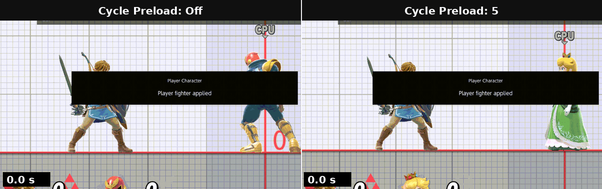

### Preload

What is kept ready: the fighters of your cycles, Kirby's hats, or both. The banks and groups below need Fighters or Both.

| Value | What it does |
| --- | --- |
| Fighters | Keeps the fighters of your cycles ready. |
| Hats | Keeps Kirby's hats ready. |
| Both (default) | Keeps both fighters and hats ready. |
| To change it | Left or Right switches it; A opens the list. |

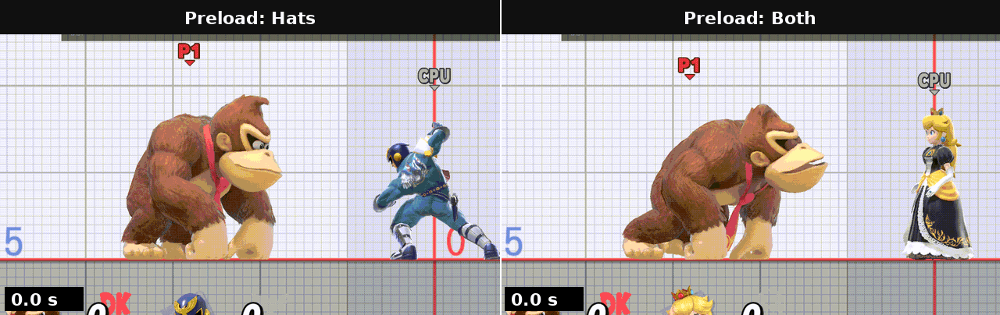

### Ready Fighters

The total number of fighters kept loaded, for Player 1 and the CPU together, the two on screen included.

| Value | What it does |
| --- | --- |
| 2 to 12 (default: 10) | The total kept loaded across Player 1 and the CPU, including both on screen. |
| To change it | Left or Right steps one (it stops at 2 and 12); A opens the list. |

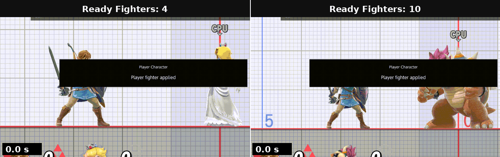

- **When your cycles need more:** the fighters that fit stay loaded and the others stay cold.
- A cold fighter is loaded while it's on screen and freed after, so you go one fighter over this number only for that time.
- The rest of the cycle never loads again.
- Lowering this number frees the loaded fighters whose turn is farthest away, right away.

### Ready Hats

How many Kirby hats are kept ready, apart from Ready Fighters. A hat whose fighter is already kept ready uses that fighter, and takes no place of its own.

| Value | What it does |
| --- | --- |
| 0 to 5 (default: 5) | The number of Kirby hats kept ready, apart from Ready Fighters. |
| To change it | Left or Right steps one (it stops at 0 and 5); A opens the list. |

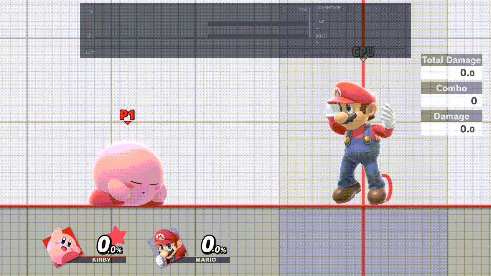

### Ready Fighter Bodies

How many fighters each role keeps loaded in its own slot, the one on screen included. Switching among them is instant.

| Value | What it does |
| --- | --- |
| Off | Only the fighter on screen is kept in the role's slot, with no groups. |
| 2 | Keeps 2 fighters in each role's own slot, including the one on screen. |
| 3 (default) | Keeps 3 fighters in each role's own slot, including the one on screen. |
| To change it | Left or Right switches it; A opens the list. |
| To change it | The Ice Climbers pair bank in [Swap groups](#swap-groups) needs 3. |

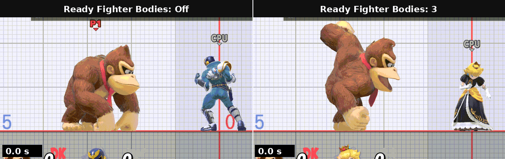

### Group Swap

On: each role can keep more groups of fighters ready besides its own slot, up to Ready Fighters. Off: only the role's own slot; the group entries of [Swap groups](#swap-groups) are greyed ("Group Swap is Off").

| Value | What it does |
| --- | --- |
| On (default) | Each role can keep more groups ready besides its own slot, up to Ready Fighters. |
| Off | Only the role's own slot is kept. Group entries are greyed. |
| To change it | A, Left or Right flips it. |

### Swap groups

Opens seven switches for the fighters that need special care when they are kept ready. The row shows how many are On, such as "7 of 7".

| Value | What it does |
| --- | --- |
| On (default for all seven) | The entry keeps its named bank or group ready. |
| Off | The entry does not keep its named bank or group ready. |
| To change it | A opens the list. |
| To change it | Up / Down move, A flips the entry, B goes back. |
| To change it | A greyed entry shows why and ignores A. |
| To change it | Y on this row (on the page) puts all seven back to your saved defaults. |

| Entry | What it does | Greyed when |
| --- | --- | --- |
| Ice Climbers pair bank | Popo and Nana share a role's slot with one other fighter, so switching between them is instant. | Ready Fighter Bodies is not 3 |
| Original fighter bank | Keeps the role's starting fighter (its 0) ready. Miis and Solo Popo still reload. | Never |
| Solo Popo groups | Keeps Solo Popo ready as a group. | Group Swap is Off |
| Ice Climbers pair groups | Keeps the role's groups ready while the pair is in its slot. | Group Swap or the pair bank is Off |
| PT / Aegis groups | Keeps Pokémon Trainer and Pyra / Mythra ready as whole groups, or not at all. | Group Swap is Off |
| Ice Climbers pair group | Keeps the pair ready as a group of its own. | Group Swap or the pair bank is Off |
| Mii groups | Keeps one Mii group per role ready. | Group Swap is Off |

- PT / Aegis groups need **3 free Ready Fighters** (the total is shared with the other ready fighters).
- With fewer, the group loads on the swap instead, with no message on screen.
- The row's help line says "PT / Aegis groups need 3 free Ready Fighters." Every entry also needs Cycle Preload above Off, Preload on Fighters or Both and Ready Fighter Bodies above Off; the list doesn't grey them for that.

 
*Swap groups help at Ready Fighters 2. Eden, rc.13 (untested on hardware).*

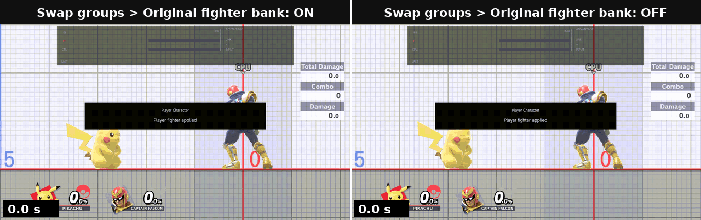 
*Original fighter bank On and Off. Eden, rc.14 (untested on hardware).*

In the comparison, the CPU is Captain Falcon and a timer runs bottom left. On shows "Original fighter restored".

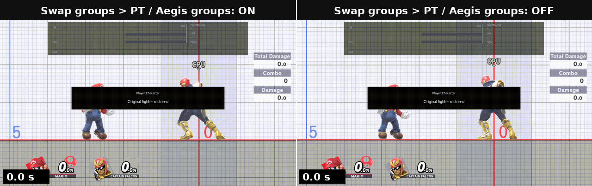 
*PT / Aegis groups: Pokémon Trainer. Eden, rc.14 (untested on hardware).*

The CPU is Captain Falcon in both, and a timer runs bottom left. With groups Off, the spot stays empty a little longer while the three load.

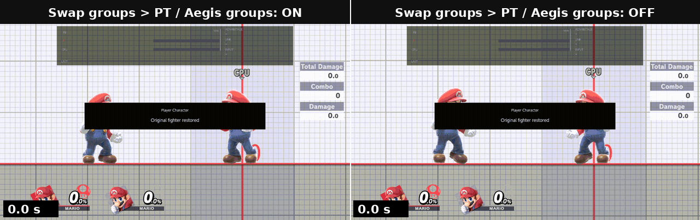 
*PT / Aegis groups: Pyra / Mythra. Eden, rc.14 (untested on hardware).*

With groups Off, the spot stays empty a little longer while Pyra and Mythra load.

<!-- CAPTURE-REQUEST v05-swap-groups: a short group Off then On clip for each Swap groups entry not yet shown: the Ice Climbers pair bank, pair groups, pair group and Solo Popo groups (they look alike and serve each other, so each needs its own setup: label each). Original fighter bank and PT / Aegis groups are shown above. See artifacts/docs4/CAPTURE-REQUESTS.md. -->

## Practice games

Tutorials: [Practice games](practice-games.md), [Parry practice](../guide/parry-practice.md), [Mash out](../guide/mash-out.md), [Break the Targets](../guide/break-the-targets.md), [Tech practice](../guide/tech-practice.md) and [Eggs-ercise](../guide/eggs-ercise.md).

**Practice games** lists one row per game. **A** on a game opens its own screen, laid out like **Button chords**: the path at the top (Fighters & Stages > Practice games > the game), then **Start** and the game's settings.

| Row | Its screen |
| --- | --- |
| **Eggs-ercise**, **Break the Targets**, **Tech practice** | Start and the game's settings, described below. |
| **Mash out** | Its screen: Start and **Fighter and move**; it runs until Stop. |
| **Parry practice** | Start, then 10 attempts or Free practice, Saved parry practices and Save this parry practice; using a saved practice starts it when the menu closes. |
| **Guard the Edge** and **Juggler** | Described below. |

The keys are the page's:

| Key | What it does |
| --- | --- |
| Up/Down | Move. |
| Left/Right | Change a setting. |
| **A** | Opens it. |
| **Y** | Resets it. |
| **B** | Goes back to the list. |

- **Start** (the first row; the cursor opens on it) closes the menu and starts the game with the settings shown.
- Backing out with **B** starts nothing and stops nothing.
- Choosing a saved parry practice is a separate way to start one.
- One game runs at a time: starting one stops the one that was running.
- While a game runs, its row on the list shows **Running** in green, and the first row of its screen reads **Stop**.
- **A** on Stop ends the game and the menu stays open; the row reads Start again.
- **B** closes the menu and the game keeps running.
- Settings you change for a running game apply at its next Start.
- **Reset page to defaults** (the page's last line) also resets the settings inside the games' screens.

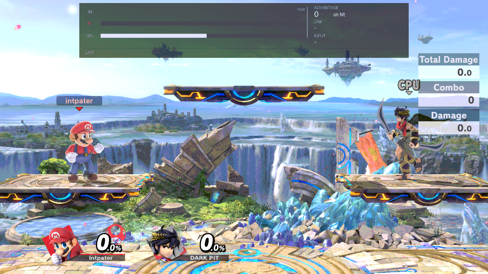 
*Starting Eggs-ercise. Eden, 2026-11-18, build 9aa51374 (untested on hardware).*

The clip's Eggs-ercise screen shows Start, then 10 targets, Breaks on, Target, Target speed and CPU during a game. The first target appears with a count of 0 of 10.

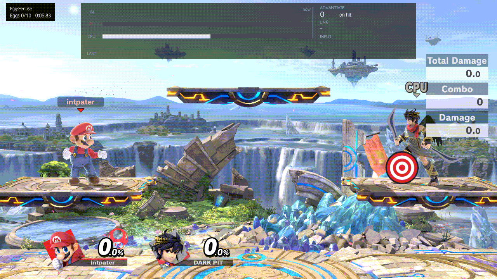 
*Stopping Eggs-ercise. Eden, 2026-11-18, build 9aa51374 (untested on hardware).*

The open screen reads Stop with "Running" in green.

### Guard the Edge and Juggler

#### The set-up pages

| Drill | Pages |
| --- | --- |
| Guard the Edge | Its setup has three pages: CPU start, Player 1 start, then Preview. |
| Juggler | Four pages: CPU spot, Percent, Player 1 start, then Preview. |

| Page | Controls |
| --- | --- |
| Any crosshair page | Move the crosshair with the stick (2 units a frame at full tilt) or D-pad (1 unit a press). |
| Guard the Edge, CPU start | The CPU start must be off the stage; **A** refuses a point over the stage or in it, and a point under it unless **Under the stage** is On. **X** restores that side's default and **Y** picks the other side's default. |
| Guard the Edge, Player 1 start | Player 1's crosshair chooses a point on the main floor. |
| Juggler, CPU spot and Player 1 start | Its CPU and Player 1 pages use the same crosshair controls; the Player 1 start can be on a floor or platform. |
| Juggler, Percent | The Percent page still uses the D-pad to change the value by 1 horizontally or 10 vertically. |

- While either setup is open the CPU itself waits at its start, under the crosshair on the CPU page.
- When that point is outside the picture, the game shows its own off-screen magnifier of the CPU at the edge, pointing toward it.
- **B** out of the setup puts the CPU back where it stood. (Eden, 2026-11-23; untested on hardware.)
- If the drill has a CPU fighter of its own, **B** puts that fighter at the CPU's place, and the Training CPU returns when you close the menu. (Not run in Eden yet.)

#### How the CPU starts in Guard the Edge

- 2026-11-25.
- Two rows on the Guard the Edge page change how the CPU starts.
- Both apply at the next Start.

| Row | Default | What it does |
| --- | --- | --- |
| **Under the stage** | Off | On: **A** on the CPU page also takes a point under the stage. A point over the stage, in it or outside the blast lines is still refused. A start under the stage that you set up is used again by Start only while the row is On; with it Off, Start opens the setup at the default start. |
| **CPU midair jumps** | Kept | Used: the CPU starts every attempt with all its midair jumps already spent. The number comes from the fighter's own jump count, so there is no list of fighters. Perfect mode plans its recovery without them. |

Known limits:

- A point just under the stage can put the fighter's upper body inside the stage. What the game does with such a start is not known.
- Perfect mode's route from under the stage is not established; it was built for starts beside the stage.
- Whether a fighter's own moves give the jumps back after the start is not known. A second resource, such as a float, is not touched.

- In an Eden smoke boot on install 5 (2026-11-25) the set-up opened with **Under the stage** On, and on Battlefield with **CPU midair jumps** set to Used.
- The drill was not played, so what the CPU does with either option has not been seen in a game.
- [Install evidence](../EVIDENCE-rc15-installs.md#the-eden-smoke-boot-of-the-finished-build)

#### The floor you stand on

- 2026-11-25.
- Both drills start from the floor you are standing on, not from the middle of the stage.
- On a stage with more than one piece of ground, such as the Training stage, stand on the piece you want to use and choose **Start**.

| Drill | What it uses |
| --- | --- |
| Guard the Edge | Each end of that floor that has open air beside it. A floor with one such end has one side: **Y** (the other side) does nothing there. On the Training stage the long floor has its left ledge only, and the island has both. |
| Guard the Edge, default CPU start | On a side, halfway across the open air beside that ledge and halfway down to the bottom blast line. A fighter with a default start of its own keeps it only where that point is in open air. |
| Juggler | Needs no ledge. Its CPU spot can be over the stage (the default is above you) or in open air beside it. |

- Every point you confirm with **A** on the CPU page is checked against the stage one frame later.
- A start you set up is used again by **Start** only on the floor it was made on. On another floor Start opens the setup at that floor's defaults.

When a start cannot happen, a message says why and the menu row reads **Start** again:

| Message | When |
| --- | --- |
| "The stage could not be read" | Start, when the stage's lines could not be read on that frame. Try Start again. |
| "Stand on the stage to start this drill" | Start, when there is no solid floor under you (over a gap, or in the air off stage). |
| "This floor has no ledge to guard" | Guard the Edge's Start, when neither end of your floor has open air beside it: it meets a wall or a step, or runs out past the blast line. |

In the setup, **A** on a CPU point the drill cannot use shows "Pick a point over the stage or beside it" for Juggler or "Pick a point off the stage" for Guard the Edge. You stay on the CPU page: move the crosshair and press **A** again.

- In an Eden smoke boot on install 5 (2026-11-25), Start opened the set-up on its CPU page with no refusal: for Guard the Edge on the Training stage's long floor, from its island and on Battlefield, and for Juggler on the Training stage.
- Neither drill was played through, and none of these messages has been seen in a game.
- [Install evidence](../EVIDENCE-rc15-installs.md#the-eden-smoke-boot-of-the-finished-build)

#### CPU fighter and mode

Open **CPU fighter and mode** and press **A** on a portrait.

| Key | What it does |
| --- | --- |
| A, with the popup open | Cycles through **CPU**, **Perfect**, and any drills for that fighter. |
| X, in CPU mode | Cycles the stock CPU level from 1 to 9 and back to 1. |
| B | Closes the popup. |

Choose **Current CPU** to use the fighter already in Training.

- Hero's **Zoom** drill casts Zoom through Command Selection for every recovery attempt in Guard the Edge and every escape attempt in Juggler.
- Hero gets at least the 8 MP needed for each cast.
- Read where he will return and land a hit or grab during his descent or within the **Zoom landing window** after touchdown.
- The default is 10 frames and you can set it from 1 to 30.
- The notice shows each attempt's result and the running win count.

#### In a waiting room

Both drills also run in a waiting room with [Lobby Practice](#lobby-practice) On, against the first training partner ([Waiting rooms](../guide/waiting-rooms.md#what-works-there)). With more than one partner in the room, the others keep fighting, as extra CPUs do in Training.

### Eggs-ercise

A practice game for your attacks. With the default settings, look for targets on floors and platforms or in the air above them.

- **Where:** Practice games > Eggs-ercise > the **Eggs-ercise** row (the mode)

| Value | What it does |
| --- | --- |
| 1 minute (default) | Break as many targets as you can in one minute. |
| 10 targets | Break 10 targets as fast as you can. |
| 20 targets | Break 20 targets as fast as you can. |
| Free practice | Practise without a timer. |
| To change it | Pick a mode and choose **Start**. The menu closes and the first target appears. |
| Count | The notice shows the count in a band at the top, under Input Display's strip and the combo bar when they show, so targets keep the middle of the screen. |
| Clock | The clock runs while the game runs. Pausing or opening the menu stops it. |

- Hit a target to get the next one. When there is room, about half the candidate spots are in the air, up to 25 units above the floor.
- At Normal speed the ordinary target rises for about half a second and bounces once. It returns to its starting height but can drift sideways.
- It passes through platforms.

| Mode | While it runs | At the end |
| --- | --- | --- |
| **1 minute** | The count starts at 0 and the clock counts down from 1:00. | At 0:00 the targets stop. A three-second result shows your count and best, e.g. "Time! 12 eggs (best 15)". |
| **10 targets, 20 targets** | The count starts at 0/10 or 0/20; the clock counts up in hundredths. | The last target stops the clock. A three-second result shows your time and best, e.g. "Done! 10 in 0:18.27 (best 0:16.90)". |
| **Free practice** | Only the count. | No timed finish. |

The best is per fighter and per mode, and lasts until the game closes.

#### Spawn area

- Check **In view**, **Whole stage**, **Off stage**, or a combination.
- Each new target gets an equal chance of using each checked area.
- Changes apply at the next Start.

| Area | Where targets appear |
| --- | --- |
| **In view** | The default; it takes over when the checklist is empty. |
| **Whole stage** | Uses the stage's world bounds, so a target can appear outside the current camera. |
| **Off stage** | Only in the air off stage, inside the zones below: never inside another part of the stage, and never above a floor or a platform. |

- Open **Off-stage zone…** to edit the zones: two mirrored ones on most stages.
- The active edge has a handle, sample targets show places targets can appear, and the rest of the screen is dimmed.
- The solid stage is excluded.
- Yellow limit lines mark how far inward each side can reach under the stage.

| Control | What it does |
| --- | --- |
| Left stick up/down | Moves the blue **Top** and **Bottom** lines. |
| Left stick left/right | Moves the paired yellow **Inner edges** and paired purple **Outer edges** in or out. |
| **A** | Advances. In **Preview**, **A** or **+** applies. |
| **B** | Goes back, or cancels from Top. |
| **X** | Previews the factory zone. |

Training Rooms saves the zone for the current stage and form.

- Each zone lies beside a ledge of the stage's main floor, the floor under the middle of the camera's range.
- A side has a zone only when its ledge has open air next to it, so a stage can have one zone or none.
- The outer edge stops where that open air ends: at the next part of the stage, or short of the blast line. On the Training stage the one zone is the gap between the long floor and the island.
- The stage is read when the zone is first needed on it. A platform that moves afterwards is not followed, and a piece of the stage narrower than 10 units can be missed.

- In an Eden smoke boot on install 5 (2026-11-25) the zone editor on the Training stage showed that one zone, in the gap, and the game started with only the Off stage area chosen.
- Where the targets then appeared was not checked.
- [Install evidence](../EVIDENCE-rc15-installs.md#the-eden-smoke-boot-of-the-finished-build)

- A break on an Off stage target shows **Recover!**.
- Get offstage and then grab a ledge or land on the main stage floor to add it to the score.
- A KO cancels the hit.
- With **Hit streak** on, a cancellation clears the current streak and keeps your best.

#### Moving paths and target expiry

- Check one or more **Moving paths** to have each new target use one selected flight.
- When the list is empty, targets use the ordinary bouncing flight.
- Target speed changes playback speed.

Choose Richter's Axe, Pac-Man's Galaxian, Link's Boomerang or Samus's Homing Missile. The Homing Missile follows the active player's movement.

| Spawn area | Where a moving target stays |
| --- | --- |
| **In view** or **Whole stage** | Over the floor it appeared on. The flight shrinks to fit, but needs at least a target's width in each direction it moves. If none of the spots tried has room, the target uses Pop up. |
| **Off stage** | Inside its zone. |

- Set **Target expiry** to **Off** or from **1 second** through **10 seconds**.
- An unhit target then disappears and is replaced.
- Pausing or opening a menu freezes its timer.
- With **Hit streak** on, an expiry clears the current streak and keeps your best.

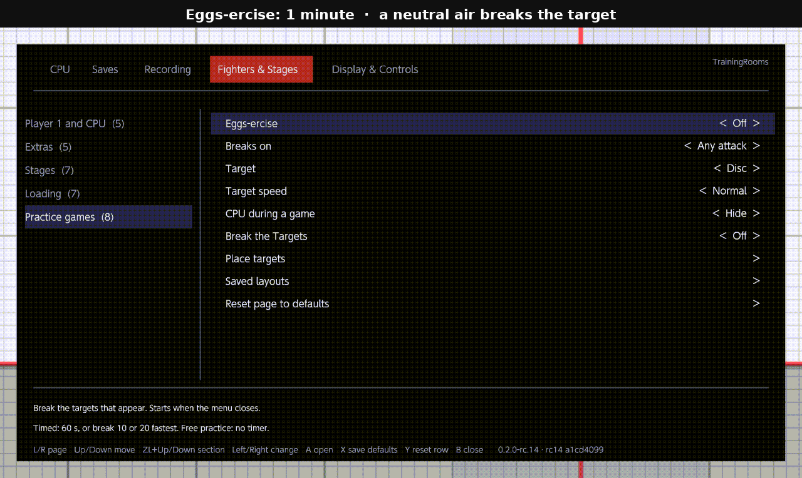 
*Eggs-ercise, 1 minute. Eden, rc.14 (untested on hardware).*

The clip reads "Eggs 0 0:59", then Eggs 1 as Fox breaks the target.

 
*Eggs-ercise, 10 targets. Eden, rc.14 (untested on hardware).*

In the clip the clock counts up in hundredths and the count climbs: 3/10, 7/10, 9/10.

| Clip moment | Display |
| --- | --- |
| Start | "Eggs 0/10   0:00.00" |
| Tenth break | "Done! 10 in 0:16.96 (best 0:16.96)" |

#### Going again, and what else changes

| You do | The run |
| --- | --- |
| L+R+A in Training (with **L+R+A Reset** On) | Starts a new run from 0. |
| Open and close the menu | Keeps going. |
| Change the stage | Starts a new run too. |
| A fighter cycle or a save-state load | Keeps going. |
| **Stop** | Removes the target and the notice, and the notices are back where they were. |

- The target is drawn by the plugin, so Hitbox Visualization can be On or Off: with it On you see your hitboxes meet the target.
- Nothing changes in the game.
- It works in the waiting room's practice as in Training, a break's freeze included, and only your own screen shows the target.
- The CPU keeps doing what the CPU page says; hitting it doesn't count, unless the CPU is the target (see **Target**).

### Breaks on

Which of Player 1's hits break a target. **Breaks on** also applies to Player 1's projectiles and thrown items.

| Value | What it does |
| --- | --- |
| Any attack (default) | Any hitbox of Player 1. |
| Aerials | Only while Player 1 is in an aerial. |
| Hits of 12%+ | Only hitboxes that deal 12% or more, so most jabs and tilts do not count. |
| Applies | The rule applies from the next Start. |

For Hits of 12%+, use the projectile hit's damage. Ice Climbers' Nana counts as Player 1.

### Target

What the target is: the plugin's disc or the CPU itself.

| Value | What it does |
| --- | --- |
| Disc (default) | The plugin's target. |
| CPU | The CPU itself is the target and flies like the disc. |
| Applies | It applies from the next Start. In waiting-room practice the CPU is moved too. |

With **CPU**:

| Moment | What the CPU does |
| --- | --- |
| At each spot | Starts at 0%. Like the disc, it can start above a floor or platform. |
| In the air | Shows its falling pose. After an ordinary bounce it can stay in the air if it started there. |
| Target speed | Changes the CPU's flight speed just as it does for the disc. |
| A hit that the game registers on it, in the air or on the ground, and that **Breaks on** lets count | Breaks the target: the game plays its own hitlag and knockback, then the CPU goes back to 0% at the next spot and flies again. |
| A hit that doesn't count | Puts it back on its flight. |

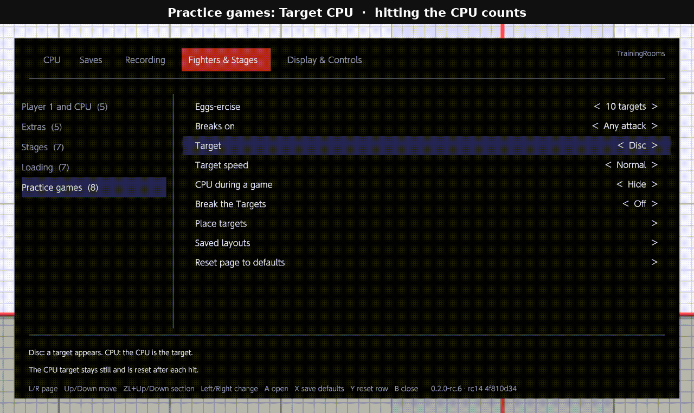 
*Eggs-ercise with the CPU as target. Eden, rc.14 (untested on hardware).*

The clip uses Free practice, Aerials and Slow. The CPU has its "CPU" tag, and no disc target appears.

### Target speed

How fast the targets fly, the disc or the CPU. Every speed traces the same path: the same height and the same landing spot.

| Value | What it does |
| --- | --- |
| Normal (default) | Up for half a second and at rest after about 1.6 s. |
| Slow | Half as fast, at rest after about 3.2 s. |
| Fast | One and a half times as fast, at rest after about 1.1 s. |
| Applies | It applies from the next Start. |
| Availability | While Break the Targets runs it is greyed ("Targets stay still"). |

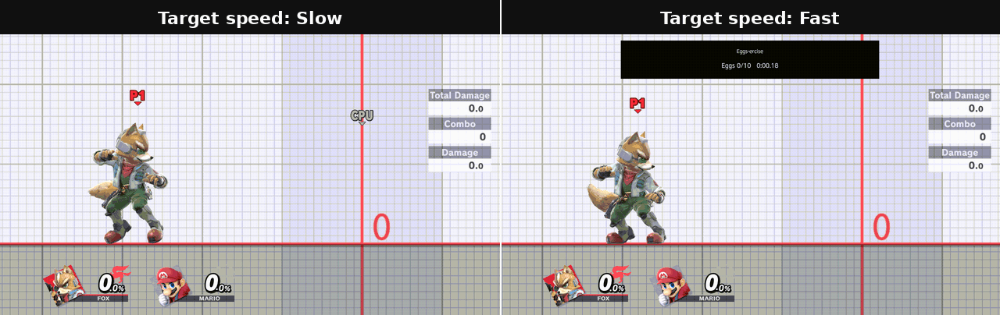 
*Eggs-ercise target speed comparison. Eden, rc.14 (untested on hardware).*

In the comparison, the Fast target rests within about a second while the Slow one is still in the air after three seconds.

### Break the Targets

- A practice game where you choose where the targets go.
- The stage zooms out while you place up to 10 targets, then returns to your previous camera mode when you start.
- Break them all against the clock.
- Like every practice game it runs alone: starting it stops the game that was running.

- **Where:** Practice games > Break the Targets: Start, Projectiles break targets, Place targets, Saved layouts and CPU during a game

| Key | What it does |
| --- | --- |
| Start | Opens the placing view with no targets placed yet. With a layout it opens at Ready. |
| Place targets | Goes straight to the placing view. |

The game has three states:

| State | What you see | What it waits for |
| --- | --- | --- |
| Placing | The zoomed-out stage, a crosshair and the compact box, for example "3/10". | X, once at least one target is placed. |
| Ready | Every target is up and the clock reads 0:00.00. | Your first input: a button, or the stick leaving its dead zone. |
| Running | A small target chip, "4/10" and "0:07.12" share one line at the top-left, clear of the frame strip. | The last target. |

Breaking the last target stops the clock and the notice reads "Done! 10 in 0:18.27 (best 0:16.90)" for three seconds, then Ready again with every target back.

Keys while placing (the game doesn't see these buttons while you place):

| Key | What it does |
| --- | --- |
| Left stick | Moves the crosshair, up to 2 units a frame. |
| D-pad | Moves it one unit a press; held, it repeats. |
| A | Places a target at the crosshair. A target can't go on top of another, and 10 is the most. |
| B | Removes the last target when you let go of it: B + D-pad Up still opens the menu and removes nothing. |
| Y twice | Clears them all. |
| X | Starts, once at least one target is placed. |

- The best time is per fighter and per layout, and lasts until the game closes.
- Targets stay where you put them: while it runs, Eggs-ercise's **Target speed** is greyed ("Targets stay still").
- **Breaks on** applies to your fighter's attacks, which briefly freeze your fighter on a break. Projectile hits use their native attack shapes and play the same break animation.
- To go again, press L+R+A in Training (with **L+R+A Reset** On), or choose **Stop** and **Start**.
- Opening and closing the menu keeps the run and its clock going.
- Each stage keeps its own layout until the game closes.
- In the waiting room's practice it works as in Training: the camera zooms out while placing and returns on start. The targets and the camera are on your own screen only.

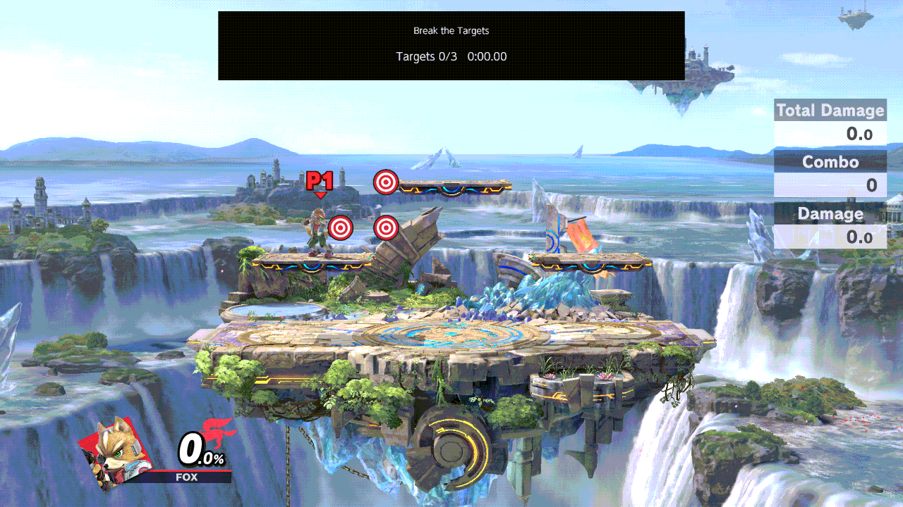 
*A Break the Targets run. Eden, rc.14 (untested on hardware).*

The clip is on Battlefield.

| Clip moment | Display |
| --- | --- |
| Ready | "Targets 0/3   0:00.00" |
| Breaks | "Targets 1/3", "2/3" |
| Finish | "Done! 3 in 0:04.15 (best 0:04.15)" |

### Projectiles break targets

- **On** by default.
- Any projectile that does damage breaks a target (Fox's blaster included), using P1's active projectile or article hitbox.
- It does not need to make a fighter flinch.
- **Off** leaves target breaks to your fighter's attacks.
- This setting is independent of Hitbox Visualization and **Breaks on**, which applies to fighter attacks.
- A change made while Break the Targets runs applies at its next **Start**.

### Place targets

Closes the menu into the placing view and starts Break the Targets there (any other game stops). Your layout stays: place more, remove some, or press X to start.

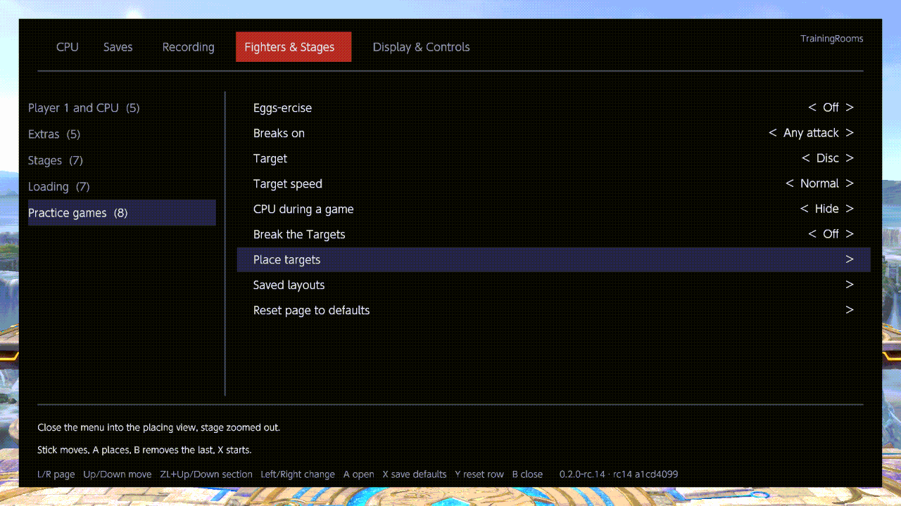 
*Placing Break the Targets targets. Eden, rc.14 (untested on hardware).*

The clip shows these displays:

| Clip moment | Display |
| --- | --- |
| Placing | "Place targets 0/10", "Place targets 3/10", "2/10" |
| Ready | "Targets 0/2   0:00.00" |

### Saved layouts

Your saved layouts, each one its own file in `ultimate/TrainingRooms/layouts/`, so you can place a course once and come back to it. The list shows the layouts of the stage you're on; other stages' layouts aren't listed, since their target positions belong to their stage.

- **The list.** The five layouts you used last come first, the newest at the top, inside a green outline, with a thin line after the fifth; the rest follow by name, as in the Recording lists.
- Saving, loading, duplicating and renaming count as a use, and a sixth use pushes the oldest out of the five (its file stays).

| Key in the list | What it does |
| --- | --- |
| Up/Down | Move. |
| A | Opens the layout's own screen. |
| B | Goes back. |

**A layout's own screen:**

| Row | What it does |
| --- | --- |
| Load | Puts its targets on the stage: **Start** plays them from Ready. While Break the Targets runs, Load replaces the course at once and goes back to Ready with it. |
| Rename | Opens the Switch keyboard (B keeps the old name). |
| Duplicate | Saves a copy as a new layout, at the top of the list. |
| Delete | Asks once: Keep it or Delete it. |

**While placing,** the Save State chords work on the layout. Outside placing, the chords are the normal save states.

| Chord while placing | What it does |
| --- | --- |
| **Save State Save** (ZL + D-pad Down by default) | Saves it as a new layout, named like "Layout 2 · Battlefield" (the lowest number free on that stage); a save never replaces another layout. |
| **ZL + D-pad Left / Right** | Steps through this stage's five (the notice shows "1/3 Layout 2 · Battlefield: 6"). |
| **Save State Load** (ZL + D-pad Up) | Loads the one shown, still in Placing, so you can edit it or start it with X. |
| **ZL + Y** twice | Deletes it. |

- Editing a loaded layout doesn't change its file: save it to keep the change as a new layout.
- A file that can't be read is skipped, and the list's help line counts it ("2 files skipped").

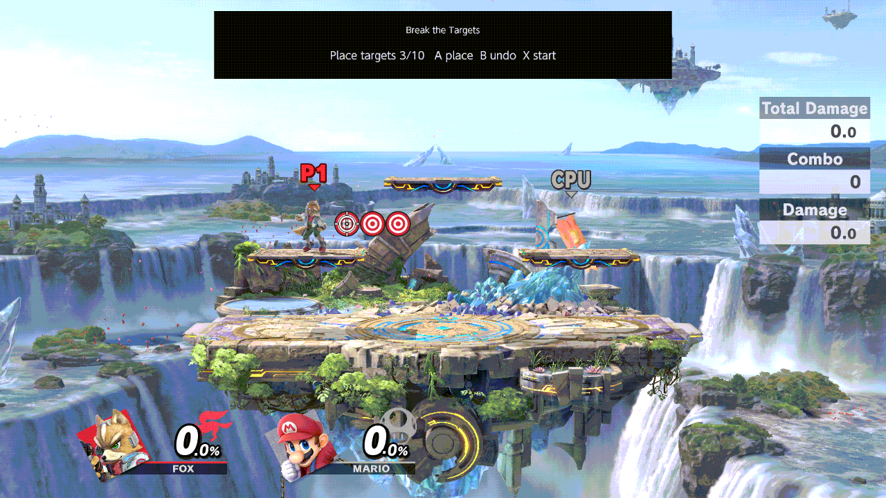 
*Saving and loading layouts. Eden, rc.14 (untested on hardware).*

In the clip, the first course has three targets and saving displays "Saved: Layout 1 · Battlefield". The second course is saved as Layout 2.

The list displays "2/2 Layout 1 · Battlefield: 3". Loading displays "Loaded: Layout 1 · Battlefield".

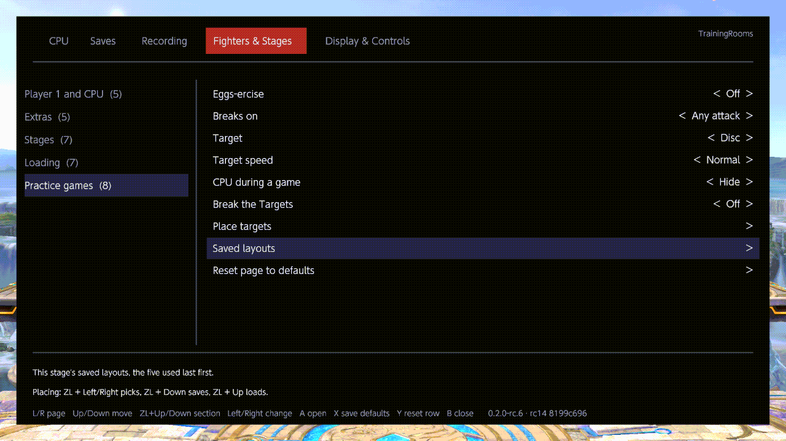 
*The Saved layouts list. Eden, rc.14 (untested on hardware).*

The clip’s five recent layouts run from Layout 7 to Layout 3, followed by Layout 1 and 2.

Loading Layout 7 turns Break the Targets On and closes the menu onto the zoomed-out stage with three targets. It displays "Loaded Layout 7 · Battlefield: close the menu to start".

## Stage tech practice

Tutorials: [Practice games](practice-games.md) and [Tech practice](../guide/tech-practice.md).

Practice your techs by being launched at a spot on the stage, then try to tech when you touch it. Open **Fighters & Stages > Practice games > Tech practice**: its screen holds **Start**, the session, the wizard, the point picker and the launch settings.

### Tech practice

Repeats the launch for **10 attempts**, **20 attempts**, **1 minute**, **3 minutes** or **Free practice**.

| Value | What it does |
| --- | --- |
| 20 attempts (default) | Repeats the launch for 20 attempts. |
| 10 attempts | Repeats the launch for 10 attempts. |
| 1 minute | Repeats the launch for 1 minute. |
| 3 minutes | Repeats the launch for 3 minutes. |
| Free practice | Repeats the launch in Free practice. |
| To change it | Left / Right chooses the session. Or **A** opens the list, **Up / Down** chooses and **A** sets it. |
| Start / Stop | Choose **Start** to begin and **Stop** to end it. |
| Tech wizard / Tech point | Each starts practice in its own view. |
| Opening the menu | Cuts the attempt in flight, which does not count. After **B**, practice carries on with the next attempt and the count, streak and clock where they were. |
| Settings | Settings changed meanwhile apply at the next **Start**. |

### Tech point

Choose the spot you want to tech: **A** on this row opens a crosshair over the stage, the **left stick** or **D-pad** moves it, **A** sets the nearest surface point, and **X** starts the launches.

The view zooms out while you aim; the marked point snaps to a floor, wall or underside near the crosshair. Use **Camera > Follow** to follow your fighter during the run, or **Whole stage** to keep the stage in view.

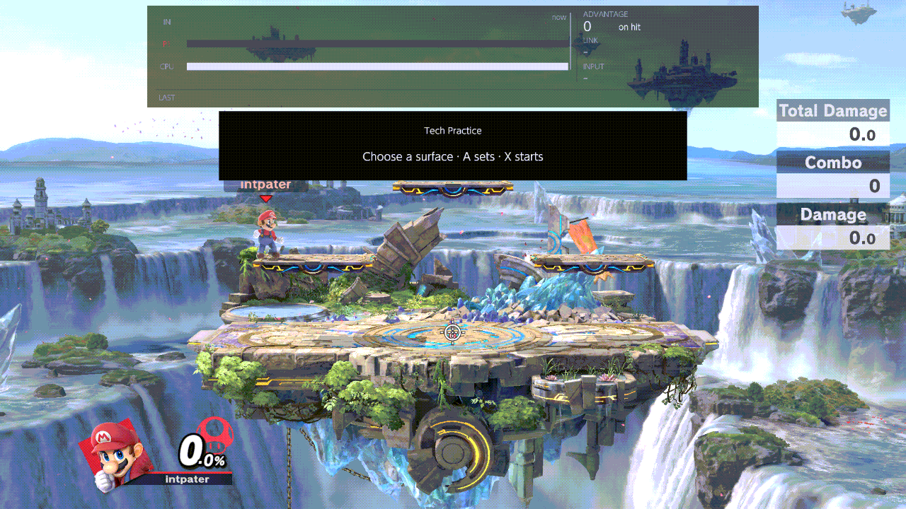 
*A tech-point launch and grade. Eden, 2026-11-17, rc.15 build 55b20f59; untested on hardware in this capture.*

### Surface

Chooses a new random spot each attempt on **Any**, **Floor**, **Wall** or **Ceiling (underside)**, or keeps your **Chosen point**; use **Left / Right** to choose, or **A** to open its list.

### Set, Random and Auto

| Mode | What it does |
| --- | --- |
| **Set** | Keeps the value at the lower handle of its range. |
| **Random** | Chooses again between the two handles each attempt. |
| **Auto (approximate)** | Works out the angle or start position for your spot. Auto is available for **Angle** and **Start position**; the other ranges use Set or Random. |

Use **Left / Right** on a setting to choose its mode, or **A** to open its list.

| On the range row | Key | What it does |
| --- | --- | --- |
| The row | **A** | Opens the slider on Min. |
| The slider | **Up / Down** | Choose Min or Max. |
| The slider | **A** | Edits it. |
| While editing | **Up** / **Down** | **Up** raises and **Down** lowers it by the range's own step; holding speeds up. |
| While editing | **A** or **B** | Puts the handle down; **B** again goes back. |
| While editing | **Left / Right** | Do nothing, and Min stays at or below Max. |

Auto lands on your spot on floors and platform tops; on walls it can land off your spot or find no solution, and under the stage it can miss by a lot, so use Set or Random there. If the chosen values cannot make a launch, the message asks for a different setup.

### Launch settings

Each range has the mode row above it: choose **Set** or **Random** with **Left / Right**, then edit the range with **A** and the **D-pad** as above.

| Option | What it does and how to use it |
| --- | --- |
| Damage | Your percent before the hit; set it with **Damage range**. |
| Hit damage | The percent you see added on hit, which also sets how long the freeze lasts; choose 1–30 with **Hit damage range**. |
| Launch speed | The knockback strength; a larger value launches you faster, and **Launch speed range** sets it. |
| Angle | The launch direction: 0° is right, 90° up, 180° left and 270° down; use **Angle range**, or choose **Auto (approximate)**. |
| Start position | How far from the spot you start; use **Start range**, or choose **Auto (approximate)**. |
| Time to contact | The travel time Auto aims for; edit **Time range**. |
| DI | **Off** leaves the launch alone, **Player** uses your stick, **Set** uses **DI direction** (**A**, D-pad, **A**), and **Random** picks a direction each attempt; **Left / Right** chooses the mode. |
| Facing | Which way you face at the start: **Toward the point**, **Left**, **Right** or **Random**; choose with **Left / Right**. |
| Delay before launch | How long you wait at the start before each launch; edit **Delay range**. |
| Camera | **Follow** follows your fighter and **Whole stage** keeps the stage in view; choose with **Left / Right**. |

For example, **Damage 20** and **Hit damage 12** launch you at **32%**.

### Grade, streak and summary

Press your **shield button** just before touching the surface to tech; each landing shows its grade, the attempt count and your current streak, then puts you back for the next attempt.

- A successful tech adds to the streak; a miss ends it, and wall techs, wall jumps and ceiling techs are named when recognized.
- If timing or grading cannot be read, the message says it is unavailable; an ungraded attempt is not counted.
- At the end of a counted or timed session, **Done!** shows the results and best streak; a timing average appears only when timing is available.
- To go again, choose **Stop** and **Start** (another session first, if you like).

<!-- CAPTURE-REQUEST rc15-stage-tech-options: the shared clip above shows the picker, launch and grade.
Dedicated session-list, Surface Random, launch-setting/Set-Random-Auto edits and Done summary clips are not in
this capture; do not describe the shared GIF as showing them. Use the retained 55b20f59 run if those views exist. -->

### CPU during a game

Whether the CPU is hidden for as long as a practice game runs (a game runs from its Start until its Stop; "Time!", the end notice and the wait between runs count as running).

- **Where:** in the Eggs-ercise and the Break the Targets screens.
- It is one setting: a change in one shows in the other.
- Tech practice always hides the CPU, so it is greyed while Tech practice runs.

| Value | What it does |
| --- | --- |
| Hide (default) | The CPU is hidden during a game, then follows **Hide CPU** afterwards. |
| Show | The CPU stays as it is. |
| Applies | It applies at the next **Start** of a game. |

- A hidden CPU's "CPU" tag and its panel at the bottom of the screen are hidden too. They always follow the CPU: shown when it is shown, hidden when it is hidden.
- When the CPU is the Eggs-ercise target (**Target** reads CPU), the CPU is never hidden, so the setting changes nothing for it: its body, its "CPU" tag and its panel stay, also while it flies.

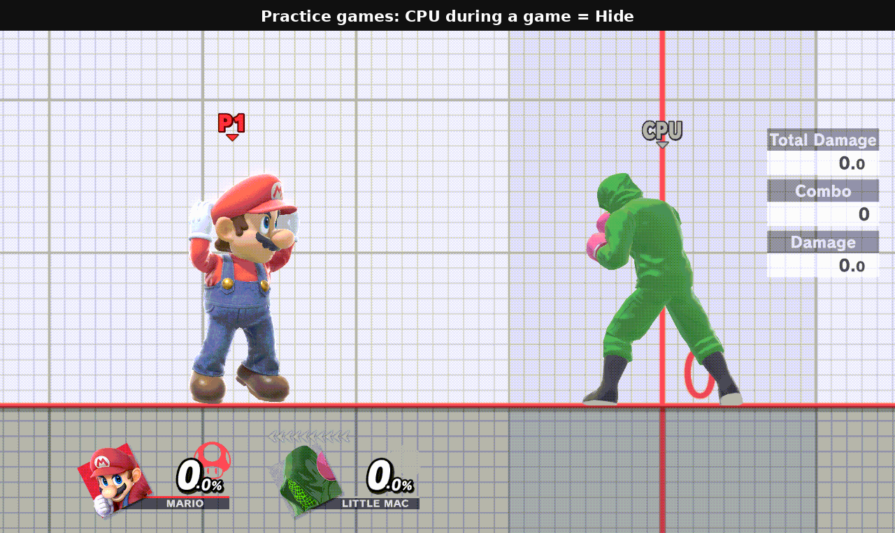 
*The CPU hidden during a game. Eden, rc.14 (untested on hardware).*

In the clip, Hero is hidden on Hide while the count reads "Eggs 0 1:00". Its "CPU" tag and panel return with it when Eggs-ercise is turned Off.

The input is named in a box.

## Reset page to defaults

- The last row of the page.
- It asks first, then puts every row of Fighters & Stages back to your saved defaults (the factory values above, until you save your own with X): the switches, the Loading rows, both cycle lists, both Kirby hat lists, the Lobby Stages list, and Player Character and CPU Character.
- If a pick changes, that fighter loads when the menu closes.
- Your Mii choices, the stage forms, the Lobby Stages mode (Rotation or Direct) and the Solo Popo marks of Character Cycles stay as they are.

 
*Resetting Fighters & Stages. Eden, rc.13 (untested on hardware).*

In the clip, Up wraps to the last row.
