# Fighters & Stages

This page picks the fighters on both sides, the order the cycle chords step through, Kirby's hats, the Mii fighters
and the stage, and turns on practice in the waiting rooms. Open the menu with B + D-pad Up (or Minus), then press L
twice from the CPU page, or R until the title reads Fighters & Stages.
[Using the menu](../guide/using-the-menu.md) explains the buttons inside the menu.

The guides: [Fighter cycles](../guide/fighter-cycles.md), [Mii fighters](../guide/mii.md),
[Stages](../guide/stages.md) and [Waiting rooms](../guide/waiting-rooms.md).

## Player 1 and CPU

### Player Swapping

On: the Cycle Player chord (ZL + D-pad Right) and a pick in [Player Character](#player-character) change your fighter.
Off: Player 1 stays the fighter you picked at the character select; only a combo's Switch (Recording) changes it. The
CPU is not affected: its chord and [CPU Character](#cpu-character) always work.

- **Values:** On, Off
- **Default:** Off
- **How:** A flips it.

With it Off, Cycle Player does nothing and shows no notice. A Player Character pick made while it is Off is kept, and
loads when you turn Player Swapping On.

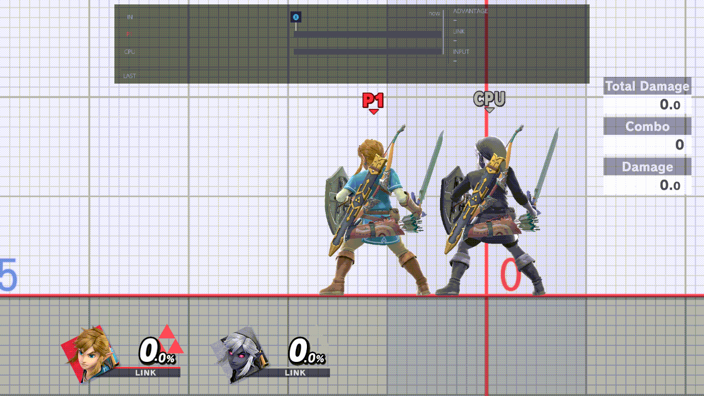 
*B + Up opens the menu on Player Swapping (Off); A turns it On; then Player Character, Captain Falcon, A, and B closes the menu: Player 1 loads Captain Falcon. The 8 s load is cut. Eden, rc.11.*

More: [Fighter cycles › Player Swapping](../guide/fighter-cycles.md#player-swapping)

### Player Character

Opens a portrait grid of every fighter. A picks Player 1's fighter, and "> " marks the pick. The new fighter loads
when you close the menu, if [Player Swapping](#player-swapping) is On.

- **Values:** any fighter on the grid
- **How:** A opens the grid. The D-pad moves, A picks, B goes back. X on a shared slot (Pokémon Trainer, Pyra / Mythra)
  shows its next form, so A picks that form.

The pick follows the fighter on screen: when you enter Training, or a cycle chord switches you, it becomes that
fighter. A greyed Mii tile has no Mii that Player 1 can load (the help line reads "… - unavailable"). In a waiting room
this changes only your practice fighter; the match uses the fighter you picked for it.

### CPU Character

The same grid for the CPU. The new fighter loads when you close the menu. It always works; in a waiting room it
changes the first training partner.

- **Values:** any fighter on the grid
- **How:** as [Player Character](#player-character).

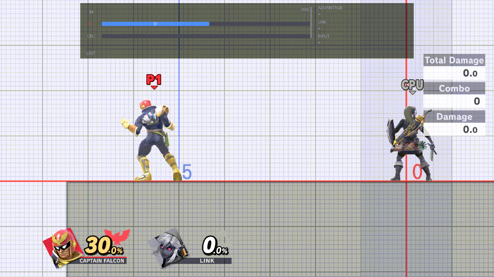 
*CPU Character: A opens the grid, Right and A pick Donkey Kong, B closes the menu, and the CPU loads it ("CPU fighter applied"). The 3.6 s load is cut. Eden, rc.11.*

### Character Cycles

The order the cycle chords step through: one list for Player 1 (red numbers) and one for the CPU (blue numbers). The
second help line says which list you are editing.

- **Values:** All, or your own order
- **Default:** All, for both
- **How:** A opens the grid. ZR switches between the Player and the CPU list. A on a fighter adds it at the end (from
  All, it starts a new list with just that fighter); A on All takes every fighter in character-select order. R removes
  a fighter (the last one stays). X on Pokémon Trainer or Pyra / Mythra shows its next form; A then makes the cycle
  load that form. Y on Ice Climbers marks Solo Popo ("S") for that list. B goes back. Y on this row (on the page)
  resets both lists.

The fighter each role started with is its 0. Each press of the cycle chord loads the next number; after the last it
goes back to 0. A Mii tile is numbered only while that role has a Mii of the class it can load; which Mii is set by
the [Mii rows](#mii-brawler). A change made in Training starts loading the new fighters at once.

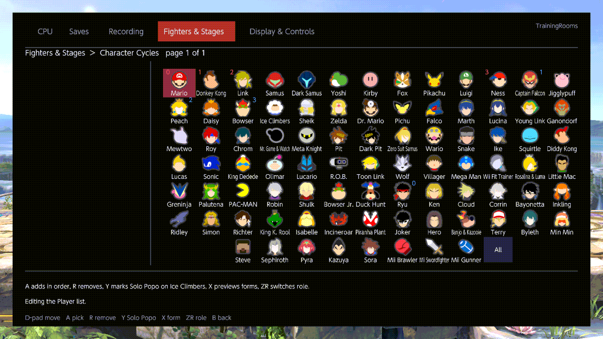

More: [Fighter cycles › The Character Cycles editor](../guide/fighter-cycles.md#the-character-cycles-editor)

### Solo Popo (original Ice Climbers)

On: when Player 1 picked Ice Climbers at the character select, Player 1 is Popo alone, without Nana. That counts for
Player 1's 0 in the cycle too. The Ice Climbers in a cycle list have their own Solo Popo mark (Y in
[Character Cycles](#character-cycles)); the CPU's mark covers both its cycle and the CPU's own pick.

- **Values:** On, Off
- **Default:** Off
- **How:** A flips it.

More: [Fighter cycles › Solo Popo](../guide/fighter-cycles.md#solo-popo)

## Extras

### Kirby Hats

The order of the hats (copy abilities) the Kirby hat chord gives Kirby: one list for Player 1's Kirby and one for the
CPU's. Kirby itself can't be a hat.

- **Values:** All, or your own order
- **Default:** Mario only, for both
- **How:** A opens the grid. ZR switches between the Player and the CPU list. A adds a fighter's hat at the end (All
  takes everyone), R removes one (the last one stays), X shows the next form of a shared slot, B goes back.

The chord is fixed: hold B with the left stick at rest and click the left stick for your Kirby, or the right stick for
the CPU's. Each click gives the next hat in the list.

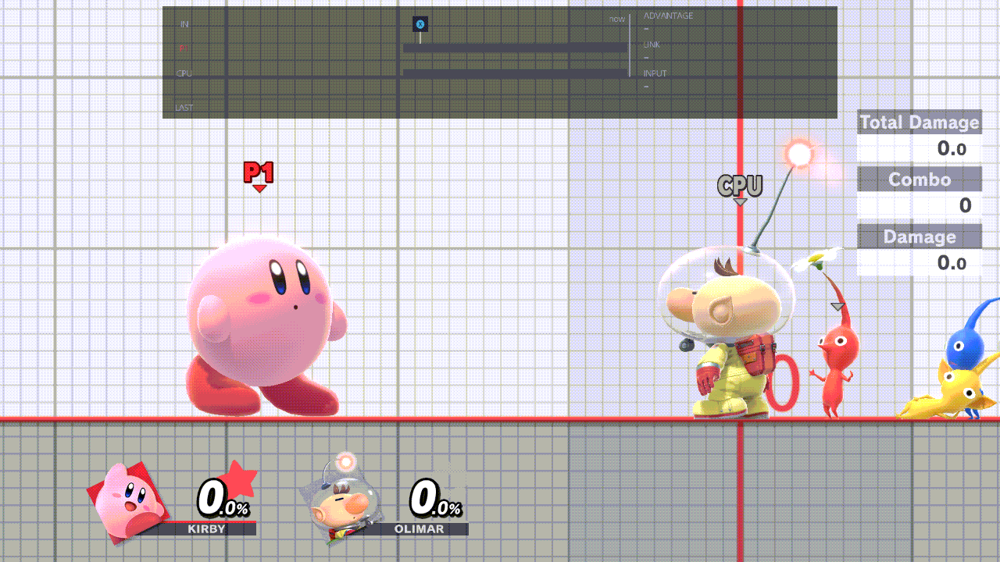

More: [Fighter cycles › Kirby hats](../guide/fighter-cycles.md#kirby-hats)

### Give item

Opens a grid of 38 fighter items: turnips (each face), bombs, Pac-Man's bonus fruit, Robin's tome and Levin Sword, and
more. A puts the item in Player 1's hand as soon as the menu closes, in place of anything Player 1 holds. The notice
reads "Character Item" and the item's name.

- **Values:** the 38 items
- **How:** A opens the grid. The D-pad moves, L / R turn its page, A gives, B goes back. Every A asks again, the same
  item included; if you press A on several, the last one is given.

Most items need their fighter's data, which the plugin loads for you. If it can't, the notice says "Load ‹fighter› as
Player or CPU first". Daisy's and Peach's Bob-omb and Mr. Saturn, and Diddy Kong's Banana Peel, need nothing. Nothing
is given during a fighter swap, a save-state load, a recording or a playback.

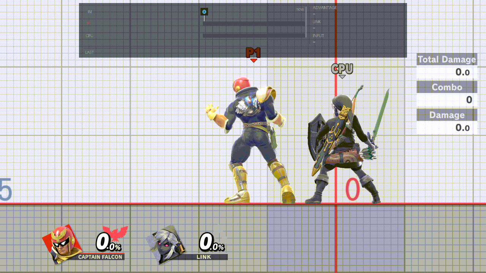 
*Give item: A opens the grid, Down, Right, Right to Daisy: Bob-omb, A, B closes the menu: Player 1 gets the Bob-omb (the notice names it). Eden, rc.11.*

### Mii Brawler

Opens the list of Mii Brawlers for Player 1; ZR switches to the CPU's list. It lists your saved Miis, then the Miis
imported from your replays, then *Add New…*, which opens Smash's own Mii Fighter editor. Each line reads "number. name
[specials]", the four specials as digits; "> " marks the role's choice.

- **Values:** a saved Mii, a replay Mii, or a new one
- **How:** A opens the list. Up / Down move, L / R move a page, A picks, ZR switches Player / CPU, B goes back.

A pick applies when you close the menu if that role is a Mii Brawler on screen; otherwise the next time a cycle or a
pick loads the class.

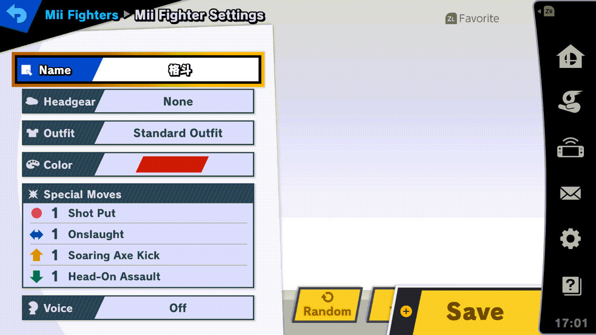

More: [Mii fighters](../guide/mii.md)

### Mii Swordfighter

The same list for the Mii Swordfighter.

- **Values:** a saved Mii, a replay Mii, or a new one
- **How:** as [Mii Brawler](#mii-brawler).

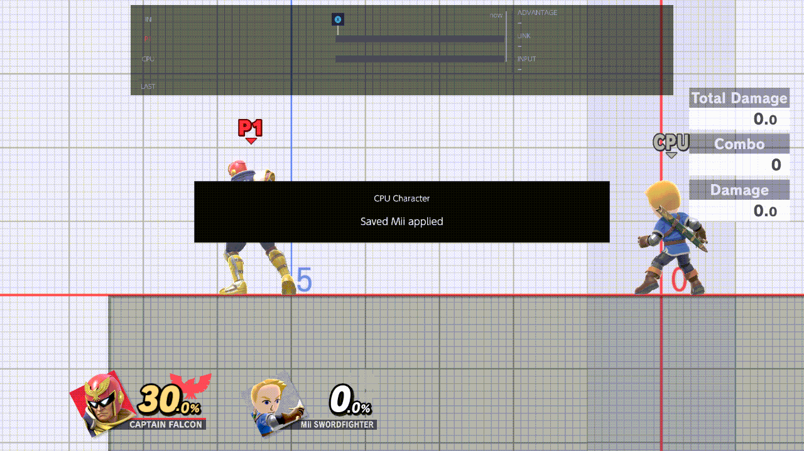 
*With the CPU a Mii Swordfighter: A opens the list (Player 1's), ZR switches to the CPU's, Down and A pick the second saved Swordfighter, and B closes the menu; the CPU reloads it ("Saved Mii applied"). The two saved Miis on this profile look alike. The 6.6 s load is cut. Eden, rc.11.*

### Mii Gunner

The same list for the Mii Gunner.

- **Values:** a saved Mii, a replay Mii, or a new one
- **How:** as [Mii Brawler](#mii-brawler).

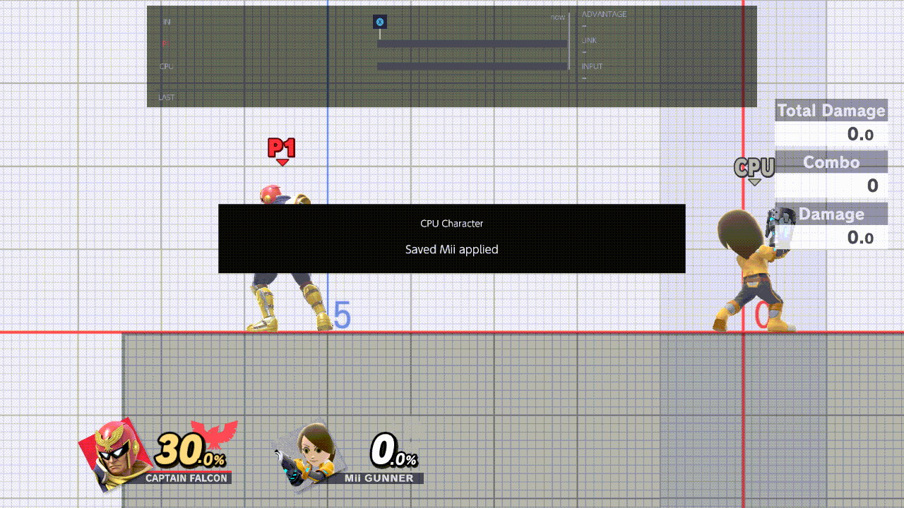 
*A opens Player 1's Mii Gunner list; ZR switches to the CPU's. This profile has one saved Gunner, then Add New…, which opens Smash's Mii editor (as for the Brawler). Eden, rc.11.*

## Stages

### Change Stage

Opens a grid of every stage. A on a stage closes the menu and goes there: the notice reads "Practice Stage · Stage
requested", then "Stage ready". It works in Training and in waiting-room practice.

- **Values:** any of the 117 stages, the Waiting Room and Training included, in the forms the game has for each
- **How:** A opens the grid. The D-pad moves, L / R turn its page, Y picks the focused stage's form first (the tile
  shows [N], [Ω] or [BF]), A goes there, B goes back.

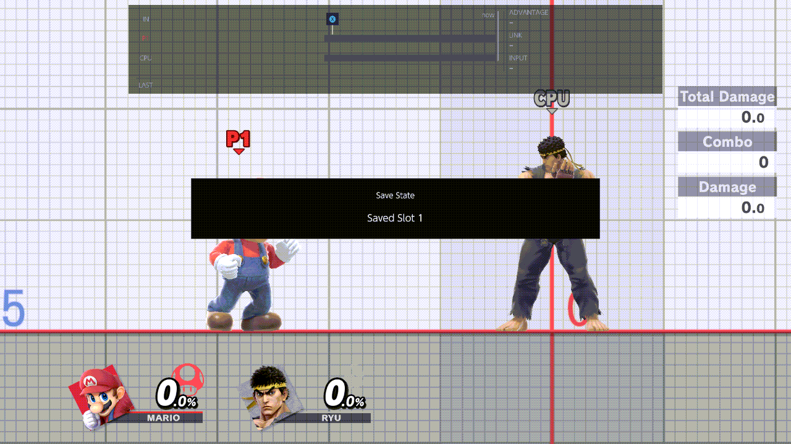

*A on Battlefield (Ω) closes the menu ("Stage requested"); then the whole morph to Battlefield Ω and "Stage ready". The 3 s wait between them, where nothing moves, is cut. Eden, rc.11.*

More: [Stages › Change Stage](../guide/stages.md#change-stage)

### Lobby Practice

On: TrainingRooms runs in the waiting rooms too (local wireless rooms and Quickplay's online waiting room). The menu
opens there, the chords work, and the CPU page drives the first training partner. Off: the waiting rooms are left to
the game, and the menu doesn't open there. Turn it On in Training before you go.

- **Values:** On, Off
- **Default:** Off
- **How:** A flips it.

More: [Waiting rooms](../guide/waiting-rooms.md)

### Lobby Stages

The stage list: each new waiting room opens on the next stage of it, and Training does too with
[Training Stage Rotation](#training-stage-rotation) On.

- **Values:** All, or your own order; Rotation or Direct
- **Default:** the Waiting Room only, Rotation
- **How:** A opens the grid. In Rotation, A adds a stage at the end or takes it out (the number is its place; the last
  one stays), and A on All takes every stage. Y changes the focused stage's form. X switches to Direct: there A goes
  to the stage now and closes the menu, as Change Stage does, and new waiting rooms open on that stage instead of the
  list. X switches back. L / R turn the page, B goes back.

The waiting rooms follow the list only while [Lobby Practice](#lobby-practice) is On.

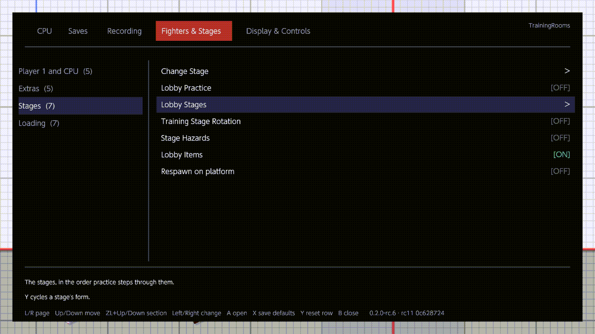

More: [Stages › Lobby Stages](../guide/stages.md#lobby-stages)

### Training Stage Rotation

On: each time you enter Training from the character select, Training opens on the next stage of the
[Lobby Stages](#lobby-stages) list. Off: Training opens on the stage you chose, as usual.

- **Values:** On, Off
- **Default:** Off
- **How:** A flips it.

It always uses the Rotation list, even while Lobby Stages is on Direct. With the default list (the Waiting Room only),
Training opens on the Waiting Room.

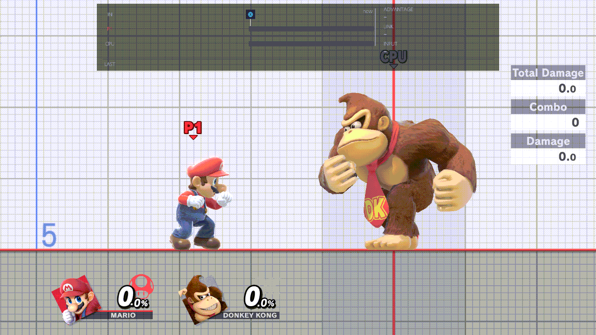

More: [Stages › Training Stage Rotation](../guide/stages.md#training-stage-rotation)

### Stage Hazards

On: stage hazards are active in Training. Off: they are not. It takes effect when a stage loads: when you enter
Training, or go to a stage with Change Stage.

- **Values:** On, Off
- **Default:** Off
- **How:** A flips it.

With [Lobby Practice](#lobby-practice) On it also sets the hazards of the waiting room's stage, when you enter the
room. The row's help line mentions Training only.

### Lobby Items

On: items appear in the waiting room as usual. Off: no items appear there, and the ones on the floor are removed when
you turn it Off. Training is not affected.

- **Values:** On, Off
- **Default:** On
- **How:** A flips it.

It works in local wireless rooms and in Quickplay's waiting room, whether Lobby Practice is On or not.

### Respawn on platform

On: after a KO, the fighter comes down on the revival platform with the game's invincibility. Off: the fighter is back
at once, with no invincibility. It works in Training and in waiting-room practice.

- **Values:** On, Off
- **Default:** Off
- **How:** A flips it. The row is greyed ("Auto-load on death is On: a save state loads instead") while Saves ›
  [Auto-load on death](saves.md#auto-load-on-death) is On.

With Saves › [Save States](saves.md#save-states) Off, the plugin leaves KOs to the game, so the revival platform comes
back even with this row Off.

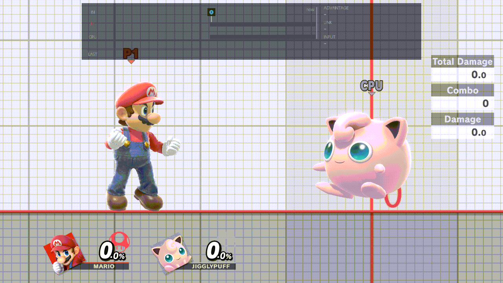

More: [Save states › Respawning](../guide/save-states.md#respawning)

## Loading

Advanced: this section is collapsed until you open it (A on its header).

These rows set how fighters and Kirby hats are loaded ahead of time, in the background, so a cycle chord or a hat
click switches at once instead of reloading. The notice "Fighters" counts them, such as "Loading 6/10", then
"Ready 10/10". The defaults suit most players.

More: [Fighter cycles › What the Loading rows do](../guide/fighter-cycles.md#what-the-loading-rows-do)

### Cycle Preload

How many of the next fighters in each role's cycle are kept ready. Off: none are; each swap loads its fighter then,
which takes longer.

- **Values:** Off, 1, 2, 3, 4, 5
- **Default:** 5
- **How:** Left or Right switches it; A opens the list.

### Preload

What is kept ready: the fighters of your cycles, Kirby's hats, or both. The banks and groups below need Fighters or
Both.

- **Values:** Fighters, Hats, Both
- **Default:** Both
- **How:** Left or Right switches it; A opens the list.

### Ready Fighters

The total number of fighters kept loaded, for Player 1 and the CPU together, the two on screen included.

- **Values:** 2 to 12
- **Default:** 10
- **How:** Left or Right steps one (it stops at 2 and 12); A opens the list.

### Ready Hats

How many Kirby hats are kept ready, apart from Ready Fighters. A hat whose fighter is already kept ready uses that
fighter, and takes no place of its own.

- **Values:** 0 to 5
- **Default:** 5
- **How:** Left or Right steps one (it stops at 0 and 5); A opens the list.

### Ready Fighter Bodies

How many fighters each role keeps loaded in its own slot, the one on screen included. Switching among them is
instant. Off: only the fighter on screen, and no groups.

- **Values:** Off, 2, 3
- **Default:** 3
- **How:** Left or Right switches it; A opens the list. The Ice Climbers pair bank in [Swap groups](#swap-groups)
  needs 3.

### Group Swap

On: each role can keep more groups of fighters ready besides its own slot, up to Ready Fighters. Off: only the
role's own slot; the group entries of [Swap groups](#swap-groups) are greyed ("Group Swap is Off").

- **Values:** On, Off
- **Default:** On
- **How:** A flips it.

### Swap groups

Opens seven switches for the fighters that need special care when they are kept ready. The row shows how many are On,
such as "7 of 7".

- **Values:** each entry On or Off
- **Default:** all On
- **How:** A opens the list. Up / Down move, A flips the entry, B goes back. A greyed entry shows why and ignores A.
  Y on this row (on the page) puts all seven back to your saved defaults.

The seven entries:

- **Ice Climbers pair bank:** Popo and Nana share a role's slot with one other fighter, so switching between the pair
  and that fighter is instant. Greyed unless Ready Fighter Bodies is 3.
- **Original fighter bank:** the fighter a role started with (its 0) stays loaded, so going back to it is instant
  instead of a reload. Miis and Solo Popo still reload. Never greyed.
- **Solo Popo groups:** Solo Popo can be kept ready as a group. Greyed while Group Swap is Off.
- **Ice Climbers pair groups:** while the Ice Climbers pair is in a role's slot, that role's groups stay ready. Greyed
  while Group Swap or the pair bank is Off.
- **PT / Aegis groups:** Pokémon Trainer and Pyra / Mythra are kept ready as groups of their own. Greyed while Group
  Swap is Off.
- **Ice Climbers pair group:** the Ice Climbers pair is kept ready as a group of its own. Greyed while Group Swap or
  the pair bank is Off.
- **Mii groups:** a Mii is kept ready as a group of its own, one Mii per role at a time. Greyed while Group Swap is
  Off.

Every entry also needs Cycle Preload above Off, Preload on Fighters or Both and Ready Fighter Bodies above Off; the
list doesn't grey them for that.

## Reset page to defaults

The last row of the page. It asks first, then puts every row of Fighters & Stages back to your saved defaults (the
factory values above, until you save your own with X): the switches, the Loading rows, both cycle lists, both Kirby
hat lists, the Lobby Stages list, and Player Character and CPU Character. If a pick changes, that fighter loads when
the menu closes (Player 1's only with Player Swapping On). Your Mii choices, the stage forms, the Lobby Stages mode
(Rotation or Direct) and the Solo Popo marks of Character Cycles stay as they are.
