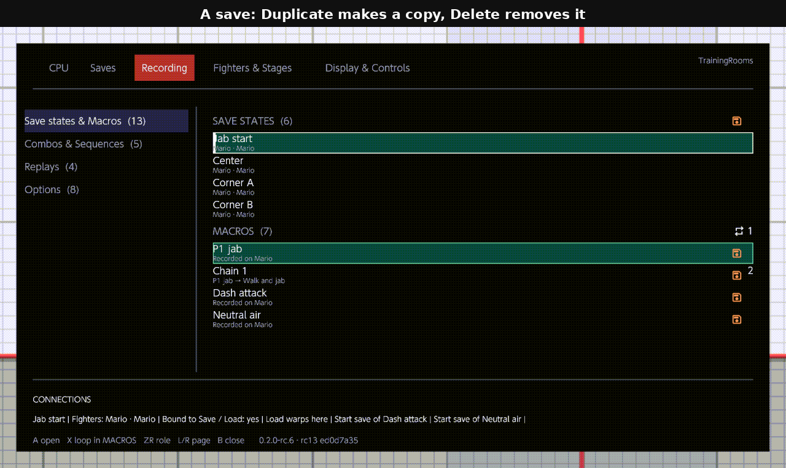
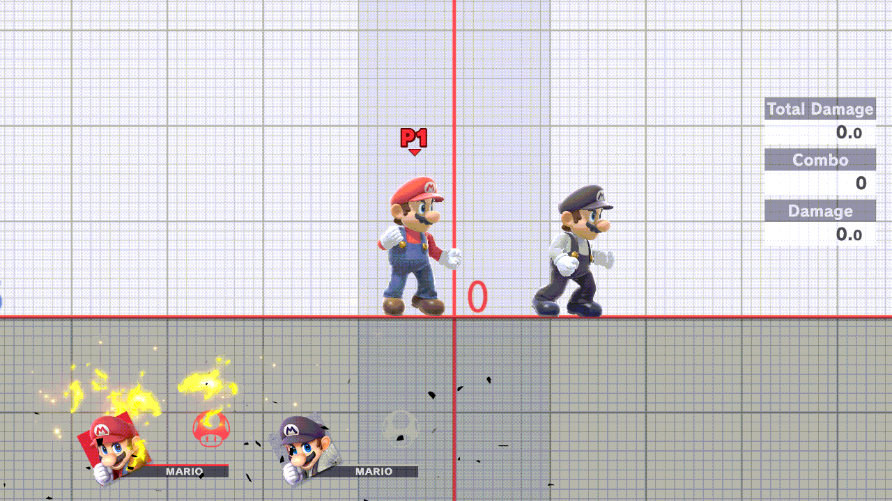
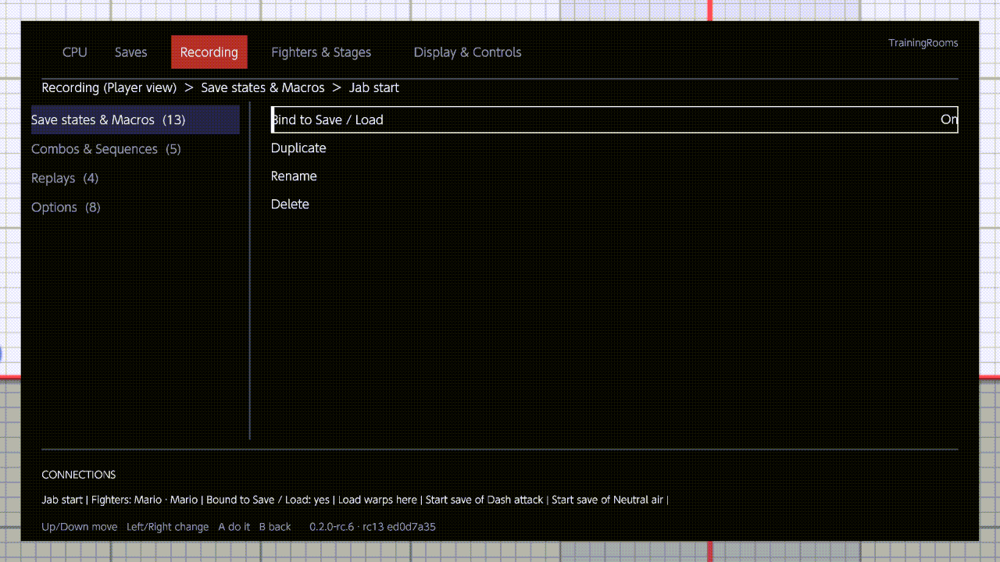
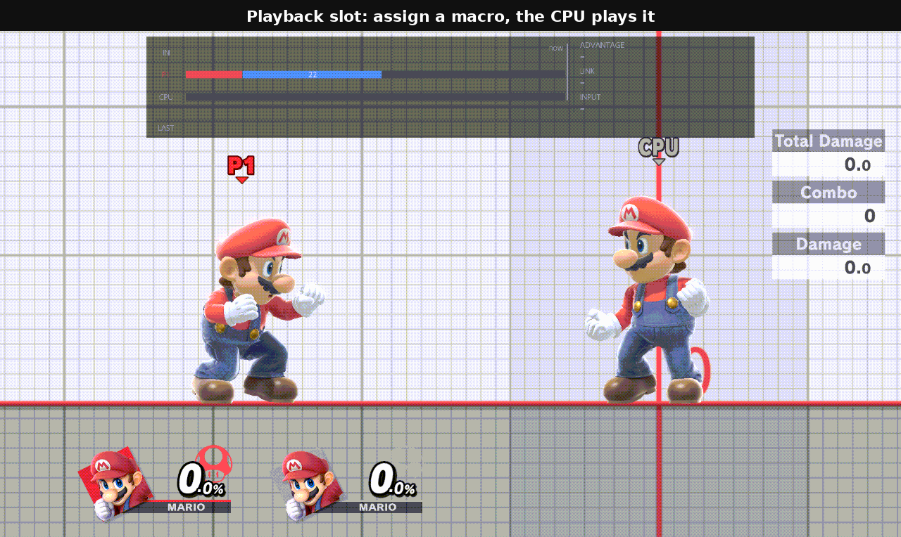
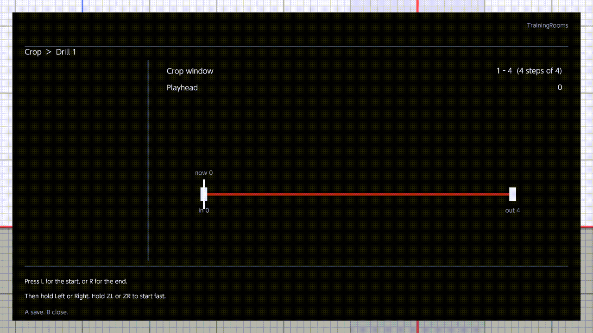
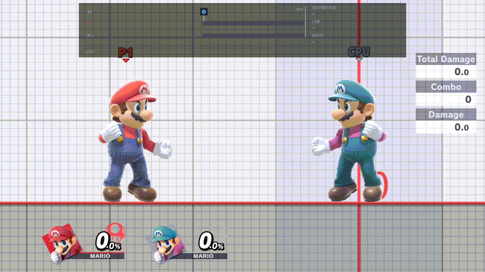
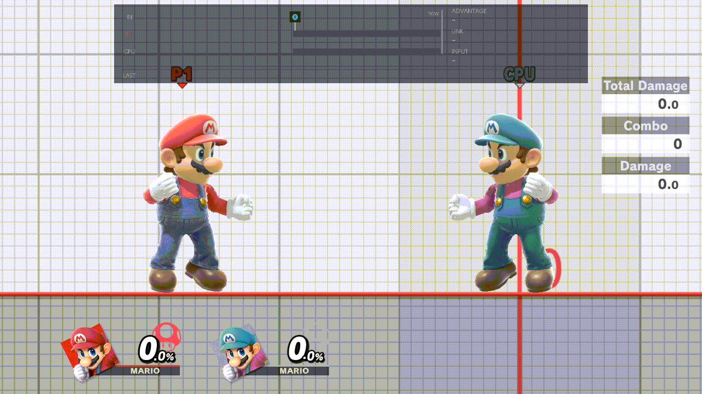
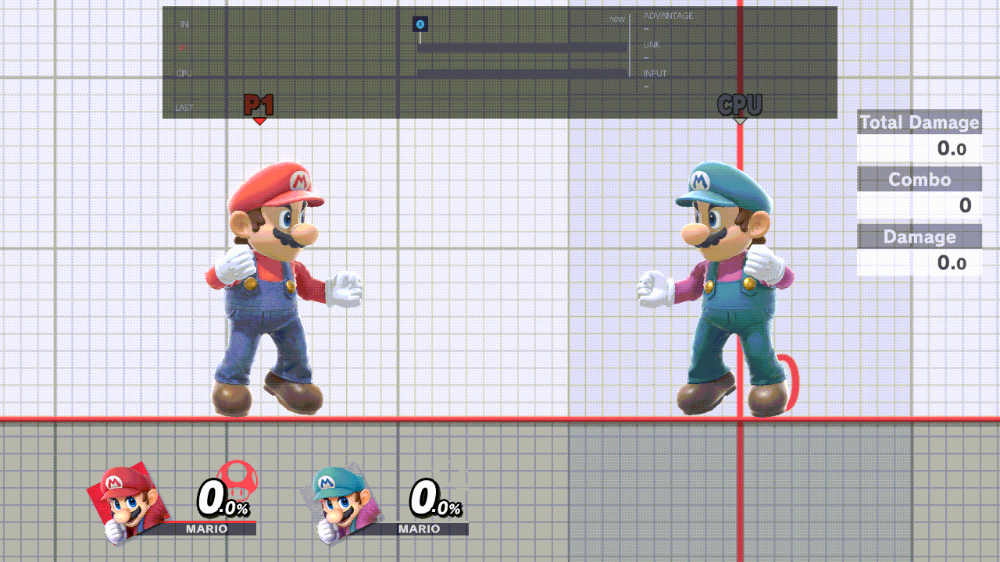
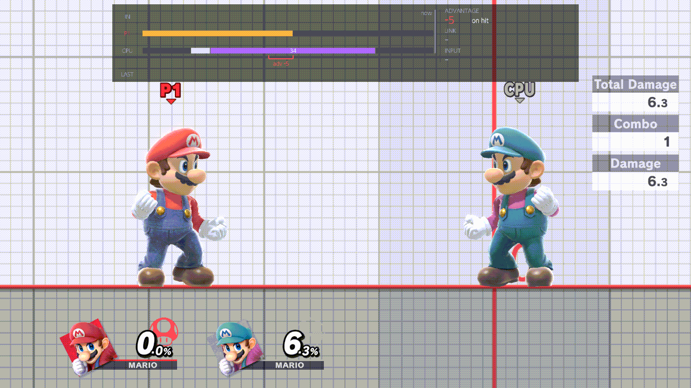

# Recording

Your recordings and combos, and the options for playing them back. Open the menu with B + D-pad Up (or Minus, or your
own menu shortcut) and press R until the title reads Recording (twice from the CPU page). The menu reopens where you
left it.

Save states & Macros and Combos & Sequences are libraries of the files you have made. Replays turns match replays into
macros, and Options sets how macros play and how the combo helper grades. The same libraries open over the match in the
[Recording pop-up](#the-recording-pop-up) (ZR + D-pad Right).

How recording and playback work is in the [Recording guide](../guide/recording.md), the combo files in
[Combo files](../guide/combos.md), and the menu's keys in [Using the menu](../guide/using-the-menu.md). All pages are
listed in [the docs index](../README.md).


This page uses some keys its own way. Its usual footer reads:

```text
A open   X loop in MACROS   ZL+Up/Down section   ZR role   L/R page   B close
```

On a drill with previewable recorded inputs, it reads:

```text
A open   X preview   ZR role   L/R page   B close
```

| Key | What it does here |
| --- | --- |
| X | Steps the loop count in MACROS, or previews a drill's available recorded inputs on Player 1. It never saves your defaults or resets a row on this page. |
| Y | Nothing. |
| ZR | Switches between the Player view and the CPU view. The CPU view hides Combos & Sequences, and the green active macro, Set active and [Loop](#loop) are then the CPU's. A file's own screen names the view in its title: "Recording (CPU view) > …". |

ZR here doesn't change who Record records: the [pop-up](#player-and-cpu) sets that. To put the rows back, use
[Reset page to defaults](#reset-page-to-defaults).

Player and CPU tabs on the top line show the page's view. The ZR cap appears beside them while ZR changes that view;
on a file's screen, picker or keyboard the tabs remain without the cap.
The page view and pop-up role are remembered separately in `settings.json` across menu closes, leaving Training and
restarting the game.
After a restart, Record uses the remembered pop-up role even before you open the menu.

## Save states & Macros

Your save states and your macros, in two lists one above the other, four rows of each at a time. The left column shows
the number of files, such as "Save states & Macros (7)".


- **SAVE STATES** lists every save state, with its fighters on a dim line. The green row is the *bound* save, the one
  the Save and Load chords use. New saves come from the Save chord (ZL + D-pad Down) and from Record, which saves where
  the fighters stood as "Macro N · start".
- **MACROS** lists your recordings and chains (a chain plays several recordings in order).
  - The dim line says "Recorded on" and the fighter; a chain's lists its recordings joined by arrows, and its row
    shows how many it holds. With the cursor on a chain, they show 1, 2, 3 before their names.
  - An orange floppy disk means the macro first warps to its start save when it plays. A grey one means that switch is
    Off.
  - The green row is the active macro of the view you're in: the one its Play chord plays. The header shows that
    view's loop count. The last row is *+ New chain*.
- **The hot five:** in each list the five files you used last come first, the newest at the top, inside a green
  outline, with a thin line after the fifth. The rest follow by name. Binding, setting active, recording, duplicating
  and making a file all count as a use. A sixth use pushes the oldest out of the five; the file stays.
- **CONNECTIONS:** the two help lines at the bottom list what the row under the cursor is joined to, such as a macro's
  start save and the chains it is in ([all the headings](../guide/recording.md#reading-the-lists)).

**How:**

- Up/Down move through each list and wrap at its ends. If a list is empty, Up or Down moves to the other list.
  Left/Right jump between the two lists. ZL + Up/Down move 12 rows, stop at the end, then go to the other list and on
  to the page's next or previous section. L/R turn the page.
- A opens the file's own screen. A on *+ New chain* opens the numbered picker, where ZL + Up/Down jump 12 rows
  and wrap at the ends.
- X, with the cursor in MACROS, steps the loop count of the view you're in: ∞, 1, 2, 3, 5, 10. It is the same count
  as the [Loop](#loop) row.

<br>
*The Recording page with the cursor on Walk and jab: the five used last are outlined in each list, the bound save (Jab start) and the active macro (P1 jab) are green, the floppy marks a macro with a start save, "2" marks Chain 1's second step, and CONNECTIONS says "Starts from Jab start | Chain 1 · step 2 | Recorded on Mario". Eden, rc.13 (untested on hardware).*

### Recordings

2026-11-24. **RECORDINGS >** is the first row of MACROS on the Recording page, in either view. It opens the latest and
previous Vault captures and saved captures, with their fighter sides and length; B returns to MACROS. A capture's
screen has **Inputs from**, **Plays on**, **Play back**, **Make macro…**, **Make combo…**, **Make drill…**, and
**Delete**.
Choose the recorded side and whether the inputs play on Player 1 or the CPU. Play back opens the clip editor and
starts its preview. Make macro saves the selected clip as that role's active macro. Make combo plays it on that role
to capture a combo, or an input drill when no hit is made. Make drill always saves an input drill and its take.

2026-11-25. **Delete** removes the capture at once, without asking, as it does for a macro. A saved capture's files go
from the card; a Vault capture is dropped for this boot. Macros, combos and drills you already made from it stay, and
the game's own replay in the Vault is untouched. If the delete cannot start, the capture stays in the list as it was;
it is never left there half-deleted. Not yet seen in a game.

In the waiting room an opening first lets the CPU finish what it is doing. Until then the row reads
**Waiting for the CPU…** and only B acts: it cancels the opening and leaves the screen up. If the CPU is still busy
after 3 seconds the opening is dropped and the help line reads "CPU did not settle; capture opening cancelled".
In Training the opening is immediate.

More: [Recording a macro](../guide/recording.md#recording-a-macro-and-its-start-save),
[Chains](../guide/recording.md#chains), [Save states](../guide/save-states.md)

### A file's own screen

Up/Down move, A does the row (on a switch, A flips it), Left/Right turn a switch Off or On, and B goes back. L and R
don't turn the page while a file's screen is open.

| File | Rows |
| --- | --- |
| Save state | Bind to Save / Load, Change placement, Duplicate, Rename, Delete |
| Macro | Start save, Change placement and Momentum (only if it has a start save), Offset (only if it also has an offset), Set active, Playback slot, Rename, Trim, Crop, Make combo, Delete |
| Recording | Inputs from, Plays on, Play back, Make macro…, Make combo…, Make drill…, Delete |
| Chain | Start save and Change placement (only if its first macro has a start save), Set active, Edit chain, Rename, Make combo, Delete |
| Combo | Drill, Made from (only if it was made from a macro), Rename, Crop, Delete |
| Input drill | Drill, Made from (only if made from a macro or chain), Rename, Trim, Crop, Delete |
| Sequence | Drill sequence, a row for each of its combos (A drills that combo alone), Edit combos, Rename, Delete |

| Row | What it does |
| --- | --- |
| Bind to Save / Load | On makes this the save the Save and Load chords use. Load only warps there; it never starts a macro. |
| Change placement | Closes the menu and opens the [placement picker](#change-placement) on this save: a macro's start save, or the start save of a chain's first macro. |
| Duplicate | Makes a copy named Save N. |
| Start save | On warps both fighters to the macro's start save once, before it plays. Off plays it from where the fighters are. |
| Momentum | Keep recorded speed (the default) gives the side that plays the speed it had when Record started, on its first input after the warp to the start save. Start at rest starts it standing. Left, Right or A flips it; it is kept in the macro's file. |
| Offset | Only on a macro that still has a start offset from Edit placement, the offset editor of earlier builds. It shows the offset, such as X -40, and Play adds it to the side that plays, on top of the start save's spot. A clears it and changes nothing else in the file; Left/Right do nothing. |
| Set active | On makes this the active macro of the view you're in, replacing the one before. Off clears it. |
| Playback slot | None or Slot 1 to 5 (Left/Right, or A to step on). The CPU plays this macro when it picks that Playback Slot in Mash, Followup, the overrides or Ledge Options. One macro per slot: choosing a slot another macro holds takes it. A slot holds up to 600 frames (10 s), so crop a longer macro first. Kept with the library; deleting the macro empties its slot. |
| Rename | Opens the Switch keyboard (up to 48 characters). B, or an empty name, keeps the old name. |
| Trim | Start, End, Both or Off: skip neutral frames at those sides during playback, without changing the saved frames. A, Left or Right cycles. |
| Crop | Opens the [clip editor](#replay-window). It is a strip over the bottom of the screen, so both fighters stay visible. L picks In, R picks Out; Left/Right move it and Y snaps it to the nearest move. Macros use frames and X previews on the CPU or Player 1 (a ZR tap swaps); combos use whole links and drills use whole steps, with no X action. A names and saves a new file of the same kind; the original stays, and a crop of the role's active macro becomes active. B stops a preview or its tail, and leaves when the editor is idle. |
| Make combo | Plays the file once on Player 1 from its start save: hits make a combo; a pass with no hits makes an input drill. |
| Drill, Drill sequence | Makes this the one combo or sequence the combo helper grades. |
| Edit chain, Edit combos | Opens the numbered picker. |
| Delete | Removes the file at once, without asking. |

Hit combos have no Trim row because their files contain links, not idle input frames.

<br>
*A on the save Center opens its screen. A on Duplicate adds a copy, and the left-hand count goes from 13 to 14. B to the list, A on the copy ("Save 1"), Down three times to Delete, A: it is gone and the count is 13 again. Each press is named in a box. Eden, rc.13 (untested on hardware).*

<br>
*A on Walk and jab opens its screen, Down to Rename, A: the Switch keyboard (a window of its own in Eden). The typed name "Renamed jab" shows in the breadcrumb and in MACROS, and Chain 1 now reads "P1 jab → Renamed jab". Each press is named in a box. Eden, rc.13 (untested on hardware).*

**The numbered picker** (*+ New chain* and *Edit chain*; *+ New sequence* and *Edit combos* for combos) lists your
recordings, or your combos (a chain can't hold a chain). A gives the one under the cursor the next number, R takes a
number off, X is done, and B backs out: nothing is saved, and an edited chain or sequence keeps its old order. X on a
new chain or sequence asks for a name on the Switch keyboard. An empty name makes it Chain N or Sequence N; cancelling
the keyboard makes nothing.

<br>
*Chain 1 (Walk, Crouch, P1 jab) played by the CPU; on its own screen, Edit chain opens the picker, whose tiles run A to Z (Crouch, P1 jab, Walk) with their numbers: R takes Walk's and Crouch's numbers off, A numbers Crouch 2 and Walk 3, so the chain reads P1 jab, Crouch, Walk; B finishes and the CPU plays the new order. Eden, rc.14 (untested on hardware).*

<br>
*A macro (Walk and jab, with a start save): Start save reads "Jab start · On" beside the orange floppy. Eden, rc.13 (untested on hardware).*

<br>
*A chain (Chain 1, P1 jab then Walk and jab): its Start save is the first macro's. Eden, rc.13 (untested on hardware).*

<br>
*A combo (Jab jab, made from the macro P1 jab). Eden, rc.13 (untested on hardware).*

<br>
*A save state (Jab start, bound: Bind to Save / Load reads On). Eden, rc.13 (untested on hardware).*


<br>
*Macro 1's own screen: Playback slot reads None, Right sets Slot 1, and the menu closes. With the CPU's Mash on Playback Slot 1 (set beforehand), Fox's forward smash hits the CPU (Mario, 17.6%) and the CPU plays the macro, "Input Recording: Playback" on screen. Eden, rc.14 (untested on hardware).*

More: [A file's own screen](../guide/recording.md#a-file-s-own-screen)

## Combos & Sequences

The combos you drill with the [Combo helper](#combo-helper), and sequences, which are combos drilled one after another.
It is shown in the Player view only. The left column shows the number of files, such as "Combos & Sequences (4)".

- **SEQUENCES** (the upper list) lists your sequences, each with its combos joined by arrows on the dim line. The last
  row is *+ New sequence*.
- **COMBOS** lists your combos, each with "Recorded on" and the fighter. Its first row is *+ Save last combo…*.
- **DRILLS >** under COMBOS opens your no-hit input drills and **+ Record drill…** ([below](#input-drills)).
- **The drill:** the green row is the one combo, input drill or sequence the helper grades. There is only one, so choosing another
  replaces it.
- **The hot five** works as above. With the cursor on a sequence, its combos show their place in it; on a combo, the
  sequences it is in show where it comes.
- **CONNECTIONS:** for a combo, its fighter, the macro it was made from, its links (the two moves, TRUE or not, then
  the inputs) and its sequences. For a sequence, its combos, then its streak and best.

**How:**

- Up/Down wrap within each list, as in Save states & Macros. Left/Right switch lists, and ZL + Up/Down jump to the
  other list and then to the page's next or previous section after reaching an end.
- A on *+ Save last combo…* keeps the last combo the frame strip saw as a new combo and makes it the drill. The Switch
  keyboard asks for a name; an empty name gives it the next Combo N. With no combo on the strip yet, it says so and
  saves nothing.
- A on *+ New sequence* opens the numbered picker of your combos, then the name. A on a combo or a sequence opens its
  own screen ([rows above](#a-file-s-own-screen)).
- X and Y do nothing here. ZR switches to the CPU view, which hides this section.

<br>
*Drilling a sequence*

More: [Combos](../guide/recording.md#combos),
[Sequences and the one drill](../guide/recording.md#sequences-and-the-one-drill),
[Combo files](../guide/combos.md)

### Input drills

Practise movement without hitting the opponent: **A** on **COMBOS → DRILLS > → + Record drill…** arms a Player 1 take, then **ZR + D-pad Down** starts and stops it with the default Record chord.

Each step shows its first and last inputs' moves, or the inputs when no move was recorded. Presses on one frame count
as one input; stick flicks appear in the title only without a button or C-stick input. Grading still checks inputs.

On a drill row, X previews its recorded inputs on Player 1. While the take plays, the strip's key line reads
`B stop preview`. B or X stops it and drops the rest of its frames; the page or pop-up returns. After the last frame
the result stays on screen for about a second and the key line reads `B back`; B or X returns to the page or pop-up at once,
or it returns after the tail.

The new drill becomes the helper's grading target; its bar counts steps and timing, with no TRUE verdict. To make one from a macro or chain, choose **Make combo**: a pass with no hits makes a drill. On a drill's own screen, **A** on **Crop** opens the same editor as a macro, with whole-step handles; **A** names and saves a new drill and keeps the original. Empty names use Drill N. **B** leaves, and there is no X preview.

<br>
*A drill's Crop: L selects the start or R the end; Left/Right changes the kept steps (4 → 3 → 4 → 3). Eden, 2026-11-15, rc.15 `2eb3903e`. This early build's helper overlaps the editor; the overlap was fixed before the integrated release. The clip shows range selection, not recording or grading.*

[Input drill acceptance evidence](../EVIDENCE-rc15-input-drill.md).

More: [Input drills](../guide/recording.md#input-drills).

## Replays

Turning saved match replays into macros, and moving where a macro starts.

### Ask before switching fighter

Whether to ask before switching to the fighter a recording was made on. It covers every Fighter Mismatch question: a
capture opened in the [Replay window](#replay-window), Play on a macro or a chain, and a drilled combo. On: a recording
made on another fighter asks first (Keep current fighter, or Switch to recorded fighter). Off: the fighter you have
stays, without asking, as if you had picked Keep.



- **Values:** On, Off
- **Default:** On
- **How:** A, Left or Right flips it.

More: [Fighter Mismatch](../guide/recording.md#fighter-mismatch)

### Change placement

Moves where a save state puts the fighters. The menu closes and a picker opens on the live game, with the camera on
the whole stage. Both fighters stand at the save's spots, you move them with the Break the Targets crosshair, and A
or + writes the new spots into the save file.

From this row it opens the start save of the active macro of the side the [pop-up](#player-and-cpu) is set to (not
always the view ZR shows here); for a chain that is its first macro's start save. The same picker opens from
**Change placement** on a save's, a macro's or a chain's [own screen](#a-file-s-own-screen), and with X on a save in
the [pop-up](#the-lists-and-the-hot-five).

<!-- CAPTURE-REQUEST rec-change-placement: Change placement on a save: Where, Off stage for the CPU, the crosshair with the game's magnifier, A saves, then Load puts both fighters on the new spots. See artifacts/docs4/CAPTURE-REQUESTS.md. -->

- **Values:** a picker of five pages: Where, Spot, State, Percent, Preview.
- **How:** A opens it. It opens with both practice fighters there and no recording, playback or load under way. Over
  a running practice game the notice reads "Stop the practice game to place fighters". From this row, if it can't
  open, the notice says why, such as "Make a macro active for this role first" or "Link a start save to the macro
  first" (the macro has no start save, or its Start save switch is Off).
- **Where:** Training and the waiting room.

| Page | What you set | Keys |
| --- | --- | --- |
| Where | On stage or Off stage, for Player 1 and for the CPU | L / R or Up / Down pick the fighter. Left / Right switch it on or off stage. |
| Spot | The spot | The stick or the D-pad moves it. L / R take the other fighter. Y switches on or off stage. |
| State | How the fighter starts: Standard; on stage also Missed tech or Trip; off stage also Tumble, Helpless or Footstool | Left / Right change it. On a missed tech, X turns it face up or face down. |
| Percent | The damage, 0 to 300% | Left / Right change it by 1, Up / Down by 10. |
| Preview | Both fighters as they will be saved | A or + saves. |

On every page A goes to the next page and B goes back; B on Where cancels, puts both fighters back where they stood
and writes nothing. X puts both fighters back to the saved values. + saves at once, from any page: a page you did not
visit keeps the save's own values.

- **On stage:** the fighter stands on a floor. Left / Right move it along that floor, and Up / Down step to the floor
  above or below, a platform or the ground. For a moment after the picker opens, until the stage's floors are traced,
  the crosshair moves freely and the fighter stands on the floor under it.
- **Off stage:** the fighter is held in the air at the crosshair, which reaches to 1 unit inside the blast line.
  Outside the picture the game shows its own magnifier of the fighter; with the game's HUD off, a dotted pointer at
  the border shows the way.
- **Switching to Off stage:** if the spot is in open air or under the stage, the fighter is held there. If it is over
  the stage or inside it, the fighter goes to the open air beside the nearest ledge, halfway across that gap and
  halfway down to the bottom blast line. On the Spot page the spot is the crosshair's, and the crosshair goes with
  the fighter. After that the crosshair moves freely, also back over the stage.
- **A start save that macros share:** when macros start from the save, the picker first asks whether to change it for
  all of them (it says how many) or to copy it. Up / Down choose, A goes on, B cancels. Opened from a macro, the copy
  becomes that macro's start save. From a chain, only its first macro gets the new start-save link. From the save's
  own screen, the copy is a new save and no macro is relinked.
  [Shared start save](#shared-start-save) answers the question ahead.
- **What is saved:** only what you changed, for the fighter you changed: its spot, its start state, its damage. With
  nothing changed the file is not written. The save then loads once, so both fighters end on the saved spots.
  Copy changes at most a macro's start-save link, not its inputs, Momentum or offset. Play still
  adds an existing offset on top of the save's spot until you clear it with the Offset row of the macro's
  [own screen](#a-file-s-own-screen).

In an Eden smoke boot on install 5 (2026-11-25), in the picker that Record opens, switching Player 1 to Off stage
moved the spot beside the ledge, and one D-pad step moved it on. No placement was saved or loaded, and Change
placement was not opened on a save; those rest on host tests. [Install evidence](../EVIDENCE-rc15-installs.md#the-eden-smoke-boot-of-the-finished-build)

More: [Change placement and the Replay window](../guide/recording.md#change-placement-and-the-replay-window)

### Replay window

Turns part of a saved match into a macro. It lists the captures you have: "Latest Vault capture" and "Previous Vault
capture" (replays you played in the Vault), then each capture saved with [Replay capture](#replay-capture) On, with
its name and its length in frames ("(partial)" if it ended early).

2026-11-25. Y deletes the capture under the cursor, at once and without asking; the list stays open and the cursor
returns to its first row. Deleting the last one closes the window. Not yet seen in a game.

Pick one with A. If the CPU isn't the fighter it was recorded on, Fighter Mismatch may ask first
([Ask before switching fighter](#ask-before-switching-fighter)). Then the menu closes and the clip editor takes the
controller. The editor is a strip over the bottom of the screen: the game keeps running above it, so you see both
fighters while you crop and while a preview plays. The strip shows the kept range, where the preview plays, the move
at the selected handle, and one timeline with the In and Out handles, the playhead and a tick for every move:

| Key | What it does |
| --- | --- |
| Up/Down | On a capture with two sides, pick whose inputs to take. Nothing for a saved file. |
| ZR | A tap (pressed and released with nothing else) swaps where the preview of a macro or a capture plays: the CPU or Player 1, as ZR does on the Recording page. The strip names it ("Plays on CPU", or after a capture's fighter "plays on Player 1"). A recording opened from its own screen starts on its Plays on choice, and Make uses the target the strip shows. During a preview it stops the preview and swaps; X then plays on the other fighter. ZR held with Left/Right is the fast scrub and does not swap. |
| L / R | L picks the start and R the end. After a preview or save, pick a handle again before moving it. |
| Left/Right | Move it: frames for replays and macros, whole links for combos, whole steps for drills. A tap moves 1; holding speeds up to 180 a tick, and holding ZL or ZR starts fast. |
| Y | Snaps the selected handle to the nearest move: In to a move's start, Out to a move's end. A move whose end is not known offers the next move's start, or the end of the take. Pick a handle with L or R first. On a Replay window capture, a start in the middle of an action also takes the move's short setup, as ZL + Y does, so X and A work from it; where no move can start there, the strip says why. |
| ZL + Y | Replay window captures only: moves In back to the start of the move it sits in, with its short setup. |
| X | Previews the kept part: a capture on the CPU (or on Player 1 after a ZR tap, or when its Plays on says so), or a macro through Play on the role you opened Crop from (Player view: Player 1; CPU view: the CPU), using its start save when On, or on the other fighter after a ZR tap. No save is needed first. The strip stays up and its playhead follows the inputs; X or B stops it early and drops its remaining frames. Not offered for combos or drills. |
| A | Names and saves the kept part as a new file of the same kind. An empty name uses the next unused Macro N, Combo N or Drill N. The original stays. |
| B | Stops a preview or its tail without leaving; the next B closes the editor. B closes at once when the editor is idle. |

While a preview plays, the key line reads `B stop preview`. After the last frame the result stays on screen for about
a second and the key line reads `B back`; B or X ends that tail without closing the editor, and the usual keys return.

Crop on a macro, combo or drill opens this same editor. A one-side file has no fighter-selection row. Combos and drills have no preview button. The frame strip and helper bar step aside until you leave the editor, including after preview or save. On a capture the strip names the captured side and where the preview plays.

**Move marks.** A tick on the timeline is where a move starts; a thin band runs to where it ends, when that is known.

- A macro recorded on this build keeps its moves in its file (the optional `actions` key: each move's start frame, the first frame the fighter could act again, and the move), so the marks are there when the editor opens.
- 2026-11-25: a mark also keeps which form of the move it was, as a combo link does. `variant` is the first, second or third jab, the rapid jab or its finisher, or which aerial, grab or throw. `angle` is a side tilt or side smash aimed up or down. A take saved before that has neither and still loads.
- If automatic trim cuts off a move's known end, its band ends at the end of the saved take. A move whose end was never observed still has no end mark.
- An older macro and a Replay window capture show a tick for every press, C-stick input or flick that starts a move. Their ends and names appear as a preview plays past them.
- With [Move names](#move-names) On, a mark reads as the combo and drill lists do: "Jab 1", "Jab 2", "Forward tilt ↑", "Forward air", "Dash grab", and a special by the fighter's own name. A grab that throws reads as the throw. A jab that runs into a rapid jab without restarting reads "Rapid jab". An older take has no forms, so its jab reads "Jab" and its side tilt "Forward tilt".
- With Move names Off, every mark keeps its short name: "Jab", "Side tilt", "Neutral B".
- 2026-11-25: a take, and each fighter of a replay capture, stores the fighter it was recorded on (`recorded_fighter`, the key a combo file uses), so its specials read that fighter's own names whoever Player 1 is. A take or capture saved before that has none: its specials take the fighter's own names only while Player 1 is that fighter; otherwise they read "Neutral special", "Side special" and so on. A Mii's specials are named by the selection saved with the take, and by those common names when the take saved none. If you delete the latest Vault capture while its replay is still playing, the rest of the replay becomes a partial capture. Fighters already seen use the same rule as an old capture for their special names.
- A combo has one mark per link and a drill one per step, with the name the list shows.
- The timeline draws the 24 marks nearest the playhead. A take keeps ends for its first 32 moves.

<br>
*Macro Crop, Eden, 2026-11-15, rc.15 d520d325 (untested on hardware). L selects the start handle; Left/Right moves it. This clip shows range selection.*

[Crop acceptance evidence](../EVIDENCE-rc15-crop-editor.md)

<br>
*Opening a replay moment*

- **Values:** an editor.
- **How:** A opens it. It opens only while nothing else is going on: not during a recording, a playback, a load or a
  fighter change. With no capture, it says "Save a replay with match capture on, or play one in Vault first".

More: [Change placement and the Replay window](../guide/recording.md#change-placement-and-the-replay-window)

### Replay capture

On: when you save a replay of a match, its inputs are kept too, so the Replay window can list it. They go in
`replay_capture.ini` in `sd:/ultimate/TrainingRooms/`, not with your other settings, and are written when the menu
closes. X, Y and *Reset page to defaults* don't change it. If you have Online Deluxe, its page has the same switch.

<br>
*Turning replay capture on*

<br>
*With Replay capture On, a 1-stock match is played and its replay saved: A, A, Y on the results opens "Save a replay of this battle?", Right and A answer Yes ("Replay saved"), and Recording > Replays > Replay window then lists the capture with its name and length. The loads, the match and the menus between the clips are cut. Eden, rc.13 (untested on hardware).*

- **Values:** On, Off
- **Default:** Off
- **How:** A, Left or Right flips it.

## Options

How macros play, and how the combo helper grades.

<a id="crop-trailing-neutral"></a>
### Trim trailing neutral

Record drops neutral frames at the Start, End, or Both sides of the take; Off keeps them. Neutral means no button
other than flick jump and sticks within the dead zone. An all-neutral take saves nothing unless Trim is Off.
The older On setting migrates to End and Off stays Off. Each macro or input drill also has a separate file Trim
for playback; Crop's preview still addresses the complete file.


- **Values:** Start, End, Both, Off
- **Default:** End
- **How:** A opens the list; Left or Right cycles.

### Show playback indicator

On shows PLAY P1, PLAY CPU, or PLAY P1 + CPU while the roles play a recording, alongside REC when a take is open.
Off hides the playback indicator.

- **Values:** On, Off
- **Default:** On

### Playback delay

Waits after the fighters are placed and before the first input, once per Play, not on later loop passes. It applies to
Play on Player 1, Play on CPU, Vault Play back and Make combo's pass, but not to editor previews or CPU Playback
slots. The playing role is neutral while it waits, the indicator stays visible, and Stop cancels the run.

- **Values:** None, 10, 20, 30, 45, 60, 90 or 120 frames
- **Default:** None
- **How:** Left/Right cycle through the values; A opens the list.
- **Known limit:** if a Play on Player 1 starts in the middle of one of Player 1's input polls, that one poll can
  pass what you hold instead of neutral. It is at most one frame, at the start of the wait; the chord's own buttons
  never reach the game.

### Place fighters before Record

On: Record first opens five pages (Where, Spot, State, Percent, Preview) to place Player 1 and the CPU, choose their
starting states and set their damage. It is the picker of [Change placement](#change-placement), with the same pages
and keys: both fighters stand at their spots while you place them, and + starts the recording from any page. The
recorded start is saved with the macro. Off: Record starts at once. The Recording pop-up's Y button also flips this
setting. Placement works in Training and the waiting room.

- **Values:** On, Off
- **Default:** Off
- **How:** A, Left or Right flips it.

### Hitstun timing

When a Playback Slot action starts after the CPU is hit: As Hitstun Ends (when the CPU can act again), As Hitstop
Ends (when the freeze of the hit ends) or As Hitstop Begins (at the hit). It is read when the CPU starts a Playback
Slot action in Mash, Followup or the overrides; Ledge Options start their own way. A slot plays the macro you gave it
with Playback slot on the macro's screen. See
[The Playback Slot actions](../guide/cpu-behaviour.md#the-playback-slot-actions).


- **Values:** As Hitstun Ends, As Hitstop Ends, As Hitstop Begins
- **Default:** As Hitstun Ends
- **How:** Left/Right cycle through the values; A opens the list.

### Mash interrupts playback

On: when the CPU would do a mash action (from [Mash](cpu.md#mash) or a
[Situation override](cpu.md#situation-overrides)) while a macro plays on the CPU, the macro stops and the CPU does
the mash action. Player 1's macro keeps playing. Off: the macro plays to its end.

- **Values:** On, Off
- **Default:** On
- **How:** A, Left or Right flips it.

<br>
*With CPU › Reactions › Mash set: Play on CPU starts its taunt loop; Mario's jab hits, the CPU does its mash action
and the macro stops.*

More: [Recordings and the CPU settings](../guide/cpu-behaviour.md#recordings-and-the-cpu-settings)

### Loop

How many times the active macro plays each time you press its Play chord. Player 1 and the CPU each keep their own
count, and the row shows the count of the view you're in (ZR). ∞ plays until you press the Play chord again. Only
the first pass warps to the start save, and a chain repeats as a whole.



- **Values:** ∞, 1, 2, 3, 5, 10
- **Default:** 1, for Player 1 and for the CPU
- **How:** Left/Right step through the counts (wrapping). X does the same with the cursor in MACROS, here or in the
  pop-up. A opens the list: Up/Down picks a count, A applies it, and B cancels.

The count is kept with your recordings (`recording-index.json`), not with your saved defaults, so X doesn't save it.
*Reset page to defaults* puts both counts, Player 1's and the CPU's, back to 1. The MACROS header shows the count too.

More: [The loop](../guide/recording.md#the-loop)

### Settings override playback

An advanced row: the page shows it as "Settings override playback (advanced)". Off: while a macro plays on the CPU,
the macro wins, and DI Direction, SDI Direction, Airdodge Direction, Tech Options, Mistech Options and Throw wait until
it ends. On: those settings act during the macro too.


- **Values:** On, Off
- **Default:** Off
- **How:** A, Left or Right flips it.

More: [Recordings and the CPU settings](../guide/cpu-behaviour.md#recordings-and-the-cpu-settings)

### Shared start save

An advanced row. What [Change placement](#change-placement) does with a start save that macros share. Prompt: the
picker asks each time whether to change the save for every macro that starts from it or to copy it. Always change:
it changes the save, without asking. Always copy: it copies the save, without asking; opened from a macro, the copy
becomes that macro's start save. A save no macro starts from is changed without a question, whatever this is set to.

- **Values:** Prompt, Always change, Always copy
- **Default:** Prompt
- **How:** Left/Right cycle through the values; A opens the list.

### Combo helper

On: while a combo, input drill or sequence is the drill (see [Combos & Sequences](#combos-sequences)), a bar under the frame
strip grades each attempt link by link: on time or how many frames early or late, the streak and the best. Off: no
grading. Input drills grade input steps without needing a hit or a TRUE verdict. The drill stays chosen either way.

<br>*Grading a combo*

- **Values:** On, Off
- **Default:** On
- **How:** A, Left or Right flips it.

More: [Combos](../guide/recording.md#combos)

### Match sweet/sour spot

A saved combo remembers, for each link, whether its hit landed Sweet, Sour or Late (see
[Spot labels](display-and-controls.md#spot-labels)). On: a link counts only if your attempt lands the same spot as the
saved link. A link that lands Sour where the saved one landed Sweet drops, and the bar says "L1 Sour, saved Sweet". A link
saved with no spot always matches: one from an older combo file, one from identical hitboxes, or one saved while both this
row and Spot labels were Off, because the plugin works out spots only while one of them is On. Off: the spot is not
compared.

- **Values:** On, Off
- **Default:** Off
- **How:** A, Left or Right flips it.

More: [How a combo is graded](../guide/recording.md#how-a-combo-is-graded)

<!-- CAPTURE-REQUEST spots-v03: a combo saved with a Sweet link, drilled with Match sweet/sour spot On: a Sweet attempt is clean, a Sour attempt drops with "L1 Sour, saved Sweet" on the bar. See artifacts/rc14-spots/. -->

### Match angle and deflection

On: an aimed special in an input drill also compares the deciding stick's angle and deflection with the saved ones.
Off: the path is compared without matching the stick. Older drills without travel details keep their previous grading.

- **Values:** On, Off
- **Default:** Off
- **How:** A, Left or Right flips it.

### Move names

On: moves use their common names; specials and Final Smashes use the names in the game's message file when available.
Saved combos use the recorded fighter's names. Older files without that identity, or an unavailable message file, use
common names. The Crop editor's move marks use the same names. Off: the short names.
Pyra and Mythra currently use common special names.

- **Values:** On, Off
- **Default:** Off
- **How:** A, Left or Right flips it.

### On-time tolerance

How many frames an input may be away from the recorded one and still count as on time. An input outside it drops the
attempt.


- **Values:** Exact, 1 frame, 2 frames
- **Default:** 1 frame
- **How:** Left/Right cycle through the values; A opens the list.

More: [How a combo is graded](../guide/recording.md#how-a-combo-is-graded)

### After an attempt

What happens once an attempt ends, landed or dropped. Keep playing: nothing, you carry on. Load save state: when the
exchange is over, the bound save loads, as the Load chord does, so you retry from the same spot.

<br>
*With Combo 1 as the drill: After an attempt set to Load save state; jab > jab drops; once the exchange is over, the
bound save loads on its own and both fighters are back on the spot at 0%. The 5.4 s between (the menu closing, the Load
chord) is cut.*

- **Values:** Keep playing, Load save state
- **Default:** Keep playing
- **How:** Left/Right cycle through the values; A opens the list.

More: [Save states](../guide/save-states.md)

## Reset page to defaults

The last row of the page. It asks first, then puts every Replays and Options row back to your saved defaults (the
factory values above, until you save your own with X on another page; X doesn't save on this page). It also puts both
[Loop](#loop) counts back to 1, whatever defaults you saved. It leaves your files, the bound save, the active macros, the
drill and [Replay capture](#replay-capture) as they are.

<br>
*Down from After an attempt is Reset page to defaults. A asks, A resets: Crop trailing neutral, Hitstun timing, Mash interrupts playback, Combo helper, On-time tolerance and After an attempt read their defaults, and Loop goes from 3 back to 1. Eden, rc.13 (untested on hardware).*
## The Recording pop-up

ZR + D-pad Right opens the pop-up over the match, wherever the menu opens
([Using the menu › Opening and closing](../guide/using-the-menu.md#opening-and-closing)). While it is open your buttons
go to it, not to your fighter or the chords, so the chord doesn't close it. B closes it and leaves everything as it is,
and that B never reaches your fighter, tapped or held. Unlike the page, A acts at once: there are no file screens, so
renaming, cropping and deleting are done on the page.

The first help line shows the Record and Play chords set in Display & Controls > Button chords. With the defaults it
reads `Record ZR + D-pad Down   Play on Player 1 ZR + D-pad Left   Play on CPU ZR + D-pad Up`. It follows a changed
chord; an unbound chord reads `disabled`. If the full line is too long, it uses P1 and CPU; if that is still too long,
it points to the chords screen.

### Player and CPU

The title reads Recording, with Player and CPU role tabs and a ZR cap beside them. ZR switches between Player 1 and
the CPU, as it does on the Recording page; the lit tab is the side you're working on. That side is the one Record
(ZR + D-pad Down) records, and the one whose active macro the Replays row [Change placement](#change-placement)
opens. It stays until you change it, and starts on Player.

Under the title are the pop-up's own tabs:

- **Player:** Save states & Macros, and Combos & Sequences. ZL, L or R switches between them. The footer says
  `ZL/L/R tab   ZR role`.
- **CPU:** Save states & Macros only. ZL, L and R do nothing; the footer says `ZR role`.

<br>
*ZR + Right opens the pop-up over the match on the Player tab; R switches to the CPU tab and its list; B closes it.*
This clip was recorded before the keys changed; ZR now switches to the CPU.

### The lists and the hot five

Each tab shows the same two lists as the page's section, four rows of each, with the same
[hot five](#save-states-macros). Up/Down move inside a list, Left/Right switch lists, ZL + Up/Down move 12 rows and
wrap within the list. A
column on the right, headed CONNECTIONS, shows the row under the cursor and the files joined to it, each in a box
labelled SAVE STATE, MACRO, COMBO or SEQUENCE ([how to read it](../guide/recording.md#reading-the-lists)).

The footer says what A does in the list under the cursor:

| List | Footer | A does |
| --- | --- | --- |
| SAVE STATES | A bind   X place | Binds the save: the Save and Load chords use it. X closes the pop-up and opens [Change placement](#change-placement) on the save. |
| MACROS | A set active   X loop | Sets the macro active for the side you're on. X steps its loop count. |
| COMBOS, SEQUENCES | A drill | Makes the combo or sequence the drill. |

A on *+ New chain*, *+ New sequence* or *+ Save last combo…* works as on the page. Y does nothing.

<br>
*MACROS shows the five used last first, inside the green outline. A on Macro D, below the line, makes it active; it
moves to the top of the hot five. Y changes nothing.*

### Setting the active macro

A on a macro in MACROS makes it the active macro of the side you're on (a recording or a chain), replacing the one
before, and its row turns green. That side's Play chord then plays it: Play on Player 1 (ZR + D-pad Left) or Play on
CPU (ZR + D-pad Up). The same chord again stops it. Stopping Record makes the new macro the active one too.

If the active macro was recorded on another fighter, Play asks Fighter Mismatch first, unless
[Ask before switching fighter](#ask-before-switching-fighter) is Off. To clear an active macro, set Set active Off
on its screen on the page.

<br>
*Record, then the CPU plays it back*

More: [Set active, and the Play chords](../guide/recording.md#set-active-and-the-play-chords),
[Fighter Mismatch](../guide/recording.md#fighter-mismatch)

### The loop count

X, with the cursor in MACROS, steps the loop count of the side you're on: ∞, 1, 2, 3, 5, 10, then ∞ again. The
MACROS header shows it. It is the same count as the page's [Loop](#loop) row.

<br>
*On the CPU tab, X steps Walk + jab's loop count to 2; Play on CPU: the CPU walks and jabs, then again from where it
stands.*

More: [The pop-up](../guide/recording.md#the-pop-up), [The loop](../guide/recording.md#the-loop)
