# Recording

- Your recordings and combos, and the options for playing them back.
- Open the menu with B + D-pad Up (or Minus, or your own menu shortcut) and press R until the title reads Recording (twice from the CPU page).
- The menu reopens where you left it.

- Save states & Macros and Combos & Sequences are libraries of the files you have made.
- Replays turns match replays into macros, and Options sets how macros play and how the combo helper grades.
- The same libraries open over the match in the [Recording pop-up](#the-recording-pop-up) (ZR + D-pad Right).

How recording and playback work is in the [Recording guide](../guide/recording.md), the combo files in [Combo files](../guide/combos.md), and the menu's keys in [Using the menu](../guide/using-the-menu.md). All pages are listed in [the docs index](../README.md).


This page uses some keys its own way. Its usual footer reads:

```text
A open   X loop in MACROS   ZL+Up/Down section   ZR role   L/R page   B close
```

On a drill with previewable recorded inputs, it reads:

```text
A open   X preview   ZR role   L/R page   B close
```

| Key | What it does here |
| --- | --- |
| X | Steps the loop count in MACROS, or previews a drill's available recorded inputs on Player 1. It never saves your defaults or resets a row on this page. |
| Y | Nothing. |
| ZR | Switches between the Player view and the CPU view. The CPU view hides Combos & Sequences, and the green active macro, Set active and [Loop](#loop) are then the CPU's. A file's own screen names the view in its title: "Recording (CPU view) > …". |

ZR here doesn't change who Record records: the [pop-up](#player-and-cpu) sets that. To put the rows back, use [Reset page to defaults](#reset-page-to-defaults).

- Player and CPU tabs on the top line show the page's view.
- The ZR cap appears beside them while ZR changes that view; on a file's screen, picker or keyboard the tabs remain without the cap.
- The page view and pop-up role are remembered separately in `settings.json` across menu closes, leaving Training and restarting the game.
- After a restart, Record uses the remembered pop-up role even before you open the menu.

## Save states & Macros

Your save states and your macros, in two lists one above the other, four rows of each at a time. The left column shows the number of files, such as "Save states & Macros (7)".


- **SAVE STATES** lists every save state, with its fighters on a dim line.
- The green row is the *bound* save, the one the Save and Load chords use.
- New saves come from the Save chord (ZL + D-pad Down) and from Record, which saves where the fighters stood as "Macro N · start".
- **MACROS** lists your recordings and chains (a chain plays several recordings in order).
  - The dim line says "Recorded on" and the fighter; a chain's lists its recordings joined by arrows, and its row shows how many it holds. With the cursor on a chain, they show 1, 2, 3 before their names.
  - An orange floppy disk means the macro first warps to its start save when it plays. A grey one means that switch is Off.
  - The green row is the active macro of the view you're in: the one its Play chord plays.
  - The header shows that view's loop count.
  - The last row is *+ New chain*.
- **The hot five:** in each list the five files you used last come first, the newest at the top, inside a green outline, with a thin line after the fifth.
- The rest follow by name.
- Binding, setting active, recording, duplicating and making a file all count as a use.
- A sixth use pushes the oldest out of the five; the file stays.
- **CONNECTIONS:** the two help lines at the bottom list what the row under the cursor is joined to, such as a macro's start save and the chains it is in ([all the headings](../guide/recording.md#reading-the-lists)).

Keys:

| Key | What it does |
| --- | --- |
| Up/Down | Move through each list and wrap at its ends. If a list is empty, move to the other list. |
| Left/Right | Jump between the two lists. |
| ZL + Up/Down | Move 12 rows, stop at the end, then go to the other list and on to the page's next or previous section. |
| L/R | Turn the page. |
| A | Opens the file's own screen. On *+ New chain*, opens the numbered picker, where ZL + Up/Down jump 12 rows and wrap at the ends. |
| X in MACROS | Steps the loop count of the view you're in: ∞, 1, 2, 3, 5, 10. It is the same count as the [Loop](#loop) row. |

<br>
*The Recording page lists. Eden, rc.13 (untested on hardware).*

In the picture the cursor is on Walk and jab, the bound save is Jab start and the active macro is P1 jab. "2" marks Chain 1's second step.

CONNECTIONS says "Starts from Jab start | Chain 1 · step 2 | Recorded on Mario".

### Recordings

2026-11-24. **RECORDINGS >** is the first row of MACROS on the Recording page, in either view.

It opens the latest and previous Vault captures and saved captures, with their fighter sides and length. B returns to MACROS.

A capture's screen has **Inputs from**, **Plays on**, **Play back**, **Make macro…**, **Make combo…**, **Make drill…**, and **Delete**. Choose the recorded side and whether the inputs play on Player 1 or the CPU.

| Row | What it does |
| --- | --- |
| Play back | Opens the clip editor and starts its preview. |
| Make macro | Saves the selected clip as that role's active macro. |
| Make combo | Plays it on that role to capture a combo, or an input drill when no hit is made. |
| Make drill | Always saves an input drill and its take. |

- 2026-11-25. **Delete** removes the capture at once, without asking, as it does for a macro.
- A saved capture's files go from the card; a Vault capture is dropped for this boot.
- Macros, combos and drills you already made from it stay, and the game's own replay in the Vault is untouched.
- If the delete cannot start, the capture stays in the list as it was; it is never left there half-deleted.
- Not yet seen in a game.

- In the waiting room an opening first lets the CPU finish what it is doing.
- Until then the row reads **Waiting for the CPU…** and only B acts: it cancels the opening and leaves the screen up.
- If the CPU is still busy after 3 seconds the opening is dropped and the help line reads "CPU did not settle; capture opening cancelled".
- In Training the opening is immediate.

More: [Recording a macro](../guide/recording.md#recording-a-macro-and-its-start-save), [Chains](../guide/recording.md#chains), [Save states](../guide/save-states.md)

### A file's own screen

Up/Down move, A does the row (on a switch, A flips it), Left/Right turn a switch Off or On, and B goes back. L and R don't turn the page while a file's screen is open.

| File | Rows |
| --- | --- |
| Save state | Bind to Save / Load, Change placement, Duplicate, Rename, Delete |
| Macro | Start save, Change placement and Momentum (only if it has a start save), Offset (only if it also has an offset), Set active, Playback slot, Rename, Trim, Crop, Make combo, Delete |
| Recording | Inputs from, Plays on, Play back, Make macro…, Make combo…, Make drill…, Delete |
| Chain | Start save and Change placement (only if its first macro has a start save), Set active, Edit chain, Rename, Make combo, Delete |
| Combo | Drill, Made from (only if it was made from a macro), Rename, Crop, Delete |
| Input drill | Drill, Made from (only if made from a macro or chain), Rename, Trim, Crop, Delete |
| Sequence | Drill sequence, a row for each of its combos (A drills that combo alone), Edit combos, Rename, Delete |

| Row | What it does |
| --- | --- |
| Bind to Save / Load | On makes this the save the Save and Load chords use. Load only warps there; it never starts a macro. |
| Change placement | Closes the menu and opens the [placement picker](#change-placement) on this save: a macro's start save, or the start save of a chain's first macro. |
| Duplicate | Makes a copy named Save N. |
| Start save | On warps both fighters to the macro's start save once, before it plays. Off plays it from where the fighters are. |
| Momentum | Keep recorded speed (the default) gives the side that plays the speed it had when Record started, on its first input after the warp to the start save. Start at rest starts it standing. Left, Right or A flips it; it is kept in the macro's file. |
| Offset | Only on a macro that still has a start offset from Edit placement, the offset editor of earlier builds. It shows the offset, such as X -40, and Play adds it to the side that plays, on top of the start save's spot. A clears it and changes nothing else in the file; Left/Right do nothing. |
| Set active | On makes this the active macro of the view you're in, replacing the one before. Off clears it. |
| Playback slot | None or Slot 1 to 5 (Left/Right, or A to step on). The CPU plays this macro when it picks that Playback Slot in Mash, Followup, the overrides or Ledge Options. |
| Playback slot: ownership | One macro per slot: choosing a slot another macro holds takes it. |
| Playback slot: length | A slot holds up to 600 frames (10 s), so crop a longer macro first. |
| Playback slot: storage | Kept with the library; deleting the macro empties its slot. |
| Rename | Opens the Switch keyboard (up to 48 characters). B, or an empty name, keeps the old name. |
| Trim | Start, End, Both or Off: skip neutral frames at those sides during playback, without changing the saved frames. A, Left or Right cycles. |
| Crop | Opens the [clip editor](#replay-window). It is a strip over the bottom of the screen, so both fighters stay visible. |
| Crop: handles | L picks In, R picks Out; Left/Right move it and Y snaps it to the nearest move. |
| Crop: preview | Macros use frames and X previews on the CPU or Player 1 (a ZR tap swaps); combos use whole links and drills use whole steps, with no X action. |
| Crop: save and close | A names and saves a new file of the same kind; the original stays, and a crop of the role's active macro becomes active. B stops a preview or its tail, and leaves when the editor is idle. |
| Make combo | Plays the file once on Player 1 from its start save: hits make a combo; a pass with no hits makes an input drill. |
| Drill, Drill sequence | Makes this the one combo or sequence the combo helper grades. |
| Edit chain, Edit combos | Opens the numbered picker. |
| Delete | Removes the file at once, without asking. |

Hit combos have no Trim row because their files contain links, not idle input frames.

<br>
*Duplicating and deleting a save. Eden, rc.13 (untested on hardware).*

In the clip, the save is Center and the duplicate is "Save 1". The left-hand count goes from 13 to 14 and back to 13.

Each press is named in a box.

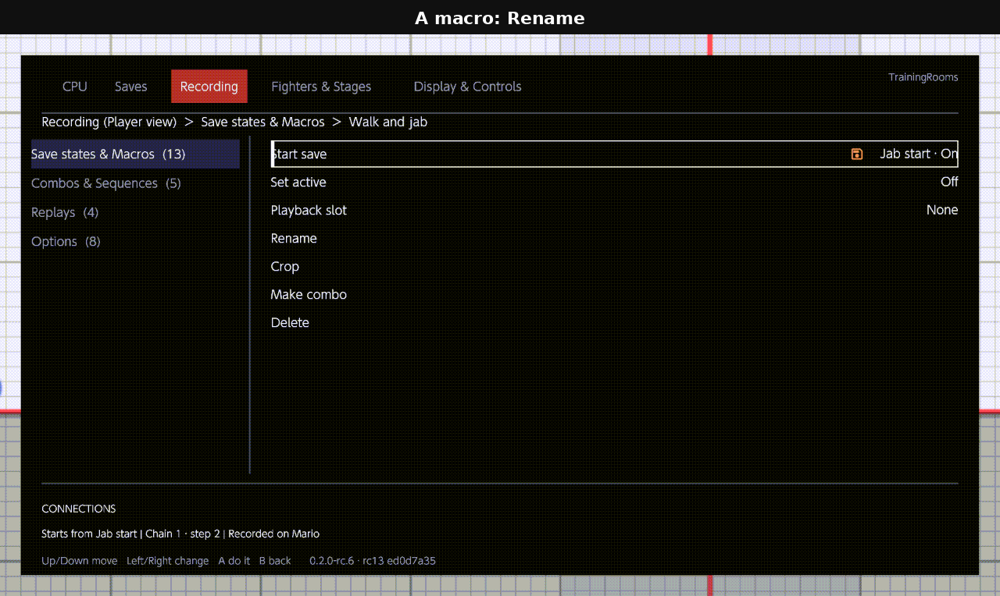<br>
*Renaming a macro. Eden, rc.13 (untested on hardware).*

In Eden the Switch keyboard is a window of its own. The typed name "Renamed jab" shows in the breadcrumb and MACROS, and Chain 1 reads "P1 jab → Renamed jab".

Each press is named in a box.

- **The numbered picker** (*+ New chain* and *Edit chain*; *+ New sequence* and *Edit combos* for combos) lists your recordings, or your combos (a chain can't hold a chain).
- A gives the one under the cursor the next number, R takes a number off, X is done, and B backs out: nothing is saved, and an edited chain or sequence keeps its old order.
- X on a new chain or sequence asks for a name on the Switch keyboard.
- An empty name makes it Chain N or Sequence N; cancelling the keyboard makes nothing.

<br>
*Editing a chain. Eden, rc.14 (untested on hardware).*

The clip starts with Chain 1 in Walk, Crouch, P1 jab order, then ends with P1 jab, Crouch, Walk. The picker's tiles run A to Z: Crouch, P1 jab, Walk.

The clip removes Walk's and Crouch's numbers with R, then numbers Crouch 2 and Walk 3 with A. B finishes the edit and the CPU plays the new order.

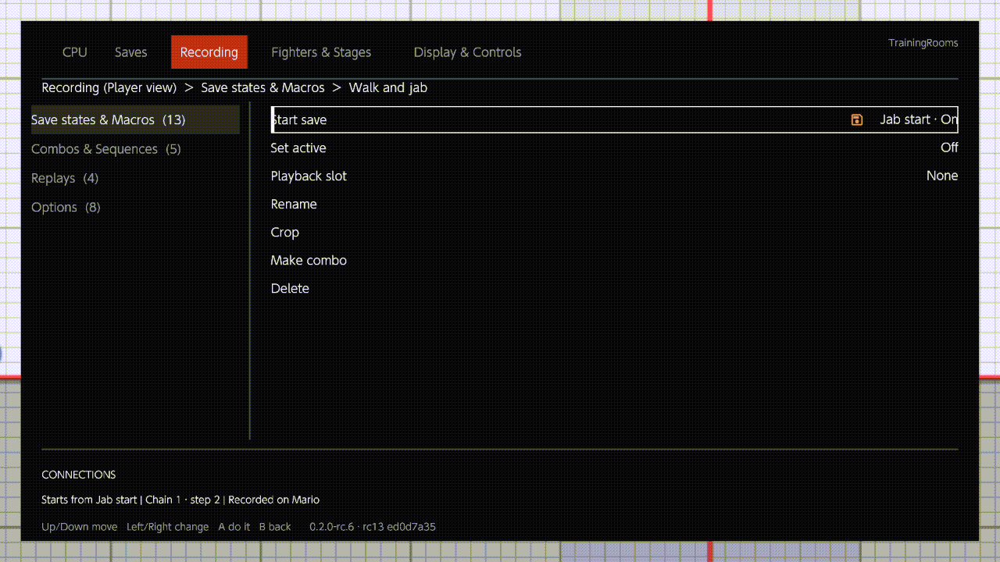<br>
*A macro's screen. Eden, rc.13 (untested on hardware).*

The pictured macro is Walk and jab. Start save reads "Jab start · On" beside the orange floppy.

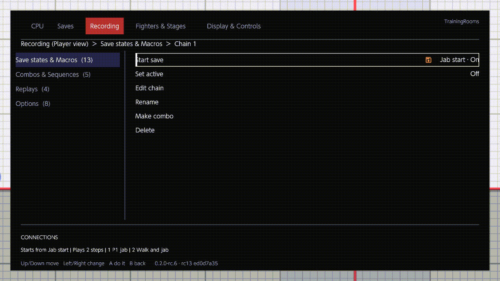<br>
*A chain's screen. Eden, rc.13 (untested on hardware).*

The pictured Chain 1 contains P1 jab then Walk and jab. Its Start save is the first macro's.

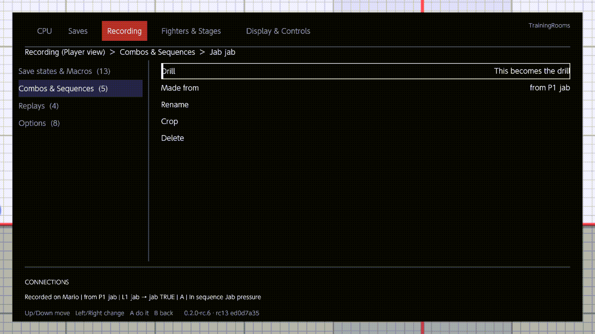<br>
*A combo's screen. Eden, rc.13 (untested on hardware).*

The pictured combo is Jab jab, made from the macro P1 jab.

<br>
*A save state's screen. Eden, rc.13 (untested on hardware).*

The pictured Jab start is bound, and Bind to Save / Load reads On.


<br>
*A macro's Playback slot. Eden, rc.14 (untested on hardware).*

In the clip, Macro 1 changes from None to Slot 1. The CPU's Mash is set to Playback Slot 1 before Fox hits Mario at 17.6%, and the CPU plays the macro with "Input Recording: Playback" on screen.

More: [A file's own screen](../guide/recording.md#a-file-s-own-screen)

## Combos & Sequences

- The combos you drill with the [Combo helper](#combo-helper), and sequences, which are combos drilled one after another.
- It is shown in the Player view only.
- The left column shows the number of files, such as "Combos & Sequences (4)".

- **SEQUENCES** (the upper list) lists your sequences, each with its combos joined by arrows on the dim line. The last row is *+ New sequence*.
- **COMBOS** lists your combos, each with "Recorded on" and the fighter. Its first row is *+ Save last combo…*.
- **DRILLS >** under COMBOS opens your no-hit input drills and **+ Record drill…** ([below](#input-drills)).
- **The drill:** the green row is the one combo, input drill or sequence the helper grades. There is only one, so choosing another replaces it.
- **The hot five** works as above. With the cursor on a sequence, its combos show their place in it; on a combo, the sequences it is in show where it comes.
- **CONNECTIONS:** for a combo, its fighter, the macro it was made from, its links (the two moves, TRUE or not, then the inputs) and its sequences. For a sequence, its combos, then its streak and best.

Keys:

| Key | What it does |
| --- | --- |
| Up/Down | Wrap within each list, as in Save states & Macros. |
| Left/Right | Switch lists. |
| ZL + Up/Down | Jump to the other list, then to the page's next or previous section after reaching an end. |
| A on *+ Save last combo…* | Keeps the last combo the frame strip saw as a new combo and makes it the drill. The Switch keyboard asks for a name; an empty name gives it the next Combo N. With no combo on the strip yet, it says so and saves nothing. |
| A on *+ New sequence* | Opens the numbered picker of your combos, then the name. |
| A on a combo or sequence | Opens its own screen ([rows above](#a-file-s-own-screen)). |
| X and Y | Do nothing here. |
| ZR | Switches to the CPU view, which hides this section. |

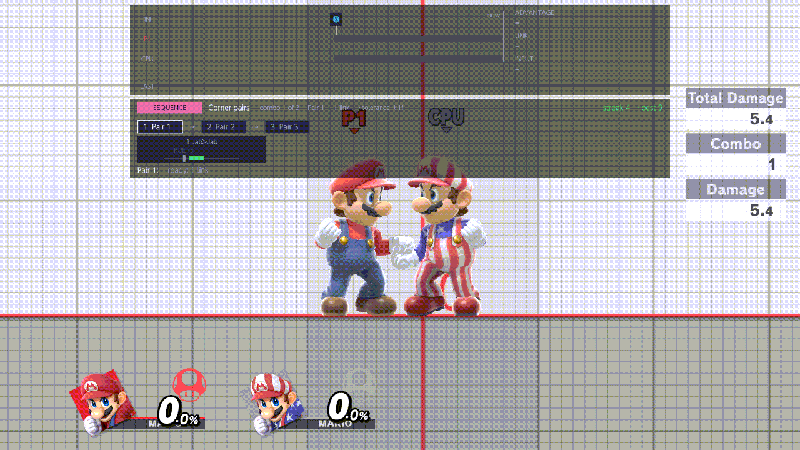<br>
*Drilling a sequence*

More: [Combos](../guide/recording.md#combos), [Sequences and the one drill](../guide/recording.md#sequences-and-the-one-drill), [Combo files](../guide/combos.md)

### Input drills

Practise movement without hitting the opponent: **A** on **COMBOS → DRILLS > → + Record drill…** arms a Player 1 take, then **ZR + D-pad Down** starts and stops it with the default Record chord.

- Each step shows its first and last inputs' moves, or the inputs when no move was recorded.
- Presses on one frame count as one input; stick flicks appear in the title only without a button or C-stick input.
- Grading still checks inputs.

| When | Preview |
| --- | --- |
| On a drill row | X previews its recorded inputs on Player 1. |
| While the take plays | The key line reads `B stop preview`. B or X stops it and drops the rest of its frames; the page or pop-up returns. |
| After the last frame | The result stays on screen for about a second and the key line reads `B back`. B or X returns to the page or pop-up at once, or it returns after the tail. |

- The new drill becomes the helper's grading target; its bar counts steps and timing, with no TRUE verdict.
- To make one from a macro or chain, choose **Make combo**: a pass with no hits makes a drill.
- On a drill's own screen, **A** on **Crop** opens the same editor as a macro, with whole-step handles; **A** names and saves a new drill and keeps the original.
- Empty names use Drill N.
- **B** leaves, and there is no X preview.

<br>
*A drill's Crop. Eden, 2026-11-15, rc.15 `2eb3903e`.*

The clip changes the kept steps 4 → 3 → 4 → 3. This early build's helper overlaps the editor.

The overlap was fixed before the integrated release.

The clip shows range selection, not recording or grading.

[Input drill acceptance evidence](../EVIDENCE-rc15-input-drill.md).

More: [Input drills](../guide/recording.md#input-drills).

## Replays

Turning saved match replays into macros, and moving where a macro starts.

### Ask before switching fighter

Whether to ask before switching to the fighter a recording was made on.

| Value | What it does |
| --- | --- |
| On (default) | A recording made on another fighter asks first: Keep current fighter, or Switch to recorded fighter. |
| Off | The fighter you have stays, without asking, as if you had picked Keep. |
| To change it | A, Left or Right flips it. |

It covers every Fighter Mismatch question: a capture opened in the [Replay window](#replay-window), Play on a macro or a chain, and a drilled combo.


More: [Fighter Mismatch](../guide/recording.md#fighter-mismatch)

### Change placement

Moves where a save state puts the fighters.

| Value | What it does |
| --- | --- |
| Where, Spot, State, Percent, Preview | The five pages of the placement picker. |
| Availability | It opens with both practice fighters there and no recording, playback or load under way. |
| During a practice game | The notice reads "Stop the practice game to place fighters". |
| If it cannot open | From this row, the notice says why, such as "Make a macro active for this role first" or "Link a start save to the macro first" (the macro has no start save, or its Start save switch is Off). |
| To change it | A opens it. |

The menu closes and a picker opens on the live game, with the camera on the whole stage. Both fighters stand at the save's spots, you move them with the Break the Targets crosshair, and A or + writes the new spots into the save file.

- From this row it opens the start save of the active macro of the side the [pop-up](#player-and-cpu) is set to (not always the view ZR shows here); for a chain that is its first macro's start save.
- The same picker opens from **Change placement** on a save's, a macro's or a chain's [own screen](#a-file-s-own-screen), and with X on a save in the [pop-up](#the-lists-and-the-hot-five).

<!-- CAPTURE-REQUEST rec-change-placement: Change placement on a save: Where, Off stage for the CPU, the crosshair with the game's magnifier, A saves, then Load puts both fighters on the new spots. See artifacts/docs4/CAPTURE-REQUESTS.md. -->


- **Where:** Training and the waiting room.

| Page | What you set | Keys |
| --- | --- | --- |
| Where | On stage or Off stage, for Player 1 and for the CPU | L / R or Up / Down pick the fighter. Left / Right switch it on or off stage. |
| Spot | The spot | The stick or the D-pad moves it. L / R take the other fighter. Y switches on or off stage. |
| State | How the fighter starts: Standard; on stage also Missed tech or Trip; off stage also Tumble, Helpless or Footstool | Left / Right change it. On a missed tech, X turns it face up or face down. |
| Percent | The damage, 0 to 300% | Left / Right change it by 1, Up / Down by 10. |
| Preview | Both fighters as they will be saved | A or + saves. |

On every page A goes to the next page and B goes back; B on Where cancels, puts both fighters back where they stood and writes nothing. X puts both fighters back to the saved values. + saves at once, from any page: a page you did not visit keeps the save's own values.

- **On stage:** the fighter stands on a floor.
- Left / Right move it along that floor, and Up / Down step to the floor above or below, a platform or the ground.
- For a moment after the picker opens, until the stage's floors are traced, the crosshair moves freely and the fighter stands on the floor under it.
- **Off stage:** the fighter is held in the air at the crosshair, which reaches to 1 unit inside the blast line. Outside the picture the game shows its own magnifier of the fighter; with the game's HUD off, a dotted pointer at the border shows the way.
- **Switching to Off stage:** if the spot is in open air or under the stage, the fighter is held there.
- If it is over the stage or inside it, the fighter goes to the open air beside the nearest ledge, halfway across that gap and halfway down to the bottom blast line.
- On the Spot page the spot is the crosshair's, and the crosshair goes with the fighter.
- After that the crosshair moves freely, also back over the stage.
- **A start save that macros share:** when macros start from the save, the picker first asks whether to change it for all of them (it says how many) or to copy it.
- Up / Down choose, A goes on, B cancels.
- Opened from a macro, the copy becomes that macro's start save.
- From a chain, only its first macro gets the new start-save link.
- From the save's own screen, the copy is a new save and no macro is relinked.
- [Shared start save](#shared-start-save) answers the question ahead.
- **What is saved:** only what you changed, for the fighter you changed: its spot, its start state, its damage.
- With nothing changed the file is not written.
- The save then loads once, so both fighters end on the saved spots.
- Copy changes at most a macro's start-save link, not its inputs, Momentum or offset.
- Play still adds an existing offset on top of the save's spot until you clear it with the Offset row of the macro's [own screen](#a-file-s-own-screen).

- In an Eden smoke boot on install 5 (2026-11-25), in the picker that Record opens, switching Player 1 to Off stage moved the spot beside the ledge, and one D-pad step moved it on.
- No placement was saved or loaded, and Change placement was not opened on a save; those rest on host tests.
- [Install evidence](../EVIDENCE-rc15-installs.md#the-eden-smoke-boot-of-the-finished-build)

More: [Change placement and the Replay window](../guide/recording.md#change-placement-and-the-replay-window)

### Replay window

Turns part of a saved match into a macro. Crop on a macro, combo or drill opens the same editor.

| Value | What it does |
| --- | --- |
| An editor | Selects the part to keep. |
| Availability | It opens only while nothing else is going on: not during a recording, a playback, a load or a fighter change. |
| No capture | It says "Save a replay with match capture on, or play one in Vault first". |
| To change it | A opens it. |

<video src="https://git.syntaxbyexample.com/intpa/TrainingRoomsForUltimate/media/blob/867d9322ecba30bf1c344ca71e5a3b394461e594" autoplay muted loop playsinline controls></video>

*Macro Crop and frame positions. Eden diagnostic build `5df3d9dc`, 2026-11-26.* [Open the clip](../media/tut-clip-scrub.mp4)

The clip opens Crop on Macro 3. The fighters follow the selected frame without playing a preview.

<video src="https://git.syntaxbyexample.com/intpa/TrainingRoomsForUltimate/media/blob/4a1682c8e3a70a876ed2764fc4e6629bbd6cfcdc" autoplay muted loop playsinline controls></video>

*The free playhead. Eden diagnostic build `5df3d9dc`, 2026-11-26.* [Open the clip](../media/tut-clip-playhead.mp4)

In the clip, Y takes the playhead to the nearest move at 66 and L sets In there. R keeps frame 100 as the last frame, with Out at 101.


#### Pick a capture

The window lists the captures you have:

| Row | What it is |
| --- | --- |
| "Latest Vault capture", "Previous Vault capture" | Replays you played in the Vault. |
| A named capture | A replay saved with [Replay capture](#replay-capture) On, with its name and its length in frames ("(partial)" if it ended early). |

| Key | What it does |
| --- | --- |
| A | Picks the capture. If the CPU isn't the fighter it was recorded on, Fighter Mismatch may ask first ([Ask before switching fighter](#ask-before-switching-fighter)). Then the menu closes and the clip editor takes the controller. |
| Y | 2026-11-25. Deletes the capture under the cursor, at once and without asking. The list stays open and the cursor returns to its first row. Deleting the last one closes the window. Not yet seen in a game. |

#### The clip editor

The editor is a strip over the bottom of the screen. The game keeps running above it, so you see both fighters while you crop and while a preview plays.

The strip shows:

- the kept range;
- where the preview plays;
- the move at the selected handle;
- one timeline with the In and Out handles, the playhead and a tick for every move.

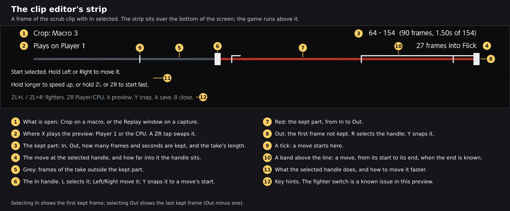<br>
*The clip editor legend. [Open the full-size legend](../diagrams/clip-editor-legend.svg).*

The legend shows In selected at frame 64 and Out at 154, so frames 64 through 153 are kept. The picture is from the preview clip, not install 6.

Install 6 does not show the fighter-switch hint.

| Key | What it does |
| --- | --- |
| Up/Down | On a capture with two sides, pick whose inputs to take. Nothing for a saved file. |
| ZR tap | Switch the playback target between Player 1 and the CPU. During preview, this stops playback; X starts it on the new target. Holding ZR for fast scrub does not switch targets. |
| L / R | Select In / Out. After browsing, set the first / last kept frame instead (see [The free playhead](#the-free-playhead)). |
| Left/Right | Move the handle by frames (macro or capture), links (combo) or steps (drill). Tap for one; hold to accelerate up to 180 per tick. Hold ZL or ZR to start fast. |
| Y with In / Out selected | Snap In to a move's start or Out to its end. If the end is unknown, Out uses the next start or the end of the take. On a mid-action capture, snapping In also takes the move's short setup if available; otherwise the strip explains the refusal. |
| ZL + Y | Replay window captures only: moves In back to the start of the move it sits in, with its short setup. |
| X | Preview the kept inputs without saving a new file. The strip stays up and the playhead follows playback. X or B stops it and drops the remaining frames. |
| A | Names and saves the kept part as a new file of the same kind. An empty name uses the next unused Macro N, Combo N or Drill N. The original stays. |
| B | Stops a preview or its tail without leaving; the next B closes the editor. B closes at once when the editor is idle. |

What differs by where the editor was opened:

| Opened from | Difference |
| --- | --- |
| A capture | The strip names the captured side and playback target. The Replay window starts on the CPU; a capture opened from its own screen uses its **Plays on** choice. Make uses the displayed target. |
| Crop on a macro | Preview starts on the role you opened Crop from and uses the macro's start save when On. Tap ZR to change the playback target. |
| A one-side file | No fighter-selection row. |
| A combo or a drill | No preview button. |

The frame strip and helper bar step aside until you leave the editor, including after preview or save.

During a preview:

| When | Key line | Keys |
| --- | --- | --- |
| The preview plays | `B stop preview` | X or B stops it early. |
| After the last frame, while the result stays on screen for about a second | `B back` | B or X ends that tail without closing the editor, and the usual keys return. |

#### The free playhead

2026-11-26. The free playhead (Left/Right, Y, then L or R with no handle selected) is in install 6.

| On a macro or a capture | The strip reads |
| --- | --- |
| No handle selected | "Hold Left or Right to browse the take, or Y for the nearest move." |
| The playhead has moved | "Playhead moved. L sets the start here, R the end." |

- With no handle selected on a macro or capture, Left/Right browses the whole take without changing the cuts.
- Y jumps to the nearest move mark, not an unmarked take boundary.
- Combos and drills require a handle.
- After browsing, L sets In at the playhead; R sets Out one frame past it.
- The new handle is selected.
- At or past Out, L reads "Playhead is past Out: set Out first"; at or before In, R reads "Playhead is at or before In: set In first".
- Neither refusal changes the range.
- Starting a preview with X selects the playhead.
- An accepted A opens the naming prompt; it clears the pending cut at the playhead but does not deselect an In or Out handle.
- A refused preview or export leaves the selection alone.

- Browsing was seen in Eden on `eb39d6bc`.
- The playhead clip above shows browsing, Y snapping the playhead to frame 66 and L and R setting the two cuts on one macro, in Eden on install 6's diagnostic build (`5df3d9dc`).
- It does not show snapping In on a match capture, or a match-capture preview or export.

#### Positions while you scrub

2026-11-26. Positions while you scrub are in install 6.

With In or Out selected, or once the playhead has moved, and no preview playing, both fighters are shown where the take had them on that frame. Both use the target's position when the hold begins, so their recorded spacing is kept.

Each fighter's point is judged separately. The editor refuses points it detects in the first row's places:

| The point | What happens to that fighter |
| --- | --- |
| Inside solid ground or a wall, outside the camera bounds, or beyond the safe blast-line bounds | Refused. The fighter returns to where its hold began, or stays put if it was not held. The other fighter can still be held at a valid point. |
| The stage geometry cannot be read | The same. |
| The camera bounds themselves are unavailable | The hold is released without that warning. |

Install 6 judges the point only, not whether the fighter's body fits beside a wall (see the test below).

Only one notice fits on the strip. The fighters' placement does not depend on which notice wins.

| Case | Notice shown |
| --- | --- |
| A snapped move with a temporary setup | Its setup line, first. |
| Otherwise, a clean In | The position message, including "Can't stand there on this stage." if either point is refused. |
| A mid-action In | The snap hint instead. |

Where the positions come from:

| Take | Its positions |
| --- | --- |
| Any macro | Kept in a second file beside it, `<id>.pos`. Record writes it, and so do a crop and a capture saved as a macro. The macro format is unchanged. Play starts from the macro's inputs without reading positions at startup. Delete also removes `<id>.pos`; Rename changes the display name, not the ID or either filename. |
| A macro without positions | Reads "Play it once to see positions while scrubbing.". Play it by itself from its first input, with Play or with X here from the start of the take, and they are saved; after X they show at once. They are that playback's positions, not the original recording's. No positions file is made for a chain step, when the playing character's fighter kind differs from the recorded one, or when Trim skips the first input. |
| A playback stopped early | Positions up to where it stopped; past them the key line reads "Positions end here.". A playback never replaces a valid file saved by Record; a damaged or mismatched one counts as missing. |
| A long recording, on install 6 | It can keep all its inputs but stop saving positions after 20 seconds (1,200 frames). Playing it will not extend a valid file written by Record. [Known issues](../CURRENT-RELEASE.md#known-issues) |

- On a capture, or a macro preview that uses a temporary checkpoint, the first X can be refused with "Let the CPU settle to idle and leave the ledge before previewing".
- Press the selected handle's button again (L for In, R for Out), let the CPU settle, then press X.
- A macro loading its own start save does not use that checkpoint.
- The pose is frozen or neutral, and projectiles, items and damage are not shown. Combos and drills show nothing.

What was seen in Eden, and on which build:

| Build | Seen |
| --- | --- |
| Install 6's diagnostic build | The hold at In after Record, In and Out following the handles, the old-macro line, a crop that keeps its positions, and Delete removing both files. |
| The same, on a match capture | A fighter whose point was inside the ground was left where it stood. One whose point was free but too close beside the stage's wall was pushed about 5 units off it by the game, which is a [known issue](../CURRENT-RELEASE.md#known-issues). |
| `eb39d6bc`, the build before install 6's last fix | Positions from one Play, and at once after X. |
| Not seen yet | The waiting room, a fighter swap or a scene change while a fighter is held, and the installed release file itself. |

#### Moves while you scrub (preview build)

2026-11-27. This part describes the preview build `cc71537c`.

It is staged for the card and **not installed**. Install 6 behaves as the part above says.

The [release notes](../RELEASE-NOTES-rc15.md) list what else it changes.

<video src="https://git.syntaxbyexample.com/intpa/TrainingRoomsForUltimate/media/blob/23b4e00d007427260ccff3ee35d14c0f976f2e50" autoplay muted loop playsinline controls></video>

*Recorded poses in Crop. Eden, diagnostic build `cc71537c`, 2026-11-27.* [Open the clip](../media/tut-clip-scrub-moves.mp4)

The clip crops a 154-frame macro recorded on the preview build. With In and then Out selected and moved, both fighters take the pose the take had on that frame.

The strip names Player 1's move: "27 frames into Flick", "End of Side smash", "6 frames into Side smash". With no handle selected they stand again.

Both builds position the fighters relative to where the target stood when the hold began. Install 6 keeps the fighter's current pose.

The preview can also show a recorded pose:

| Take | While you scrub |
| --- | --- |
| A macro or capture recorded on the preview build | Each fighter shows its recorded move if its fighter kind matches and the frame has a pose. The clip shows this for Mario and Link on one macro. |
| A macro with positions but no recorded moves | Positions only. The editor can read "Play it once to see the moves while scrubbing." This message was not filmed for this page. |
| A capture made before the preview build | Positions only. In the snap clip the diagnostic log reported no stored pose for the CPU; the clip shows snapping and playback, not a fighter switch. |
| Projectiles, items and damage | Not shown, as before. |

<video src="https://git.syntaxbyexample.com/intpa/TrainingRoomsForUltimate/media/blob/7c00d97bf3abf99b2191b84d54bf130ffe0620ed" autoplay muted loop playsinline controls></video>

*Snapping a capture to a move. Eden, diagnostic build `cc71537c`, 2026-11-27.* [Open the clip](../media/tut-clip-snap.mp4)

The clip uses a capture of King K. Rool.

In sits 3 frames into an aerial and X is refused.

The strip reads "In is mid-action. Snap to a move start before previewing or saving." Y moves In to the start of that aerial.

X then plays the kept part on the CPU. The key line reads `B stop preview`, then `B back`.

**Known issue — fighter switch:** the preview editor shows a fighter-switch hint, but the Player 1 request timed out and applied only after the editor closed. The CPU side was not tested.

[Preview known issues](../RELEASE-NOTES-rc15.md#known-issues).

#### Move marks

A tick on the timeline is where a move starts; a thin band runs to where it ends, when that is known.

- A macro recorded on this build keeps its moves in its file (the optional `actions` key: each move's start frame, the first frame the fighter could act again, and the move), so the marks are there when the editor opens.
- 2026-11-25: a mark also keeps which form of the move it was, as a combo link does.
- `variant` is the first, second or third jab, the rapid jab or its finisher, or which aerial, grab or throw.
- `angle` is a side tilt or side smash aimed up or down.
- A take saved before that has neither and still loads.
- If automatic trim cuts off a move's known end, its band ends at the end of the saved take. A move whose end was never observed still has no end mark.
- An older macro and a Replay window capture show a tick for every press, C-stick input or flick that starts a move. Their ends and names appear as a preview plays past them.
- With [Move names](#move-names) On, a mark reads as the combo and drill lists do: "Jab 1", "Jab 2", "Forward tilt ↑", "Forward air", "Dash grab", and a special by the fighter's own name.
- A grab that throws reads as the throw.
- A jab that runs into a rapid jab without restarting reads "Rapid jab".
- An older take has no forms, so its jab reads "Jab" and its side tilt "Forward tilt".
- With Move names Off, every mark keeps its short name: "Jab", "Side tilt", "Neutral B".
- 2026-11-25: a take, and each fighter of a replay capture, stores the fighter it was recorded on (`recorded_fighter`, the key a combo file uses), so its specials read that fighter's own names whoever Player 1 is.
- A take or capture saved before that has none: its specials take the fighter's own names only while Player 1 is that fighter; otherwise they read "Neutral special", "Side special" and so on.
- A Mii's specials are named by the selection saved with the take, and by those common names when the take saved none.
- If you delete the latest Vault capture while its replay is still playing, the rest of the replay becomes a partial capture.
- Fighters already seen use the same rule as an old capture for their special names.
- A combo has one mark per link and a drill one per step, with the name the list shows.
- The timeline draws the 24 marks nearest the playhead. A take keeps ends for its first 32 moves.

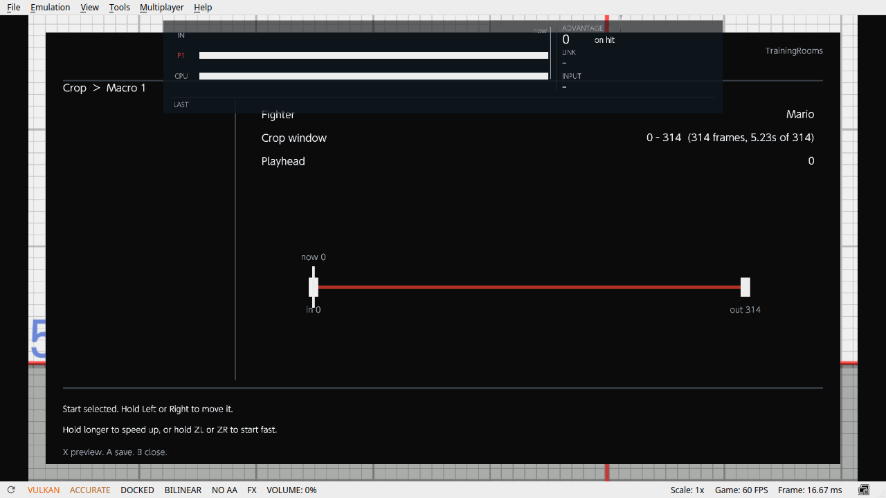<br>
*Macro Crop. Eden, 2026-11-15, rc.15 d520d325 (untested on hardware).*

This clip shows range selection. L selects the start handle and Left/Right moves it.

[Crop acceptance evidence](../EVIDENCE-rc15-crop-editor.md)

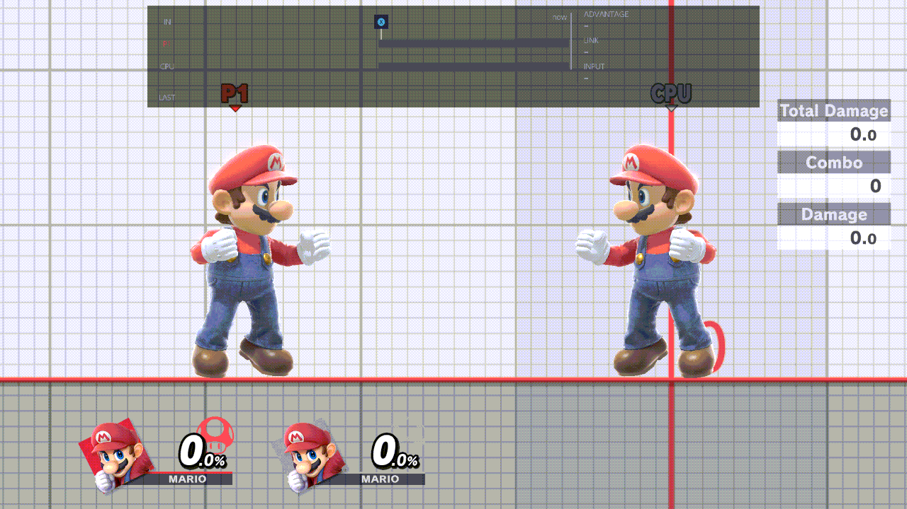<br>
*Opening a replay moment*

More: [Change placement and the Replay window](../guide/recording.md#change-placement-and-the-replay-window)

### Replay capture

Controls whether the inputs are kept when you save a replay of a match.

| Value | What it does |
| --- | --- |
| On | The inputs are kept too, so the Replay window can list the replay. |
| Off (default) | The inputs are not kept by this setting. |
| To change it | A, Left or Right flips it. |

- They go in `replay_capture.ini` in `sd:/ultimate/TrainingRooms/`, not with your other settings, and are written when the menu closes.
- X, Y and *Reset page to defaults* don't change it.
- If you have Online Deluxe, its page has the same switch.

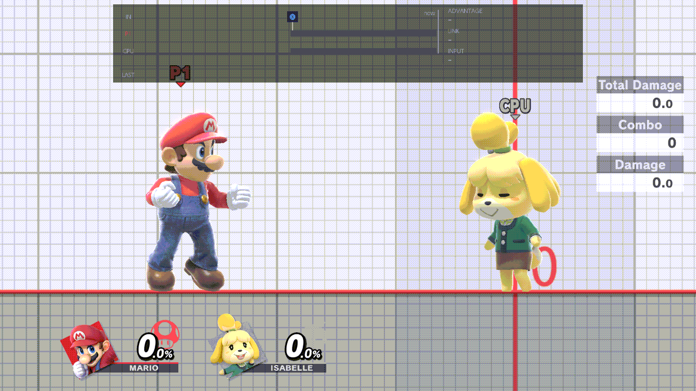<br>
*Turning replay capture on*

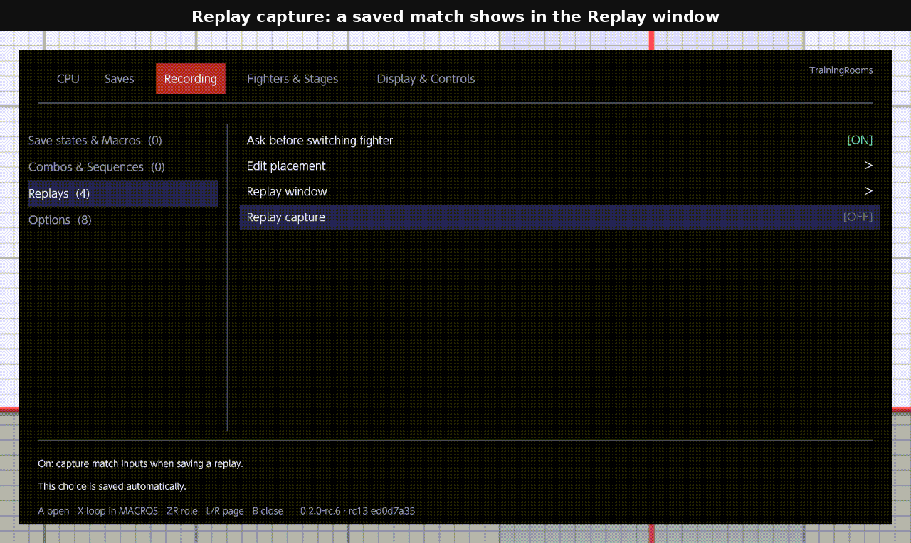<br>
*Saving a replay capture. Eden, rc.13 (untested on hardware).*

In the clip, a 1-stock match ends and A, A, Y on the results opens "Save a replay of this battle?". Right and A answer Yes, and "Replay saved" shows.

The loads, the match and the menus between clips are cut.


## Options

How macros play, and how the combo helper grades.

<a id="crop-trailing-neutral"></a>
### Trim trailing neutral

Record drops neutral frames from the chosen sides of a take.

| Value | What it does |
| --- | --- |
| Start | Drops neutral frames at the start. |
| End (default) | Drops neutral frames at the end. |
| Both | Drops neutral frames at both sides. |
| Off | Keeps them. |
| To change it | A opens the list; Left or Right cycles. |

- Neutral means no button other than flick jump and sticks within the dead zone.
- An all-neutral take saves nothing unless Trim is Off.
- The older On setting migrates to End and Off stays Off.
- Each macro or input drill also has a separate file Trim for playback; Crop's preview still addresses the complete file.

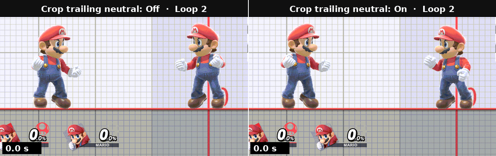


### Show playback indicator

Controls the playback indicator while the roles play a recording.

| Value | What it does |
| --- | --- |
| On (default) | Shows PLAY P1, PLAY CPU, or PLAY P1 + CPU, alongside REC when a take is open. |
| Off | Hides the playback indicator. |


### Playback delay

Waits after the fighters are placed and before the first input, once per Play.

| Value | What it does |
| --- | --- |
| None (default) | No playback delay. |
| 10, 20, 30, 45, 60, 90 or 120 frames | Waits that many frames before the first input. |
| To change it | Left/Right cycle through the values; A opens the list. |

- There is no wait on later loop passes.
- It applies to Play on Player 1, Play on CPU, Vault Play back and Make combo's pass, but not to editor previews or CPU Playback slots.
- The playing role is neutral while it waits, the indicator stays visible, and Stop cancels the run.


- **Known limit:** if a Play on Player 1 starts in the middle of one of Player 1's input polls, that one poll can pass what you hold instead of neutral. It is at most one frame, at the start of the wait; the chord's own buttons never reach the game.

### Place fighters before Record

Controls whether Record first opens the placement picker.

| Value | What it does |
| --- | --- |
| On | Opens five pages (Where, Spot, State, Percent, Preview) to place Player 1 and the CPU, choose starting states and set damage. |
| Off (default) | Record starts at once. |
| To change it | A, Left or Right flips it. |

- It is the picker of [Change placement](#change-placement), with the same pages and keys: both fighters stand at their spots while you place them, and + starts the recording from any page.
- The recorded start is saved with the macro.
- The Recording pop-up's Y button also flips this setting.
- Placement works in Training and the waiting room.


### Hitstun timing

When a Playback Slot action starts after the CPU is hit.

| Value | What it does |
| --- | --- |
| As Hitstun Ends (default) | When the CPU can act again. |
| As Hitstop Ends | When the freeze of the hit ends. |
| As Hitstop Begins | At the hit. |
| To change it | Left/Right cycle through the values; A opens the list. |

- It is read when the CPU starts a Playback Slot action in Mash, Followup or the overrides; Ledge Options start their own way.
- A slot plays the macro you gave it with Playback slot on the macro's screen.
- See [The Playback Slot actions](../guide/cpu-behaviour.md#the-playback-slot-actions).

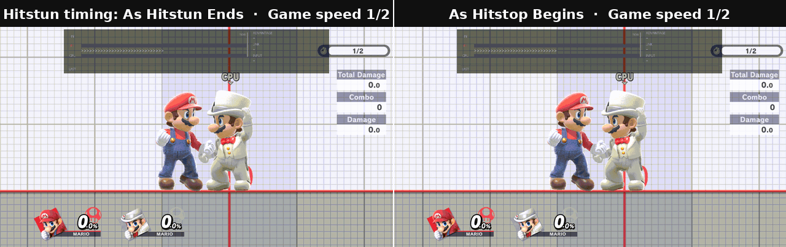


### Mash interrupts playback

Controls whether a CPU mash action interrupts a macro playing on the CPU.

| Value | What it does |
| --- | --- |
| On (default) | When the CPU would do a mash action from [Mash](cpu.md#mash) or a [Situation override](cpu.md#situation-overrides), the macro stops and the CPU does the mash action. |
| Off | The macro plays to its end. |
| To change it | A, Left or Right flips it. |

Player 1's macro keeps playing.


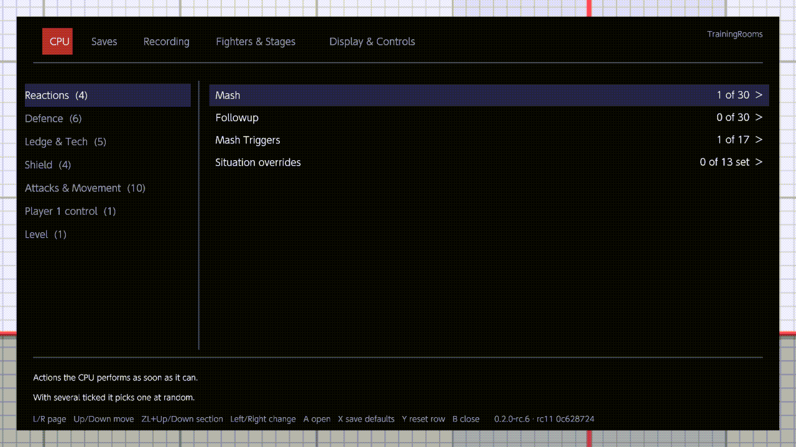<br>
*A CPU mash interrupts its macro.*

The clip sets CPU › Reactions › Mash before Play on CPU starts its taunt loop.

More: [Recordings and the CPU settings](../guide/cpu-behaviour.md#recordings-and-the-cpu-settings)

### Loop

How many times the active macro plays each time you press its Play chord.

| Value | What it does |
| --- | --- |
| ∞ | Plays until you press the Play chord again. |
| 1 (default for Player 1 and the CPU) | Plays once. |
| 2, 3, 5, 10 | Plays that many times. |

| Key | What it does |
| --- | --- |
| Left/Right | Step through the counts, wrapping. |
| X in MACROS | Does the same here or in the pop-up. |
| A | Opens the list: Up/Down picks a count, A applies it, and B cancels. |

Player 1 and the CPU each keep their own count, and the row shows the count of the view you're in (ZR). Only the first pass warps to the start save, and a chain repeats as a whole.


- The count is kept with your recordings (`recording-index.json`), not with your saved defaults, so X doesn't save it.
- The *Reset page to defaults* row puts both counts, Player 1's and the CPU's, back to 1.
- The MACROS header shows the count too.

More: [The loop](../guide/recording.md#the-loop)

### Settings override playback

An advanced row: the page shows it as "Settings override playback (advanced)".

| Value | What it does |
| --- | --- |
| Off (default) | While a macro plays on the CPU, the macro wins. DI Direction, SDI Direction, Airdodge Direction, Tech Options, Mistech Options and Throw wait until it ends. |
| On | Those settings act during the macro too. |
| To change it | A, Left or Right flips it. |


More: [Recordings and the CPU settings](../guide/cpu-behaviour.md#recordings-and-the-cpu-settings)

### Shared start save

An advanced row. What [Change placement](#change-placement) does with a start save that macros share.

| Value | What it does |
| --- | --- |
| Prompt (default) | The picker asks each time whether to change the save for every macro that starts from it or to copy it. |
| Always change | Changes the save without asking. |
| Always copy | Copies the save without asking. Opened from a macro, the copy becomes that macro's start save. |
| To change it | Left/Right cycle through the values; A opens the list. |

A save no macro starts from is changed without a question, whatever this is set to.


### Combo helper

Controls grading by the combo helper.

| Value | What it does |
| --- | --- |
| On (default) | While a combo, input drill or sequence is the drill (see [Combos & Sequences](#combos-sequences)), a bar under the frame strip grades each attempt link by link: on time or how many frames early or late, the streak and the best. |
| Off | No grading. |
| To change it | A, Left or Right flips it. |

Input drills grade input steps without needing a hit or a TRUE verdict. The drill stays chosen either way.

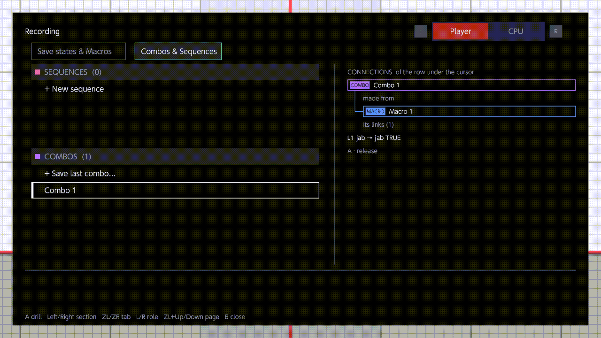<br>
*Grading a combo*


More: [Combos](../guide/recording.md#combos)

### Match sweet/sour spot

A saved combo remembers, for each link, whether its hit landed Sweet, Sour or Late (see [Spot labels](display-and-controls.md#spot-labels)).

| Value | What it does |
| --- | --- |
| On | A link counts only if your attempt lands the same spot as the saved link. |
| Off (default) | The spot is not compared. |
| To change it | A, Left or Right flips it. |

- A link that lands Sour where the saved one landed Sweet drops, and the bar says "L1 Sour, saved Sweet".
- A link saved with no spot always matches: one from an older combo file, one from identical hitboxes, or one saved while both this row and Spot labels were Off, because the plugin works out spots only while one of them is On.


More: [How a combo is graded](../guide/recording.md#how-a-combo-is-graded)

<!-- CAPTURE-REQUEST spots-v03: a combo saved with a Sweet link, drilled with Match sweet/sour spot On: a Sweet attempt is clean, a Sour attempt drops with "L1 Sour, saved Sweet" on the bar. See artifacts/rc14-spots/. -->

### Match angle and deflection

Controls whether an input drill matches an aimed special's stick angle and deflection.

| Value | What it does |
| --- | --- |
| On | Also compares the deciding stick's angle and deflection with the saved ones. |
| Off (default) | The path is compared without matching the stick. |
| To change it | A, Left or Right flips it. |

Older drills without travel details keep their previous grading.


### Move names

Controls the names shown for moves.

| Value | What it does |
| --- | --- |
| On | Moves use their common names. Specials and Final Smashes use the names in the game's message file when available. |
| Off (default) | Uses the short names. |
| To change it | A, Left or Right flips it. |

- Saved combos use the recorded fighter's names.
- Older files without that identity, or an unavailable message file, use common names.
- The Crop editor's move marks use the same names.
- Pyra and Mythra currently use common special names.


<video src="https://git.syntaxbyexample.com/intpa/TrainingRoomsForUltimate/media/blob/edd9787940d24d0eb09d0a71f1ea68de4f58267b" autoplay muted loop playsinline controls></video>

*Move names Off and On. Eden, 2026-11-25, install 4, build `a945b0c1`.* [Open the clip](../media/i4-move-names-toggle.mp4)

In the clip the drill reads jab, side tilt, up b with Move names Off. With it On the drill reads Jab 1, Forward tilt, Final Cutter.

### On-time tolerance

How many frames an input may be away from the recorded one and still count as on time.

| Value | What it does |
| --- | --- |
| Exact | The input must be on the recorded frame. |
| 1 frame (default) | Allows an input 1 frame away. |
| 2 frames | Allows an input 2 frames away. |
| To change it | Left/Right cycle through the values; A opens the list. |

An input outside it drops the attempt.


More: [How a combo is graded](../guide/recording.md#how-a-combo-is-graded)

### After an attempt

What happens once an attempt ends, landed or dropped.

| Value | What it does |
| --- | --- |
| Keep playing (default) | Nothing happens, and you carry on. |
| Load save state | When the exchange is over, the bound save loads, as the Load chord does, so you retry from the same spot. |
| To change it | Left/Right cycle through the values; A opens the list. |

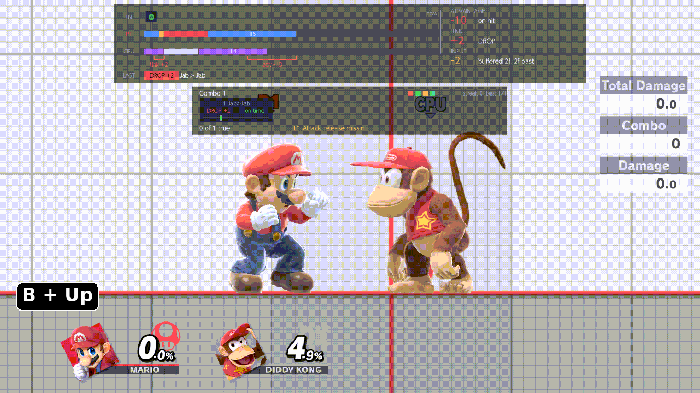<br>
*Loading a save after an attempt.*

In the clip, both fighters return at 0%. The 5.4 s between, including the menu closing and the Load chord, is cut.


More: [Save states](../guide/save-states.md)

## Reset page to defaults

- The last row of the page.
- It asks first, then puts every Replays and Options row back to your saved defaults (the factory values above, until you save your own with X on another page; X doesn't save on this page).
- It also puts both [Loop](#loop) counts back to 1, whatever defaults you saved.
- It leaves your files, the bound save, the active macros, the drill and [Replay capture](#replay-capture) as they are.

<br>
*Resetting Recording options. Eden, rc.13 (untested on hardware).*

The clip resets Crop trailing neutral, Hitstun timing, Mash interrupts playback, Combo helper, On-time tolerance and After an attempt. Loop goes from 3 to 1.

## The Recording pop-up

- ZR + D-pad Right opens the pop-up over the match, wherever the menu opens ([Using the menu › Opening and closing](../guide/using-the-menu.md#opening-and-closing)).
- While it is open your buttons go to it, not to your fighter or the chords, so the chord doesn't close it.
- B closes it and leaves everything as it is, and that B never reaches your fighter, tapped or held.
- Unlike the page, A acts at once: there are no file screens, so renaming, cropping and deleting are done on the page.

- The first help line shows the Record and Play chords set in Display & Controls > Button chords.
- With the defaults it reads `Record ZR + D-pad Down   Play on Player 1 ZR + D-pad Left   Play on CPU ZR + D-pad Up`.
- It follows a changed chord; an unbound chord reads `disabled`.
- If the full line is too long, it uses P1 and CPU; if that is still too long, it points to the chords screen.

### Player and CPU

- The title reads Recording, with Player and CPU role tabs and a ZR cap beside them.
- ZR switches between Player 1 and the CPU, as it does on the Recording page; the lit tab is the side you're working on.
- That side is the one Record (ZR + D-pad Down) records, and the one whose active macro the Replays row [Change placement](#change-placement) opens.
- It stays until you change it, and starts on Player.

Under the title are the pop-up's own tabs:

| Role | Tabs and keys |
| --- | --- |
| **Player:** | Save states & Macros, and Combos & Sequences. ZL, L or R switches between them. The footer says `ZL/L/R tab   ZR role`. |
| **CPU:** | Save states & Macros only. ZL, L and R do nothing. The footer says `ZR role`. |

<br>
*Recording pop-up tabs before the key change.*

In this clip R switches from the Player tab to the CPU tab. This clip was recorded before the keys changed; ZR now switches to the CPU.

### The lists and the hot five

- Each tab shows the same two lists as the page's section, four rows of each, with the same [hot five](#save-states-macros).
- Up/Down move inside a list, Left/Right switch lists, ZL + Up/Down move 12 rows and wrap within the list.
- A column on the right, headed CONNECTIONS, shows the row under the cursor and the files joined to it, each in a box labelled SAVE STATE, MACRO, COMBO or SEQUENCE ([how to read it](../guide/recording.md#reading-the-lists)).

The footer says what A does in the list under the cursor:

| List | Footer | A does |
| --- | --- | --- |
| SAVE STATES | A bind   X place | Binds the save: the Save and Load chords use it. X closes the pop-up and opens [Change placement](#change-placement) on the save. |
| MACROS | A set active   X loop | Sets the macro active for the side you're on. X steps its loop count. |
| COMBOS, SEQUENCES | A drill | Makes the combo or sequence the drill. |

A on *+ New chain*, *+ New sequence* or *+ Save last combo…* works as on the page. Y does nothing.

<br>
*The MACROS hot five.*

### Setting the active macro

- A on a macro in MACROS makes it the active macro of the side you're on (a recording or a chain), replacing the one before, and its row turns green.
- That side's Play chord then plays it: Play on Player 1 (ZR + D-pad Left) or Play on CPU (ZR + D-pad Up).
- The same chord again stops it.
- Stopping Record makes the new macro the active one too.

If the active macro was recorded on another fighter, Play asks Fighter Mismatch first, unless [Ask before switching fighter](#ask-before-switching-fighter) is Off. To clear an active macro, set Set active Off on its screen on the page.

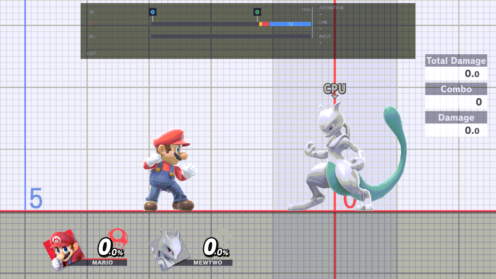<br>
*Record, then the CPU plays it back*

More: [Set active, and the Play chords](../guide/recording.md#set-active-and-the-play-chords), [Fighter Mismatch](../guide/recording.md#fighter-mismatch)

### The loop count

- X, with the cursor in MACROS, steps the loop count of the side you're on: ∞, 1, 2, 3, 5, 10, then ∞ again.
- The MACROS header shows it.
- It is the same count as the page's [Loop](#loop) row.

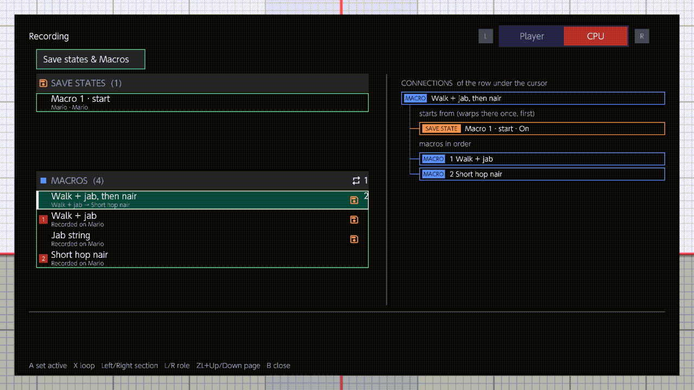<br>
*The CPU macro loop count.*

More: [The pop-up](../guide/recording.md#the-pop-up), [The loop](../guide/recording.md#the-loop)
