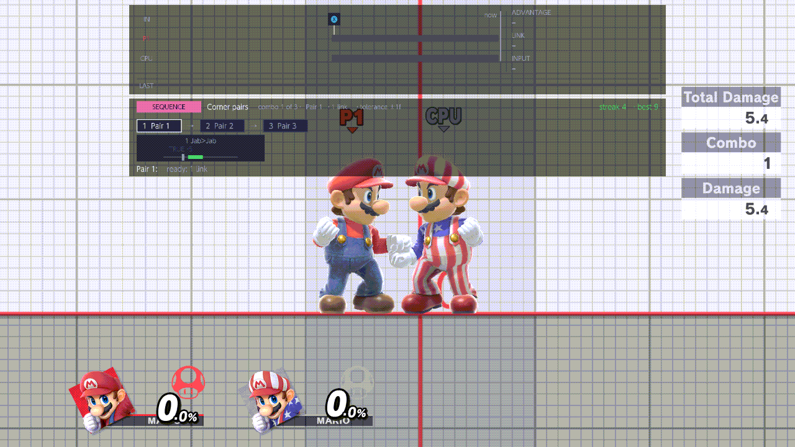
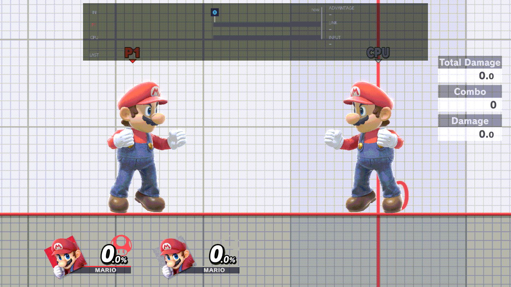
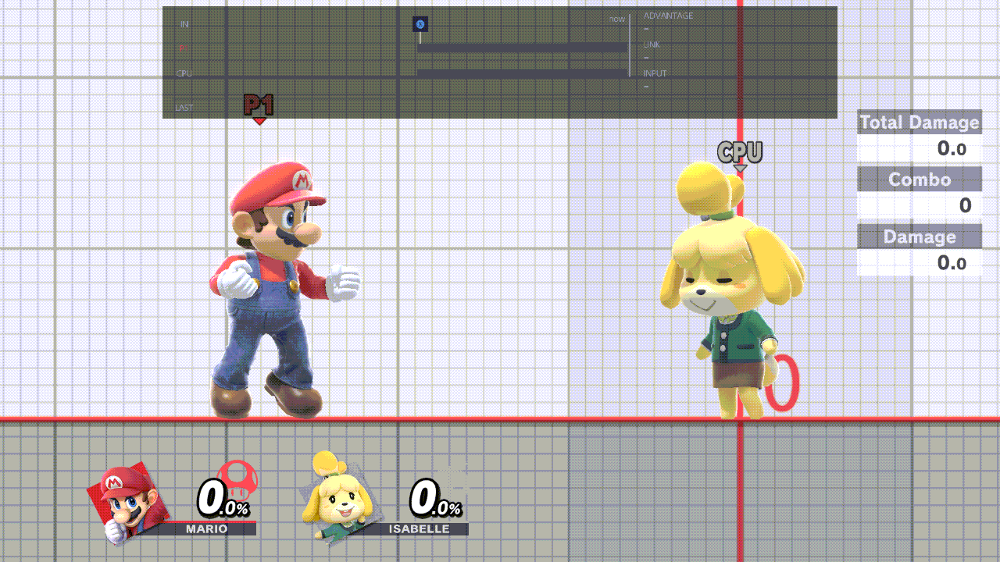
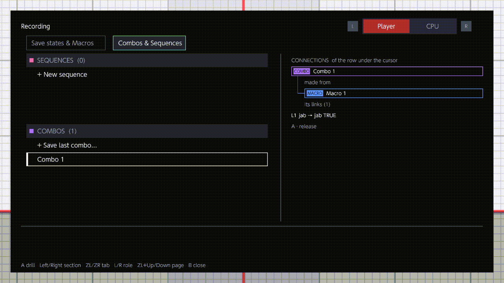
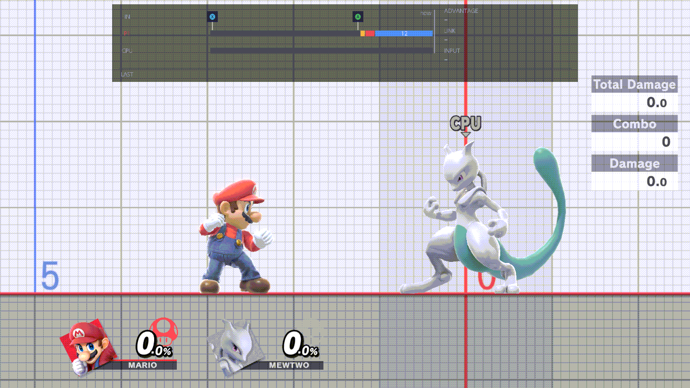

# Recording

This page holds your recordings and combos, and the options for playing them back. Its first two sections are
libraries: the save states and macros (recorded inputs) you have made, and the combos and sequences you drill. Then
come Replays, for turning match replays into macros, and Options. Open the menu with B + D-pad Up (or Minus, or your
own menu shortcut) and press R until the title reads Recording (twice from the CPU page). The menu reopens where you
left it.

The same libraries open over the match with the Recording pop-up (ZR + D-pad Right), described
[at the end of this page](#the-recording-pop-up). How recording and playback work is in the
[Recording guide](../guide/recording.md), and the combo files in [Combo files](../guide/combos.md). The menu's keys
are in [Using the menu](../guide/using-the-menu.md). All pages are listed in [the docs index](../README.md).

This page uses some keys its own way. Its footer reads:

```text
A open   X loop in MACROS   ZR role   L/R page   B close
```

- X and Y never save your defaults or reset a row on this page. X changes the loop count while the cursor is in
  MACROS, and Y does nothing. To put the rows back, use [Reset page to defaults](#reset-page-to-defaults).
- ZR switches the page between the Player view and the CPU view. The CPU view hides Combos & Sequences, and the green
  active macro, Set active and [Loop](#loop) are then the CPU's. The page doesn't name the view, but a file's own
  screen does, in its title: "Recording (CPU view) > …".
- ZR here doesn't change who Record records. The [pop-up](#player-and-cpu) sets that.

## Save states & Macros

Your save states and your macros, in two lists, one above the other. The left column shows the section with the
number of files in it, such as "Save states & Macros (7)". Move onto it and the lists fill the right-hand side, four
rows of each at a time.

- **SAVE STATES** lists every save state, with its fighters on a dim line under the name. The green row is the
  *bound* save: the one the Save and Load chords use. New saves come from the Save chord (ZL + D-pad Down) and from
  Record, which saves where the fighters stood as "Macro N · start".
- **MACROS** lists your recordings and chains (a chain plays several recordings in order). Under a recording the dim
  line says "Recorded on" and the fighter. Under a chain it lists the chain's recordings joined by arrows, and the
  chain's row shows how many it holds. An orange floppy disk means the macro first warps to its start save when it
  plays; a grey one means that switch is Off. The green row is the active macro of the view you're in: the one its
  Play chord plays. The header shows that view's loop count. The last row is *+ New chain*.
- In each list the five files you used last come first, the most recent at the top, inside a green outline. Binding,
  setting active, recording, duplicating and making a file all count as a use. A thin line marks the end of those
  five, and the rest follow by name.
- With the cursor on a chain, the macros in it show their place (1, 2, 3) before their names.
- The two help lines at the bottom, headed CONNECTIONS, list what the row under the cursor is joined to: whether a
  save is bound, the macros that start from it, a macro's start save, the chains it is in, the combos made from it,
  and the fighter it was recorded on.

**How:**

- Up/Down move through a list. Down past the last save goes on into MACROS, and past the top or the bottom of the
  two lists the cursor moves on to the previous or next line of the page. Left/Right jump between the two lists.
  ZL + Up/Down move 12 rows.
- A opens the file's own screen (below). A on *+ New chain* opens the numbered picker.
- X, with the cursor in MACROS, steps the loop count of the view you're in: ∞, 1, 2, 3, 5, 10. It is the same count
  as the [Loop](#loop) row.
- Y does nothing. ZR switches between the Player and CPU views.

A file's own screen lists what you can do with that file. Up/Down move, A does the row (on a switch, A flips it),
Left/Right turn a switch Off or On, B goes back. L and R don't turn the page while it is open.

| File | Rows |
| --- | --- |
| Save state | Bind to Save / Load, Duplicate (a copy named Save N), Rename, Delete |
| Macro | Start save (only if it has one), Set active, Rename, Crop, Make combo, Delete |
| Chain | Start save (only if its first macro has one), Set active, Edit chain, Rename, Make combo, Delete |

- **Bind to Save / Load:** On makes this the save the Save and Load chords use. Load only warps there; it never
  starts a macro.
- **Start save:** On warps both fighters to the macro's start save once, before it plays. Off plays it from where the
  fighters are.
- **Set active:** On makes this the active macro of the view you're in, replacing the one before. Off clears it.
- **Rename** opens the Switch keyboard (up to 48 characters). B, or an empty name, keeps the old name.
- **Crop** opens two handles, In and Out: Up/Down pick one, L and R move it, A saves the cut as a new file (the
  original stays), B leaves without saving.
- **Make combo** plays the file once on Player 1 from its start save and saves the hits that land as a new combo.
- **Delete** removes the file at once, without asking.
- **+ New chain** and **Edit chain** open a numbered picker of your recordings (a chain can't hold a chain): A gives
  the macro under the cursor the next number, R takes a number off, B finishes. A new chain then asks for a name on
  the Switch keyboard. An empty name, or an online waiting room where the keyboard can't open, makes it Chain N.

More: [Recording a macro](../guide/recording.md#recording-a-macro-and-its-start-save),
[Chains](../guide/recording.md#chains), [A file's own screen](../guide/recording.md#a-files-own-screen),
[Save states](../guide/save-states.md)

## Combos & Sequences

The combos you drill with the [Combo helper](#combo-helper), and sequences: combos drilled one after another. It is
shown in the Player view only. The left column shows the number of files, such as "Combos & Sequences (4)".

- **SEQUENCES** (the upper list) lists your sequences, each with its combos joined by arrows on the dim line. The last
  row is *+ New sequence*.
- **COMBOS** lists your combos, each with "Recorded on" and the fighter. Its first row is *+ Save last combo…*.
- The green row is the *drill*: the one combo or sequence the helper grades. There is only one, so choosing another
  replaces it.
- The five used last come first in a green outline, as in Save states & Macros. With the cursor on a sequence, its
  combos show their place in it; with the cursor on a combo, the sequences it is in show where it comes.
- CONNECTIONS lists a combo's fighter, the macro it was made from, its links (the two moves, TRUE or not, then the
  inputs) and the sequences it is in. For a sequence it lists its combos, then its streak and best.

**How:**

- Up/Down, Left/Right and ZL + Up/Down move as in Save states & Macros.
- A on *+ Save last combo…* keeps the last combo the frame strip saw as a new combo and makes it the drill. The Switch
  keyboard asks for a name; an empty name, or an online waiting room, gives it the next Combo N. With no combo on the
  strip yet, it says so and saves nothing.
- A on *+ New sequence* opens the numbered picker of your combos (A numbers, R removes, B finishes), then the name.
- A on a combo or a sequence opens its own screen. The keys are the same as on a macro's screen.
- X and Y do nothing here. ZR switches to the CPU view, which hides this section.

| File | Rows |
| --- | --- |
| Combo | Drill, Made from (only if it was made from a macro), Rename, Crop, Delete |
| Sequence | Drill sequence, a row for each of its combos (A drills that combo alone), Edit combos, Rename, Delete |

<br>
*Drilling a sequence*

More: [Combos](../guide/recording.md#combos),
[Sequences and the one drill](../guide/recording.md#sequences-and-the-one-drill),
[Combo files](../guide/combos.md)

## Replays

Turning saved match replays into macros, and moving where a macro starts.

### Ask before switching fighter

Whether to ask before switching to the fighter a recording was made on. It covers every Fighter Mismatch question: a
capture opened in the [Replay window](#replay-window), Play on a macro or a chain, and a drilled combo. On: a recording
made on another fighter asks first (Keep current fighter, or Switch to recorded fighter). Off: the fighter you have
stays, without asking, as if you had picked Keep.

- **Values:** On, Off
- **Default:** On
- **How:** A flips it.

More: [Fighter Mismatch](../guide/recording.md#fighter-mismatch)

### Edit placement

Moves where a macro starts. Play warps the fighters to the macro's start save, and this adds an offset for the side
that plays it. The screen edits the active macro of the side the [pop-up](#player-and-cpu) is set to (Player 1 until
you switch the pop-up to CPU), which is not always the view ZR shows on this page. For a chain, it edits the chain's
first macro.

The screen is a grid of keys. x- and x+, y- and y+ move the start a little; X- and X+, Y- and Y+ four times as far.
Momentum chooses how the side starts after the warp: Keep recorded speed (the default) gives it the speed it had when
Record started, Start at rest starts it standing. Then Write saves the offset into the macro file, Keep uses it for
that file until you close the game (the file stays as it is), New saves it into a copy, and Back (or B) leaves without
writing.

- **Values:** an editor: the offset and the Momentum choice.
- **How:** A opens it. The D-pad moves between keys, A presses one, B leaves. If it can't open, the help line says
  why, such as "Make a macro active for this role first" or "Link a start save to the macro first" (the macro has no
  start save, or its Start save switch is Off).

More: [Edit placement and the Replay window](../guide/recording.md#replays-edit-placement-and-the-replay-window)

### Replay window

Turns part of a saved match into a macro. It lists the captures you have: "Latest Vault capture" and "Previous Vault
capture" (replays you played in the Vault), then each capture saved with [Replay capture](#replay-capture) On, with
its name and its length in frames ("(partial)" if it ended early).

Pick one with A. If the CPU isn't the fighter it was recorded on, Fighter Mismatch may ask first
([Ask before switching fighter](#ask-before-switching-fighter)). Then the menu closes and the clip editor takes the
controller: Up/Down pick whose inputs to take, L picks the start and R the end, Left/Right move it (hold to go
faster), X previews it on the CPU, A saves the part between the two as a new macro (named on the keyboard), B leaves.

- **Values:** an editor.
- **How:** A opens it. It opens only while nothing else is going on: not during a recording, a playback, a load or a
  fighter change. With no capture, it says "Save a replay with match capture on, or play one in Vault first".

<br>
*Opening a replay moment*

More: [Edit placement and the Replay window](../guide/recording.md#replays-edit-placement-and-the-replay-window)

### Replay capture

On: when you save a replay of a match, its inputs are kept too, so the Replay window can list it. It is kept in
`replay_capture.ini` in `sd:/ultimate/TrainingRooms/`, not with your other settings, and is written when the menu
closes. X, Y and *Reset page to defaults* don't change it. If you have Online Deluxe, its page has the same switch.

- **Values:** On, Off
- **Default:** Off
- **How:** A flips it.

<br>
*Turning replay capture on*

## Options

How macros play, and how the combo helper grades.

### Crop trailing neutral

Meant to drop the idle frames at the end of a recording. In this build it has no effect: a macro made with Record
(ZR + D-pad Down) keeps every frame up to the stop, whatever this row says. To cut a macro, use Crop on its own
screen (see [Save states & Macros](#save-states--macros)).

- **Values:** On, Off
- **Default:** On
- **How:** A flips it.

### Hitstun timing

When a Playback Slot action starts after the CPU is hit: As Hitstun Ends (when the CPU can act again), As Hitstop
Ends (when the freeze of the hit ends) or As Hitstop Begins (at the hit).

It has no effect in this build. The row is read only when the CPU starts one of its Playback Slot actions (in Mash,
Followup, the overrides or Ledge Options), and those five slots are never filled: Record saves a macro, not a slot,
and nothing copies a macro into one. See
[The Playback Slot actions](../guide/cpu-behaviour.md#the-playback-slot-actions).

- **Values:** As Hitstun Ends, As Hitstop Ends, As Hitstop Begins
- **Default:** As Hitstun Ends
- **How:** Left/Right cycle through the values; A opens the list.

### Mash interrupts playback

On: when the CPU would do a mash action (from [Mash](cpu.md#mash) or a
[Situation override](cpu.md#situation-overrides)) while a macro plays on the CPU, the macro stops and the CPU does
the mash action. Player 1's macro keeps playing. Off: the macro plays to its end.

- **Values:** On, Off
- **Default:** On
- **How:** A flips it.

More: [Recordings and the CPU settings](../guide/cpu-behaviour.md#recordings-and-the-cpu-settings)

### Loop

How many times the active macro plays each time you press its Play chord. Player 1 and the CPU each keep their own
count, and the row shows the count of the view you're in (ZR). ∞ plays until you press the Play chord again. Only
the first pass warps to the start save (when its Start save switch is On); later passes play on from where the
fighters are. A chain repeats as a whole.

- **Values:** ∞, 1, 2, 3, 5, 10
- **Default:** 1, for Player 1 and for the CPU
- **How:** Left/Right step through the counts (wrapping). X does the same with the cursor in MACROS, here or in the
  pop-up. A opens the list of counts, but picking one there doesn't change the count in this build: use Left/Right.

The count is kept with your recordings (`recording-index.json`), so *Reset page to defaults* leaves it as it is. The
MACROS header shows it too.

More: [The loop](../guide/recording.md#the-loop)

### Settings override playback

An advanced row: the page shows it as "Settings override playback (advanced)". Off: while a macro plays on the CPU,
the macro wins, and DI Direction, SDI Direction, Airdodge Direction, Tech Options, Mistech Options and Throw wait until
it ends. On: those settings act during the macro too.

- **Values:** On, Off
- **Default:** Off
- **How:** A flips it.

More: [Recordings and the CPU settings](../guide/cpu-behaviour.md#recordings-and-the-cpu-settings)

### Combo helper

On: while a combo or a sequence is the drill (see [Combos & Sequences](#combos--sequences)), a bar under the frame
strip grades each attempt link by link: on time or how many frames early or late, the streak and the best. Off: no
grading. The drill stays chosen either way.

- **Values:** On, Off
- **Default:** On
- **How:** A flips it.

<br>*Grading a combo*

More: [Combos](../guide/recording.md#combos)

### On-time tolerance

How many frames an input may be away from the recorded one and still count as on time. An input outside it drops the
attempt.

- **Values:** Exact, 1 frame, 2 frames
- **Default:** 1 frame
- **How:** Left/Right cycle through the values; A opens the list.

### After an attempt

What happens once an attempt ends, landed or dropped. Keep playing: nothing, you carry on. Load save state: when the
exchange is over, the bound save loads, as the Load chord does, so you retry from the same spot.

- **Values:** Keep playing, Load save state
- **Default:** Keep playing
- **How:** Left/Right cycle through the values; A opens the list.

More: [Save states](../guide/save-states.md)

## Reset page to defaults

The last row of the page. It asks first, then puts every Replays and Options row back to your saved defaults (the
factory values above, until you save your own with X on another page; X doesn't save on this page). It leaves your
files, the bound save, the active macros, the drill, the [Loop](#loop) counts and
[Replay capture](#replay-capture) as they are.

## The Recording pop-up

ZR + D-pad Right opens the pop-up over the match, wherever the menu opens
([Using the menu › Opening and closing](../guide/using-the-menu.md#opening-and-closing)). B closes it and leaves
everything as it is; the chord doesn't, because while the pop-up is open your buttons go to it, not to your fighter
or the chords. The B that closes it never reaches your fighter, tapped or held. Unlike the page, A in the pop-up
acts at once: there are no file screens, so renaming, cropping and deleting are done on the page.

### Player and CPU

The title reads Recording, with two tabs beside it: L Player and CPU R. L picks Player 1 and R the CPU; the lit tab is
the side you're working on. That side is also the one Record (ZR + D-pad Down) records, and the one
[Edit placement](#edit-placement) edits. It stays until you change it, and starts on Player.

Under the title are the pop-up's own tabs:

- **Player:** Save states & Macros, and Combos & Sequences. ZL or ZR switches between them.
- **CPU:** Save states & Macros only. ZL and ZR do nothing.

### The lists and the hot five

Each tab shows the same two lists as the page's section, four rows of each. Up/Down move inside a list, Left/Right
switch lists, ZL + Up/Down move 12 rows. A column on the right, headed CONNECTIONS, shows the row under the cursor and
the files joined to it, each in a box labelled SAVE STATE, MACRO, COMBO or SEQUENCE.

The five files of each kind you used last are the hot five. They come first, the most recent at the top, inside a
green outline, with a thin line under the fifth. The rest follow by name. A sixth use pushes the oldest out of the
five; the file itself stays.

The footer says what A does in the list under the cursor: "A bind" in SAVE STATES, "A set active   X loop" in
MACROS, "A drill" in COMBOS and SEQUENCES.

- A on a save binds it: the Save and Load chords use it.
- A on a combo or a sequence makes it the drill.
- A on *+ New chain*, *+ New sequence* or *+ Save last combo…* works as on the page.
- Y does nothing.

### Setting the active macro

Player 1 and the CPU each have one active macro, a recording or a chain. A on a macro in MACROS makes it the active
macro of the side you're on, replacing the one before, and its row turns green. That side's Play chord then plays it:
Play on Player 1 (ZR + D-pad Left) or Play on CPU (ZR + D-pad Up). The same chord again stops it.

Stopping Record makes the new macro the active one too, so you can record and play straight away. If the active
macro was recorded on another fighter, Play asks Fighter Mismatch first, unless
[Ask before switching fighter](#ask-before-switching-fighter) is Off. To clear an active macro, set Set active Off
on its screen on the page.

<br>
*Record, then the CPU plays it back*

More: [Set active, and the Play chords](../guide/recording.md#set-active-and-the-play-chords),
[Fighter Mismatch](../guide/recording.md#fighter-mismatch)

### The loop count

X, with the cursor in MACROS, steps the loop count of the side you're on: ∞, 1, 2, 3, 5, 10, then ∞ again. The
MACROS header shows it. It is the same count as the page's [Loop](#loop) row.

More: [The pop-up](../guide/recording.md#the-pop-up), [The loop](../guide/recording.md#the-loop)
