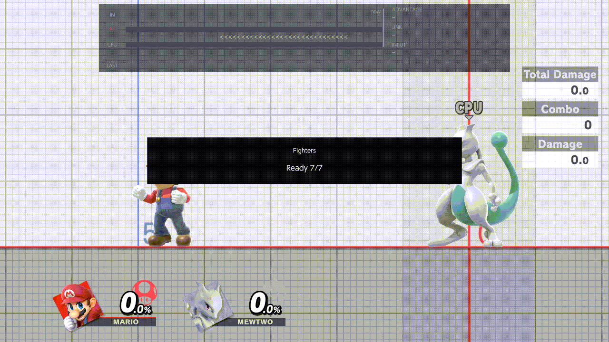

# Saves

This page sets what happens when a save state loads: the fighters' damage, which way they face, character buffs, and
whether a KO loads the save for you. It also keeps a library of named setups. Open the menu with B + D-pad Up (or
Minus), then press R once from the CPU page, or L until the title reads Saves.
[Using the menu](../guide/using-the-menu.md) explains the buttons inside the menu, and
[Save states](../guide/save-states.md) explains saving and loading step by step.

The save states themselves (the files you bind, rename and delete) are listed on the Recording page, under
[Save states & Macros](recording.md#save-states--macros).

## Save states

### Save States

On: the Save chord (ZL + D-pad Down) saves where both fighters are, and the Load chord (ZL + D-pad Up) puts them both
back there. Off: the two chords do nothing, Auto-load on death stops, and a load already under way is cancelled.

With it Off, a KO follows Fighters & Stages › [Respawn on platform](fighters-and-stages.md#respawn-on-platform): back
at once, or on the revival platform.

- **Values:** On, Off
- **Default:** On
- **How:** A flips it. The chords themselves are changed at Display & Controls ›
  [Button chords](display-and-controls.md#button-chords).

More: [Save states › Saving and loading](../guide/save-states.md#saving-and-loading)

### Mirroring

Flips a load left to right: each fighter lands at the mirror image of its saved spot, across the middle of the stage,
and faces the other way. Use it to practise the same situation from both sides.

- **Values:** None, Alternate, Random
- **Default:** None
- **How:** Left or Right switches it; A opens the list.

None never flips. Alternate flips every other load, starting with the first load after a Save. Random flips each load
by chance, one in two. Play's warp to a macro's start save is never flipped.

More: [Save states › Mirroring](../guide/save-states.md#mirroring)

### Auto-load on death

On: when Player 1 or the CPU is KO'd, the save state loads at once instead of a respawn. Off: you load it yourself with
the Load chord.

- **Values:** On, Off
- **Default:** Off
- **How:** A flips it.

It loads the bound save, the one the Load chord uses. With nothing bound, nothing loads and the fighter respawns at
once. While this row and Save States are On, Fighters & Stages ›
[Respawn on platform](fighters-and-stages.md#respawn-on-platform) is greyed with the reason "Auto-load on death is On:
a save state loads instead".

More: [Save states › Auto-load on death](../guide/save-states.md#auto-load-on-death)

### Player damage on load

Player 1's damage after a load.

- **Values:** Default (0%, as after a respawn), Save State (the damage Player 1 had when you saved), Random Value (a
  random damage within [Player damage range](#player-damage-range))
- **Default:** Default
- **How:** Left or Right switches it; A opens the list.

With Default, a load puts Player 1 at 0% whatever the save holds. Choose Save State to get the saved damage back.

More: [Save states › Damage on load](../guide/save-states.md#damage-on-load)

### Player damage range

The lowest and the highest damage Random Value can give Player 1.

- **Values:** 0 to 150 for each end; the lower end stays at or below the upper
- **Default:** 0 to 150
- **How:** A opens the slider. Left or Right chooses the lower or the upper handle, A picks it up, Left / Right move it
  by 1 and Up / Down by 10, A puts it down. B goes back. The row is greyed ("Only used when damage on load is Random
  Value") unless Player damage on load is Random Value.

### CPU damage on load

The CPU's damage after a load. It works like [Player damage on load](#player-damage-on-load), for the CPU.

- **Values:** Default (0%), Save State (the CPU's saved damage), Random Value (a random damage within
  [CPU damage range](#cpu-damage-range))
- **Default:** Default
- **How:** Left or Right switches it; A opens the list.

More: [Save states › Damage on load](../guide/save-states.md#damage-on-load)

### CPU damage range

The lowest and the highest damage Random Value can give the CPU.

- **Values:** 0 to 150 for each end; the lower end stays at or below the upper
- **Default:** 0 to 150
- **How:** as [Player damage range](#player-damage-range). Greyed unless CPU damage on load is Random Value.

### Buffs on load

Character buffs given right after every load, to Player 1 and to the CPU alike, when the fighter is one of these. Any
other fighter gets nothing.

| Fighter | Buffs | After a load |
| --- | --- | --- |
| Hero | Accelerate, Oomph, Psyche Up, Bounce | Hero casts every ticked spell, one after another. |
| Joker | Arsene | The rebellion gauge fills, so Arsene comes out. |
| Wii Fit Trainer | Deep Breathing | A successful Deep Breathing. |
| Cloud | Limit | The Limit gauge is full. |
| Little Mac | KO Punch | The KO meter is full. |
| Sephiroth | 1-Winged Angel | Sephiroth has his wing. |
| Shulk | Jump, Speed, Shield, Buster, Smash | One of the ticked Monado Arts, picked at random on each load. |
| Min Min | Power Dragon | Her left arm is the powered-up Dragon. |
| Wario | Mini Waft, Half Waft, Full Waft | The waft is charged to one of the ticked levels, picked at random. |

- **Values:** the 18 buffs above
- **Default:** none ticked
- **How:** A opens the checklist. A ticks or unticks, ZL ticks all (or none when all are ticked), B goes back. The row
  shows how many are ticked, such as "2 of 18".

Every ticked buff counts, except that Shulk and Wario can have only one art or waft at a time, so one of their ticked
entries is picked each load.

More: [Save states › Buffs](../guide/save-states.md#buffs)

## Setup library

A setup is a named copy of a save state, with the stage it was saved on. Setups are kept in a library of their own
(`sd:/ultimate/TrainingRooms/setups/`), apart from the save states on the Recording page.

### Save setup to library...

Keeps what the Load chord would load now (normally your bound save) as a new setup, under a name you type.

- **How:** A reads the save ("Reading the selected saved setup…"; B cancels), then the keyboard opens with the name
  "Setup". Type a name of up to 48 characters and confirm. The notice reads "Saved setup" and the name. Each setup is
  a new file: saving never overwrites one.

Both fighters must have been saved on the same stage. If not, or if nothing is bound, the notice reads "Save both
fighters in this slot on the same stage before exporting" and nothing is kept.

More: [Save states › The setup library](../guide/save-states.md#the-setup-library)

### Setup library

The list of your setups, each with its name and its two fighters ("name · Player 1's fighter / the CPU's fighter"). A
setup you choose here is applied when you close the menu.

- **How:** A opens the list. Up / Down choose, then:
  - **A** binds and restores: when the menu closes, the fighters go to the setup. The next Load goes back to your
    bound save.
  - **Y** binds only: nobody moves, and the Load chord (and Auto-load on death) goes to the setup until you Save or
    bind another save.
  - **B** goes back without choosing.

A notice confirms the choice: "Setup will bind and restore when the menu closes", or "Setup will bind when the menu
closes".

A needs Save States On, the stage the setup was saved on, and the same fighters on both sides (for a Mii, the same
Mii). If one of them doesn't match, a notice says which, and that Y can bind the setup without moving. Y needs none of
them. With no setups saved, the list reads "No setups saved".

More: [Save states › The setup library](../guide/save-states.md#the-setup-library)
