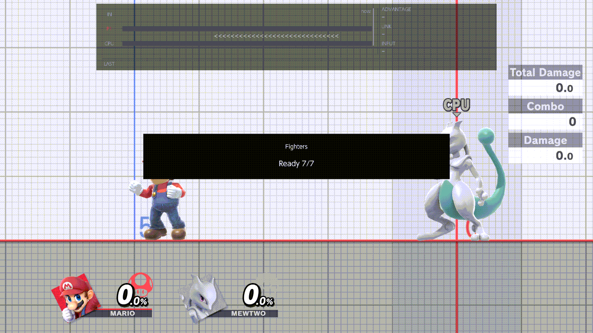
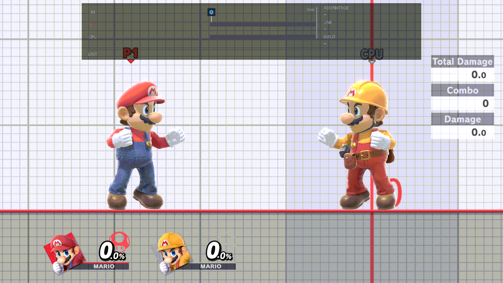
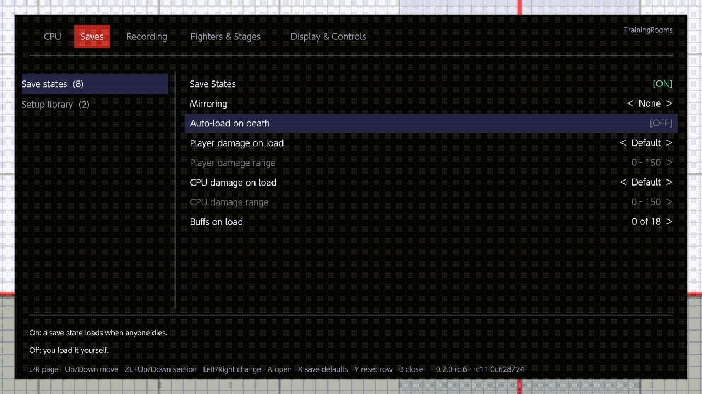
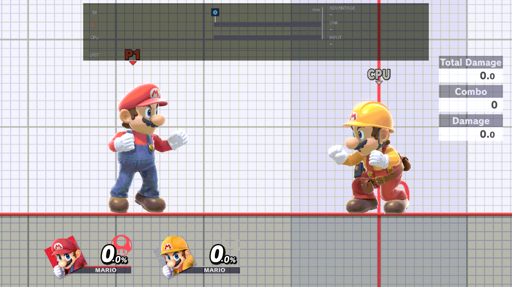
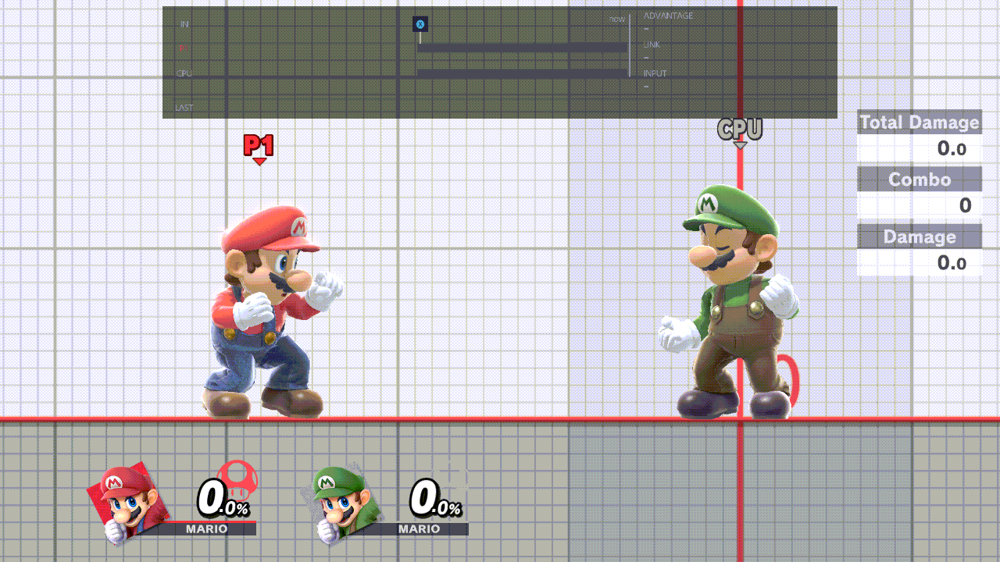
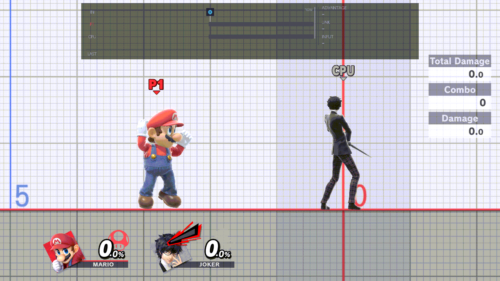
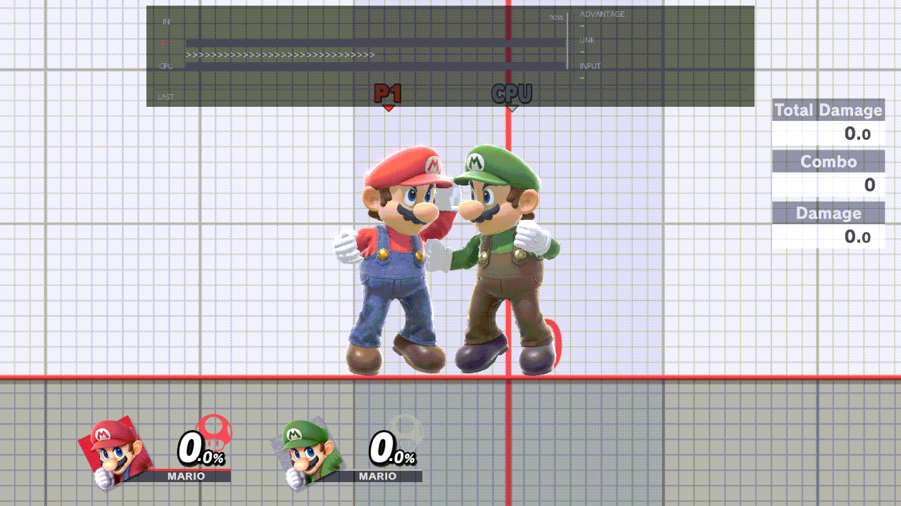
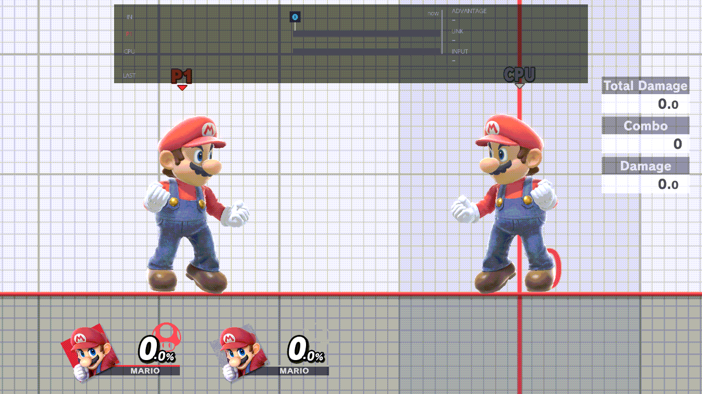

# Saves

This page sets what happens when a save state loads: the fighters' damage, which way they face, character buffs, and
whether a KO loads the save for you. It also keeps a library of named setups. Open the menu with B + D-pad Up (or
Minus), then press R once from the CPU page, or L until the title reads Saves.
[Using the menu](../guide/using-the-menu.md) explains the buttons inside the menu, and
[Save states](../guide/save-states.md) explains saving and loading step by step.

The save states themselves (the files you bind, rename and delete) are listed on the Recording page, under
[Save states & Macros](recording.md#save-states-macros).

## Save states

### Save States

On: the Save chord (ZL + D-pad Down) saves where both fighters are, and the Load chord (ZL + D-pad Up) puts them both
back there. Off: both chords show "Save States is Off (Saves page)", Auto-load on death stops, and a load already under
way is cancelled. A KO then follows Fighters & Stages › [Respawn on platform](fighters-and-stages.md#respawn-on-platform):
back at once, or on the revival platform.

A Save or Load that doesn't happen for another reason (nothing bound, a load under way, the CPU playing Player 1) says
why in a notice: the list is in [Save states › Saving and loading](../guide/save-states.md#saving-and-loading). Both
chords work while Online Deluxe's window is open.

- **Values:** On, Off
- **Default:** On
- **How:** A, Left or Right flips it. The chords themselves are changed at Display & Controls ›
  [Button chords](display-and-controls.md#button-chords).

More: [Save states › Saving and loading](../guide/save-states.md#saving-and-loading)

### Mirroring

Flips a load left to right: each fighter lands at the mirror image of its saved spot, across the middle of the stage,
and faces the other way. Use it to practise the same situation from both sides.

- **Values:** None, Alternate, Random
- **Default:** None
- **How:** Left or Right switches it; A opens the list.

None never flips. Alternate flips every other load, starting with the first load after a Save. Random flips each load
by chance, one in two. Play's warp to a macro's start save is never flipped.

More: [Save states › Mirroring](../guide/save-states.md#mirroring)

### Auto-load on death

On: when Player 1 or the CPU is KO'd, the save state loads at once instead of a respawn. Off: you load it yourself with
the Load chord.

- **Values:** On, Off
- **Default:** Off
- **How:** A, Left or Right flips it.

It loads the bound save, the one the Load chord uses. With nothing bound, nothing loads and the fighter respawns at
once. While this row and Save States are On, Fighters & Stages ›
[Respawn on platform](fighters-and-stages.md#respawn-on-platform) is greyed with the reason "Auto-load on death is On:
a save state loads instead".

More: [Save states › Auto-load on death](../guide/save-states.md#auto-load-on-death)

### Player damage on load

Player 1's damage after a load.

- **Values:** Default (0%, as after a respawn), Save State (the damage Player 1 had when you saved), Random Value (a
  random damage within [Player damage range](#player-damage-range))
- **Default:** Default
- **How:** Left or Right switches it; A opens the list.

With Default, a load puts Player 1 at 0% whatever the save holds. Choose Save State to get the saved damage back.

More: [Save states › Damage on load](../guide/save-states.md#damage-on-load)

### Player damage range

The lowest and the highest damage Random Value can give Player 1.

- **Values:** 0 to 150 for each end; the lower end stays at or below the upper
- **Default:** 0 to 150
- **How:** A opens the slider. Left or Right chooses the lower or the upper handle, A picks it up, Left / Right move it
  by 1 and Up / Down by 10, A puts it down. B goes back. The row is greyed ("Only used when damage on load is Random
  Value") unless Player damage on load is Random Value.

### CPU damage on load

The CPU's damage after a load. It works like [Player damage on load](#player-damage-on-load), for the CPU.

- **Values:** Default (0%), Save State (the CPU's saved damage), Random Value (a random damage within
  [CPU damage range](#cpu-damage-range))
- **Default:** Default
- **How:** Left or Right switches it; A opens the list.

More: [Save states › Damage on load](../guide/save-states.md#damage-on-load)

### CPU damage range

The lowest and the highest damage Random Value can give the CPU.

- **Values:** 0 to 150 for each end; the lower end stays at or below the upper
- **Default:** 0 to 150
- **How:** as [Player damage range](#player-damage-range). Greyed unless CPU damage on load is Random Value.

### Buffs on load

Character buffs given right after every load, to Player 1 and to the CPU alike, when the fighter is one of these. Any
other fighter gets nothing.

| Fighter | Buffs | After a load |
| --- | --- | --- |
| Hero | Accelerate, Oomph, Psyche Up, Bounce | Hero casts every ticked spell, one after another. |
| Joker | Arsene | The rebellion gauge fills, so Arsene comes out. |
| Wii Fit Trainer | Deep Breathing | A successful Deep Breathing. |
| Cloud | Limit | The Limit gauge is full. |
| Little Mac | KO Punch | The KO meter is full. |
| Sephiroth | 1-Winged Angel | Sephiroth has his wing. |
| Shulk | Jump, Speed, Shield, Buster, Smash | One of the ticked Monado Arts, picked at random on each load. |
| Min Min | Power Dragon | Her left arm is the powered-up Dragon. |
| Wario | Mini Waft, Half Waft, Full Waft | The waft is charged to one of the ticked levels, picked at random. |

- **Values:** the 18 buffs above
- **Default:** none ticked
- **How:** A opens the checklist. A ticks or unticks, ZL ticks all (or none when all are ticked), B goes back. The row
  shows how many are ticked, such as "2 of 18".

Every ticked buff counts, except that Shulk and Wario can have only one art or waft at a time, so one of their ticked
entries is picked each load.

More: [Save states › Buffs](../guide/save-states.md#buffs)

## Setup library

A setup is a spot you practise from, kept under a name: where both fighters stand, which fighters they are, and the
stage. Keep as many as you like, then put both fighters on any of them in one step. Setups are separate from your save
states (they are files in `sd:/ultimate/TrainingRooms/setups/`): Load uses a setup only if you pick Make Load use it
below.

<!-- CAPTURE-REQUEST setup-own-screen: a new clip, rc14-setup-own-screen.gif (Setup library, A on Corner trap: the screen with Restore here, Make Load use it, Rename, Delete; Right moves the cursor and the line under the rows changes; B goes back to the list). Replaces the A-versus-Y picture. Plan: artifacts/setup-library-review/PROPOSAL.md section 2 and storyboard-setup-library.png. -->

### Save setup here...

Keeps where both fighters stand now as a new setup under a name you type. Your bound save is not touched.

<!-- CAPTURE-REQUEST setup-save-here: a new clip, rc14-save-setup-here.gif. Training, Mario vs Little Mac: Load puts both in the middle (the bound save); walk them to the far left and far right; Saves › Save setup here..., the keyboard with "Where they stand now", type Corner trap, the notice "Saved setup Corner trap"; the Setup library lists Corner trap with its spots; close the menu and Load: both go back to the middle, so the bound save did not change. The same clip goes in docs/guide/save-states.md › Making a setup. -->

- **Values:** a name of up to 48 characters
- **Default:** the name "Setup"
- **How:** put both fighters where you want to practise, open the menu and press A on this row. The keyboard opens,
  with "Where they stand now" and the two fighters under the name box. Type a name and confirm. The notice reads
  "Saved setup" and the name.

It keeps what Save keeps: which fighters they are, where they stand and which way they face, their damage, whether
they are on the ground, in the air or on the ledge, their charges, Player 1's held item, a Mii's exact look, and the
stage. For the Ice Climbers it keeps Popo's spot, as Save does. Load still goes to your bound save; to make Load go to
the new setup, open it in the Setup library and pick Make Load use it.

It keeps nothing, and says why on the page's second line, when:

| What it says | What to do |
| --- | --- |
| "Save States is Off (Saves page)" | Turn [Save States](#save-states) On. |
| "A save or restore is already in progress" | Wait for the save, load or setup under way to finish, then try again. |
| "Wait for the practice fighters to finish loading" | A fighter, or a Mii's exact look, is still loading or changing: try again in a moment. |

More: [Save states › Making a setup](../guide/save-states.md#making-a-setup)

### Save setup from bound save...

Keeps the spot your Load chord goes to now, your bound save, as a new setup under a name you type.

<!-- CAPTURE-REQUEST setup-save-setup: reshoot this clip as rc14-save-setup.gif after the list-screen fixes (Mario vs Little Mac on far-apart spots: Save, Save setup from bound save..., the keyboard, the notice, the list with the new row, its footer naming the stage and the spots). Plan: artifacts/setup-library-review/PROPOSAL.md section 2.1 and storyboard-save-setup.png. -->

- **Values:** a name of up to 48 characters
- **Default:** the name "Setup"
- **How:** A reads your save ("Reading your save…"; B cancels), then the keyboard opens, with "From your bound save" and
  the two fighters under the name box. Type a name and confirm. The notice reads "Saved setup" and the name.

It copies your bound save, not where the fighters stand now: for that, use Save setup here... above. This row keeps a
save you already have as a setup.

Both fighters must have been saved on the same stage. With nothing saved yet, the notice reads "Nothing is saved here
yet: Save first, or bind a save"; with the two saved on different stages, "Both fighters must be saved on the same
stage". Either way nothing is kept. Each setup is a new file: saving never overwrites one.

More: [Save states › Making a setup](../guide/save-states.md#making-a-setup)

### Setup library

Lists your setups, A to Z, so you can open one. A row reads "name · Player 1's fighter / the CPU's fighter · stage ·
spots", such as "Corner trap · Mario / Little Mac · Training · spots -40 / 35". The spots are where the two fighters
stand, in the units of the floor markers; a minus is left of the middle. The grid cuts a longer row off at 16 characters
and ends it with "…", so the full row shows under the grid for the setup under the cursor. With no setups, the list reads "No setups saved".

<!-- CAPTURE-REQUEST setup-library: reshoot this clip as rc14-setup-library.gif after the list-screen fixes (Load puts both in the middle; Setup library, A on Corner trap, A on Restore here; the menu closes and both jump to the far spots; Load goes back to the middle). Plan: artifacts/setup-library-review/PROPOSAL.md section 2.2 and storyboard-setup-library.png. -->

<!-- CAPTURE-REQUEST setup-load-target: a new clip, rc14-setup-load-target.gif (A on Corner trap, Make Load use it, close the menu, nobody moves; Load goes to the setup, and again after a smash). Plan: artifacts/setup-library-review/PROPOSAL.md section 2.3 and storyboard-load-target.png. -->

- **How:** A opens the list. Up / Down / Left / Right choose a setup, then:
  - **A** opens the setup's own screen (below).
  - **X** renames it. The keyboard opens with the name, and "Renaming" and the two fighters under the name box. Confirm
    to keep the new name; the setup stays in the same file. The notice reads "Renamed to" and the name.
  - **Y** makes Load use it, in one press: the same as Make Load use it below.
  - **B** goes back to the Saves page.

### A setup's own screen

A on a setup opens its screen: four rows, and the line under them says what the row under the cursor does. The title
is the setup's name.

| Row | What it does |
| --- | --- |
| Restore here | When you close the menu, both fighters go to the setup. The next Load goes back to your bound save, as before. The notice reads "Setup chosen: both fighters move there when you close the menu". |
| Make Load use it | Nobody moves. Load, and Auto-load on death, go to the setup until you Save or bind another save. To drill a setup again and again, use this, then Load. The notice reads "Setup chosen: Load will go there once you close the menu. Nobody moves". |
| Rename | The keyboard opens with the name, as X does. |
| Delete | Asks once: "Keep it" (where the cursor starts) or "Delete it". Delete it removes the setup's file, and the notice reads "Setup deleted". Your saves are not touched. |

B goes back one step: from the question to the screen, from the screen to the list, from the list to the Saves page.
After you restore, make Load use it, rename or delete, the menu returns to the Saves page and the notice confirms it.
Nothing moves until you close the menu.

**When Restore here says no.** Restore here is refused unless Save States is On, you are on the stage the setup was saved
on, and the same fighters are on both sides (for a Mii, the same Mii). Restore here never changes the stage, so go to it
first; the row names it. The screen comes back with the reason on its second line, such as "This setup is for another
stage. Make Load use it works anywhere". Make Load use it has none of these limits, but a setup's spots only make sense
on the stage it was saved on.

A restored setup follows Player damage on load, Mirroring and Buffs on load like any Load.

The number beside "Setup library" in the left column counts that group's rows, not your setups.

More: [Save states › Using a setup](../guide/save-states.md#using-a-setup)