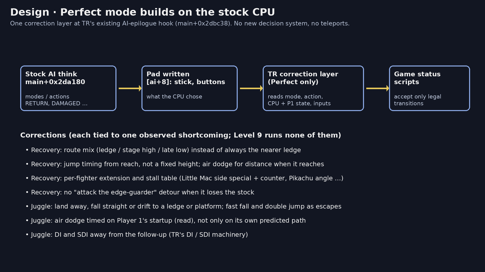
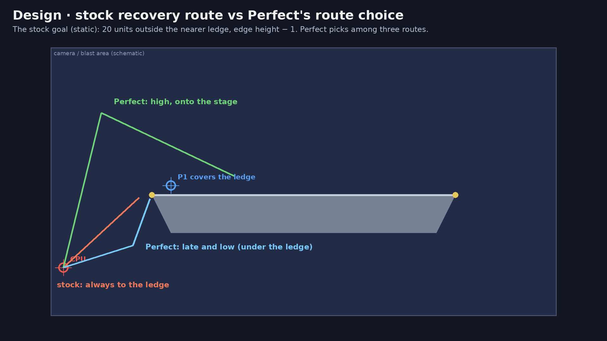
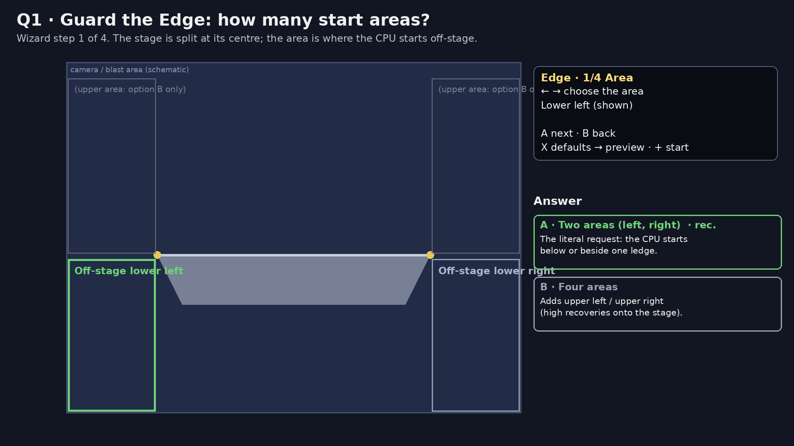
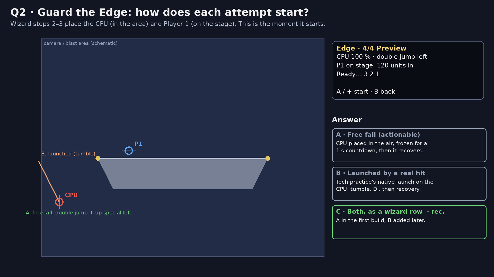
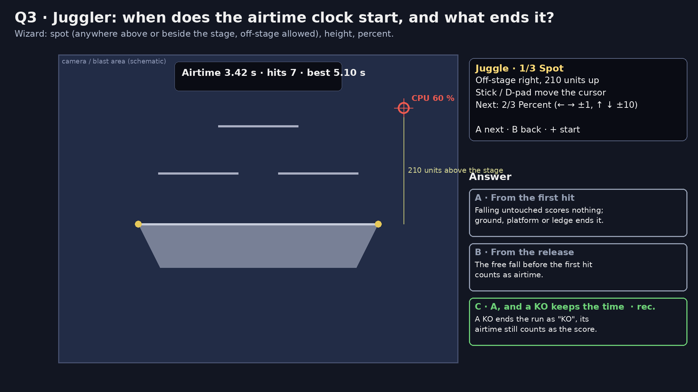
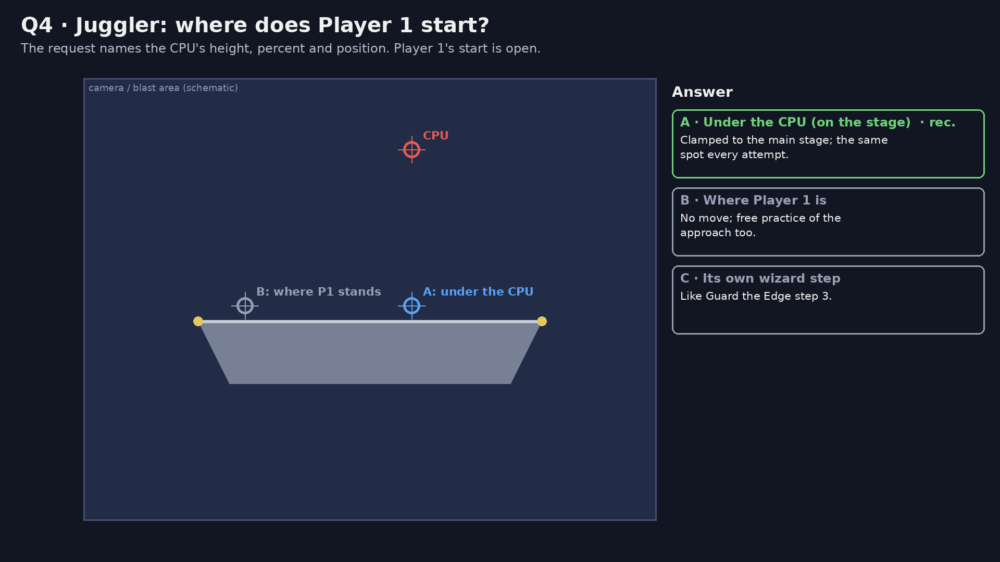
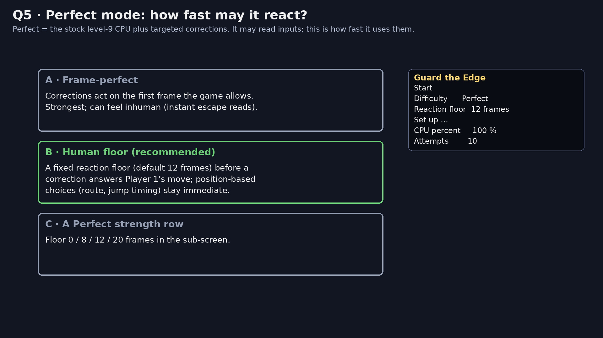
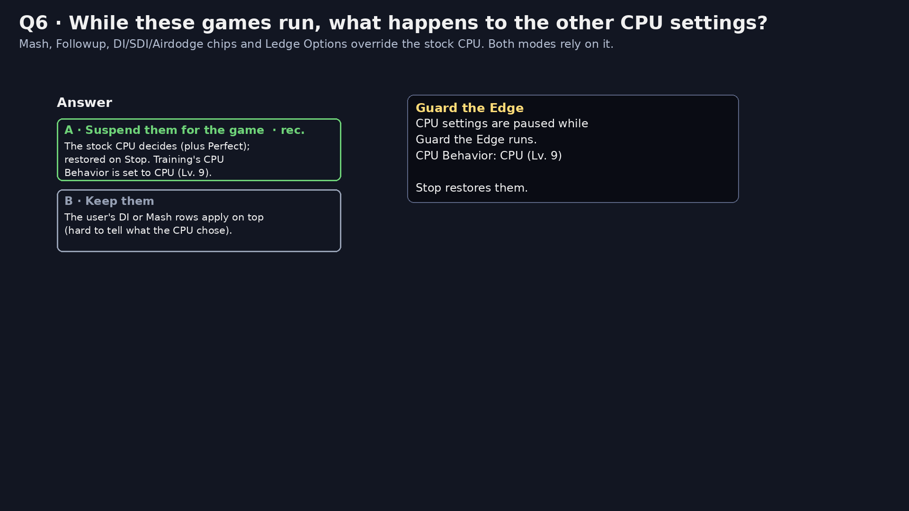

# Guard the Edge + Juggler: design draft (for the build after rc.15)

Research and design by the edge-juggle-opus lane (Claude Opus 5.5 high). There's no code yet. The static findings were **checked on Eden** (P0, 2026-11-20 01:21Z: 21,143 per-frame
stock-AI records on the exact card build; [P0 results](edge-juggle/evidence/P0-RESULTS.md)). Confirmed: always the nearer
ledge, identical starts repeat identical paths, and the air dodge only from about 20 units out. Corrected: the CPU jumps on
its first actionable frame, not late. Supported (one sample): the drift goes toward you. Not yet covered: starts that
force an up-special, recovering against an active edge-guard, and juggle rates.
Full documents: [RESEARCH.md](edge-juggle/RESEARCH.md) and [DESIGN.md](edge-juggle/DESIGN.md).

## What the game's CPU does wrong (from its own code; recovery points checked on Eden)

**Recovering (Guard the Edge):**
- it always goes to the **nearer ledge**, and identical starts repeat identical paths (confirmed);
- it air-dodges only when already close to the ledge, about 20 units out (confirmed);
- it jumps on its first actionable frame every time (corrected on Eden; the static read said fixed heights);
- it sometimes **attacks a nearby edge-guarder instead of recovering**.

**Being juggled (Juggler):**
- it air-dodges only when it predicts a hit on its own path;
- it rarely double jumps;
- its **DI and drift point toward you**.

## Perfect mode builds on the vanilla CPU

Perfect = the stock level-9 CPU plus **one small correction per weak spot**. The corrections sit right after the game's AI
decides, at a hook TR already owns (where Mash out already drives the CPU's controller). There's no new decision system
and no teleporting; every correction is a real controller input. Level 9 mode runs none of the corrections.

## Six questions for you (recommendation first)

1. **Start areas for Guard the Edge:** two (off-stage lower left / lower right, as you asked) or four (adding upper left
   / upper right)? Recommended: **two**. 
2. **How the CPU starts in Guard the Edge:** in free fall, after a real launch, or both? Recommended: **free fall first,
   launch later**. 
3. **Juggler clock:** from your first hit or from release; does a KO keep the airtime? Recommended: **from the first
   hit; a KO keeps its airtime**. 
4. **Juggler: where do you start?** Recommended: **under the CPU**. 
5. **Perfect's reaction speed:** frame-perfect, a human floor, or a setting? Recommended: **a 12-frame floor**.
   
6. **While a game runs:** should TR suspend its other CPU settings and set CPU Behavior to CPU (Lv. 9), then restore
   them on Stop? Recommended: **yes**. 

The pictures are mockups, not game footage.
