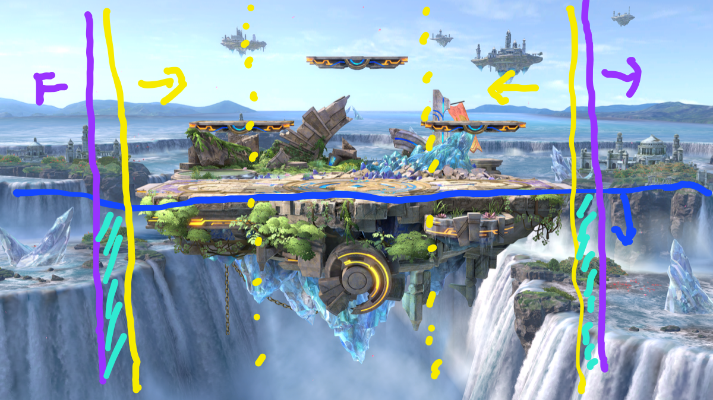
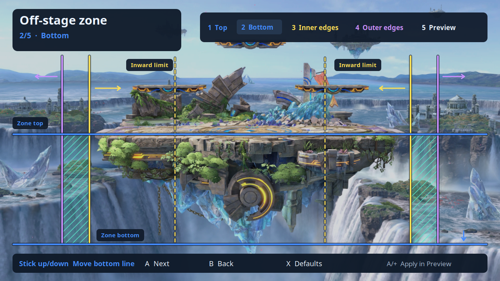
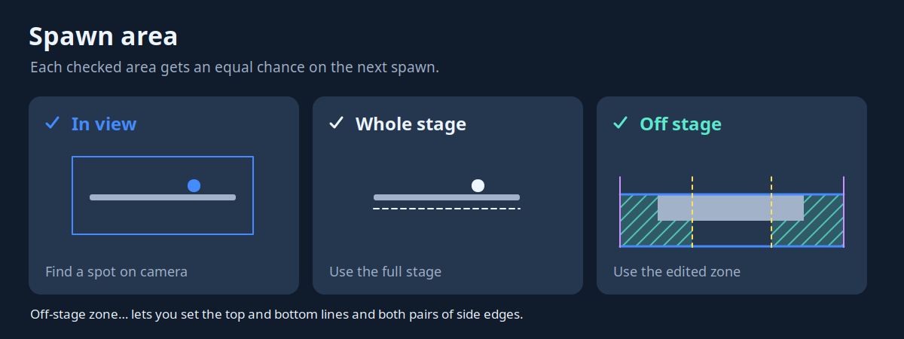
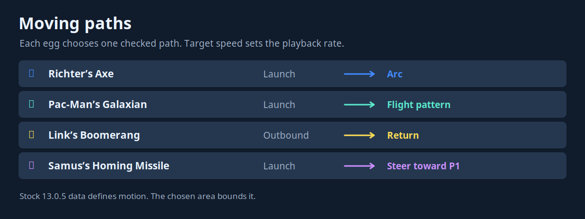
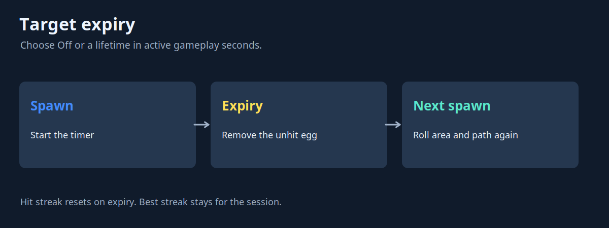
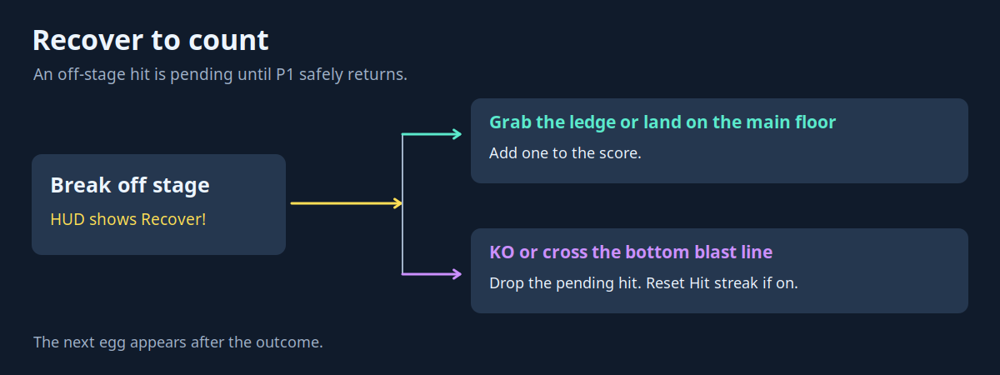

# Eggs-ercise: Off-stage zone, moving paths, expiry, recover to count

Design review for rc.15, made 2026-11-21. These are design mockups, not in-game captures. Implementation has started
(tests first). In-game MP4s will follow from one Eden session.

## Your sketch

## Off-stage zone wizard (mockup v2)

Five steps: **1 Top · 2 Bottom · 3 Inner edges · 4 Outer edges · 5 Preview**.

- **Top / Bottom (blue):** stick up/down moves that line. The two lines close in on each other or open apart, so you
  set the safe height band. They stay at least one egg apart and stop short of the blast zones.
- **Inner edges (yellow):** stick left/right moves both bars together, mirrored. They can go under the stage as far as
  the dashed **Inward limit**, which is halfway from each ledge to the center.
- **Outer edges (purple):** stick left/right moves both bars toward or away from the side blast zones.
- **A** next, **B** back, **X** defaults, **A/+** apply from Preview.
- The zone is saved relative to each stage's ledges and blast zones, so one setting works on every stage.

## Spawn area becomes a multi-select

## Moving paths

Each egg follows one of the checked projectiles' real flight paths, taken from 13.0.5 game data. The missile steers
toward you.

## Target expiry

Off, or 1 to 10 seconds.

## Recover to count

The hit counts when you grab either ledge or land on the main stage floor; a platform landing alone doesn't count.
