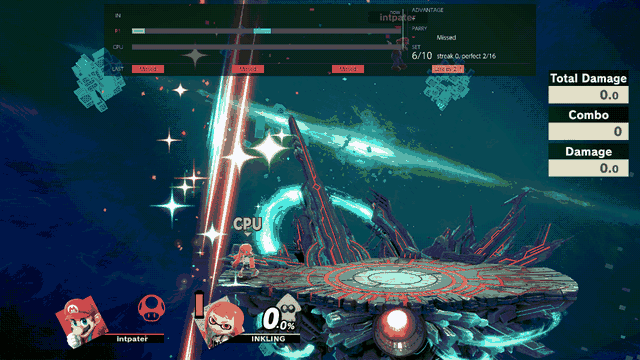

# Parry practice: what it looks like (Eden, 2026-11-18)

Eden recording from acceptance run 2 (04:25Z, an earlier build of the feature; the strip readouts are the same on
the current candidate 26c93533). The CPU (Inkling) replays a recorded attack; Mario shields and lets go.

What to watch, top right of the strip:

- **PARRY:** the last attempt's grade. Here: `Perfect · 2f before` (shield let go 2 frames before the hit), then
  `+9 Late by 9f`.
- **SET:** `7/10 · streak 1 · perfect 3/17` = attempt 7 of a 10-attempt set, current streak, and the running total.
- **LAST:** coloured pills for the most recent attempts (Perfect, Late, Missed).

At the end of a set a "Done!" summary (Perfect / Early / Late / Missed counts, best streak, running total) goes to the
compact top-left notice box. This older recording predates that box.
