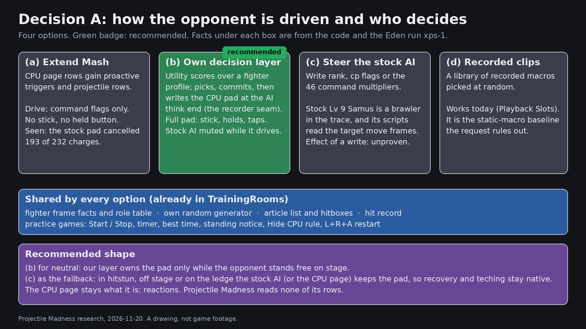
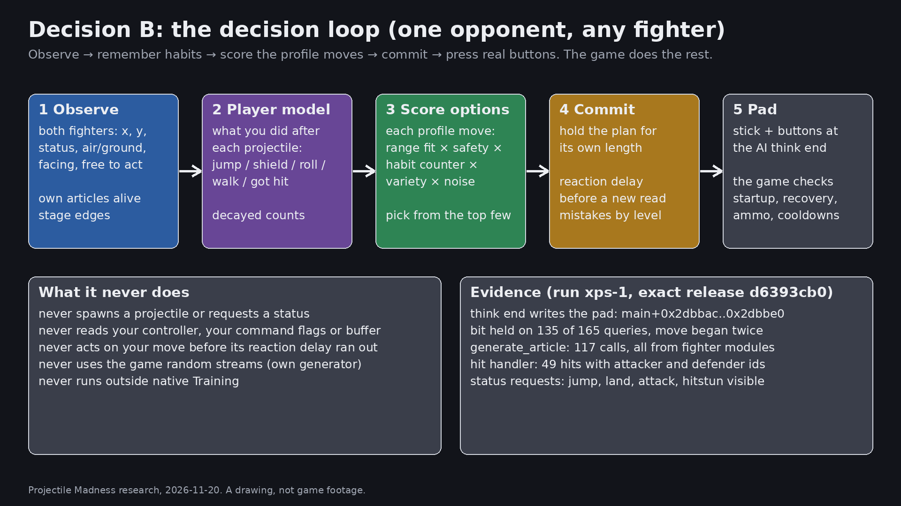
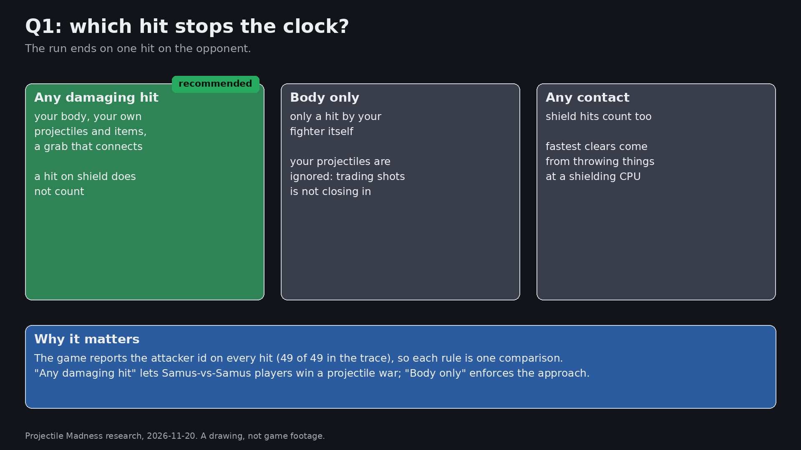
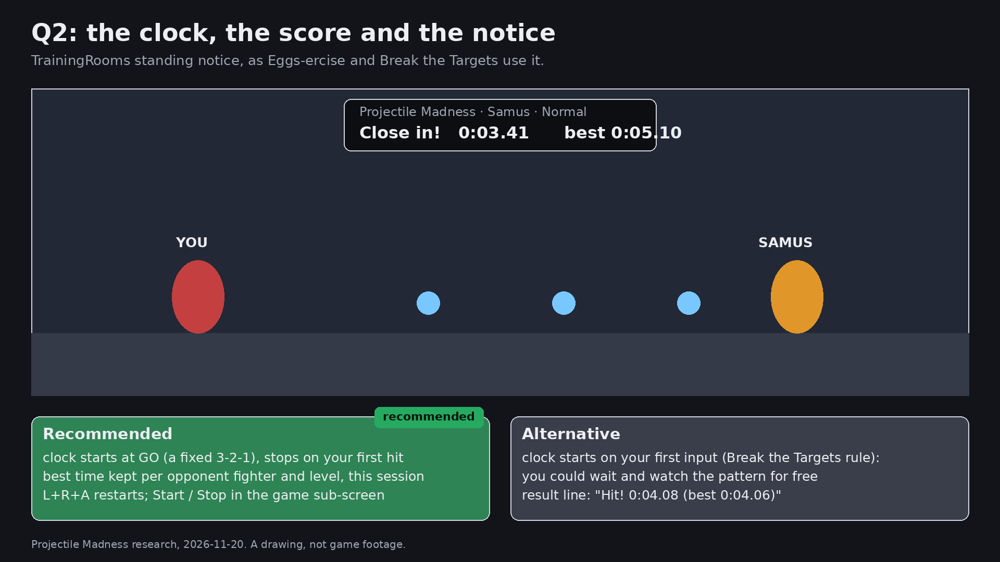
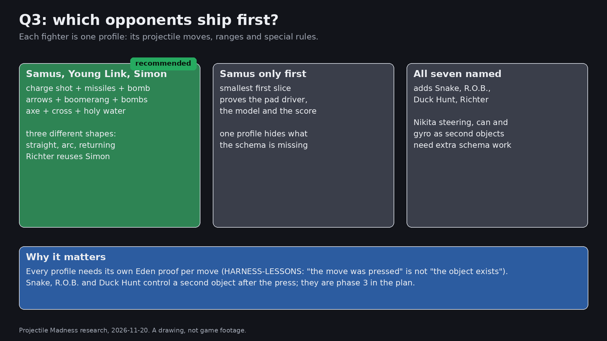
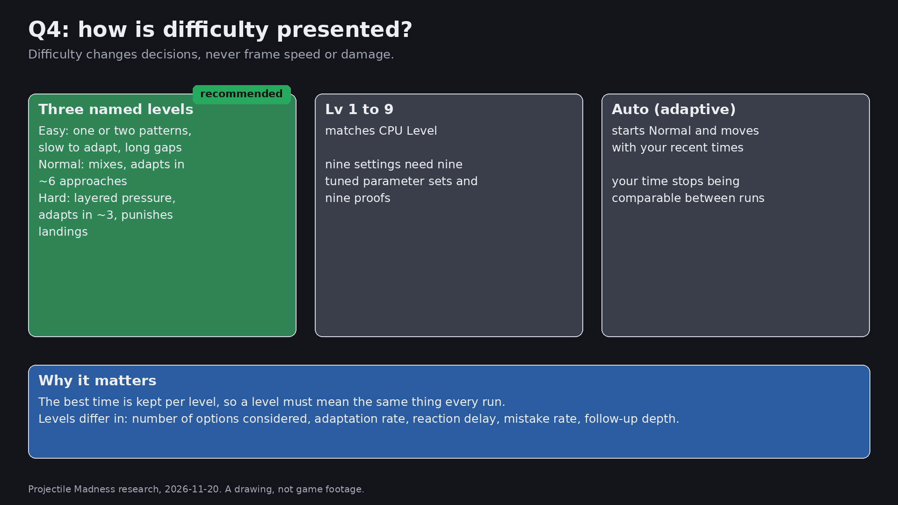
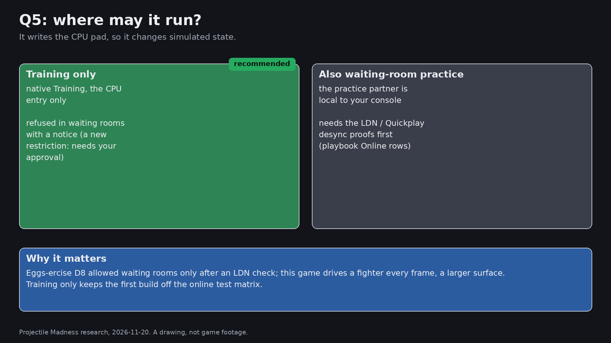
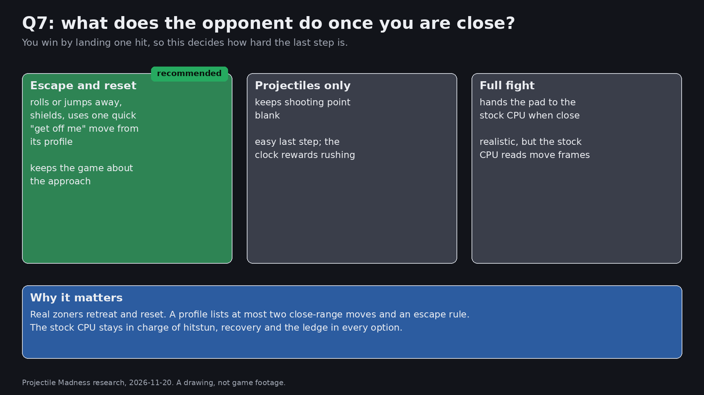
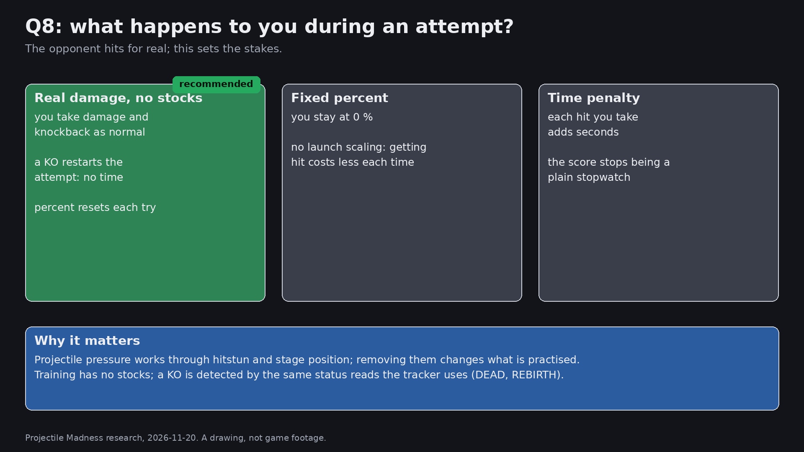

# Projectile Madness: research result (for the build after rc.15)

Research by the projectile-madness-fable lane (Claude Fable 5.2 xhigh). There's no code yet. The full write-up is
[RESEARCH.md](projectile-madness/RESEARCH.md); the evidence is a traced Eden run on the exact card build (d6393cb0).

## The answer in short

- **It's feasible**, as a practice game in native Training.
- **Recommended:** TR's own lightweight decision layer, with one profile per fighter. While the opponent stands free on
  stage, the layer chooses projectile pressure (moves, spacing, follow-ups) and presses buttons on the CPU's controller
  at the point where the game's own AI finishes thinking. TR's recorder already uses that point. Every move is a real
  button press, so the game's own startup and recovery always apply.
- **The game's own CPU keeps the rest:** hitstun, teching, DI, recovery and the ledge stay native for every fighter.
- **Why not the alternatives:**
  - The stock level-9 CPU isn't a zoner. Traced Samus mostly closed in and brawled, and its scripts read your move
    frames, which is the "input-reading" feel you wanted to avoid.
  - The CPU page's Mash fights with the game's AI: the stock AI cancelled 193 of 232 charge-shot charges.
  - Recorded clips are the static macros you ruled out.
- **Adapting without reading inputs:** it learns your habits from what it sees (jumping over, shielding, rolling,
  approach paths), with decay and a human reaction-time floor. It picks with weighted randomness and sometimes makes
  mistakes.
- **Difficulty** comes from better decisions, not faster attacks: more options, deeper follow-ups, faster adaptation,
  fewer mistakes and better spacing.
- **Size estimate:** about +1,600 lines for the first 3 fighters (not measured yet). Each later fighter costs about
  +60–120 lines.
- **Plan:**
  1. A spike: Samus's charge shot and missile, measured.
  2. The MVP: Samus, Young Link, Simon (Richter reuses Simon).
  3. Show the adaptation.
  4. Snake, R.O.B. and Duck Hunt.
  5. More fighters and stages.

## Eight questions for you (recommendation first)

**Decided (operator, 2026-11-20 ~02:06Z):** all as recommended, except **Q5: it also runs in waiting rooms (lobbies)**, not only native Training.

1. **Which hit stops the clock?** Any damaging hit by you or your projectiles; a hit on a shield doesn't count.
   
2. **When does the clock start, and where's the score?** At GO after a short countdown; the standing notice shows it, with
   a best time per opponent and level. 
3. **Which opponents first?** Samus, Young Link, Simon (Richter reuses Simon).
   
4. **Difficulty?** Three named levels. 
5. **Where can it run?** Native Training only (refused in waiting rooms).
   
6. **Should it tell you what it read?** Yes, one line after each attempt (e.g. "you jumped 4 of 5 times; it started
   aiming at your landing"). 
7. **What does it do once you're close?** It tries to escape and reset, with at most two close moves.
   
8. **What happens to you during an attempt?** You take real damage; a KO restarts the attempt without a time.
   

The drawings are illustrations, not game footage.
