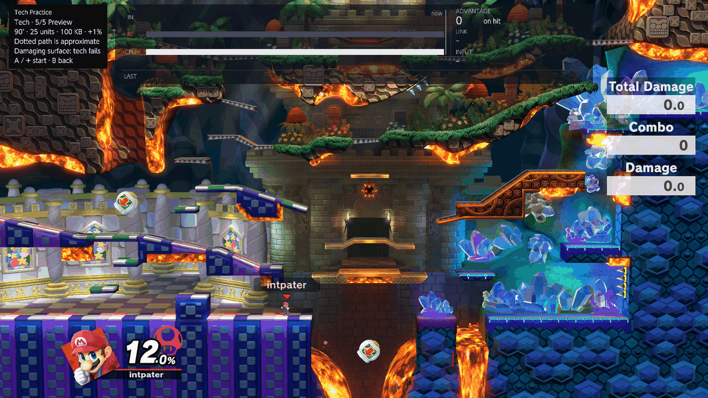
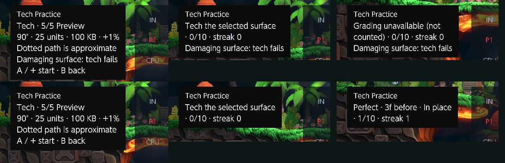
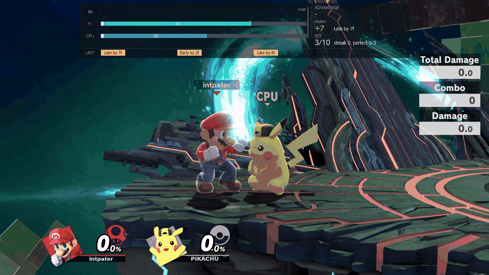
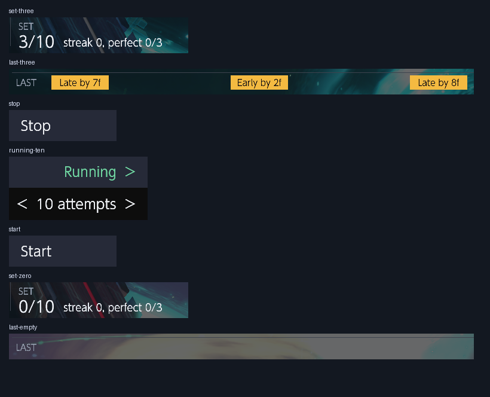
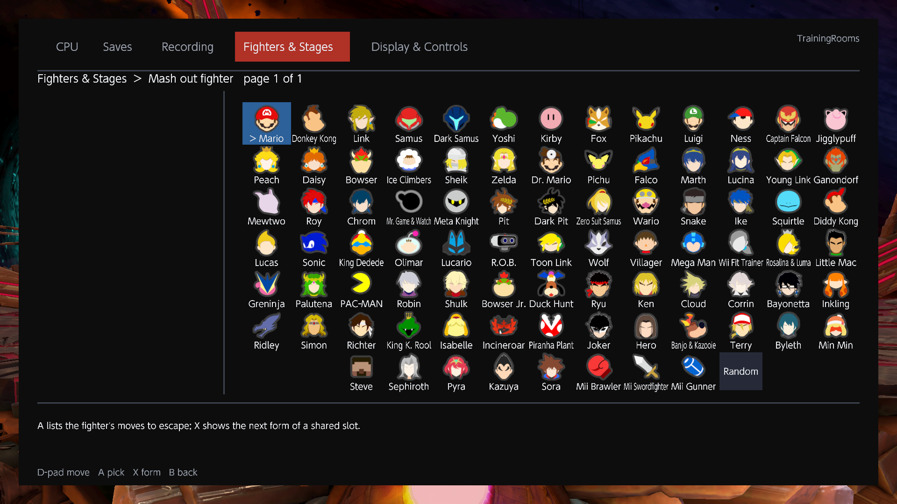
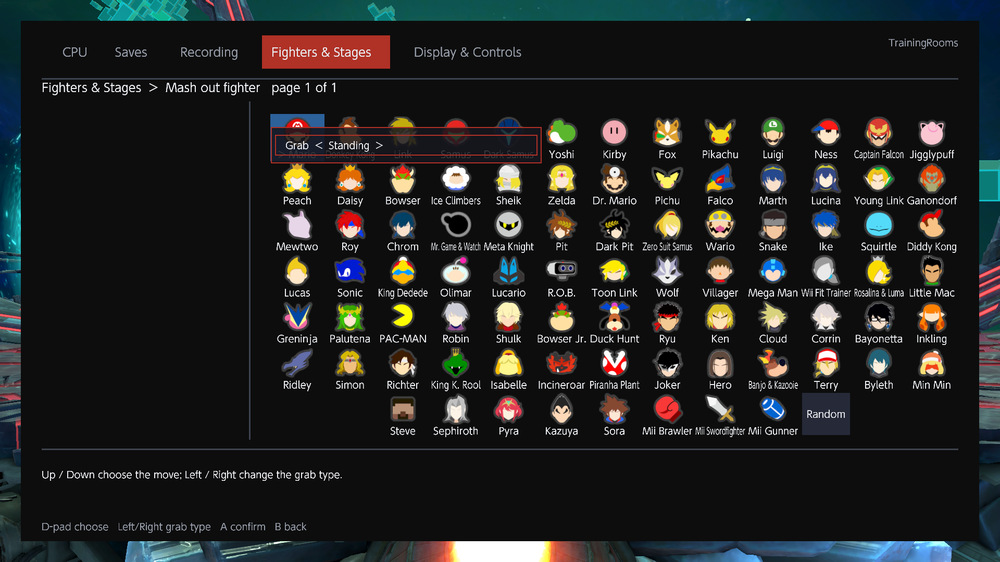
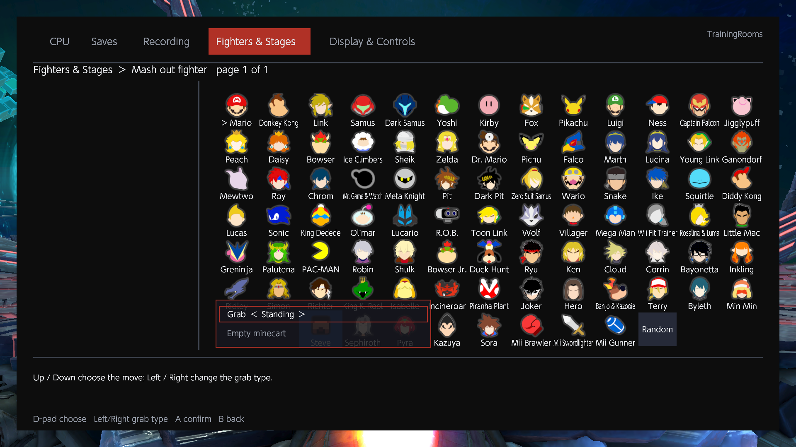

# rc.15 changes from the Switch test feedback (review page)

This is a review page, not product docs. Everything here was recorded in Eden on each change's own gated release build,
before the merge. GIFs are the 720p documentation versions (≤5 MB).

## Tech practice: hint for surfaces you can't tech on

The game never lets you tech on damaging surfaces. When your chosen spot is one of those, the Preview and the Start
notice now say **"Damaging surface: tech fails"**. The hint never stops you starting. A normal floor shows no hint.

Recorded on Great Cave Offensive. Damaging slope: the hint shows, and the attempt is uncounted. Normal floor: no hint,
and the tech is graded **Perfect · 3f before · 1/10**.

Merged into local main `e2b722b9` (review PASS); not pushed yet.

## Parry practice: Start begins a fresh set

Stop then Start now begins a new set: **SET 0/10** and the LAST grades cleared. Your running totals and per-fighter
bests stay. L+R+A, a state load and using a saved practice keep the current set, as before.

Merged into local main `9f6aeae0` (review PASS); not pushed yet.

## Mash out: fighter grid picker (early preview)

Practice games › Mash out › **Fighter and move** opens the fighter grid. **A** on a fighter opens a popup over their
chip that lists only the moves you can mash out of for that fighter. Mario has only **Grab**; Steve has **Grab** and
**Empty minecart**. Left/Right on Grab picks Standing, Dash or Pivot. There is also a **Random** chip.

The popup background is being made solid; for now the portraits show through. The GIF of a full run comes next.

