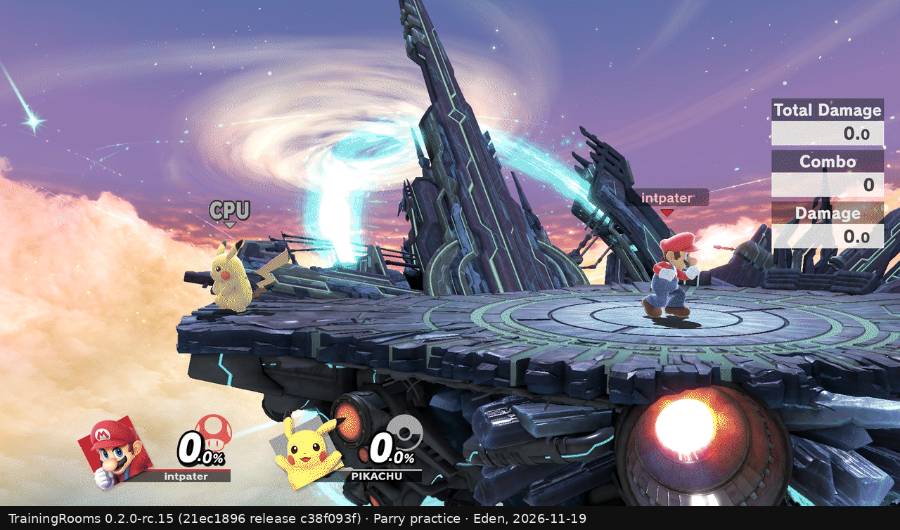
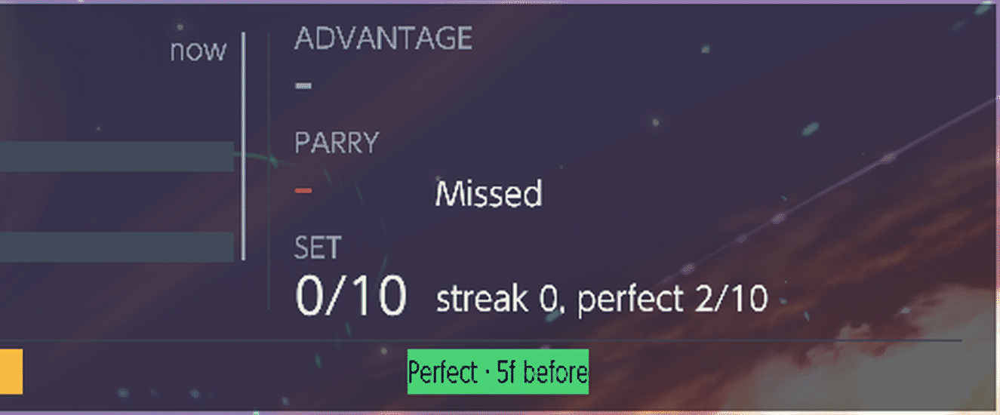
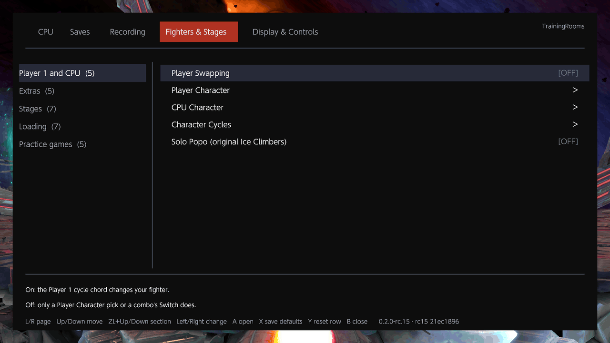
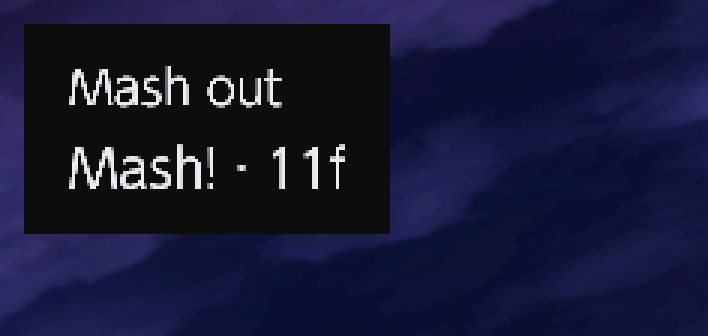

# rc.15 GIFs at the new quality (review page)

Review page, not product docs. Both GIFs were recorded in Eden on the **final rc.15 card build** (`21ec1896`, release
`c38f093f`), captured at 1920×1080, with a full 256-colour palette. Each has a zoomed GIF of the result text.
The Tech wizard angle is on its own page: [TECH-WIZARD.md](TECH-WIZARD.md).

## Parry practice

The path is Fighters & Stages > Practice games > Parry practice. The submenu reads **Parry practice ‹ 10 attempts ›**:
the label fix (the old build showed "Off").
- Start: the strip shows **SET 0/10**.
- The CPU (Pikachu) replays its recorded dash attack, Mario shields and releases: **Perfect · 1f before**, **1/10**.
- A late release on the next attempt: **+12 Late by 12f**, **2/10**.

Zoom on the grade and the set count:

## Mash out

The path is Fighters & Stages > Practice games > Mash out > Start.
- CPU Mario's standing grab connects, and P1 is held: "Mash! 11f".
- P1 mashes and breaks free. The compact grade reads **OK · 33f · fastest 10f · no mash 90f · best 33f**.

The gameplay was captured frame by frame at reduced emulation speed and played back at the game's real timing. The menu
part cuts to a later attempt in the same boot.

Zoom on the grade:

