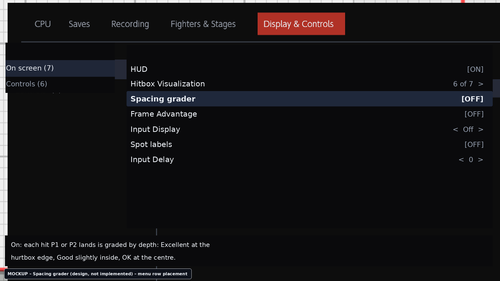
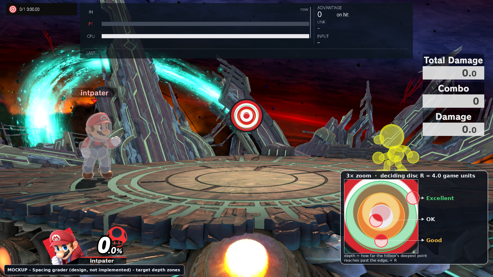
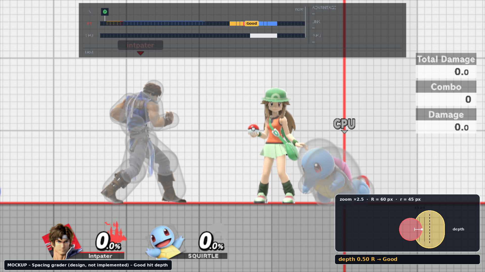
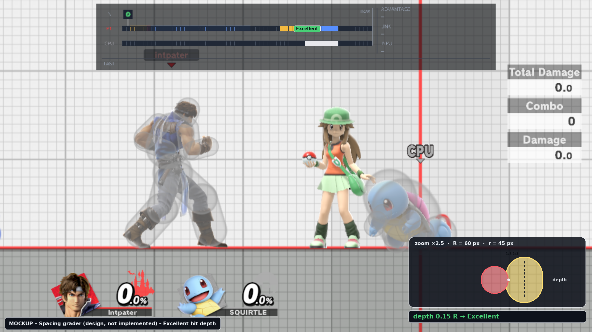
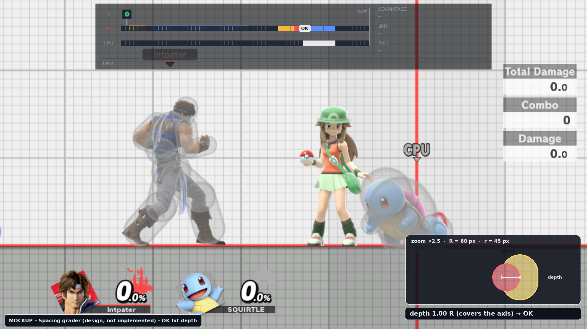
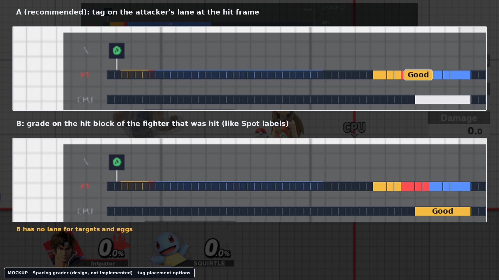

# Spacing grader: design for approval (review page)

This is a review page, not product docs. Every picture here is a **mockup**, made from real screenshots plus drawn
overlays. Nothing is built yet. The design was traced on the exact card build (d6393cb0) in Eden.

## What it does

- A new row, **Display & Controls › Spacing grader**, Off by default. It sits right after Hitbox Visualization.
- When it's On, every hit you land gets one grade. It works on the CPU, Break the Targets targets and Eggs-ercise eggs,
  for your projectiles too, and P2 gets their own grades in two-player Training:
  - **Excellent**: your hitbox only just reaches into the hurtbox (the outer third);
  - **Good**: slightly inside (the middle third);
  - **OK**: it reaches the centre or covers the hurtbox.
- Hits on a shield get no grade.

**How it's measured:** for fighters, it uses the game's own measurement of how deep the hitbox went into the hurtbox
part it hit, on the hit frame. Targets and eggs use exactly the same circle that decides whether they break, so the
grade always agrees with the break.

## The grade in the input display

## Three questions for you (recommended answer first)

1. **Where does the grade tag go?**
   - **A (recommended):** on your own lane, at the hit frame. This works for targets, eggs and projectiles, and keeps
     the Spot labels where they are.
   - **B:** on the hit block of the fighter that was hit. B has no lane for targets and eggs.

   
2. **With the Spacing grader On but Input Display Off, should the strip still show?** Parry practice already works
   this way. Recommended: **yes**.
3. **Should the zone rings be drawn on targets and eggs only, not on the CPU's body?** Recommended: **yes**. On the CPU,
   rings on every capsule would clutter the screen.

Size estimate: about +260 counted lines. When the option is Off it costs one tiny check per frame.
