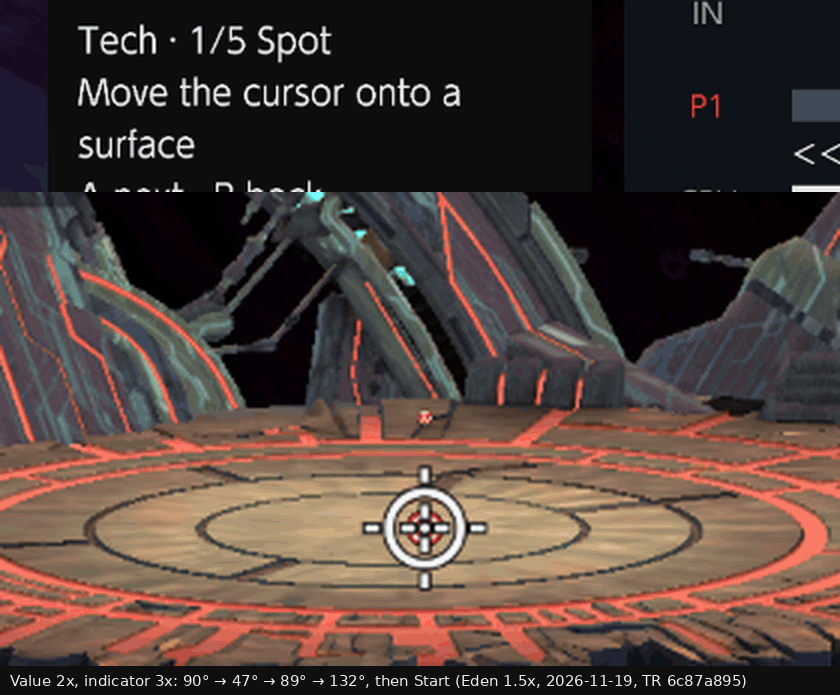
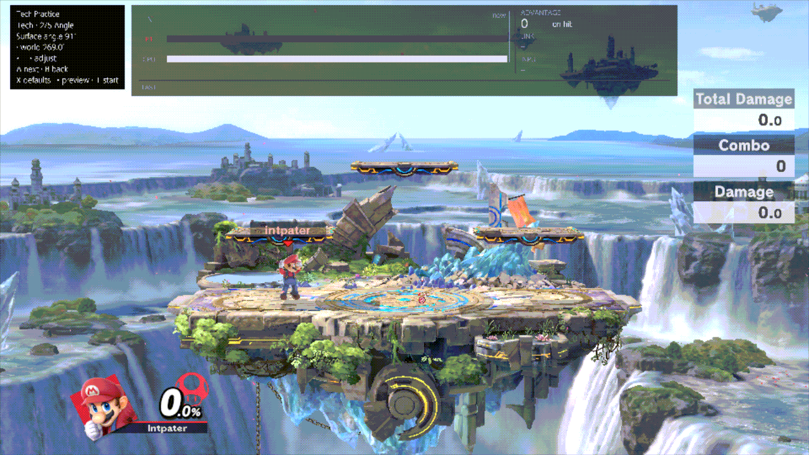
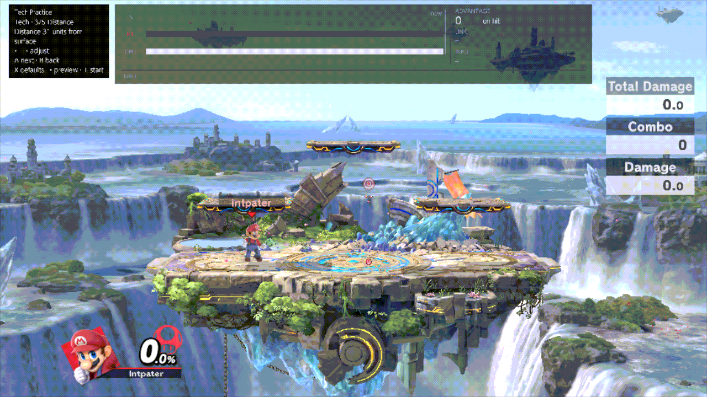

# Tech wizard

## NEW: the angle at 1080p (rc.15, 2026-11-19)

The take was captured at 1920×1080 from Eden on TR rc.15 (`6c87a895` release; the wizard code is unchanged in the final
`21ec1896`). It uses the rc.15 path **Fighters & Stages > Practice games > Tech practice > Tech wizard**:
- the spot on Final Destination's floor;
- the angle set to **90° → 47° → 89° → 132°**, each held about 1 s;
- Plus starts it, and Mario launches down-left along 132° (world 228°): "Missed · 1/20".

The full-screen GIF is 1280 wide, 9.7 s, with a full 256-colour palette:

Zoom: the value at 2x above the on-stage indicator at 3x (the marker dots lean left at 47° and right at 132°).

## Earlier clips (1280×720, recorded before the five-game menu)

Review page, not product docs. This is the Eden walkthrough on TR `41ce6dad` (gate-built DIAG `9171b0a0…`), XPS,
2026-11-18, and the reviewer inspected every frame.

It was recorded before the five-game menu landed. In rc.15 the wizard is under **Fighters & Stages > Practice games >
Tech practice > Tech wizard**; the wizard steps themselves are unchanged. The first clip has two brief (100–380 ms)
blank Tech Practice notices during transitions; this is cosmetic.

## 1. Open the wizard, move the cursor to a spot, set the angle (4.70 s)

## 2. A advances; set the distance (1.97 s)

## 3. Set speed and hit damage, then open Preview (3.10 s)

## 4. B goes back and keeps the edits (1.47 s)

## 5. X jumps to Preview with the defaults (1.48 s)

## 6. Plus starts it and the first attempt counts (3.24 s)

