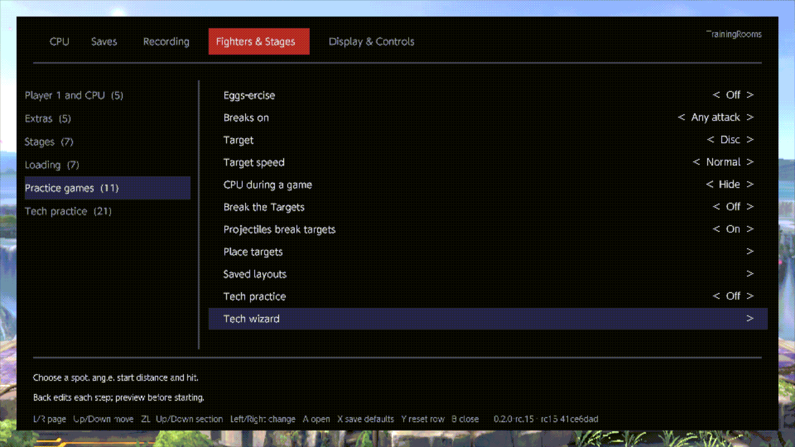
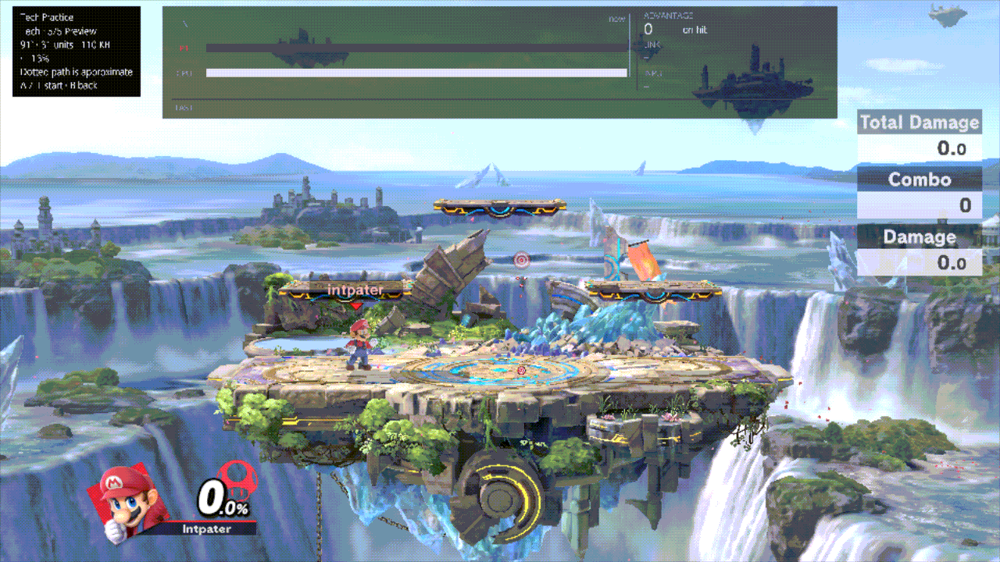
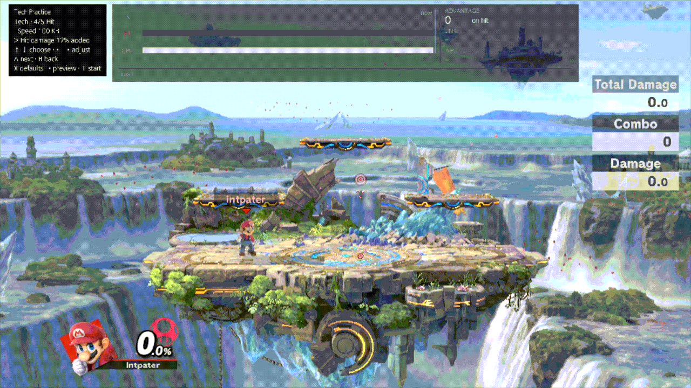

# Tech wizard (full size, 1280×720)

Review page, not product docs. This is the Eden walkthrough on TR `41ce6dad` (gate-built DIAG `9171b0a0…`), XPS,
2026-11-18, and the reviewer inspected every frame.

It was recorded before the five-game menu landed. In rc.15 the wizard is under **Fighters & Stages > Practice games >
Tech practice > Tech wizard**; the wizard steps themselves are unchanged. The first clip has two brief (100–380 ms)
blank Tech Practice notices during transitions; this is cosmetic.

## 1. Open the wizard, move the cursor to a spot, set the angle (4.70 s)

## 2. A advances; set the distance (1.97 s)

## 3. Set speed and hit damage, then open Preview (3.10 s)

## 4. B goes back and keeps the edits (1.47 s)

## 5. X jumps to Preview with the defaults (1.48 s)

## 6. Plus starts it and the first attempt counts (3.24 s)

