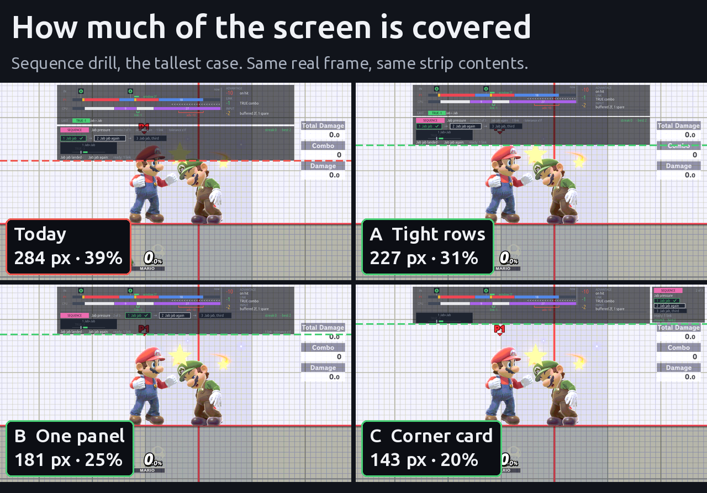
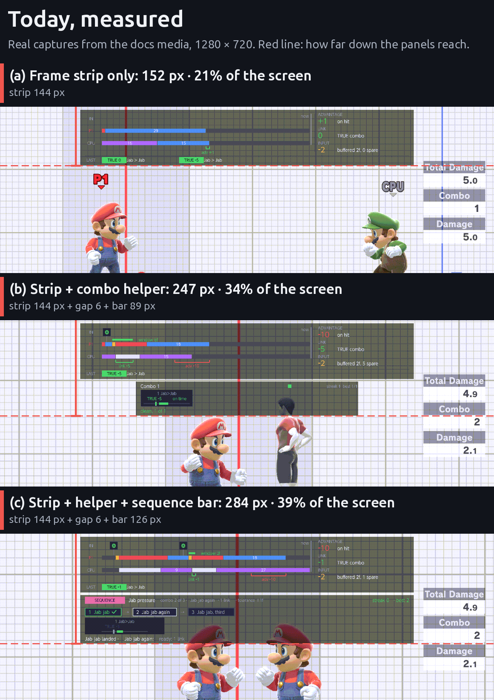
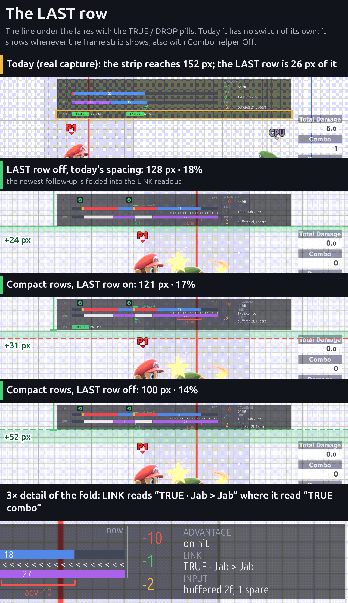
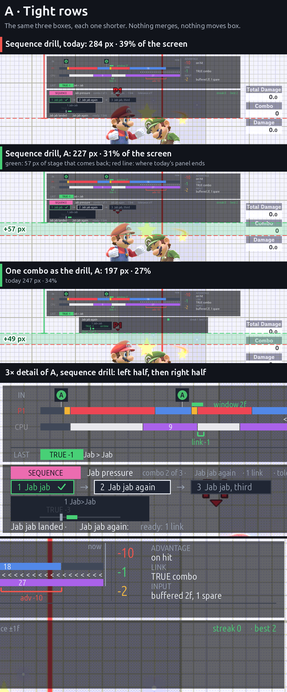
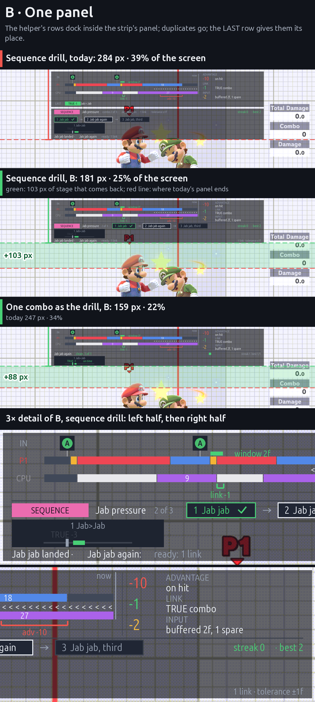
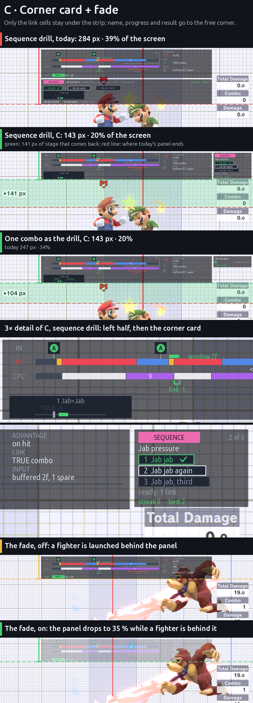

# Compact frame strip: options

2026-11-21. Design study: pictures and numbers only, no product code changed, nothing run in Eden.

**Asked:** keep the look of the frame strip, the combo helper and the sequence bar, and cover less of the screen so
the fighters are easier to see.

**Recommended: B, One panel, plus a switch for the LAST row.** A sequence drill goes from 39% of the screen to 25%,
one combo from 34% to 22%, the strip alone from 21% to 17% (14% with the LAST row off). Same colours, fonts, chips,
lanes and cells. No new panes.

## Today, measured

| On screen | Panels reach | Share of the screen |
| --- | --- | --- |
| (a) Frame strip only | 152 px | 21% |
| (b) Strip + combo helper | 247 px | 34% |
| (c) Strip + helper + sequence bar | 284 px | 39% |

- Measured on three real 1280 × 720 captures. The code gives the same: strip 144 px starting 8 px down, a gap of
  6 to 7 px, then an 88 px helper bar or a 125 px sequence bar.
- In a waiting room everything sits 64 px lower: 216 / 311 / 348 px, which is 30% / 43% / 48%. From the code
  (`LOBBY_DROP`), not measured on a capture.
- Where the height goes: the three readouts are stacked label over number, 37 px each, and that sets the strip's
  height; the LAST row is 25 px; the helper is a second box with its own gap, header and footer; the sequence bar
  writes the current combo's name three times (header, white chip, footer).

## The LAST row: the line you cannot turn off

The line under the lanes with the green TRUE and red DROP pills is the frame strip's own **LAST row** (the last four
follow-ups). It is not the combo helper, so Combo helper Off leaves it. Today only Input Display Off hides it, with
the whole strip. An empty LAST row still takes its space.

**Cost: 25 px, 3.5% of the screen** (code: 37.5 layout units; 26 rows counted on the capture).

| Option | What happens | Height back | What is lost |
| --- | --- | --- | --- |
| L1 Switch | A new row in Display & Controls, "Link history": On, Off | 24 px today, 21 px on the compact rows | Nothing: your choice |
| L2 Fold | The newest follow-up's moves go on the LINK readout ("TRUE · Jab > Jab"); the row goes for good | The same, always | The three older follow-ups |
| L3 On demand | The row hides while frames scroll and while it is empty; it shows when the strip freezes after an exchange | The same, during the action | Nothing, but the panel's bottom edge moves |

**Recommended: L1, with L2's fold while it is Off.** Default On, so nothing changes for people who use it. Pane cost:
none. The fold needs a longer text box for long move names (32 characters; today 24).

## A: Tight rows

The same three boxes in the same places, with the rows pulled closer together.

- **Kept:** everything, including the helper's own box, header and footer, and the sequence bar's header, row and footer.
- **Moved:** each readout's label (ADVANTAGE, LINK, INPUT) sits beside its number, above the words. Padding and row
  gaps shrink. Fonts, chips, lanes and cells keep their size.
- **Saved:** 31 / 49 / 57 px for (a) / (b) / (c). Reaches 121 / 197 / 227 px = 17% / 27% / 31%.
- **Panes:** none added or removed. Positions and a few heights change, so the layout archive is rebuilt.

## B: One panel (recommended)

The helper stops being a second box: its rows sit inside the strip's panel, each thing is written once, and the
sequence's header and its row of combos share one line.

- **Kept:** all of A's strip. The drill's name, the attempt squares, streak and best, the result and the reason. The
  link cells with title, verdict, grade and ruler. The SEQUENCE pill, the name, the combo chips with their colours,
  checks and arrows, the footer line, the link count and the tolerance.
- **Moved:** the helper's header and footer become one line above the cells, and the cells run the strip's width. For
  a sequence, the pill, name, "2 of 3", chips, streak and best share one line; the link count and tolerance go to the
  right end of the footer. While a drill is on, the LAST row gives its place to the link cells, which show the same
  verdict and moves (keeping it as well costs 21 px).
- **Written once now:** the current combo's name (today: header, white chip and footer; then: chip and footer).
- **Saved:** 31 / 88 / 103 px. Reaches 121 / 159 / 181 px = 17% / 22% / 25%.
- **Panes:** none added, about 3 fewer (estimate).
- **Needs a rule:** four long combo names do not fit on the one line (estimate from the code's width formula). The
  combos beside the current one would then show their number only.

## C: Corner card + fade

Only the link cells stay under the strip; the drill's name, progress and result move to a small card in the top-right
corner, and the whole panel fades while a fighter is behind it.

- **Kept:** the same information as B.
- **Moved:** name, progress, chips, result, streak and best go to a card 192 px wide above the game's damage panel:
  131 px tall for a sequence, 56 px for one combo. The chips are stacked, without arrows.
- **Saved under the strip:** 31 / 104 / 141 px. Reaches 121 / 143 / 143 px = 17% / 20% / 20%. The fade gives back the
  rest whenever a fighter is behind the panel.
- **Panes:** none added. The fade uses the container's opacity, as the menu's closing fade does, and the fighters'
  screen position, which the hitbox overlay already asks the game for.
- **Costs:** the eyes travel between the centre and the corner. The card shows 3 combos at a time, not 4 (a fourth
  would touch the damage panel). The corner is free in Training (measured on the captures); in a waiting room it is
  unchecked. Whether the strip's opacity carries to everything inside it is not proven.

## Numbers

| | (a) Strip only | (b) + combo helper | (c) + sequence bar |
| --- | --- | --- | --- |
| Today | 152 px · 21% | 247 px · 34% | 284 px · 39% |
| A | 121 px · 17% | 197 px · 27% | 227 px · 31% |
| **B** | **121 px · 17%** (100 px · 14% with LAST off) | **159 px · 22%** | **181 px · 25%** |
| C | as B | 143 px · 20% | 143 px · 20% |

Today's row is measured. A, B and C are the proposed row positions drawn by the renderer: design values, not
measured in the game.

## Recommendation

**B, with the LAST switch (L1).**

- It is the largest gain that still reads as the same strip, in one place. In the sample frame the fighters' heads
  and the P1 tag are clear of the panel; today the sequence bar covers them.
- It adds no panes and no layout setting. The fonts do not shrink in any option.
- A is the fallback if the helper should stay a separate box. C's fade is independent and can go on top of B later.

Two choices are yours; I took these defaults:

1. The LAST switch defaults to On (as today).
2. In B the LAST row hides while a drill is on. Keeping it costs 21 px.

## How the pictures were made

- `render_mockups.py` reads real frames from the docs media, measures today's panels on them, and draws today's
  layout and the options from the plugin's own layout constants and colours. `check-renderer.png` puts its redraw of
  today next to the real capture.
- Every picture uses one sample state, copied from the real capture `rc13-sequence-bar.png`.
- The game's font is approximated (widths within about 2% of the capture). The media are 256-colour captures.
- Layout limits found in the code: the panes are a fixed table built into the layout archive (197 for the strip, 81
  for the helper); at run time a pane can move, resize, recolour, hide, fade and change text, but its font size is
  fixed; a text holds 24 characters. I found no hard cap on the number of panes.
- The guide's pictures of the strip would need new captures after any of these.

## Files

All in `/home/intpa/smash-training-lobby/artifacts/phase23/compact-strip/`:

- `DESIGN.md`: this page.
- `overview.png`, `today.png`, `last-row.png`, `A-tight.png`, `B-one-panel.png`, `C-corner-fade.png`,
  `check-renderer.png`: the pictures.
- `render_mockups.py`: the renderer. Run `/usr/bin/python3 -I render_mockups.py`; it prints the numbers above.
- `base/`: the five real frames it uses, cached from
  `/home/intpa/tr-fixes-20261113/integration/docs/media/`.
