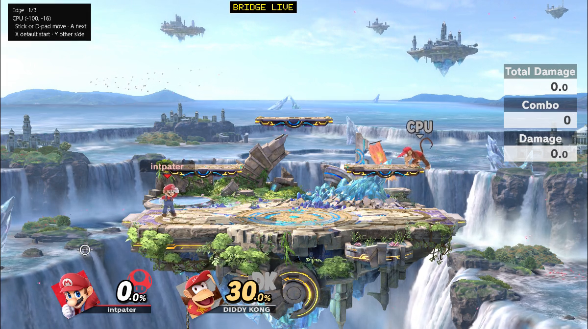
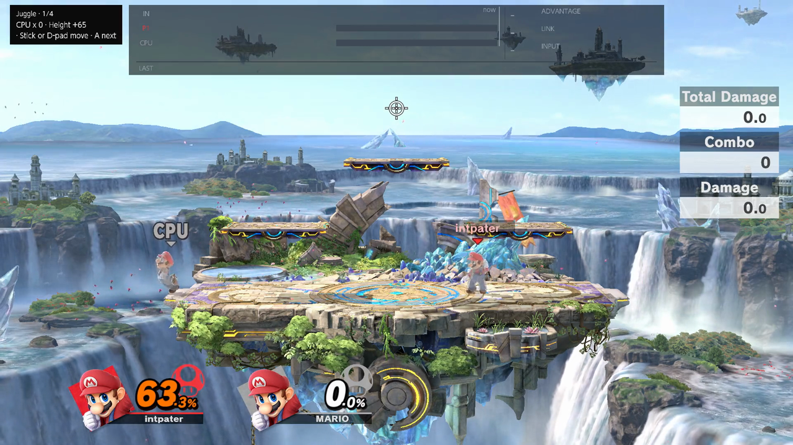

# Guard the Edge and Juggler: pick the start points with a crosshair

Guard the Edge and Juggler now let you pick where the CPU and you start by moving a crosshair on the stage, the same
crosshair Break the Targets uses.

Recorded in Eden on Battlefield, in Training (untested on hardware). Click a picture to play its clip (60 fps, no
sound).

- **Guard the Edge clip:** build `17060a5e`, 2026-11-23, 1200 × 674. The yellow "BRIDGE LIVE" badge at the top belongs
  to the test set-up, not to the build.
- **Juggler clip:** the earlier build `df625a12`, 2026-11-22, 1080p. It shows the input display across the top during
  set-up; the current build hides it while you set up.

## For the README

**Guard the Edge and Juggler: Set up…** Open the menu, go to Fighters & Stages > Practice games, pick Guard the Edge
or Juggler, then **Set up…**. Move the crosshair with the stick, or one step at a time with the D-pad, and press **A**
to go to the next page. The last page shows what you picked; **A** or **+** starts the drill there. **Start** uses the
same points again until you change them.

| Button | What it does |
| --- | --- |
| Stick | Moves the crosshair freely |
| D-pad | Moves the crosshair one step a press |
| A | Next page; on the last page, start |
| B | Back one page; on the first page, back to the menu |
| X | Back to the default start |
| Y | Guard the Edge, CPU page: the default start on the other side of the stage |
| + | On the last page, start |

## Guard the Edge: Set up…

Three pages. The text at the top left names the page and the point under the crosshair.

1. **CPU start.** Where the CPU begins its recovery. It must be off the stage: over or under the stage, **A** is
   refused and you read "Pick a point off the stage". **X** puts the crosshair back on this side's default start and
   **Y** on the other side's. When the crosshair is outside the picture, a small pointer at the edge of the screen
   shows where it is.
2. **Player 1 start.** Where you stand, on the stage's main floor. The CPU's point stays marked while you choose.
3. **Preview.** Both points and the CPU's percent. **A** or **+** starts.

In the clip: the menu, Set up…, the crosshair moved with the D-pad and the stick, a point over the stage refused
("Pick a point off the stage"), then the CPU's point and Player 1's point confirmed, and the drill starting with the
CPU off stage and Player 1 on the picked spot.

## Juggler: Set up…

Four pages.

1. **CPU spot.** Where the CPU is dropped from: how far left or right, and how high above the floor.
2. **Percent.** The CPU's damage. D-pad Left and Right change it by 1, Up and Down by 10.
3. **Player 1 start.** Where you stand: on the floor or on a platform. Under a platform, move the crosshair down to
   pick the floor below it. A spot with no floor under it is refused: "Pick a point above a floor".
4. **Preview.** The CPU's spot, its percent and your spot. **A** or **+** starts.

In the clip: the menu, Set up…, the CPU spot moved, the percent raised, Player 1 put under the left platform, and the
drill starting with the CPU falling from the picked height.

## Not recorded yet

- Juggler's "Pick a point above a floor" refusal is not in its clip, which is from the earlier build.
- Both drills also run in a waiting room, against the first training partner. That clip waits for the waiting-room
  test run.
