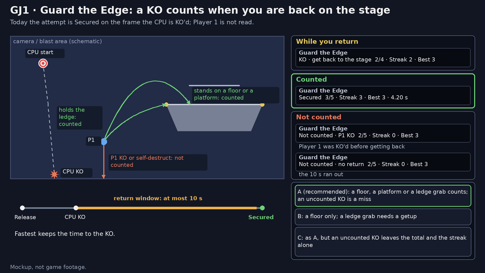
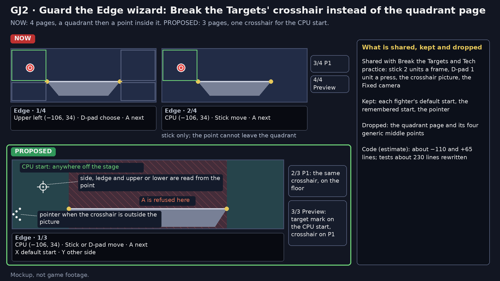
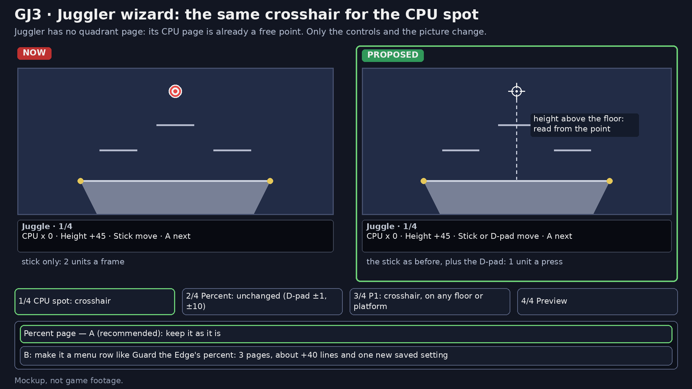
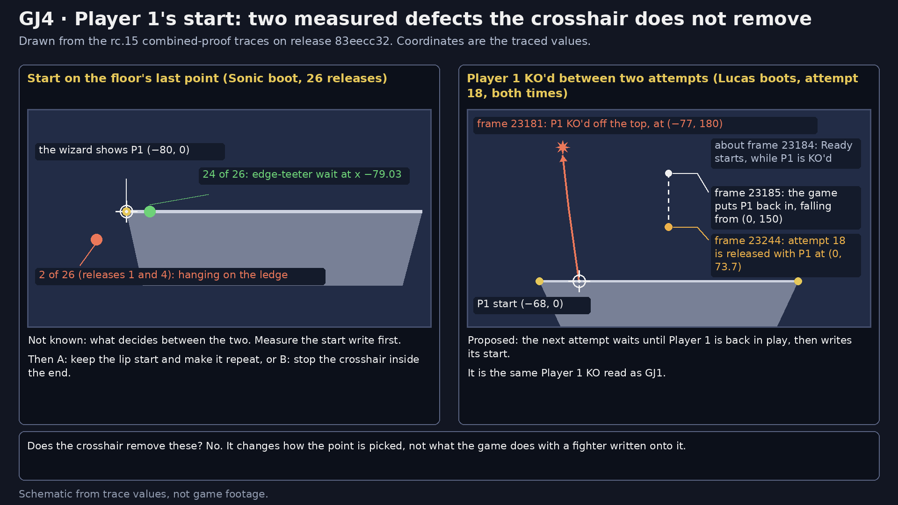

# Guard the Edge and Juggler: the return rule, the crosshair, Player 1's start (for the operator's answer)

Mockups, not Eden stills (2026-11-22, edge-juggle-sol, source `7d962416`; branch `design/gte-juggler-crosshair`, commit `52997fd2`).
Four decisions, one picture each; the recommended option has a green outline. Nothing here is implemented, and no Eden measurement was made for this page.

Kept in all four: every fighter's default start, the remembered start, the larger mark and the pointer, Player 1's start page, the Preview page.
Line counts are estimates. The full entry, with the source lines, is the PENDING OPERATOR section of `docs/DECISIONS.md` on that branch.

## GJ1: a KO counts only once you are back on the stage (recommended: A)

Your words: "I want to add the requirement that the p1 returns to the stage successfully after a successful edgeguard for it to count."

- **Back on the stage** means standing on a floor or a platform, or holding a ledge. It is the test the drill already uses for the CPU's own recovery. If you are on the stage when the KO happens, it counts at once, as today.
- **Limit:** 10 seconds after the KO.
- **You are KO'd, or the limit runs out:** the attempt is a miss. It is added to the total, the streak goes to 0, and no time is recorded. The card says `Not counted · P1 KO` or `Not counted · no return`.
- **Fastest** stays the time to the KO.
- **Read from the game:** your situation (ground, ledge) and your KO statuses. No new hook.
- Options: **B** a floor only, so a ledge grab needs a getup; **C** as A, but an uncounted KO leaves the total and the streak alone.

About +60 to +80 lines. Unproven on a running game: which statuses Player 1 goes through at a KO in Training, and what the respawned CPU does while you are still returning.

## GJ2: Guard the Edge uses Break the Targets' crosshair (recommended: yes)

One crosshair page replaces the quadrant page and the CPU page, so the wizard has 3 pages in place of 4.

- **Shared code:** Break the Targets' controls (stick 2 units a frame, D-pad 1 unit a press), its crosshair picture and the Fixed camera. Tech practice already uses the same controls.
- **Read from the point:** the side and its ledge, and upper or lower (only the best times use that). The recovery routes already read the point itself.
- **Where a start is allowed:** anywhere off the stage, 1 unit outside the ledge and inside the blast line. Over or under the stage, A is refused.
- **Defaults:** the crosshair opens on the fighter's default start. X returns to it; Y jumps to the other side's default.
- **Larger mark, pointer, remembered start:** all kept. The pointer follows the crosshair, which must be able to leave the picture because some default starts are outside it.
- **Player 1's point:** the same crosshair, on the floor.

About −110 and +65 lines, with about 230 lines of tests rewritten. It is simpler to use; the code saving is small, because the quadrant page is only about 55 lines.
Risks: every Eden route and reader of the wizard's pages changes; the four one-press quadrant middles are gone. Unproven: the crosshair outside the picture.

## GJ3: Juggler uses the same crosshair for the CPU spot (recommended: yes; keep the Percent page)

Juggler has no quadrant page: its CPU page is already a free point. It gets the crosshair picture and the D-pad's 1-unit step; the height above the floor is still read from the point. About −5 and +10 lines.

Percent page: **A** keep it as it is (recommended); **B** make it a menu row like Guard the Edge's percent, which gives 3 pages for about +40 lines and one new saved setting.

## GJ4: Player 1's start, two measured defects (recommended: measure first)

The crosshair removes neither: it changes how the point is picked, not what the game does with a fighter written onto it.

- **A start on the floor's last point** (Sonic, 26 releases): the wizard shows P1 (−80, 0), but 24 releases begin in the edge-teeter wait at −79.03 and 2 (releases 1 and 4) begin hanging on the ledge. What decides between the two is not known. After a measurement of the start write: **A** keep that start and make it repeat (recommended), or **B** stop the crosshair 1 unit inside the end.
- **Player 1 above the stage centre at attempt 18** (Lucas, both boots): a new reading of the traces shows Player 1 was KO'd off the top after attempt 17, and the game put it back in, falling from (0, 150), just as the next attempt started. Proposed: the next attempt waits until Player 1 is back in play, then writes its start. GJ1 needs the same KO read.

Unproven: the start write itself is not in the traces, nor which hit KO'd Player 1.

