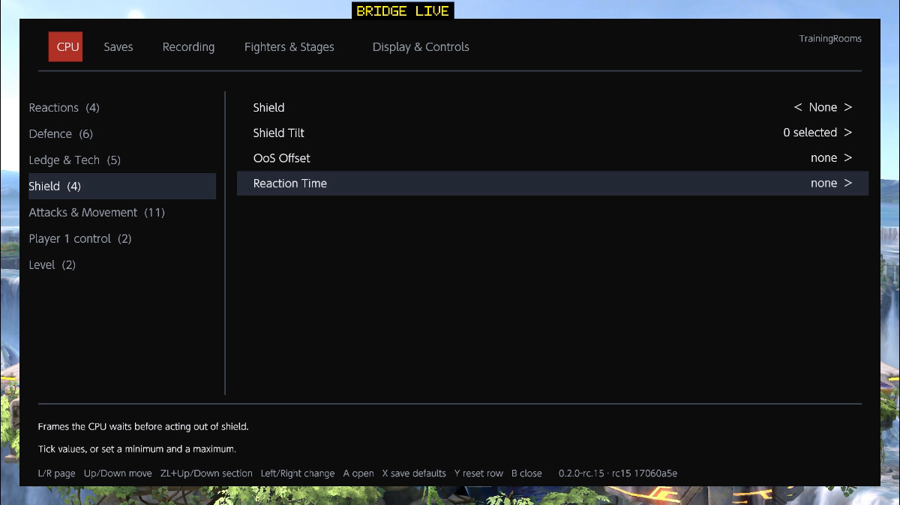
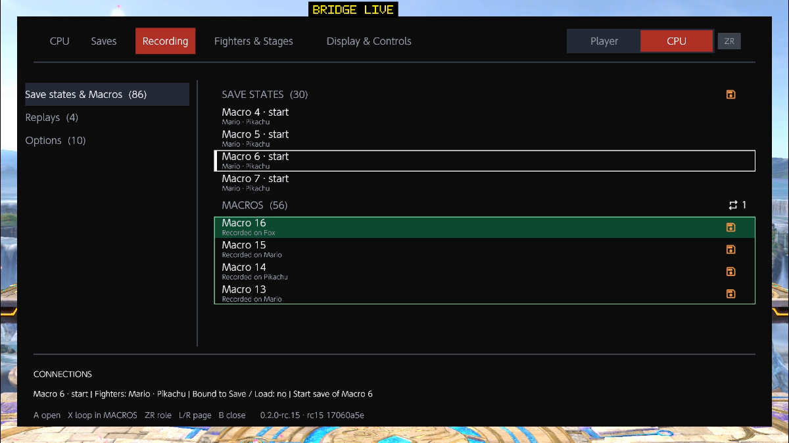
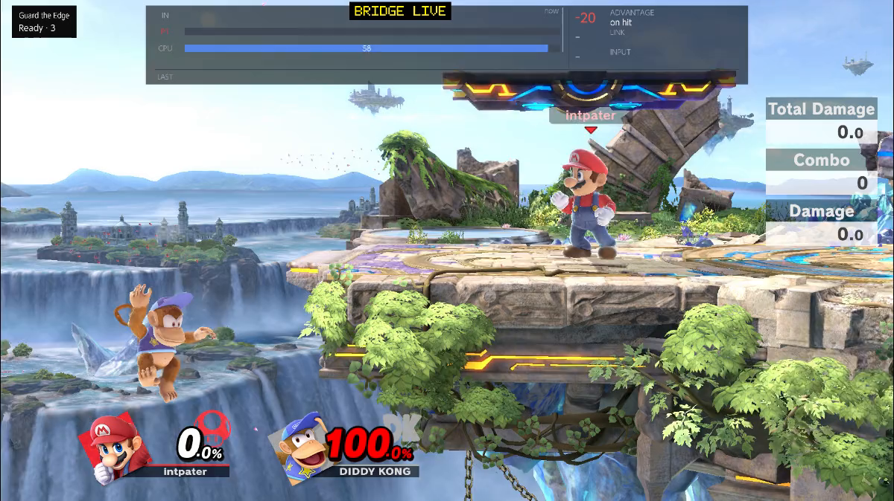

# Menu lists scroll faster, and drills start without the pause screen

Three small changes to the menu and to starting a practice game.

Recorded in Eden on build `17060a5e`, 2026-11-23, Battlefield, in Training (untested on hardware). Click a picture to
play its clip (1200 × 674, 60 fps, no sound). The yellow "BRIDGE LIVE" badge at the top of the picture belongs to the
test set-up, not to the build.

## Hold a direction to scroll a list

Hold Up or Down in any menu list and the cursor keeps moving, faster the longer you hold.

| Button | What it does |
| --- | --- |
| D-pad or stick Up / Down, held | Moves the cursor again and again; quicker after one second, quicker still after two |
| D-pad Left / Right, held | Unchanged: one change, as before |
| ZL + Up / Down, held | Jumps a section at a time, at a steady pace |

A direction you are still holding from the buttons that opened the menu does nothing until you let go of it.

In the clip: the CPU page, Down held for two seconds, then Up held for one.

## Recording lists: ZL + Down jumps a page

On the Recording page's lists, ZL + Down moves the cursor down 12 entries at a time, and from the last entry it goes
on to the next list.

| Button | What it does |
| --- | --- |
| ZL + Down | Down 12 entries; on the last entry, on to the next list |
| ZL + Up | The same, upwards |

In the clip: a Save States list of 30 entries. The cursor goes from the first entry to the 13th, the 25th and the
last, then to the first macro in the list below.

## Starting a practice game no longer flashes the pause screen

Starting or stopping Guard the Edge or Juggler no longer shows the game's pause screen for a moment.

Nothing to press differently: **Start** and **Stop** in the practice game's menu, as before.

In the clip: Guard the Edge > Start with the game's CPU Behavior set to Jump. The menu closes and the drill starts with
no pause screen in between. The start and the stop were each checked frame by frame.

One case still shows it: with the game's CPU Behavior set to Control, the pause screen appears once.

## Not recorded yet

These three are recorded in Training only. A waiting-room clip waits for the waiting-room test run.
