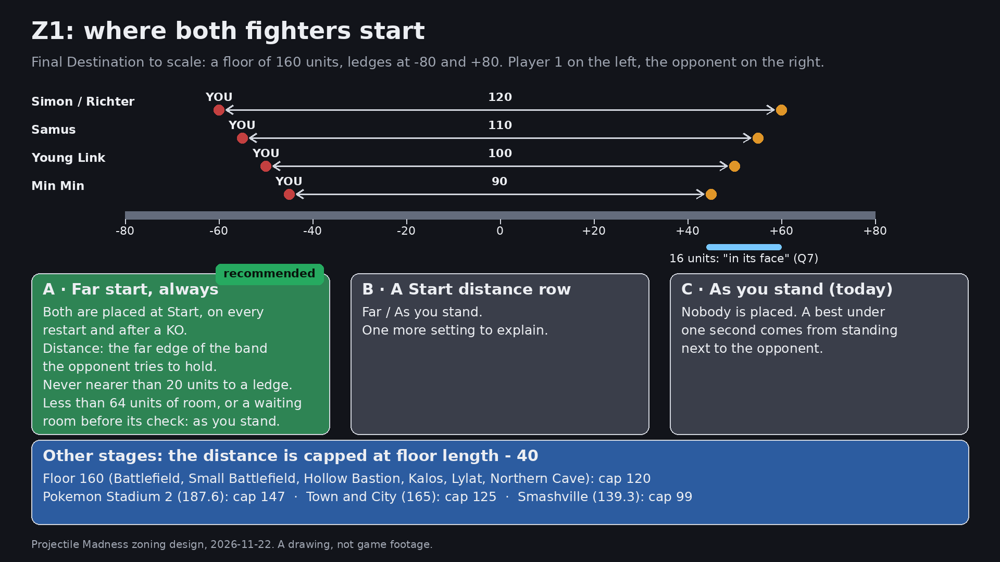
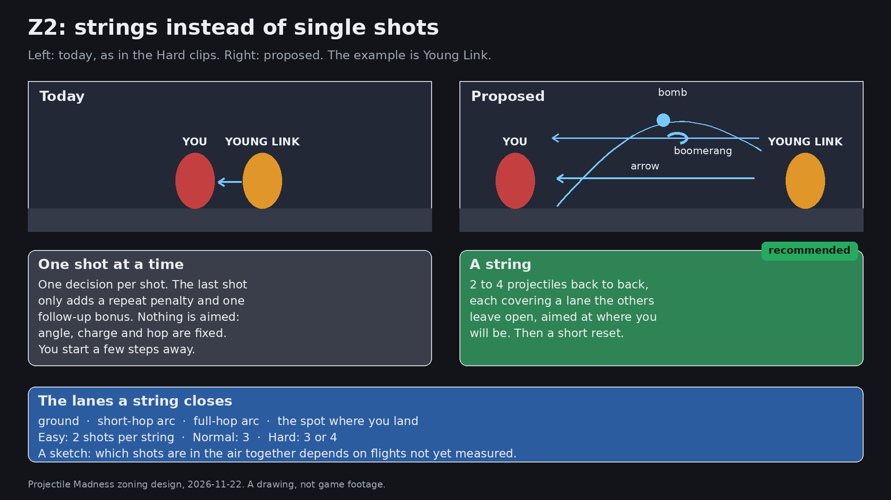
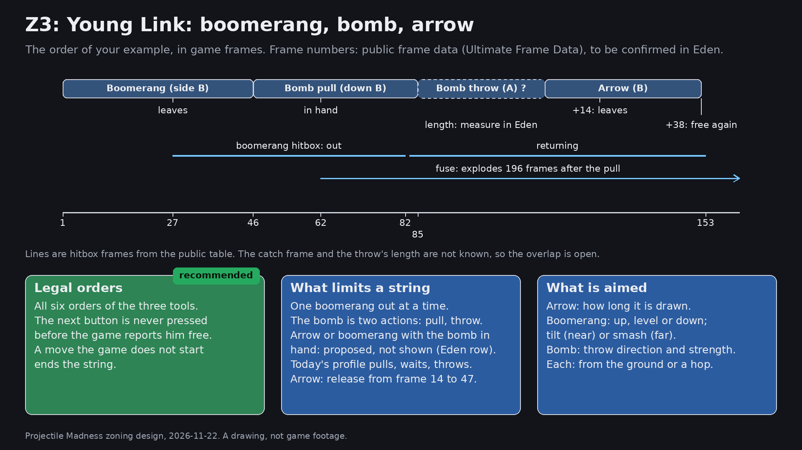
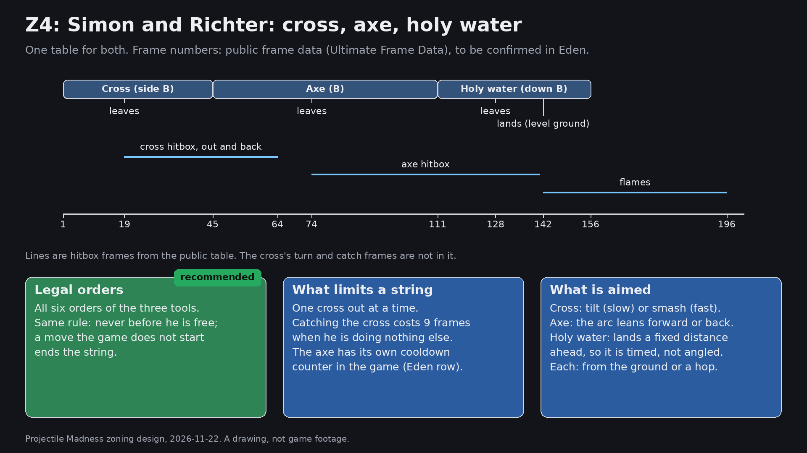
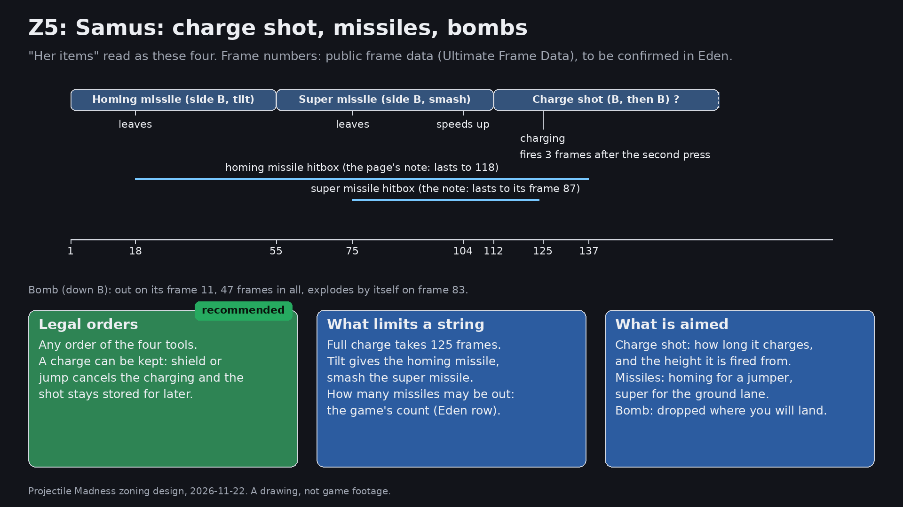
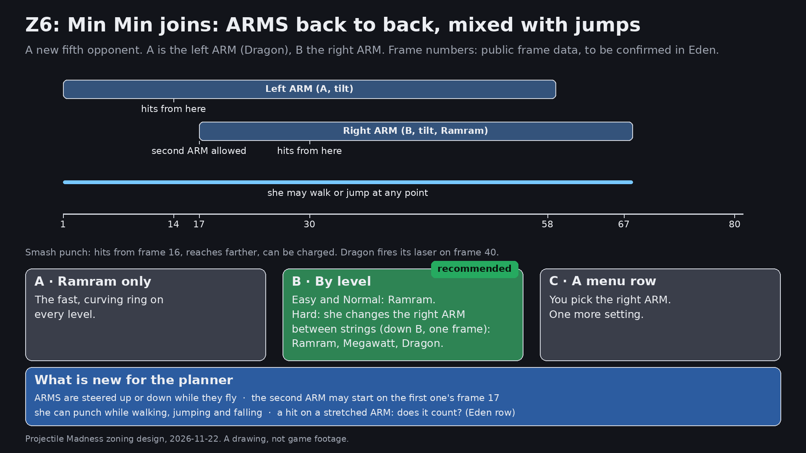
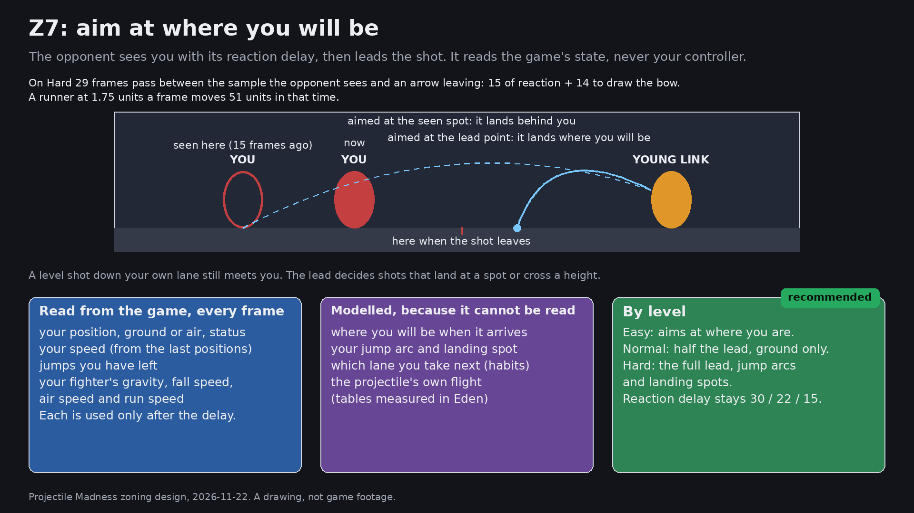
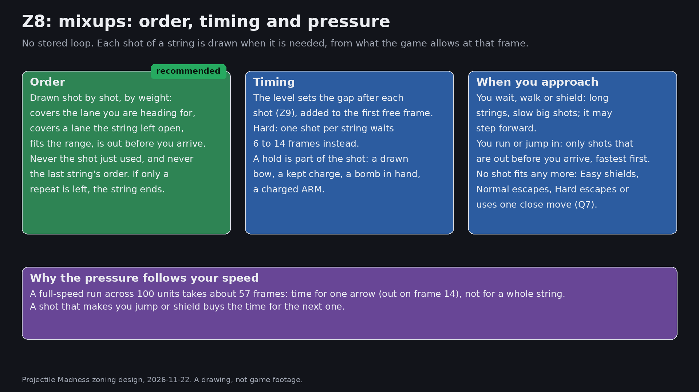
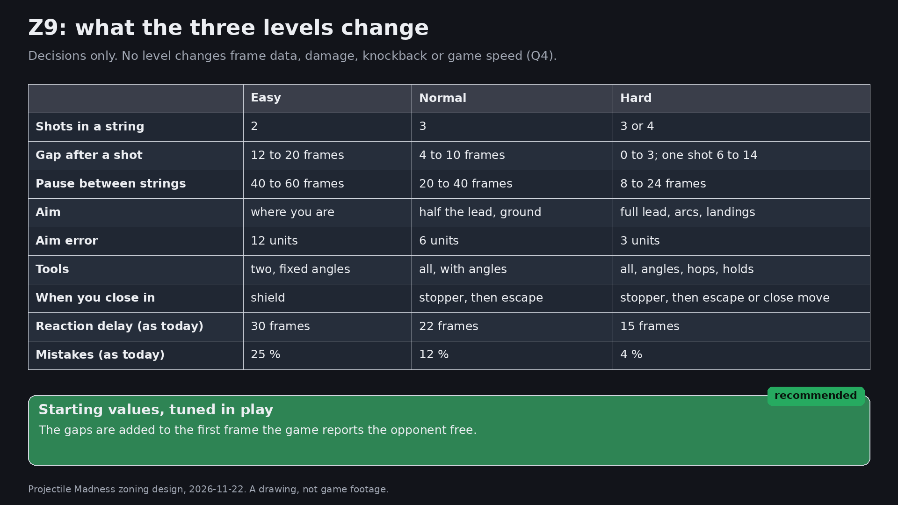
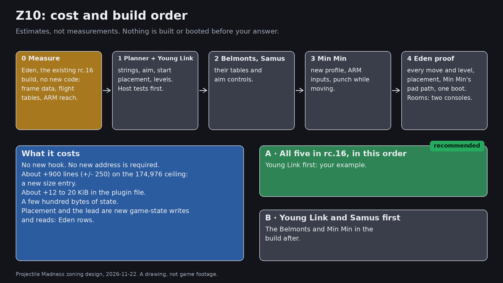

# Projectile Madness zoning design (rc.16) for the operator

Copied from rc16/projectile-madness 8ed8db26 docs/DECISIONS.md (review PASS 15:54:52Z with caption qualifications: the Z7 arcs are illustrative lobs, not measured impacts; Z1 keeps the unknown-main-floor fallback). The pictures are renderings, not game footage.

## rc.16 Projectile Madness zoning (2026-11-22): pending operator

**PENDING OPERATOR.** Nothing below is built. No product code changes and no Eden boot happen before the operator
answers. Branch `rc16/projectile-madness`, not rebased for this.

The operator's direction of 2026-11-22 (about 14:55Z, relayed by tr-primary-2), after the Hard clips of
`docs/review/projectile-madness.md` on the review branch: more zoning. Player 1 starts further away. The opponent throws
a string of its projectiles (Young Link: boomerang, then bomb and arrow), aimed at where Player 1 will be, to keep
Player 1 out, and it mixes up the order. The same goes for Richter with his items and Samus with hers. Min Min uses her
ARMS mostly back to back and mixes in jumps. Reference videos were offered; none had arrived when this was written.

Answer by number. Each item says what is decided, the options and a recommendation; the recommended option is the green
box in its picture. The pictures are drawn by `tools/render_decisions_pm_zoning.py` and are not game footage. The
evidence, the frame tables, the game's own names and the cost are in the
design note (docs/design/rc16-projectile-madness-zoning.md on the local rc16 branch). **Every frame number is public frame data (Ultimate Frame Data)
until an Eden pass confirms it on the exact build, and no projectile's flight has been measured.**

| # | Question for the operator | Recommendation |
| --- | --- | --- |
| Z1 | Where do both fighters start? | **A:** placed far apart at every Start, restart and KO: Simon and Richter 120 units, Samus 110, Young Link 100, Min Min 90, capped by the floor. Nobody is placed when less than 64 units fit, or in a waiting room before its two-console check |
| Z2 | Strings instead of single shots? | **Yes:** 2 to 4 projectiles back to back, each closing a lane the others leave open, then a short reset |
| Z3 | Young Link's string | Boomerang, bomb and arrow in any of the six orders. Holding the bomb while the others are thrown is proposed and not shown yet |
| Z4 | Simon's and Richter's string | Cross, axe and holy water in any order; one table for both |
| Z5 | Samus's string, and what "her items" are | Charge shot, homing missile, super missile and bomb, in any order; a charge can be kept for later |
| Z6 | Min Min joins; which right ARM? | **B:** Ramram on Easy and Normal; on Hard she changes the right ARM between strings |
| Z7 | How far ahead may it aim? | The full lead on Hard, half on Normal, none on Easy; the reaction delay stays 30 / 22 / 15 frames and it never reads the controller |
| Z8 | How are order and timing mixed, and what happens as Player 1 closes in? | Drawn shot by shot; never the shot just used or the last string's order, and a string ends rather than repeat. The gap comes from the level (Z9). The pressure follows Player 1's speed, and each level keeps its close rule from Q7 |
| Z9 | What do the three levels change? | The table below: string length, gaps, lead, aim error and tools |
| Z10 | Scope, cost and order | **A:** all five opponents in rc.16, Young Link first, after a measurement pass in Eden on the existing rc.16 build; placement and Min Min are proven on the new build; about +900 lines |

### Z1 · Start distance

Today the game places nobody: an attempt starts from where both fighters stand, a few steps apart in the clips, and a
best under one second comes from standing next to the opponent.
**Recommendation: A, a far start, always.** Both fighters are placed at Start, on every L+R+A and after a KO, during
the countdown that already holds Player 1.

- **How far:** the far edge of the band the opponent tries to hold. Simon and Richter 120 units, Samus 110, Young Link
  100, Min Min 90. For scale, 16 units is "in its face" (Q7), and a full-speed run crosses 100 units in about a second.
- **Where:** on the stage's main floor, the pair centred, each fighter on the side it was on, facing each other, never
  nearer than 20 units to a ledge.
- **Per stage:** the distance is capped at the floor's length minus 40. A 160-unit floor (Final Destination,
  Battlefield, Small Battlefield, Hollow Bastion, Kalos, Lylat, Northern Cave) allows 120; Town and City 125; Pokémon
  Stadium 2 147; Smashville 99. Other stages are read at Start.
- **When nobody is placed (part of A):** the attempt starts as today when the cap is under 64 units (a floor shorter
  than 104), when the main floor cannot be established, and in a waiting room until the two-console check has passed
  on the build that places.
- **B, a Start distance row** (Far / As you stand) is one more setting to explain. **C** keeps today.
- **Cost:** placing is new for this game (the build wrote only the pad). The distances are starting values: Min Min's
  waits for her reach.
- **Not established:** which floor is the main floor. The floor reader the plugin has returns floor pieces, includes
  platforms and can stop early, so "the longest piece" is not enough. The rule is checked per stage in Eden first.

### Z2 · Strings instead of single shots

Today each shot is one decision, taken when the opponent is free again. The earlier shots only add a penalty for a
repeat and a bonus for one suggested follow-up, and nothing is aimed: the angle, the charge and the hop are fixed per
move. At range it already throws shot after shot. On the older build `3dd234a4`, the sampled stills of an Easy Young
Link take show repeated arrows and boomerangs from across the stage, with Mario at 75.6 % and Young Link at 0 % in the
last still. That capture is history, not evidence for this design.
**Recommendation: strings.** A string is 2 to 4 projectiles thrown back to back, each chosen to close a lane the others
leave open (the ground, the short-hop arc, the full-hop arc, the landing spot) and aimed at where Player 1 will be. Then
comes a short reset: a step back, a hop back or a pause. Easy throws 2 per string, Normal 3, Hard 3 or 4. What is new
is that the shots of a string are chosen for the coverage they give together against the predicted approach.

- **The game decides what is legal.** A button is never pressed before the first frame the game reports the opponent
  free; the level's gap is added to that frame (Z9). "Free" is the game's general signal, not a promise for one move:
  a move counts only when its own status appears, and a move the game does not start ends the string. A move whose
  projectile is still out is not chosen.
- **No string is stored.** Each shot is drawn when it is needed (Z8).
- **The picture is a sketch.** Which shots are in the air together depends on flights that are not measured yet.

### Z3 · Young Link: boomerang, bomb, arrow

**Recommendation: all six orders of the three tools.**

| Tool | Input | Out on frame | Free again on frame | Limit |
| --- | --- | --- | --- | --- |
| Boomerang | side B | 27 | 46 | one out at a time; its hitbox is out on frames 27 to 82 and returning on 83 to 153 |
| Bomb | down B pulls, A throws | in hand on 17 | 40 after the pull | two actions; it explodes 196 frames after the pull |
| Fire arrow | hold B, release | 14 with no charge, up to 47 | 38 with no charge | none |

- **Proposed, not shown: the bomb waits in his hand** while the boomerang or the arrow is thrown. Today's profile
  pulls, waits and throws, and never throws a special with the bomb in hand. If the game refuses it, the bomb is thrown
  before the next special and the six orders still hold.
- **What is aimed:** how long the arrow is drawn; the boomerang's angle (up, level, down) and strength; the bomb's throw
  direction and strength; and whether each leaves from the ground or a hop.
- **Not known:** how long the bomb throw takes and when the boomerang is caught. Neither is in the public table, so
  how many projectiles are in the air together is open.

### Z4 · Simon and Richter: cross, axe, holy water

**Recommendation: all six orders, one table for both** (Richter reuses Simon's, as Q3 decided).

| Tool | Input | Out on frame | Free again on frame | Limit |
| --- | --- | --- | --- | --- |
| Cross | side B, tilt or smash | 19 | 45 | one out at a time; its hitbox is listed on frames 19 to 64, out and back; catching it costs 9 frames when he is idle |
| Axe | B | 30; its hitbox is listed to 97 | 67 | its own cooldown counter in the game, length not known |
| Holy water | down B | 18; from a standing throw it lands on 32 on level ground | 46 | the flames burn for 55 frames |

- **What is aimed:** the cross's speed (tilt slow, smash fast); the lean of the axe's arc; the holy water lands a fixed
  distance ahead, so it is timed, not angled; each from the ground or a hop.
- **Not known:** when the cross turns and when it is caught; where the holy water lands from a hop.
- A full string of the three takes about 155 frames; on level ground the flames last to about frame 196.

### Z5 · Samus: charge shot, missiles, bombs

"Her items" is read as four tools: the charge shot, the homing missile, the super missile and the bomb.
**Recommendation: any order of the four, and a charge may be kept.** Shield or jump cancels the charging and the shot
stays stored, so a full charge can end a later string.

| Tool | Input | Out on frame | Free again on frame | Limit |
| --- | --- | --- | --- | --- |
| Charge shot | B, then B | 3 frames after the second press; charging starts after 13 | about 45 after firing | a full charge takes 125 frames |
| Homing missile | side B, tilt | 18 | 55 | its hitbox is listed to frame 137; the page's note says it lasts to 118 |
| Super missile | side B, smash | 21; it speeds up near 50 | 58 | its hitbox is listed to frame 70; the note says it lasts to 87 |
| Bomb | down B | 11 | 48 | it explodes by itself on frame 83 |

- **What is aimed:** how long the shot charges and the height it is fired from; the homing missile for a jumper and the
  super missile for the ground; the bomb where Player 1 will land.
- **Not known:** how many missiles the game allows out at once.

### Z6 · Min Min joins: ARMS back to back, mixed with jumps

Min Min becomes the fifth opponent. A is her left ARM (always Dragon) and B her right ARM.

- **Back to back:** a punch hits from frame 14, and the second ARM may start on the first one's frame 17, so both are
  out together. A short punch takes 51 to 67 frames in all, a long (smash) punch 57 to 75.
- **Mixed with jumps:** she can walk and jump at any point while an ARM is out, and punch while jumping and falling.
- **Aim:** an ARM is steered up or down while it flies. A long punch reaches farther and can be charged.
- **The right ARM**, changed with down B in one frame: Ramram (fast, a curving ring), Megawatt (slow, heavy), Dragon.
  **A:** Ramram only. **Recommendation: B,** Ramram on Easy and Normal, and on Hard she changes it between strings.
  **C:** a menu row.
- **To know:** her ARMS are limbs, not thrown objects. Whether a hit on a stretched ARM damages her, and so stops the
  clock under Q1, is not known yet.
- **Cost:** a new profile, the A button and ARM steering in the planner, and the waiting notice's text.

### Z7 · Aim at where Player 1 will be

**Recommendation: lead the shot, by level, and keep the rule that makes it fair.**

- **Read from the game, every frame:** Player 1's position, ground or air, status, speed (from the last positions),
  jumps left and fast fall, and the fighter's own gravity, fall speed, air speed and run speed. Each read uses a call
  the plugin already makes for another feature (Guard the Edge reads the same physics). Projectile Madness's own
  admission list has to grow to include them. The names are confirmed in the stock files; the values and the jump
  formula are not validated.
- **Modelled, because the game cannot tell:** where Player 1 will be when the shot arrives, the jump arc and landing
  spot, which lane Player 1 takes next (the habit table of today), and the projectile's own flight (tables measured in
  Eden).
- **Fair:** the opponent still sees Player 1 with its reaction delay (30, 22 or 15 frames) and never reads the
  controller. Every fact about Player 1 is used only from the sample that old: position, speed, status, jumps left and
  fast fall alike. It leads from what was visible. Changing course after the shot has left beats it.
- **Why it is needed:** on Hard, 29 frames pass between the sample the opponent sees and an arrow leaving the bow (15
  of reaction, 14 to draw). A runner at 1.75 units a frame moves 51 units in that time. A level shot down Player 1's
  own lane still meets Player 1. The lead decides the shots that land at a spot or cross a height: a thrown bomb, the
  axe, the holy water's timing, an angled boomerang, any shot at a jumper. How much it changes each one depends on
  flights that are not measured yet.
- **By level:** Easy aims at where Player 1 is; Normal leads ground movement by half; Hard leads fully, with jump arcs
  and landing spots.

### Z8 · Mixups: order, timing and pressure

**Recommendation: no stored loop.**

- **Order:** each shot is a weighted draw among what the game allows at that frame. It weighs the lane Player 1 is
  heading for, a lane the string has left open, the range, and whether the shot is out before Player 1 arrives. The
  shot just used is never drawn, and neither is a shot that would complete the last string's order. If only such a
  repeat is left, the string ends there and the pause follows: it never repeats and never waits for a tool to return.
- **Timing has one source, the level (Z9).** The gap after each shot is drawn from the level's range and added to the
  first free frame. On Hard, one shot per string, at a random place, waits 6 to 14 frames instead of 0 to 3. A hold is
  part of the shot, not a gap: a drawn bow, a kept charge, a bomb in hand, a charged ARM.
- **Pressure follows Player 1's speed.** While Player 1 waits, walks or shields, the strings are long and the shots
  slow and large, and the opponent may step forward. When Player 1 runs or jumps in, only shots that are out before the
  arrival are thrown, the fastest first; the last one that fits is the stopper. When no shot fits any more, the level's
  close rule from Q7 applies: Easy shields, Normal escapes, Hard escapes or uses one close move.

### Z9 · What the three levels change

**Recommendation: the table.** Decisions only: no level changes frame data, damage, knockback or game speed (Q4). The
values are starting points, to be tuned in play.

| | Easy | Normal | Hard |
| --- | --- | --- | --- |
| Shots in a string | 2 | 3 | 3 or 4 |
| Gap after a shot, added to the first free frame | 12 to 20 frames | 4 to 10 | 0 to 3; one shot per string 6 to 14 |
| Pause between strings | 40 to 60 frames | 20 to 40 | 8 to 24 |
| Aim | where Player 1 is | half the lead, ground only | the full lead, arcs and landings |
| Aim error | 12 units | 6 | 3 |
| Tools | two, fixed angles | all, with angles | all, with angles, hops and holds |
| When Player 1 closes in | shield | a stopper, then escape | a stopper, then escape or a close move |
| Reaction delay (as today) | 30 frames | 22 | 15 |
| Mistakes (as today) | 25 % | 12 % | 4 % |

### Z10 · Cost and build order

**Recommendation: A, all five opponents in rc.16, in this order.** **B:** Young Link and Samus first, the Belmonts and
Min Min in the build after.

0. **Measure** in Eden on the existing rc.16 build, with no new code: frame data, each projectile's flight, the floors,
   and Min Min's stock timing and reach with Player 1 playing her. This needs the operator's approval to boot. That
   build has no placement and no Min Min profile, so it proves neither.
1. **The planner and Young Link**, the operator's example: strings, aim, start placement, levels. Host tests first.
2. **The Belmonts and Samus.**
3. **Min Min.**
4. **Eden proof on the new build:** every move and level, the placement and Min Min's pad path in one boot, and the
   two-console check for placement in rooms.

- **Hooks:** none new, and no new address is required. The reads and the placement use calls other features already
  have under their own guards. Projectile Madness is admitted today on a shorter list, so its list grows, and where a
  call is not available the lead or the placement is off, not the game.
- **Size (estimate, not measured):** about +900 lines (±250) on the 174,976 ceiling, which needs a new size entry;
  about +12 to 20 KiB in the plugin file.
- **Not proven:** every frame number on the exact build; each projectile's flight; tilt against smash through the pad;
  everything about Min Min under the pad; placement in a room; and that the lead feels fair, which takes play.

### What this changes in earlier decisions

- **Q3 (2026-11-20)**, first opponents Samus, Young Link, Simon and Richter: Min Min is added, and the waiting notice of
  restriction `projectile-madness-opponents` names her too.
- **The reading "the game itself places nobody"** (2026-11-20, below): reversed by Z1.
- **Unchanged:** Q1 and Q2 (the hit and the clock), Q4 (three levels), Q5 (Training and rooms), Q6 (the line after an
  attempt), Q7 (escape up close), Q8, L1 and L2.

