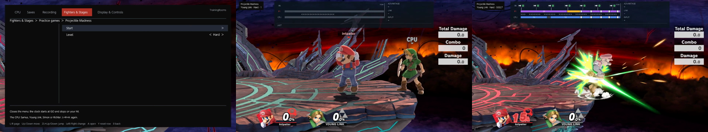
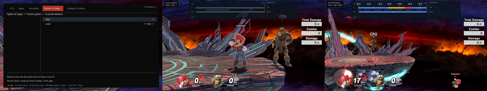
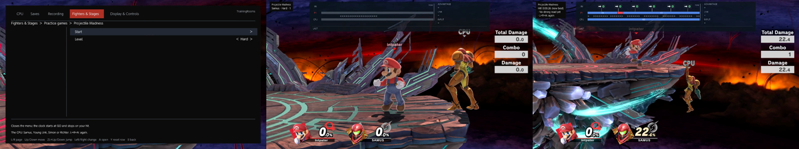
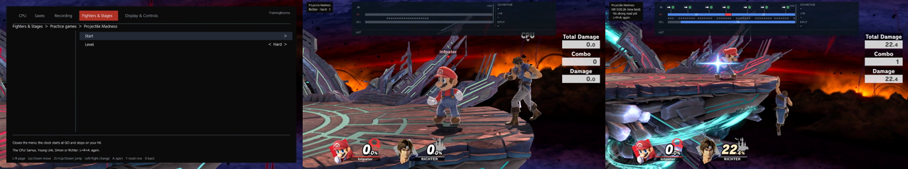

# Projectile Madness: the CPU's projectiles (rc.16 preview)

Eden clips from the rc.16 branch build `d7e1b780` (2026-11-22, Yoga, run `pm-d7e1b780-yoga-3`), Hard level, 720p, 10 s each, no audio.
Each clip opens Projectile Madness from the TrainingRooms menu, starts the drill at GO, then the CPU fires its projectiles at Mario.
These are test-run clips, not the final docs footage. Projectile Madness is rc.16 scope; it is not in the rc.15 build.

The strips show three moments of each clip (2 s, 5 s, 8 s). Click a strip to play the clip.

## Young Link (Hard)

## Simon (Hard)

## Samus (Hard)

## Richter (Hard)

More takes (easy, normal, second and third attempts, best time, KO restart, readout) are kept with the run's evidence.
