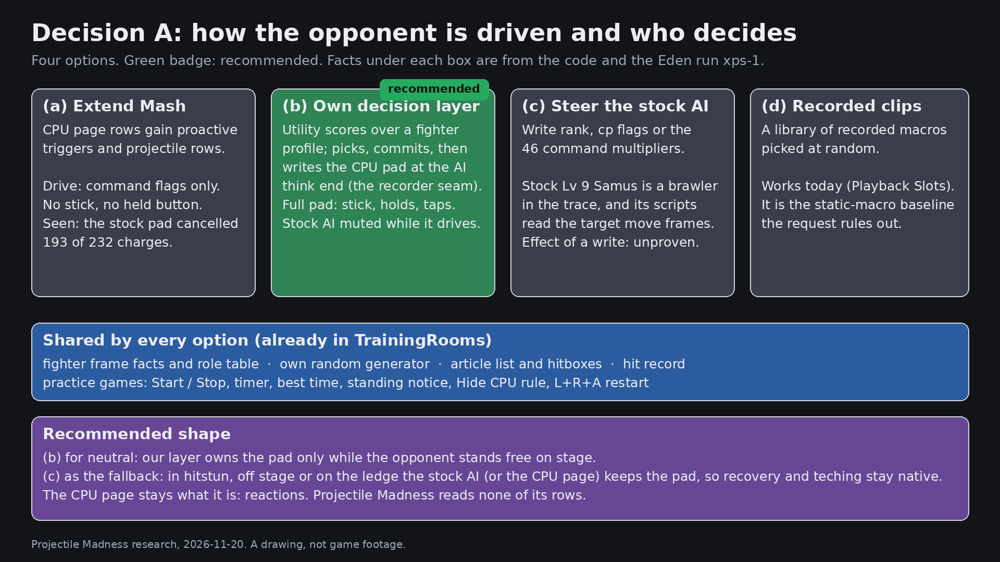
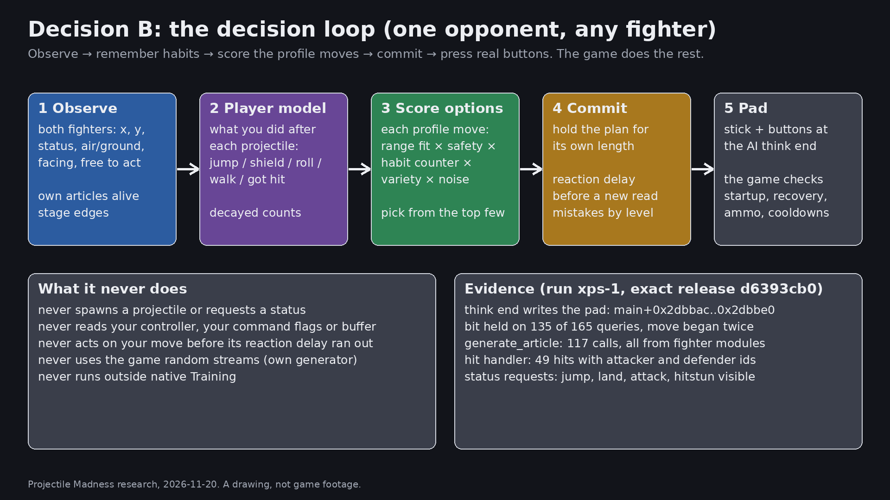
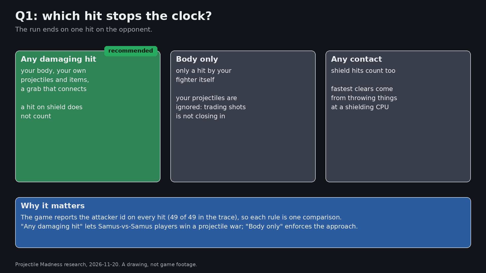
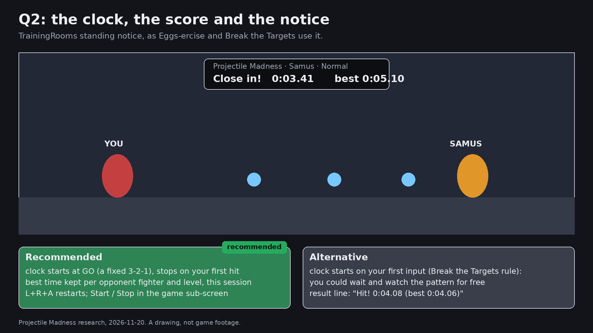
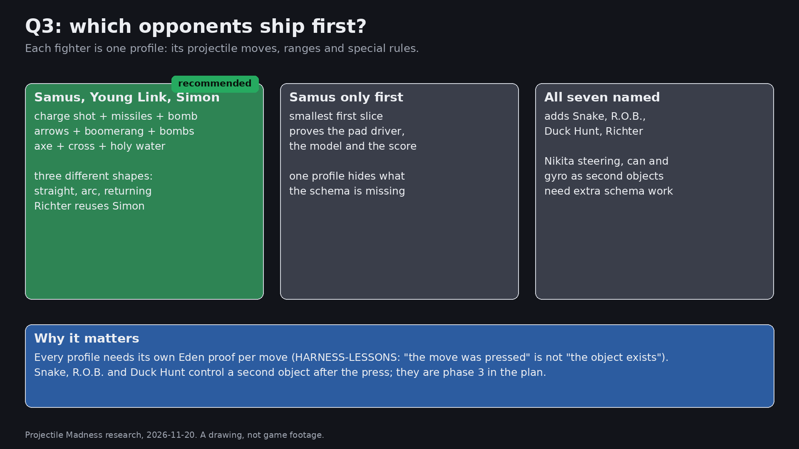
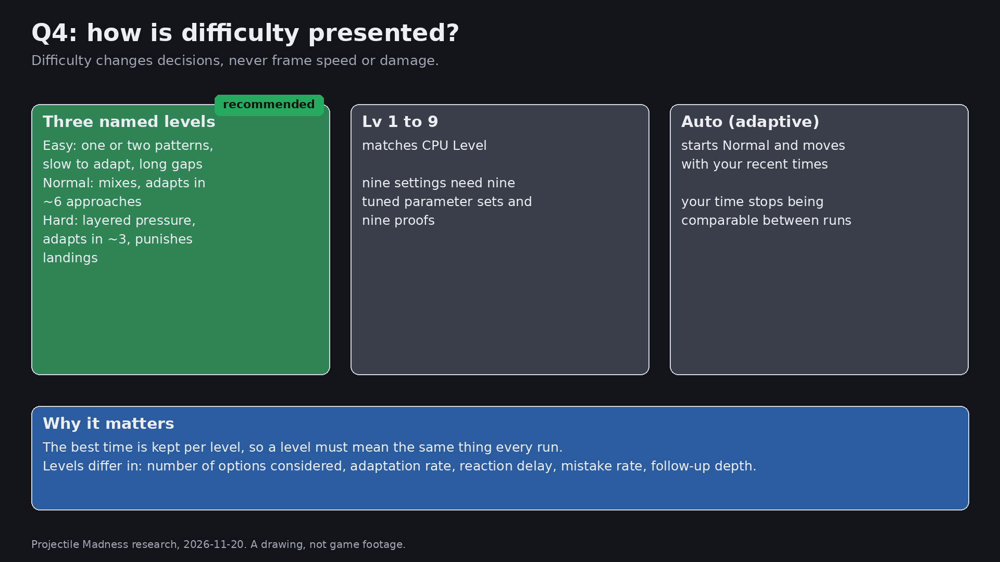
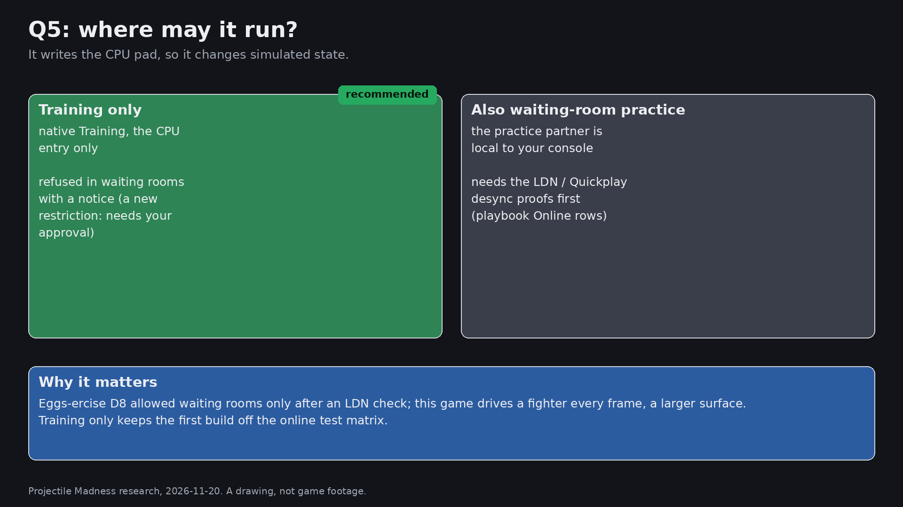
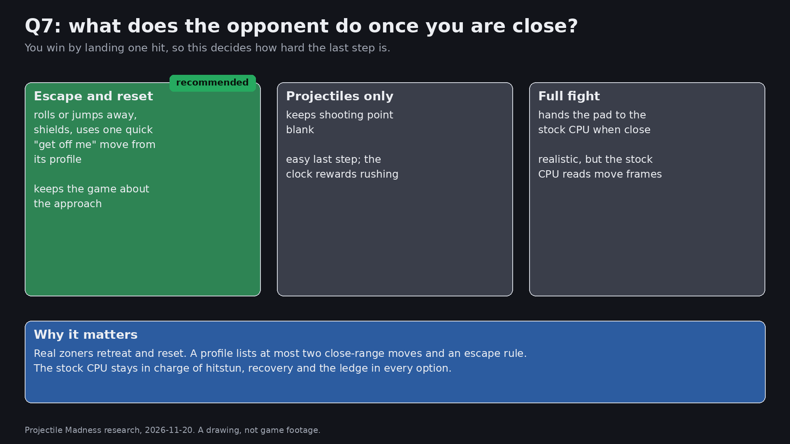
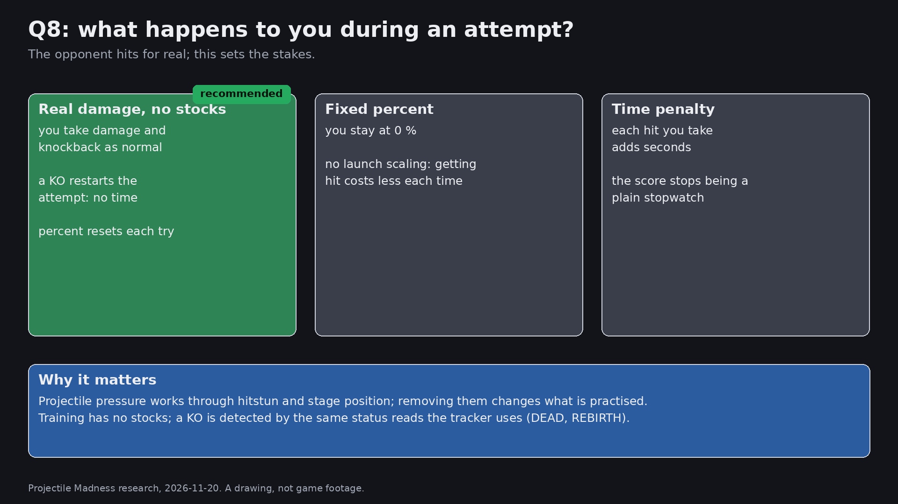

# Projectile Madness: feasibility research and recommendation

Lane projectile-madness-fable, 2026-11-20. Research only: no product code, no TrainingRooms (TR) commit, nothing pushed.
Brief: /home/intpa/smash-training-lobby/artifacts/phase23/projectile-madness/BRIEF.md.

**Summary.** The game is feasible as a practice game for the build after rc.15, in native Training.
- **Recommended:** a separate decision layer with one profile per fighter (option b). It writes the CPU's virtual pad
  at the end of the stock AI's think call, the place TR's recorder already hooks. The stock AI keeps hitstun, recovery
  and the ledge.
- **Not recommended as the driver:** extending the CPU page's Mash. In the Eden run the stock AI's own pad cancelled
  193 of Samus's 232 charges under Mash.
- **Size (estimate, not measured):** about +1,600 ± 300 lines on the 165,331 ceiling for three fighters.
- **Not shown yet:** a TR pad write on the exact release, Player 1's shield and roll in the trace, and any bias write
  into the stock AI.

Evidence root: /home/intpa/smash-training-lobby/artifacts/phase23/projectile-madness/evidence/. Ledger with raw errors:
/home/intpa/smash-training-lobby/artifacts/phase23/projectile-madness/PROGRESS.md.

## 0. Sources

| Source | What it is |
| --- | --- |
| TR source | /home/intpa/tr-fixes-20261113/integration at local main `96355cad`, read only |
| Stock game | The operator's 13.0.5 dump: /home/intpa/smash-training-lobby/research/game-13.0.5/main-13.0.5.elf, read with llvm-objdump (`evidence/tools/dis.ps1`) |
| Eden run | `projectile-madness-d6393cb0-xps-1` on the XPS, 2026-11-20 00:26–00:43Z: the shipped release NRO `d6393cb0…` (build ID checked at boot), Eden `2f315fc4…`, muted, GDB stub off, `trace.*` only, nothing rebuilt. 7/7 rows PASS, `cleanup_failures=[]`, `released=True`, console and Eden log 0 lines with panic, abort, crash or unmapped |
| Trace | `evidence/xps-1/projectile-madness-d6393cb0.trace.jsonl`, 8,266 records, SHA-256 `40a65059…` |
| Numbers | `/usr/bin/python3 -I evidence/tools/analyze_run.py <trace>`, and `phases.py`, `cycle_detail.py`, `stick_frames.py` with `<trace> 0x1203093640` (the CPU's accessor) |
| Prior art | Public talks, papers and vendor pages only (section 8). No source of the upstream Training Modpack, UnclePunch or TM-CE was opened |

The run: Training on Final Destination, Player 1 Mario, CPU Samus (TR's CPU cycle chord), TR fixture with Mash =
Neutral Special on the Always trigger and CPU Level 9. Then Mash was cleared in TR's menu and Training's CPU Behavior
was set to CPU. Stills: `evidence/xps-1/console/still-000.png` … `still-010.png`.

## 1. Feasibility of each building block

### 1.1 Driving the opponent with legal inputs: feasible, two existing paths

**How the stock CPU acts (static).** The stock AI is a set of Lua scripts per fighter that press a virtual pad.
- The ELF names an `ai_action` and an `ai_mode` script agent for each of 94 fighters and one `ai_analyst_common`, and
  exports 413 functions for them (`evidence/stock-ai-lua-api-symbols.txt`).
- `ai_system::add_button` (main+0x376310) ORs a pad bit into `ai+0xc40`. `add_stick` and its variants add into the
  vector at `ai+0xc30`.
- The think function (main+0x2da180) clears both at entry. At its end (main+0x2dbbac..0x2dbbe0) it copies the stick to
  the controller at `[ai+8]+0x10/+0x18` and `+0x40/+0x48`, and `buttons | 0x8000` to `[ai+8]+0xc`.
- From there the game maps the pad to commands exactly as for a human.

**Path 1, command flags (what the CPU page's Mash does).** TR hooks `ControlModule::get_command_flag_cat`
(main+0x2001630) and ORs its bits into the game's answer for a CPU body (`src/runtime/features/cpu.rs`
`cpu_command_flag_hook`, `src/model/cpu/command.rs` `Mash::perform`).
- **Startup and recovery are the game's.** In a 6 s window the hook's answer carried SPECIAL_N (0x1000) on 135 of 165
  category-1 queries. Samus entered SPECIAL_N twice in that window (frames 31046 and 31196). The bit is held; the game
  starts the move only when its own status allows it.
- **It is not enough for projectile play.** Command flags carry no stick and no held button.
  - The stock AI still writes the pad underneath. With CPU Behavior on Stop it pushed the stick straight down for one
    think call 15 times in 1,284. Each time Samus was charging, and her next status was the charge cancel (`phases.py`).
  - Result over the whole Mash phase (about 389 s): 193 of 232 charges ended in the charge-cancel status and a spot
    dodge. 38 shots were fired.
  - A zoner needs the stick and holds: charge and release, arrow and boomerang angles, missile kinds, grenade cooking.

**Path 2, pad write (what playback and Mash out do).** TR's inline hook sits on the instruction after the think
function's controller write (main+0x2dbc38, `src/runtime/features/recorder.rs` `ai_epilogue`). It replaces buttons,
stick and clamped stick for the primary CPU entry only.
- This is a full pad. Whatever the plugin writes goes through the game's own input mapping, buffer, transition terms,
  ammo and cooldown rules. Nothing is spawned and no status is requested.
- Shipped uses: Play on CPU, the Playback Slot actions, Mash out's `control()`, Aerial Drift.
- **Not shown in run xps-1:** the controller before and after TR's hook was equal on all 2,626 traced think calls
  (`checks.py`), because no playback ran. The path itself is shipped and was filmed on rc.10 (docs/TECHNICAL.md,
  `rc10-record-play-cpu.gif`). A trace of a TR pad write on the exact release is a phase 0 proof row.

**Projectiles come from the game.** `ArticleModule::generate_article` (main+0x2092ab0) was called 117 times in the
run: Samus's GUN ×64 and GBEAM ×12, Peach's article 1 ×41. Every call came from the fighter's own script module; a
Samus chain reads fighter module → fighter module → common script module → main. No TR address is in any chain.
- In the Mash phase Samus's module made 38 GUN calls, one for each of the 38 fired shots.
- **Not traced:** the charge shot's own creation. It is not made by `generate_article` (0 calls for article 0). Its 40
  hits on Mario are in the trace as weapon object `0x10280000`.

**Mash out is the precedent, with one difference.** It has a per-fighter move catalog and plans
(`src/model/mashout/moves.rs`, `entry.rs`). It starts its attacker by requesting the status directly
(`entry::start`). Projectile Madness must not: a requested status skips the transition check. Its multi-step pieces
(Hero's menu, Sora's magic) already follow the pattern proposed here: observe the status, emit one pad record per frame.

### 1.2 Observing the player: feasible, all reads exist

| Fact | Where TR reads it today |
| --- | --- |
| Both fighters' status, previous status, air or ground, motion frame, x | `fighter_frame` in `src/runtime/features/cpu.rs`, once per fighter frame |
| Player 1's x, y, z and the distance | `PLAYER_X/Y/Z`, `command_facts` (the Distance triggers: 16, 37, 64 units) |
| Free to act | `actionable()`: five transition terms or a cancel (the frame-advantage readout) |
| Move families from statuses | `src/model/p1/move_observer.rs` |
| A fighter's live articles and their hitboxes | `src/model/seams/article_pool.rs`, `state_natives::article_*`, `hitbox::object_hits` (the practice games' projectile breaks) |
| Stage floors in view | the Eggs-ercise spawn code (DECISIONS TR15-GAMES: floors read with Tech's column rays) |

- **Shown in the run:** Mario's script status requests carry jump squat, jump, double jump, fall, landing, jab,
  tumble, knockdown and get-up, the ledge grab and the respawn wait, each with its frame (`checks.py`).
- Plain hitstun did not pass through that function, so the tracker reads the status each frame, as TR does today,
  and doesn't rely on requests.
- **Not shown for Player 1:** shield and rolls. My presses landed while Mario was in hitstun or knocked down (my
  sequencing). The CPU's own GUARD_ON, GUARD, ESCAPE_F and ESCAPE_B appear through the same function, and TR classifies
  the same statuses in `src/model/cpu/status.rs`.
- Habits are read from statuses and positions, which are the visible result of what the player did. The controller,
  the command flags and the input buffer are never read (section 4).

### 1.3 Per-fighter projectile move data: authored profiles, checked against the game

- **What must be authored:** which input makes which projectile, how it is aimed or charged, what it covers, and how
  many may be alive. No native table says "this is a zoning tool".
- **What the game can supply at run time:**
  - the article kinds (`FIGHTER_<NAME>_GENERATE_ARTICLE_*`) and how many are alive (`ArticleModule::get_active_num`);
  - when the opponent is free again (`actionable()`), so recovery is never a stored number;
  - charge state: TR's save states already read the charge work values (`src/model/state/charge.rs`).
- **Native AI attack data exists, unverified for our use.** `ai::attack_start_frame`, `attack_end_frame`,
  `attack_cancel_frame`, `attack_data_x0..y1` and `attack_is_as_weapon` read per-command records (start `+0x8`, end
  `+0xc`, cancel `+0x14`, a range box, a "weapon" byte in 0xb8-byte records). I did not read a record at run time or
  map command ids to moves. It is a possible later source for ranges, not an MVP dependency.
- **Ranges and travel can be measured, not typed in:** a diag-only pass can watch each article from spawn to removal
  and log speed and reach. Those numbers go into the profile with the run label.

### 1.4 Scoring "time to land one hit" and reusing the practice-games framework: feasible

- **The hit event exists.** The hit handler (main+0x402cc0) ran 49 times in the run. Each record names the defender
  (Mario, id 0x0) and the attacker (the charge shot ×40, Samus's body ×8, another weapon ×1). TR already reads the
  defender's damage record for the frame strip and Spot labels (`src/model/sites_hitbox.rs`, `DAMAGE_RECORD_OFFSET`),
  and already tells a shield hit apart.
- **The frame.** `src/model/practice_games.rs` gives the game list, `best_time`, `record_time` and `result_tick`.
  `src/runtime/features/practice.rs` keeps the one running game and Start / Stop.
- **Conventions to reuse (docs/DECISIONS.md "rc.15 practice menu", rc14-eggs D4, D5, D9):** a sub-screen with Start
  first, the standing notice as the HUD, time in game frames, the best kept per key for the session, L+R+A restarts.
- **CPU ownership.** Mash out already takes the CPU body from the CPU page (`mashout::owns_cpu`,
  `Cpu::practice_frame`): Mash, throw and Hide CPU yield while the game owns the body. Projectile Madness uses the same
  boundary.

## 2. Architecture options

| Option | For | Against |
| --- | --- | --- |
| **(a) Extend the CPU page into proactive behaviour** | Reuses the queue, triggers, weights and rolls. Smallest diff | Command flags only: no stick, no holds, two actions deep. The stock pad interferes (193 of 232 charges cancelled). Every new row is a setting the player must understand, and the CPU page is documented as reactions |
| **(b) Separate decision layer with fighter profiles, pad write** | Full pad, so every projectile technique is expressible. Legality is the game's. Pure model, host-testable. One seam already hooked. Fighters are data | New code (section 6). Must own the pad cleanly and hand it back. Each profile move needs its own Eden proof |
| **(c) Steer the stock AI** | The AI already moves, recovers and techs for every fighter. Fields exist: rank `ai+0xc0c`, `cp_type` `+0xc08`, `cp_flag` `+0xc12`, 46 per-command probability multipliers at `ai+0x530` and a second table at `+0x758` | It is not a zoner: in a 25 s window at rank 100 Samus pressed special on 63 of 1,342 think calls, jump on 90 and attack on 46. Over the 83 s it played, it started neutral special 6 times, side special 5, down special 16, and jumped 23 times; it closed in and landed body hits (`checks.py`). Its scripts read the target's move frames (`ai::target_attack_start_frame`, `predict_hit_in_target_attack`), which is the input-reading feel to avoid. No write to a bias field was tested, and the scripts may reset the tables each think |
| **(d) Recorded clips chosen at random** | Works today with Playback Slots | It is the static-macro baseline the request rules out. No reaction to position |

**Recommendation: (b), with the stock AI as the fallback.**
- Our layer owns the pad only while the opponent stands free on stage.
- In hitstun, tumble, off stage, on the ledge or knocked down, it writes nothing: the stock AI (or the CPU page's
  defence rows) plays. Recovery, teching and DI stay native for all fighters.
- (c)'s fields are worth one bounded experiment later (section 6, phase 4). They aren't a dependency.
- The CPU page stays as it is. The game reads none of its rows except Hide CPU's practice rule.

## 3. A character-agnostic design

### 3.1 Fighter profile schema

One `const` table per fighter, in the model. A profile is data plus at most a few special rules.

| Field | Meaning |
| --- | --- |
| `kind` | The fighter kind from `src/model/swap/choices.rs` |
| `moves[]` | The options, below |
| `keep_out` | The distance band it tries to hold, and how close the ledge behind it may get |
| `close[]` | At most two moves for when the player is in its face, and an escape rule (roll away, jump away, shield) |
| `resources[]` | What to read: article kinds and their caps, a charge value, a cooldown |

Each move:

| Field | Meaning |
| --- | --- |
| `input` | Up to 8 steps of a small pad language: press, hold for n frames, hold until (charge ≥ x, status seen), stick direction relative to the player, wait until free, short hop or full hop first |
| `where` | Ground, air, or both |
| `band` | The distances at which it is worth using |
| `covers` | What it denies: the ground lane, the short-hop arc, the full-hop arc, the landing spot, close range |
| `shape` | Straight, arc, returning, lingering, placed, steerable, chargeable |
| `article`, `cap` | The article kind it makes and how many may be alive |
| `expect` | The status sequence that proves each step happened, with a timeout. A miss aborts the plan to a neutral pad |
| `then[]` | Follow-ups by outcome: on block, on hit, on whiff, player jumped |

How the named fighters fit (article names are the game's own constants):

| Fighter | Moves | What the schema needs |
| --- | --- | --- |
| Samus | Charge shot (hold, release at a chosen level, keep a charge), homing and super missile (tilt or smash side special), bomb | Hold-until-charge, a stored-charge resource, two inputs for one special |
| Young Link | Fire arrow (hold), boomerang (angled, returning), bomb (pull, then throw as an item) | Stick angles, an item-throw step, a cap of one for boomerang and bomb |
| Simon, Richter | Axe (arc), cross (returning, smash for speed), holy water (lingering) | Arc and lingering covers; Richter is Simon's table with one flag |
| Snake | Grenade (pull, cook, throw or drop), Nikita (steered), C4 | A cook timer and a held-item state; a steered second object |
| R.O.B. | Laser (recharges), gyro (charge, fire, stays on the floor) | A recharge resource; a second object that persists |
| Duck Hunt | Can (re-press moves it), clay pigeon, gunman | Re-press steps aimed at a second object |

Samus, Young Link and the Belmonts need only the base schema. Snake, R.O.B. and Duck Hunt steer a second object after
the press, which is extra observation and extra proof (HARNESS-LESSONS: the Gyro needs a charge and a fire, and "the
move was pressed" is not "the object exists").

### 3.2 Decision inputs

- **Distance and height** between the fighters, in bands (TR's 16 / 37 / 64 units are a starting point).
- **The player's state:** grounded or airborne, rising or falling, shielding, in lag or free, closing speed.
- **Own state:** free to act, facing, charge, articles alive per kind, the last three choices.
- **Stage:** distance to the ledge behind the opponent, platforms above (phase 4; the MVP is flat stages).
- **The player model's forecast** for this situation (section 4).

Each move gets a score: range fit × safety (can it finish before the player arrives) × counter value (does it cover
the forecast response) × variety (a penalty for repeating) × noise. The pick is a weighted draw among the top few, not
the maximum. That is the utility pattern of Dill and Mark with a weighted random among the best choices.

### 3.3 Imperfection

- **Commitment.** A chosen plan runs to its end. The next decision happens when the opponent is free again.
- **Reaction delay.** A change in the player's state is usable only after a delay (section 4).
- **Noise and mistakes.** A per-level chance to pick any legal option, to repeat the last one, or to wait a few frames.
- **Own generator.** All draws use TR's own generator (`src/model/cpu/rng.rs`), never a game stream.
- **Variety without scripts.** Sequences come from `then[]` links and the variety penalty, not from fixed strings.

## 4. Player modelling without input reading

**The model.** A small table of decayed counts.
- **Situations (about 6):** projectile coming at far, mid or near range; the opponent charging; the opponent in lag;
  the player landing.
- **Responses (about 7):** short hop, full hop, shield, roll or dodge in, run or walk in, got hit, stayed back.
- **Update.** When a situation ends, the response the player's statuses showed gets +1 and the row is multiplied by a
  decay (about 0.8). Around six observations dominate; older play fades. This is the n-gram and frequency approach of
  the public fighting-game literature, at its smallest size.
- **Use.** The row's shares feed the counter-value term. A jumper sees more arcs, anti-air and landing coverage. A
  shielder sees more grabs-range resets and lingering projectiles.

**Why it is not input reading.**
- It reads results (statuses, positions), never the pad, the command flags or the buffer.
- **Reaction floor.** An observation becomes usable only a fixed number of game frames after it happened: 15 frames
  (250 ms) at the hardest level, more below. A host test can assert that no decision uses a younger observation.
- **Anticipation is history only.** "Expects a jump" means the last approaches were jumps. On the current approach
  the opponent has committed before the player acts, so a changed habit beats it.
- The stock AI does the opposite: its scripts can ask for the target's attack start frame and predict the hit.

**Fair and explainable.**
- The table is small enough to show. After an attempt the notice can say what it expected and why (question Q6).
- The model resets on Start and on a fighter change; L+R+A keeps it, so a run of attempts adapts.
- Nothing is saved to the card.

## 5. Difficulty through decisions, not speed

No level changes frame data, damage, knockback or game speed. All levels keep the reaction floor.

| Lever | Easy | Normal | Hard |
| --- | --- | --- | --- |
| Options considered | 2 moves | The profile's main set | All moves and follow-ups |
| Follow-up depth | None | One link | Two links |
| Adaptation | Slow (decay 0.9, low weight) | About six approaches | About three approaches |
| Reaction delay | 30 frames | 22 frames | 15 frames |
| Mistakes and repeats | Often | Sometimes | Rare |
| Spacing | Stands its ground | Backs up when crowded | Holds its band, uses the ledge limit |
| Close range | Shields | Escape rule | Escape rule and one close move |

The numbers are starting values to tune in play, not measured.

## 6. Scope, risks, cost and plan

**Size (estimates, not measured; HARNESS-LESSONS asks for a measured first slice).**
- **Lines:** the gate's ceiling is 165,331 normalised lines (`size-budget.toml`, last entry). MVP estimate
  **+1,600 ± 300**: decision core 350, player model 150, pad language and plan runner 250, three profiles 250,
  observation glue (articles, hit, free-to-act, ledge) 200, run, score and notice 200, menu sub-screen and settings 150,
  site rows and capability wiring 50–100. Each later fighter: about +60–120.
- **Resident:** the release NRO is 6,541,312 B resident (`nro_size.py` on `d6393cb0`). The estimate is +40–70 KiB.
- For scale: the spacing grader's design estimated +260 lines; Mash out's model is the largest practice game.

**Hook cost.**
- No new hook is needed for the MVP. The decision runs in the existing fighter frame wrapper; the pad write is in the
  existing `ai_epilogue` hook; the hit comes from the existing damage-record read.
- The decision is a few dozen multiplications when the opponent becomes free, not per frame. Per frame: status
  compares and one pad write.
- Possible new called rows: `FighterMotionModuleImpl::get_cancel_frame` (main+0x20aa010),
  `ArticleModule::get_active_num` (main+0x2092df0). Each gets the usual 64-byte guard.
- Hooks must not block: the state lives behind try-lock or atomics, and `tests/lock_order.rs` is extended.

**Online safety.** It writes a fighter's pad, so it changes simulated state. Training only: Start is refused
elsewhere (a new refusal, which needs the operator's approval and a `docs/RESTRICTIONS.md` row). It draws no game
random number.

**Risks.**
- **Pad ownership.** The hand-over between our layer, the stock AI, playback and the CPU page must be one rule in one
  place. Record, Play on CPU and Mash out are refused or yield while the game runs.
- **Per-fighter quirks.** Every move is a small state machine against real statuses. A wrong `expect` stalls the
  opponent; the plan must fail closed to neutral.
- **Hot swaps and cycles.** The CPU body changes under the role table's receipts; the game ends or restarts on a swap.
- **Feel.** "Human-like" is tuned by play, not proven by a trace. Budget operator play sessions.
- **Hardware.** Everything here is Eden evidence. The pad path is hardware-proven through playback; the game itself is
  untested on the Switch until its pass.

**Testability.**
- **Host:** the model is pure. Seeded-generator tests for the decision, the reaction-floor invariant, plan abort,
  best-time keys, profile table sanity (every move has `expect`, caps and a band).
- **Eden, exact release, trace only:** per profile move, the pad written equals the plan, the expected article appears
  through `generate_article` or the article pool, and nothing is requested by status. The clock stops on the hit
  record's frame. A scripted jumper (macro) shifts the choice shares; a scripted shielder shifts them the other way.

**Phased plan.**
0. **Spike:** the pad driver and Samus's charge shot and missile only. Measure the size. Eden proof of a TR pad write
   and a held charge.
1. **MVP:** Samus, Young Link, Simon and Richter; three levels; the clock, best time and notice; flat stages.
2. **Adaptation shown:** the explain line, the scripted-habit proofs, tuning from play.
3. **Second-object fighters:** Snake, R.O.B., Duck Hunt.
4. **More fighters and stages:** platforms, measured ranges, and one bounded test of the stock AI's bias fields.

## 7. Open questions for the operator

| # | Question | Recommendation | Illustration |
| --- | --- | --- | --- |
| Q1 | Which hit stops the clock? | Any damaging hit by you or your projectiles; a hit on shield doesn't count |  |
| Q2 | When does the clock start, and where is the score shown? | At GO after a fixed countdown; the standing notice; best per opponent and level |  |
| Q3 | Which opponents ship first? | Samus, Young Link, Simon (Richter reuses Simon) |  |
| Q4 | How is difficulty presented? | Three named levels |  |
| Q5 | Where may it run? | Native Training only, refused in waiting rooms |  |
| Q6 | Should it say what it read? | Yes, one line after each attempt |  |
| Q7 | What does the opponent do once you are close? | Escape and reset, with at most two close moves |  |
| Q8 | What happens to you during an attempt? | Real damage; a KO restarts the attempt without a time |  |

The drawings are made by `illustrations/make_illustrations.py`; they aren't game footage.

## 8. Prior art (public material)

| Source | What it gives this design |
| --- | --- |
| Dill and Mark, "Improving AI Decision Modeling Through Utility Theory", GDC 2010 (https://www.gdcvault.com/play/1012410/Improving-AI-Decision-Modeling-Through) | Scores from normalised considerations and response curves; weighted random among the top choices instead of hard if/then |
| Game AI Pro ch. 4, "Behavior Selection Algorithms" (https://www.gameaipro.com/GameAIPro/GameAIPro_Chapter04_Behavior_Selection_Algorithms.pdf) and ch. 10, "Building Utility Decisions into Your Existing Behavior Tree" | The trade-offs between state machines, behaviour trees and utility; a tree for structure with utility at the choice points |
| Isla, "Handling Complexity in the Halo 2 AI", GDC 2005 (https://www.gamedeveloper.com/programming/gdc-2005-proceeding-handling-complexity-in-the-i-halo-2-i-ai) | Children competing by relevance; keeping a brain of about 50 behaviours readable |
| Game AI Pro ch. 48, "Implementing N-Grams for Player Prediction" (http://www.gameaipro.com/GameAIPro/GameAIPro_Chapter48_Implementing_N-Grams_for_Player_Prediction_Proceedural_Generation_and_Stylized_AI.pdf) | Cheap pattern statistics that predict a player's next move; it notes they can be so accurate in fighting games that they must be toned down |
| Ricciardi and Thill, "Adaptive AI for Fighting Games", Stanford CS229, 2008 (https://cs229.stanford.edu/proj2008/RicciardiThill-AdaptiveAIForFightingGames.pdf) | Online adaptation needs to learn from very few samples; n-gram history as one method |
| Killer Instinct's Shadows (https://www.gamedeveloper.com/programming/the-killer-groove-the-shadow-ai-of-killer-instinct; GDC 2016 "Designing AI for Competitive Games") | Records what a player did in which match state and replays it; aims to reproduce mistakes, not to win |
| Street Fighter 6 V-Rival (https://www.streetfighter.com/6/contents/v-rival/en/; Capcom's column on its CEDEC 2025 talk) | Situation-to-input snapshots from replays; tuned for human-like errors over strength |
| Tekken 8 Super Ghost Battle (https://tk8.tekken-official.jp/en/mode/offline.php) | A ghost that learns a player's habits (the vendor says Q-learning) as a practice partner |
| Hunicke, "The Case for Dynamic Difficulty Adjustment in Games", 2005 (https://dl.acm.org/doi/10.1145/1178477.1178573) | Adjustment must not feel like cheating; a reason to keep levels fixed and times comparable (Q4) |
| Smash Ultimate amiibo training guides (https://exionvault.com/ssbu-amiibo-general/) | Community description of figure players as a base CPU altered by stored values; consistent with the bias fields found in the ELF, not verified here |

What these share with the proposal: a small, readable decision core; adaptation from a short history; imperfection on
purpose. The ghost systems learn from large recordings of a human, which this game doesn't have or need.

## 9. What was not verified

- A TR pad write traced on the exact release (phase 0 row).
- Player 1's shield, roll and spot dodge in the trace.
- The charge shot's creation call.
- Which stock script pushes the stick down on Stop.
- Any write to the stock AI's rank, flags or multipliers, and whether the scripts keep it.
- The native attack-data records at run time, and the command-id to move mapping.
- The static pattern in the common script module that pairs a command flag with a transition term (the run shows the
  behaviour; the code was not read).
- Size and performance: every number in section 6 is an estimate.
- Hardware: nothing ran on the Switch. No compliance run: this lane changed no plugin code.
