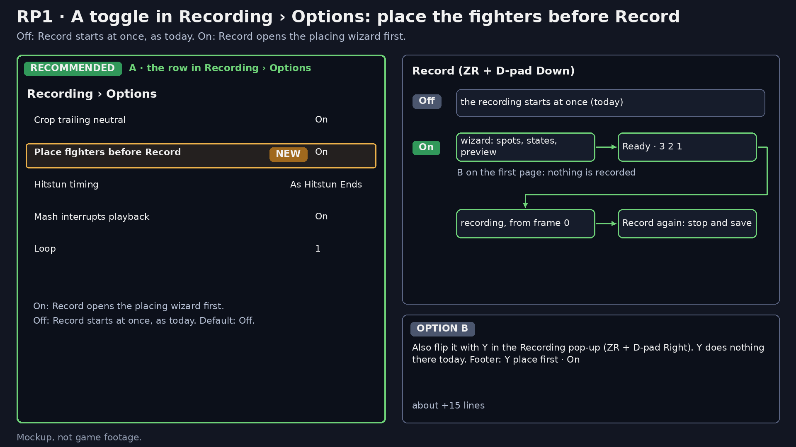
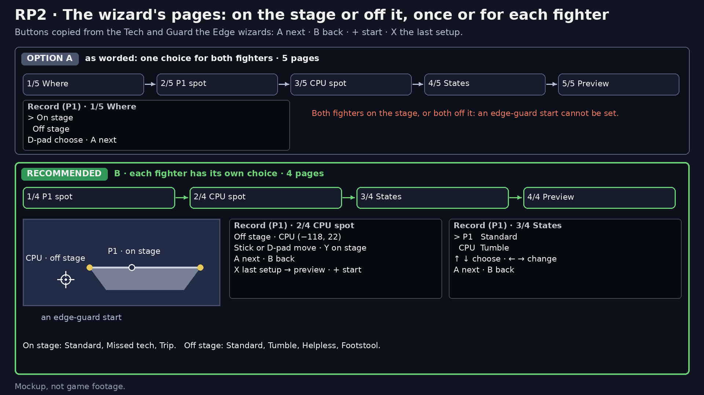
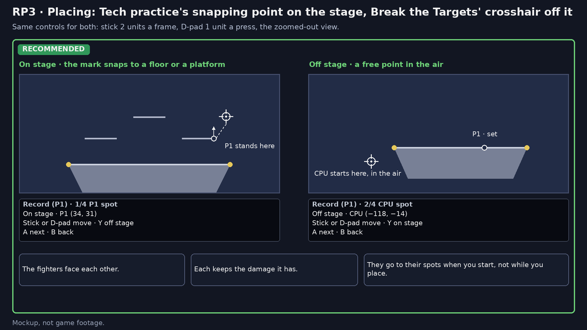
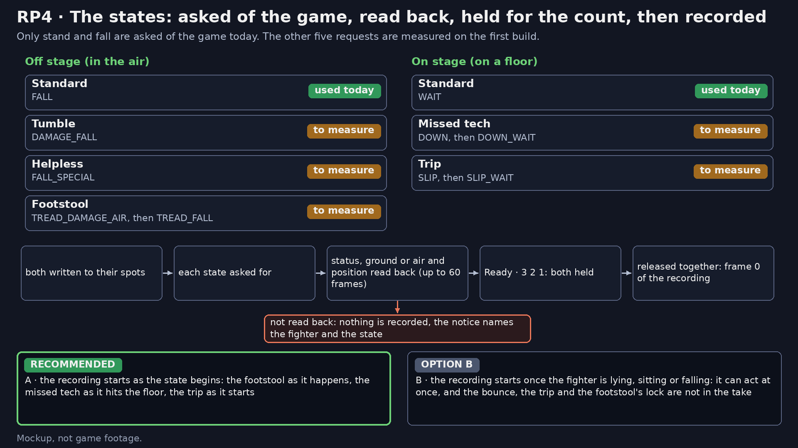
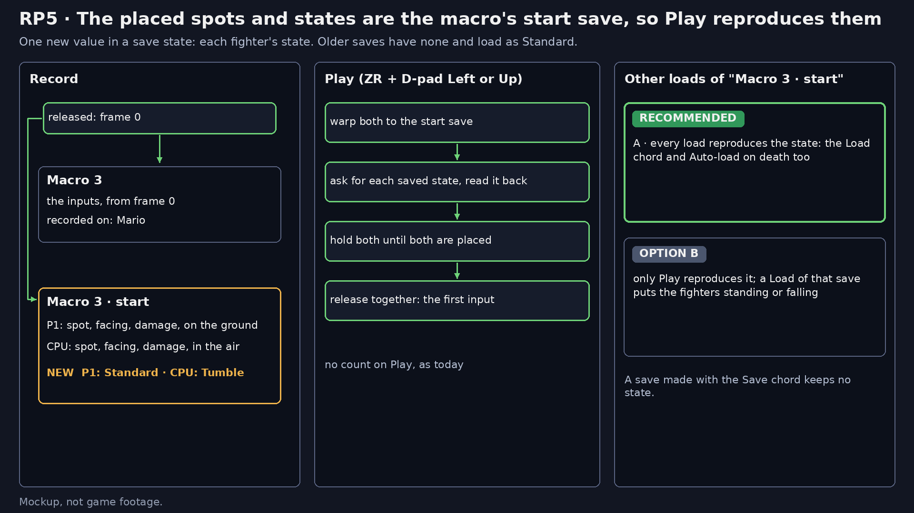

# Record: place the fighters and pick their state first (for the operator's answer)

Mockups, not Eden stills (2026-11-22, hit-streak-sol, source `7d962416`; branch `design/record-placement-and-state`,
commit `e8eb999d`).
Five decisions, one picture each; the recommended option has a green outline. Nothing here is implemented, and no Eden
measurement was made for this page.

Your words: "another feature I'd like that's small is a toggle that let's you select where you want p1 and cpu before
the recording starts. and for them the state of the player/cpu (tumble, helpless, footstool, standard). if toggled on
the wizard will say whether we'll be on the stage or off the stage (on the stage will reuse the tracer from the tech
exercise, off stage will use the crosshair from break the targets). for the off stage you will have the states I
mentioned as an option, on stage you will have "standard, missed tech, trip"."

Kept in all five: Record's chord (ZR + D-pad Down), who is recorded (the pop-up's side), the macro and its start save,
Stop, Play, the loop, chains. With the toggle Off, Record is exactly today's.
Line counts are estimates: about +450 to +600 lines in all, no new picture or pane, roughly 6 to 16 KiB of the image.
The full entry, with the source lines, is the PENDING OPERATOR section of `docs/DECISIONS.md` on that branch.

## RP1: the toggle (recommended: one row in Recording › Options)

- **The row:** Recording › Options › **Place fighters before Record**, Off by default.
- **On:** Record opens the wizard first. Its last page starts a `Ready · 3 2 1` count, and the recording starts when
  the count ends. Record again stops and saves, as today.
- **B on the first page** closes the wizard and records nothing.
- Option **B:** also flip it with Y in the Recording pop-up (Y does nothing there today). About +15 lines.

About +15 lines.

## RP2: the pages (recommended: on the stage or off it for each fighter, 4 pages)

- **A, as you worded it:** one choice for both fighters, 5 pages: Where, Player 1's spot, the CPU's spot, States,
  Preview. Both fighters are on the stage, or both are off it.
- **B, recommended:** each fighter has its own choice, 4 pages: Player 1's spot, the CPU's spot, States, Preview.
  **Y** on a spot page switches that fighter between On stage and Off stage. An edge-guard start (you on the stage, the
  CPU off it in a tumble) needs this; with A it can't be set.
- **Buttons, copied from the Tech and Guard the Edge wizards:** A next, B back, + start, X the last setup you started
  on this stage (so a second take is Record, X, A).
- **States page:** two rows, P1 and CPU; Up / Down choose the row, Left / Right change the state. On the stage:
  Standard, Missed tech, Trip. Off the stage: Standard, Tumble, Helpless, Footstool.

About +190 lines.

## RP3: placing (recommended: as drawn)

- **On stage:** Tech practice's point. The crosshair moves freely and the mark snaps to the nearest floor or platform;
  the fighter stands there.
- **Off stage:** Break the Targets' crosshair, a free point in the air inside the picture. It is the piece the Guard
  the Edge and Juggler design moves into those wizards.
- **Both:** stick 2 units a frame, D-pad 1 unit a press, the zoomed-out view while you place.
- **Facing:** the fighters face each other. **Damage:** each keeps what it has.
- The fighters are not moved while you place; they go to their spots when you start.

About +170 lines. Unproven on a running game: a point inside the stage's body; the check before the count refuses a
start whose fighter is not where it was put.

## RP4: the states, and when the recording starts (recommended: as the state begins)

- **How:** both fighters are written to their spots, and each state is asked of the game as its own status: Tumble,
  Helpless, Footstool in the air; Missed tech and Trip on the ground. Standard is today's stand or fall.
- **Checked before the count:** each fighter's status, ground or air, and position are read back. If one is not what
  was asked within 60 frames, nothing is recorded and the notice says which fighter and state.
- **Ready:** both are held on their spots for the count and released on the same frame. That frame is frame 0 of the
  recording, for Player 1 and for the CPU: a placed recording has no Lockout and no Standby.
- **A, recommended:** the recording starts as the state begins: the footstool as it happens, the missed tech as it hits
  the floor, the trip as it starts. **B:** it starts once the fighter is lying, sitting or falling.
- **The CPU** reacts to its state with the settings you have: its Tumble and Footstool triggers, Mistech Options after
  a missed tech or a trip.
- **Fighters:** none is known to be unable to enter a state. That is not measured.

About +85 lines. **Unproven on a running game, all five new states:** today the plugin asks the game only for stand
and fall. The first boot of the build measures each request, a footstool with nobody doing it, teching a requested
tumble, which way up a missed tech lies, the hold, and the roster.

## RP5: the start save and Play (recommended: every load reproduces the state)

- **Record** writes the macro and "Macro N · start" as today. The start save holds the placed spots, and one new
  value for each fighter: its state. Older saves have none and load as Standard.
- **Play** warps to the start save and asks for the saved states, with the same check. Both fighters are held until
  both are placed and released on the same frame, where the first input is given. No count on Play.
- **A, recommended:** every load of that save reproduces the state, the Load chord and Auto-load on death included.
  **B:** only Play does.
- A save made with the Save chord keeps no state.

About +110 lines.

## Questions

1. The row in Recording › Options only (recommended), or also Y in the pop-up?
2. On the stage or off it for each fighter (recommended), or one choice for both?
3. The fighters face each other (recommended), or a facing for each on the States page (about +20 lines)?
4. The recording starts as the state begins (recommended), or once the fighter is lying, sitting or falling?
5. A missed tech face up or face down as the game gives it (recommended, after the measurement), or a choice?
6. Every load of the start save reproduces the state (recommended), or only Play? Play without a count (recommended),
   or with Record's count?
7. Two new messages need your approval: `Not recorded · CPU could not start in Footstool` (the check failed), and
   `Stop the practice game to place fighters` (the wizard uses the practice games' pictures and camera).
8. Each fighter keeps its damage (recommended), or a Percent page like Juggler's (about +40 lines)?
